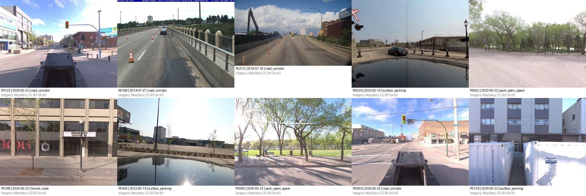

# October 2026 pilot: street-level imagery -> CPTED cues -> Reddit

*Generated 2026-10-17T02:20:59+00:00 (git `804ad46`). Every number is read from the pilot's output files.*

> **Status: feasibility pilot, not a result.** With 10 images no association between built environment, crime or perception can be estimated. The pilot shows that each stage of the work-plan pipeline runs and joins.

## 1. What was run

* **Sample points:** 423 points about 50 m apart on 218 street segments (OSM ways split at intersections).
* **Boundary:** Data/boundaries/central_business_district_osm.geojson (match='central business', 1 polygon(s)).
* **Pilot sample:** points ordered by deterministic farthest-point spread (start nearest centroid); first N with a usable image kept; per point: within radius; 360-degree panoramas allowed and cropped to two side-on views; ranked most recent year > Jun-Aug > flat > nearest.
* **Imagery:** Mapillary, CC BY-SA 4.0; max 30.0 m from the point.
* **CLIP:** `openai/clip-vit-base-patch32` on mps, 3 square views per image; prompts in `Scripts/cv_pilot/clip_prompts.json`.

## 2. Coverage and image dates

Of 10 points attempted (in spread order), **10 had a usable image** (100%). Capture years of the 10 kept images: {2014: 1, 2019: 1, 2020: 6, 2023: 2}; **2 of 10 are Jun-Aug captures.**

**Temporal mismatch to disclose:** crime and Reddit cover Jun-Aug 2026; the imagery was captured on the dates above (10 of 10 before 2024). It describes the *typical built form*, not the street in summer 2026.

View direction relative to the street: side_on_from_360=8, along_road=2. Side-on views show frontages (better for natural surveillance); along-road views mostly show carriageway. Quality flags (provisional thresholds): ok=10.

### What imagery exists across all sample points

| year | images_flat | images_360 | points_with_flat | points_with_360 |
|---|---|---|---|---|
| 2014 | 13707 | 2907 | 371 | 369 |
| 2017 | 105 | 17 | 13 | 0 |
| 2018 | 303 | 0 | 35 | 0 |
| 2019 | 172 | 0 | 38 | 0 |
| 2020 | 0 | 1606 | 0 | 264 |
| 2023 | 0 | 322 | 0 | 27 |

397 of 423 points have any image within 30 m; **0 have an image from the study period (Jun-Aug 2026)**, 0 of them a flat (non-360) image.

Pilot images captured inside the study period (Jun-Aug 2026): **0 of 10**; 8 cut from 360-degree panoramas (side-on views).

## 3. What CLIP says about the images

| point_id | road_name | captured_at | typology_top1 | typology_top1_prob | typology_margin | typology_low_confidence |
|---|---|---|---|---|---|---|
| P0123 | 22nd Street East | 2020-05-22 | road_corridor | 0.523 | 0.252 | False |
| P0168 | University Bridge | 2014-07-27 | road_corridor | 0.445 | 0.001 | True |
| P0273 | Idylwyld Freeway | 2019-07-15 | road_corridor | 0.695 | 0.5 | False |
| P0024 | Idylwyld Drive North | 2023-05-13 | surface_parking | 0.569 | 0.196 | False |
| P0052 | Spadina Crescent | 2020-05-22 | park_open_space | 0.744 | 0.609 | False |
| P0198 | 25th Street East | 2020-05-22 | transit_node | 0.562 | 0.354 | False |
| P0420 | Idylwyld Drive South | 2023-05-14 | surface_parking | 0.762 | 0.692 | False |
| P0060 | Spadina Crescent East | 2020-05-22 | park_open_space | 0.95 | 0.904 | False |
| P0364 | 24th Street East | 2020-05-22 | road_corridor | 0.733 | 0.564 | False |
| P0134 | 2nd Avenue South | 2020-05-22 | surface_parking | 0.589 | 0.451 | False |

CPTED cue scores (mean P(cue present) across the image's views; uncalibrated):

| point_id | graffiti | litter | boarded_windows | vacant_lot | active_storefront | windows_overlook_street | people_present | fences_barriers | seating |
|---|---|---|---|---|---|---|---|---|---|
| P0123 | 0.02 | 0.26 | 0.63 | 0.65 | 0.01 | 0.06 | 0.01 | 0.06 | 0.23 |
| P0168 | 0.32 | 0.45 | 0.79 | 0.68 | 0.0 | 0.13 | 0.37 | 0.78 | 0.34 |
| P0273 | 0.03 | 0.37 | 0.71 | 0.72 | 0.0 | 0.13 | 0.14 | 0.41 | 0.13 |
| P0024 | 0.08 | 0.5 | 0.35 | 0.95 | 0.07 | 0.25 | 0.12 | 0.17 | 0.3 |
| P0052 | 0.01 | 0.48 | 0.77 | 0.99 | 0.0 | 0.14 | 0.01 | 0.35 | 0.5 |
| P0198 | 0.58 | 0.3 | 0.92 | 0.27 | 0.44 | 0.2 | 0.49 | 0.03 | 0.54 |
| P0420 | 0.05 | 0.53 | 0.51 | 0.91 | 0.01 | 0.33 | 0.26 | 0.07 | 0.66 |
| P0060 | 0.03 | 0.11 | 0.47 | 0.88 | 0.0 | 0.23 | 0.8 | 0.29 | 0.61 |
| P0364 | 0.05 | 0.22 | 0.68 | 0.63 | 0.06 | 0.14 | 0.01 | 0.08 | 0.4 |
| P0134 | 0.07 | 0.44 | 0.55 | 0.17 | 0.0 | 0.15 | 0.75 | 0.16 | 0.64 |

Low-confidence typology calls: 1 of 10. Nothing here is validated until compared with hand labels (`validation_template_blind.csv` is the blank sheet for these images).

## 4. The Reddit side (r/saskatoon, 1 Jun - 31 Aug 2026)

| group | n_posts | n_comments | n_records | n_threads | mean_sentiment_adj | mean_ci95_low | mean_ci95_high | n_negative | pct_negative | pct_neg_ci95_low | pct_neg_ci95_high |
|---|---|---|---|---|---|---|---|---|---|---|---|
| Downtown / CBD (validated tag) | 18 | 220 | 238 | 51 | 0.21 | 0.135 | 0.285 | 76 | 31.9 | 26.3 | 38.1 |
| Rest of study corpus | 177 | 6183 | 6360 | 195 | 0.084 | 0.072 | 0.097 | 2034 | 32.0 | 30.8 | 33.1 |
| All records | 195 | 6403 | 6598 | 195 | 0.089 | 0.076 | 0.101 | 2110 | 32.0 | 30.9 | 33.1 |

Downtown / CBD = hand-validated location tag (other-city mentions such as "downtown Regina" removed); adjusted VADER sentiment. These figures reproduce the Downtown row of the existing `neighbourhood_summary.csv`.

### Cue by cue: what the images show vs what Reddit says

| reddit_cue | cue_status | heldout_precision | downtown_k | downtown_n | downtown_per_100 | downtown_ci95 | rest_per_100 | clip_measure_on_pilot_images | clip_value |
|---|---|---|---|---|---|---|---|---|---|
| lighting | audited | 0.5 (15/30) | 4 | 238 | 1.7 | 0.7-4.2 | 1.5 | n/a (lighting comes from the detector step, Nov) |  |
| people | audited | 0.87 (26/30) | 26 | 238 | 10.9 | 7.6-15.5 | 1.7 | mean cue_people_present_mean | 0.296 |
| graffiti_vandalism | exploratory (precision unchecked) |  | 2 | 238 | 0.8 | 0.2-3.0 | 0.4 | mean cue_graffiti_mean | 0.125 |
| litter_garbage | exploratory (precision unchecked) |  | 4 | 238 | 1.7 | 0.7-4.2 | 1.1 | mean cue_litter_mean | 0.366 |
| vacancy_disrepair | exploratory (precision unchecked) |  | 3 | 238 | 1.3 | 0.4-3.6 | 0.3 | mean cue_vacant_lot_mean & mean cue_boarded_windows_mean | 0.661 |
| parking | exploratory (precision unchecked) |  | 5 | 238 | 2.1 | 0.9-4.8 | 0.5 | share of images typed 'surface_parking' | 0.3 |
| transit | exploratory (precision unchecked) |  | 3 | 238 | 1.3 | 0.4-3.6 | 0.1 | share of images typed 'transit_node' | 0.1 |

A **template for the full comparison, not evidence**: images <= 10, Reddit cue counts are small, exploratory cues are unchecked, and the audited `lighting` cue has about 50% precision (it fires on traffic lights), so it cannot yet support H3.

### How finely can Reddit be located?

| anchor | records_all | records_in_downtown_tagged |
|---|---|---|
| Broadway (ambiguous: avenue or neighbourhood) | 39 | 7 |
| Midtown (Plaza) | 36 | 5 |
| Idylwyld | 30 | 7 |
| 2nd Avenue | 12 | 8 |
| Central Library | 9 | 4 |
| City Hall | 8 | 2 |
| Spadina | 8 | 2 |
| 20th Street | 6 | 6 |

Street and landmark mentions number in the single digits to low tens. Reddit joins to **neighbourhood or zone**, not to individual 50 m segments; this needs a decision (see README).

## 5. Limitations

* n <= 10 images: no inference. Hit rate and image dates are the useful pilot outputs.
* Daytime imagery shows lighting infrastructure, not how well lit a place is at night.
* CLIP cues are uncalibrated zero-shot scores, not yet validated; CLIP is not used for streetlights (detector step).
* Image capture dates differ from the study period (section 2).
* Reddit users are not the population of Saskatoon, and the corpus is built from seed-term searches: it describes how safety is talked about, not how safe places are.
* The study describes places; it does not predict crime or label communities.

## 6. Attribution

Street-level imagery: Mapillary contributors, CC BY-SA 4.0 (https://www.mapillary.com). Figures that reproduce these images must credit Mapillary and keep the licence. No Reddit text is quoted in this report.
