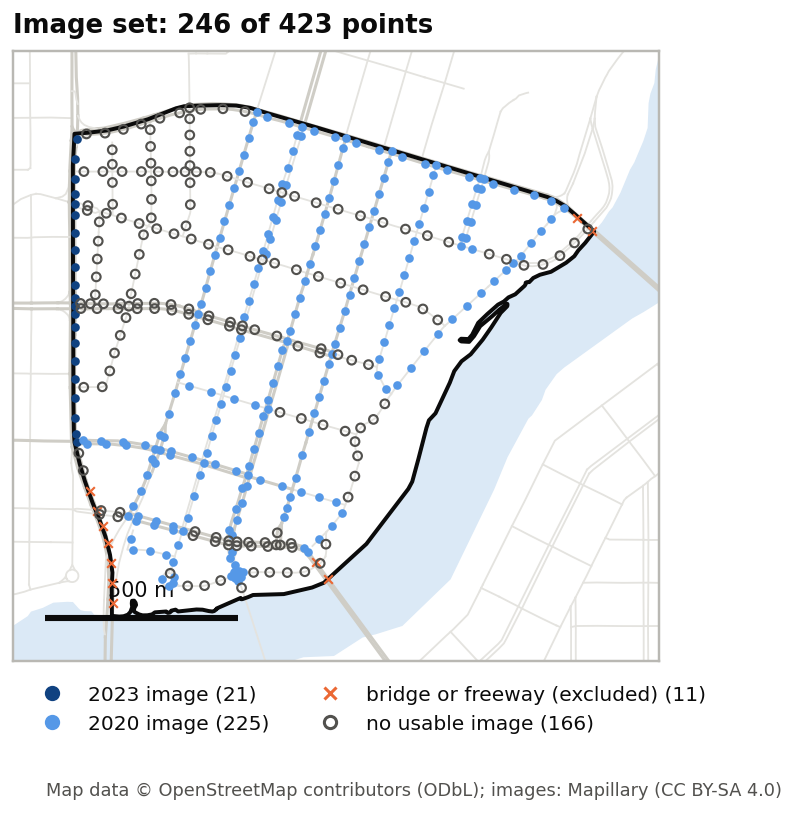
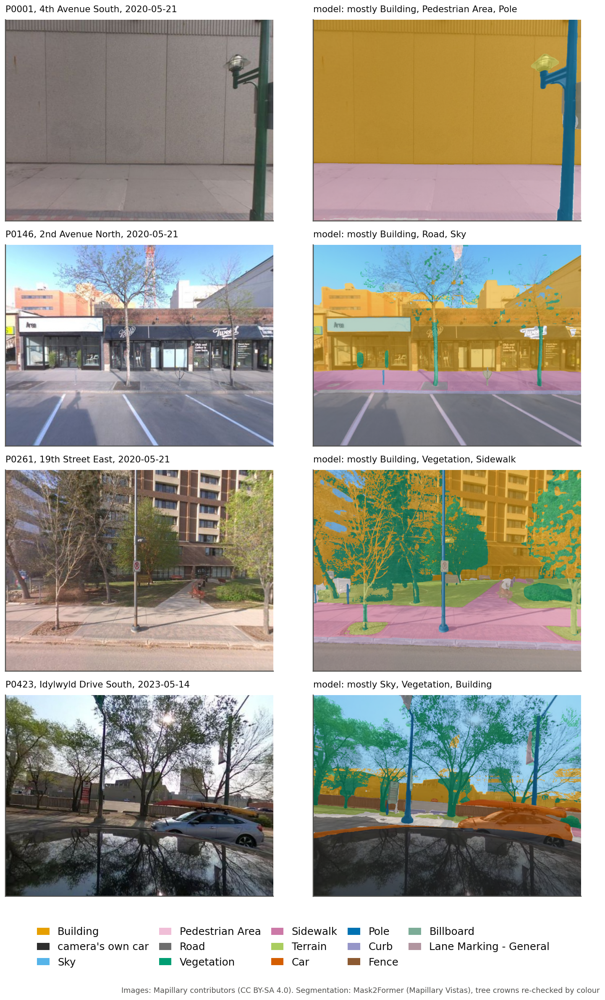
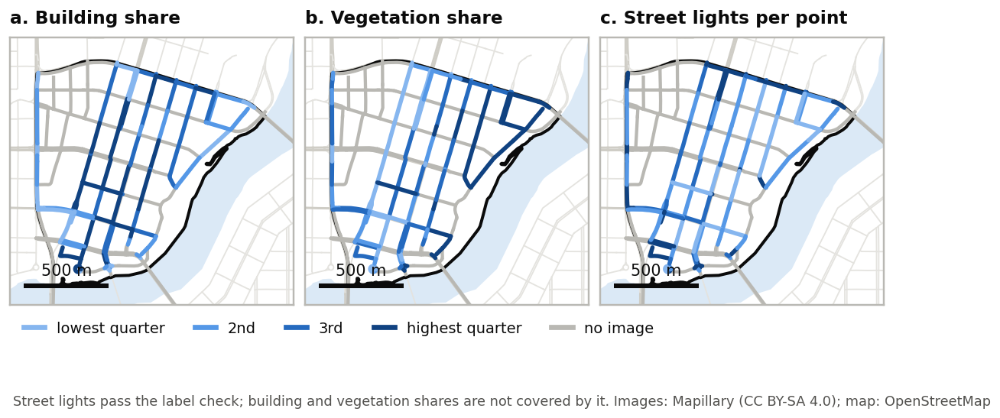
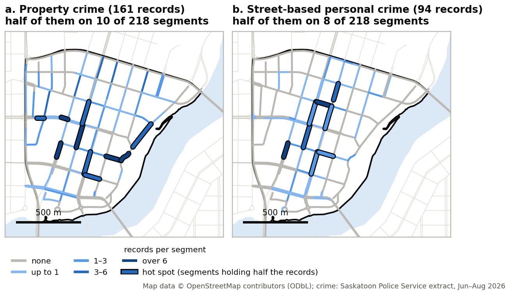
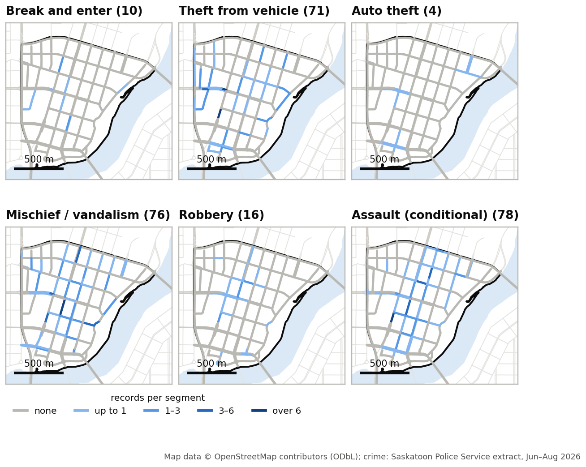

# ComputerVision_Sentinel

**November 2026 midpoint update: street images, image models and crime hot spots**

Prepared by Ryan Ocampo for Dr. Varuni Jayasooriya and Dr. Timothy Kang

November 2026  ·  revised work plan (October 2026)  ·  study period 1 June – 31 August 2026

## 1. Summary

The November tasks in the revised work plan are to run the segmentation, detection and CLIP steps, to check their accuracy against hand-labelled images, and to map crime hot spots by category. Two are done and the third is ready for the hand labels. The street images follow the image decision taken in November: the newest Mapillary image at each sample point (2020 or 2023), used with the 2026 crime and Reddit data, with the date gap stated as a limitation.

- **Street images:** 246 of the 423 sample points have a usable image, on 121 of the 218 street segments (56%). Images now have to face along the point's own street, which fixes the cross-street matches seen in the October pilot.
- **Image models (not yet validated):** one segmentation model measured what share of each of the 492 side views is building, vegetation, sidewalk and so on, and counted street lights, benches and other street furniture; CLIP scored land-use type and nine CPTED cues.
- **Hand-label check:** 150 side views were drawn blind for hand labelling, 30 of them for a second coder. No model output is used until it passes this check.
- **Crime hot spots:** 255 of the 257 study-category crimes recorded in the CBD were placed on the street segments; half of them lie on just 11 of the 218 segments.

**Table 1.** November tasks in the revised work plan (p. 5)

| November task | Status | Evidence |
|---|---|---|
| Run segmentation, detection and CLIP | Done, not yet validated | 492 side views from 246 points on 121 segments (Section 3) |
| Check accuracy against hand-labelled images | Sheet ready | 150 views drawn blind, 30 for a second coder; labelling next (Section 4) |
| Map crime hot spots by category | Done | 255 of 257 CBD records on segments; maps by group and category (Section 5) |

## 2. The street images

No open source has street-level images of Downtown from June to August 2026. Following the image decision, each sample point uses its newest Mapillary image captured from 2020 on, within 30 m. The October pilot showed that some images were taken from the cross street, so their side views looked down the wrong road; an image is now used only if the camera faced along the point's own street (within 30°). Points on bridges or the freeway have no building frontage and are left out. Each 360° image is cut into two side views, one facing each side of the street.

**Figure 1.** Which sample points have a usable image. The 2020 survey drove the avenues, so most east–west streets have no image facing along them.

**Table 2.** Image set at the sample points

| Outcome | Points |
|---|---|
| Image from 21 May 2020 | 225 |
| Image from 13–14 May 2023 | 21 |
| No 2020 or later image within 30 m | 100 |
| Only images taken from the cross street | 66 |
| Bridge or freeway (left out) | 11 |
| **All points** | **423** |

**Assumption:** the street features measured did not change much between the image year and summer 2026, so the images describe the typical built form of each street; this will be tested on the 2014 and 2020 images at the points that have both. **Limitations:**

- The images are 3 (2023) or 6 (2020) years older than the crime and Reddit data, and were taken in May, so trees have less foliage than in summer.
- The 2020 images were taken on one day during COVID-19 restrictions, so people and parked cars describe that day; they are flagged and not read as fixed features of the street.
- 97 of the 218 segments (44%) have no usable image, mostly east–west streets (Figure 1), so the images describe mainly the avenues.

## 3. What the image models found (not yet validated)

Like Hipp et al. (2022), Zhou et al. (2021), Yue et al. (2022) and Su, Li and Qiu (2023), the study measures each image by the share of the picture taken up by each kind of thing, using a semantic segmentation model; Yue et al. (2022) also detect people. Those studies used PSPNet or DeepLab trained on the Cityscapes images; none used the model chosen here, Mask2Former trained on Mapillary Vistas. Mapillary Vistas was chosen because its classes include street lights, benches, trash cans and CCTV cameras, which Cityscapes does not have, so one model gives both the segmentation and the street-furniture counts. CLIP, the model validated in October, scores the cues that are hard to segment. Both models are pinned to fixed versions, and a repeat run gives identical results.

**Table 3.** What the models found across all side views

| Measure | Result |
|---|---|
| Side views scored | 492 (246 points, 121 segments) |
| Share of the street scene: building / road / sky | 21.4% / 21.4% / 19.1% |
| Share of the street scene: vegetation / sidewalk / fence | 16% / 7.1% / 1.2% |
| Views with a street light (lights found) | 274 (472) |
| Views with a bench / trash can | 92 / 182 |
| Views with a person / a car (2020: one COVID-19 day) | 57 / 261 |
| Views with a CCTV camera / a bike rack | 4 / 24 |

The 2023 images were taken from a car roof, which covers about 17.9% of each of their side views; the camera car is left out of every share, so those streets are not made to look emptier.

**Figure 2.** Four side views and what the segmentation model labelled in them.

**Figure 3.** Three image measures per street segment, by quarter of their values. Not yet validated against hand labels.

**A warning from the first results:** CLIP's land-use label looks unreliable. It calls 230 of the 492 views a surface parking lot and only 8 a commercial street, which does not match Downtown, and 109 labels are low-confidence. The hand labels will show how far the label and each cue can be used.

## 4. The hand-label check

No image measure is used until it agrees with careful human judgement. 150 of the 492 side views were drawn for hand labelling by a rule fixed before anyone labelled: 12 groups by land-use type and image year, each sampled in proportion to its size, spread across the whole CBD. The labelling sheet shows no model output.

- Each view is labelled for land-use type and ten cues (graffiti, litter, boarded windows, vacant lot, active storefront, windows overlooking the street, people, fences, seating, a visible street light).
- 30 of the views also go to a second coder, who labels them without seeing the first coder's sheet.
- When the sheets are filled in, a script reports precision, recall and F1 for each cue and the agreement between the two coders. Proposed targets: F1 of at least 0.7 and kappa of at least 0.6; cues that fail are reported and dropped.

## 5. Recorded crime per street segment

The Saskatoon Police Service gives each record's location as a hundred-block or an intersection, with a point placed 30 to 85 m from the street itself. Records are therefore placed by the street they name: a block record goes to the nearest segment of that street, and an intersection record is shared between the segments of its two streets. 255 of the 257 study-category records in the CBD were placed; 2 are on a stretch of Spadina Crescent East with no sample point. The counts per category are small, so the two groups planned in October (property crime; street-based personal crime) are the unit for analysis.

**Table 4.** Recorded crime on the CBD street segments, June–August 2026

| Group | Category | Records |
|---|---|---|
| Property | Theft from vehicle | 71 |
|  | Mischief / vandalism | 76 |
|  | Break and enter | 10 |
|  | Auto theft | 4 |
| Street-based personal | Assault (conditional: outdoor incidents cannot be separated) | 78 |
|  | Robbery | 16 |
| **All study categories** |  | **255** |

**Hot spots:** crime is concentrated. Half of all study-category crime lies on 11 of the 218 segments (5%): half of property crime on 10 segments and half of street-based personal crime on 8.

**Figure 4.** Recorded crime per street segment, June–August 2026. Outlined segments are the hot spots: together they hold half of each group's records.

**Figure 5.** Recorded crime per street segment for each study category.

**Table 5.** The five street segments with the most recorded crime

| Street | Length (m) | Property | Street-based personal | All |
|---|---|---|---|---|
| 1st Avenue South | 113 | 18 | 21.3 | 39.3 |
| 22nd Street East | 52 | 15.2 | 1.4 | 16.6 |
| 2nd Avenue South | 177 | 10.2 | 5.8 | 16 |
| Spadina Crescent East | 81 | 7 | 2 | 9 |
| 21st Street East | 119 | 8 | 1 | 9 |

**Overlap with the street images:** the 121 segments with an image hold 164 of the 255 placed records (64%) and 6 of the 11 hot spots. The other hot spots are on east–west streets with no usable image, which limits the comparison of street design with crime.

## 6. Next steps and decisions

**Next steps (November to January):**

- Hand-label the 150 views and have the second coder label 30; score every cue and drop those that fail.
- Test the image-date assumption on the 2014 and 2020 images at the points that have both.
- Combine the validated measures into CPTED indicators per street segment and join them with the crime counts.
- Code the Reddit posts by location, crime type and environmental cue (work plan, December to January).

**Decisions for the co-leads:**

1. **Image coverage.** Requiring images to face along the street removed 66 points, mostly on east–west streets that hold several crime hot spots. Keep the rule (cleaner images, 121 segments), or allow those cross-street images with a note, or ask the City for its own street imagery?
2. **Crime hot spots.** Is "the segments holding half the records" a suitable hot-spot definition for the midpoint, with a formal hot-spot statistic later?

**How the results can be checked:** every number in this update comes from a script, not typed by hand. One command (./flight) rebuilds every output from the committed data, including the October results, and compares it file by file with the published copy; the image models can be left out of a quick run. The street images, the model outputs, the labelling sheet and the crime tables are in the project repository with a README for each folder.

*Images: Mapillary and contributors, CC BY-SA 4.0. Map data: © OpenStreetMap contributors (ODbL). Crime data: Saskatoon Police Service.*
