# Computer-vision pipeline (built environment, X)

The study correlates three measures on Downtown's street segments: the CPTED features of each street, measured from
street photos (X); recorded crime from the Saskatoon Police Service (Y1); and perceived safety from Reddit (Y2). This
document describes the pipeline that produces X. It follows the eight steps in the revised work plan (p. 5), and each
step works on the output of the step before it.

In short, the pipeline places sample points along every street segment (step 1) and finds a street photo at each
point (step 2). It then runs image models on the photos: a segmentation model measures how much of each view is
building, trees, sky and so on (step 3), the same model counts objects such as street lights and benches (step 4), and
CLIP scores cues that are hard to outline, such as graffiti and litter (step 5). The results are averaged per street
segment to give the CPTED indicators (step 6) and checked against a labelled sample of views (step 7). Finally, they are
joined with the crime and Reddit data on the same segments (step 8). Nothing from the models is used in the
correlations until it has passed the check in step 7.

The code is in `Scripts/cv_pilot/` (steps 1 and 2, and the October pilot) and `Scripts/cv_study/` (steps 2 to 7), and
their READMEs explain how to run it. The data is in `Data/cv_pilot_2026-10/` and `Data/cv_study_2026-11/`.

## Step 1: sample points

Status: done.

Because the street segment is the unit of analysis, the points are laid out segment by segment, so that long and short
streets are measured in the same way. Roads were taken from OpenStreetMap, covering nine road types from freeways to
pedestrian streets. Alleys, driveways and parking aisles were left out for now; they matter for CPTED and can be added
later. Each road was split wherever it meets another road, which gives block-length segments. Points were then spaced
about every 50 m along each segment, with a single point in the middle of any segment shorter than 75 m. Only points
inside the outline of the Central Business District (CBD) were kept
(`Data/boundaries/central_business_district_osm.geojson`), and a point closer than 10 m to one already kept was
dropped, since it would sample the same spot twice, as happens at junctions.

This gave 423 points on 218 segments (`Data/cv_pilot_2026-10/cbd/sample_points.csv`). The points are a median of
45.6 m apart, no two are closer than 10.1 m, and all lie inside the CBD. 107 segments have only one point. Eleven
points are on bridges or the freeway, where there are no buildings to look at.

An earlier run used a hand-drawn box from the August prototype instead of the CBD outline. Only 212 of its 595 points
were in the CBD, and it missed almost half of the CBD's points, so the tool now uses the outline by default.

## Step 2: image collection

Status: done.

**What photos exist.** Each point needs a photo that shows the building fronts and the street edge, because that is
where the CPTED features are judged. A coverage check listed every Mapillary photo within 30 m of every point. None of
the 423 points has a photo from the study period, June to August 2026, and a separate search found no Mapillary photos
of the CBD taken after 2023. The newest photo at a point is from 2023 at 27 points, from 2020 at 261 points, from 2017
to 2019 at 21 points and from 2014 at 88 points, and 26 points have no photo within 30 m. Google Street View cannot be
used instead, because its terms forbid downloading its images in bulk and using them with models (Google Maps
Platform Terms of Service 3.2.3, read 16 Oct 2026). The work plan allowed Street View only if its terms permitted
this kind of analysis.

**The October pilot.** In October the task was to show that street photos could be collected as secondary data and
that CLIP could read them. The method follows the street-view crime studies in `Reference/Literature/Computer_Vision/`
(He, Páez & Liu 2017; Hipp et al. 2022; Zhou et al. 2021; Yue et al. 2022; Su, Li & Qiu 2023). Ten points, chosen by a
fixed rule before any photo was seen, each got their newest photo within 30 m, and CLIP scored them
(`Data/cv_pilot_2026-10/cbd_latest_imagery/`). The pilot worked, and it also showed three problems, each of which
became a rule for the full set. Two of the ten photos were taken from the cross street, so their side views looked
down the road instead of at the buildings; a photo is now used only if its camera faced within 30° of the point's own
road. Points on bridges and the freeway have no building fronts, so those 11 points stay in the point list but get no
photo. Some of CLIP's land-use labels were plainly wrong, so nothing from CLIP is used until it has been checked
against labels (step 7). The pilot also showed that the 2014 photos came from a road-survey vehicle, so it is worth
asking the City whether newer survey photos exist.

**Decision D1: which photo dates to use (November 2026).** Published street-view crime studies keep their photos
within one to three years of the crime data (Hipp et al. 2022; Zhou et al. 2021; Yue et al. 2022), or show that the
streets did not change over a longer gap (He, Páez & Liu 2017). No open source has photos of the CBD from summer
2026: on Mapillary the newest CBD photo is from May 2023, Panoramax has no Downtown photos, and KartaView's newest is
from 2019.

Four options were weighed. The first was to use the newest Mapillary photo at each point with the 2026 crime and
Reddit data, accepting a gap of three to six years. The second was to ask the City for recent road-survey photos,
which depends on the City and its data-sharing terms. The third was to take new photos, but the plan uses secondary
data only and summer 2026 has passed. The fourth was to match the outcomes to the photos by using 2023 crime and
Reddit data. That option fails on coverage, because 2023 photos exist at only 27 points on 19 of the 218 segments. It
would also need a new police extract, although the police crime map warns against comparing its data across years,
and a new Reddit collection, which would find fewer posts: the same search found 122 posts for June to August 2023
against 168 for 2026 (7 Nov 2026). The first option was chosen. Each point uses its newest Mapillary photo from 2020 on,
within 30 m and facing along its road, and the crime and Reddit data stay at June to August 2026.

**What step 2 produced.** Photos were found for 246 points on 121 of the 218 segments (56%): 225 taken on 21 May 2020
and 21 taken on 13–14 May 2023 (`Data/cv_study_2026-11/image_manifest.csv`, made by `Scripts/cv_study/images.py`). Each
is a 360° panorama, cut into two side views, one facing each side of the street, which gives 492 side views. The
camera-direction rule removed 66 points whose only photos were taken from the cross street. Most of these are on the
east–west streets (19th to 25th Street), because the 2020 survey car drove the avenues. The 97 segments without a
photo have no X value and are left out of the correlations, and every result says that it covers 121 segments. The
year of each photo is kept with its scores.

**Assumption and limitations.** Every result that uses X assumes that the measured features (building fronts,
greenery, lighting, fences and walls, sidewalks and signs of disorder) did not change much between the photo year and
summer 2026. X therefore describes the typical built form of each segment, not its exact state in 2026. This comes
with five limitations. The photos are three (2023) or six (2020) years older than the crime and Reddit data, so changes
in between, such as new buildings or closed businesses, are not seen. All the photos were taken in May, when trees have
fewer leaves than in summer, so greenery is likely undercounted. The 2020 photos were all taken on a single day during
COVID-19 restrictions, so people, open shops and parked cars describe that day rather than a normal summer; these are
flagged and not treated as fixed features of the street. The 97 segments without a photo are mostly east–west streets,
so X describes mainly the avenues. Finally, the photos mix two years, and the 2023 photos were taken from a car roof,
which is left out of every measurement.

The assumption will be tested on the 2014 and 2020 photos, which exist together at 243 points on 144 segments. If the
measured features stayed stable over those six years, stability over the six years to 2026 is plausible, and any
features that changed will be reported. A 2020-against-2023 comparison is not possible, because only 3 points have
both.

## Steps 3 to 5: the image models

Status: done; only street lights and seating have passed the check in step 7 so far.

All three steps run in `Scripts/cv_study/models.py` on the 492 side views and write their tables to
`Data/cv_study_2026-11/`.

**Step 3, segmentation.** A segmentation model labels every pixel of a view with what it shows, such as building,
tree, sky or sidewalk. The share of the view taken by each class then measures things like how much of the street is
building frontage or greenery. The model is Mask2Former trained on Mapillary Vistas, a large set of labelled street
photos, and it is fixed to one version so that the results can be repeated. It sorts each view into 63 classes
(`segmentation_shares.csv`). Across all 492 views, buildings take up 25% of the picture, sky 24%, road 21%,
sidewalk 7%, vegetation 7% and fences 1.3%.

Two fixes were needed. First, the model outlines each tree crown as one solid shape, but in May most trees are bare, so
the sky and walls seen between the branches were being counted as vegetation. Inside each crown, a pixel now counts as
vegetation only if its colour looks like part of the tree (a trunk or branch, a green leaf, or a branch in shade).
Sky-coloured gaps become sky, and the rest take the class next to the tree, usually the building behind it. These
colour rules were set by eye on five views and are not part of the step 7 check. Second, the 2023 photos were taken
from a car roof that fills about 26% of each side view, so the car is left out of every share. The roof's shiny paint
reflects the scene above it, and in 11 of the 42 views from 2023 the model labelled the reflection instead of the car.
In those views, the roof's usual position on that side of the car is used instead.

The figure above shows four examples. Every one of the 492 side views is below, with the photo on the left and the model's classes on the right, and the three biggest shares from `segmentation_shares.csv` under each (made by `Scripts/reporting/embed_segmentation_gallery.py`, which checks that each picture matches its published shares).

<!-- segmentation gallery: start (written by Scripts/reporting/embed_segmentation_gallery.py) -->

> [!TIP]
> **All 492 segmented side views are in the section below.** Click its heading to open it. Each shows the photo on the left and the model's classes on the right, with the three biggest shares underneath; click a picture for the full view.

<h3>Click to open: all 492 segmented side views</h3>

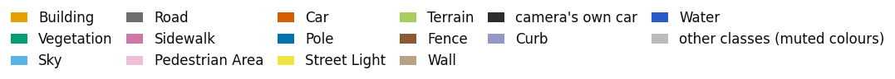

**2020 photos** (450 side views)

<table>
<tr><td width="33%" valign="top"><a href="../Data/cv_study_2026-11/images/P0001_833356744201075_left.jpg">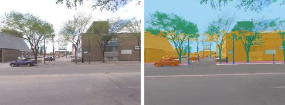</a> P0001 left, 2020 road 39%, sky 28%, building 18%</td><td width="33%" valign="top"><a href="../Data/cv_study_2026-11/images/P0001_833356744201075_right.jpg">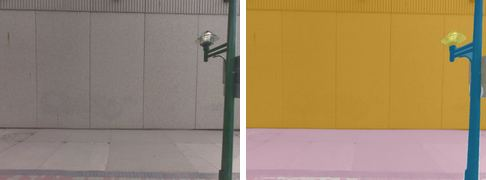</a> P0001 right, 2020 building 67%, pedestrian area 26%, pole 5%</td><td width="33%" valign="top"><a href="../Data/cv_study_2026-11/images/P0002_469245494371107_left.jpg">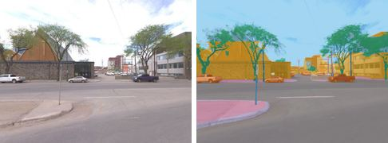</a> P0002 left, 2020 road 37%, sky 30%, building 14%</td></tr>
<tr><td width="33%" valign="top"> P0002 right, 2020 building 26%, sidewalk 21%, fence 16%</td><td width="33%" valign="top"> P0012 left, 2020 sky 34%, road 33%, building 14%</td><td width="33%" valign="top"> P0012 right, 2020 road 41%, sky 39%, building 12%</td></tr>
<tr><td width="33%" valign="top"><a href="../Data/cv_study_2026-11/images/P0013_300355241560785_left.jpg">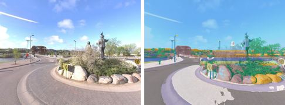</a> P0013 left, 2020 sky 45%, road 13%, vegetation 8%</td><td width="33%" valign="top"><a href="../Data/cv_study_2026-11/images/P0013_300355241560785_right.jpg">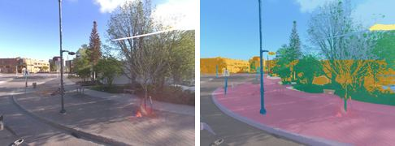</a> P0013 right, 2020 sky 35%, sidewalk 25%, vegetation 14%</td><td width="33%" valign="top"> P0016 left, 2020 building 32%, car 20%, road 13%</td></tr>
<tr><td width="33%" valign="top"> P0016 right, 2020 vegetation 36%, terrain 12%, water 8%</td><td width="33%" valign="top"><a href="../Data/cv_study_2026-11/images/P0017_1121773784984781_left.jpg">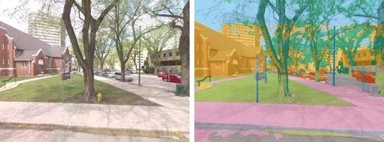</a> P0017 left, 2020 sidewalk 22%, building 20%, vegetation 16%</td><td width="33%" valign="top"> P0017 right, 2020 vegetation 34%, road 22%, terrain 15%</td></tr>
<tr><td width="33%" valign="top"><a href="../Data/cv_study_2026-11/images/P0018_992926511457480_left.jpg">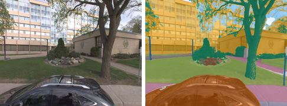</a> P0018 left, 2020 building 34%, car 18%, terrain 18%</td><td width="33%" valign="top"><a href="../Data/cv_study_2026-11/images/P0018_992926511457480_right.jpg">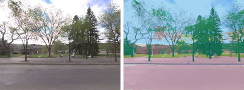</a> P0018 right, 2020 sky 35%, pedestrian area 34%, vegetation 18%</td><td width="33%" valign="top"> P0020 left, 2020 building 46%, road 32%, vegetation 11%</td></tr>
<tr><td width="33%" valign="top"> P0020 right, 2020 building 40%, road 27%, sky 20%</td><td width="33%" valign="top"><a href="../Data/cv_study_2026-11/images/P0021_872877086641447_left.jpg">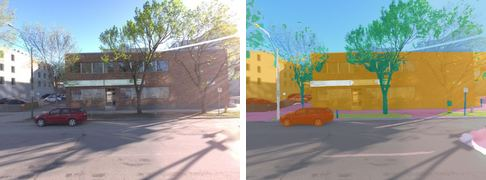</a> P0021 left, 2020 road 31%, building 24%, sky 22%</td><td width="33%" valign="top"><a href="../Data/cv_study_2026-11/images/P0021_872877086641447_right.jpg">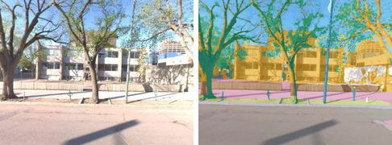</a> P0021 right, 2020 road 27%, building 24%, vegetation 16%</td></tr>
<tr><td width="33%" valign="top"> P0022 left, 2020 sky 34%, road 32%, building 16%</td><td width="33%" valign="top"><a href="../Data/cv_study_2026-11/images/P0022_1829975260530310_right.jpg">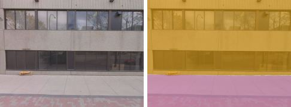</a> P0022 right, 2020 building 70%, sidewalk 30%, bird 0%</td><td width="33%" valign="top"> P0039 left, 2020 road 34%, building 22%, sky 20%</td></tr>
<tr><td width="33%" valign="top"> P0039 right, 2020 road 38%, building 20%, sky 20%</td><td width="33%" valign="top"><a href="../Data/cv_study_2026-11/images/P0040_388421869060696_left.jpg">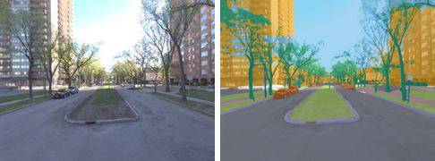</a> P0040 left, 2020 road 34%, building 22%, sky 19%</td><td width="33%" valign="top"><a href="../Data/cv_study_2026-11/images/P0040_388421869060696_right.jpg">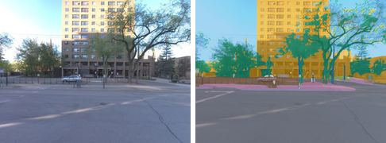</a> P0040 right, 2020 road 38%, sky 20%, building 20%</td></tr>
<tr><td width="33%" valign="top"><a href="../Data/cv_study_2026-11/images/P0051_219486436652208_left.jpg">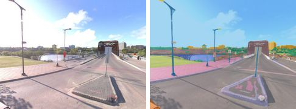</a> P0051 left, 2020 sky 41%, road 33%, sidewalk 6%</td><td width="33%" valign="top"> P0051 right, 2020 building 33%, sky 19%, road 13%</td><td width="33%" valign="top"> P0053 left, 2020 building 22%, vegetation 20%, sidewalk 14%</td></tr>
<tr><td width="33%" valign="top"> P0053 right, 2020 vegetation 30%, sky 26%, road 25%</td><td width="33%" valign="top"><a href="../Data/cv_study_2026-11/images/P0054_1935861516577676_left.jpg">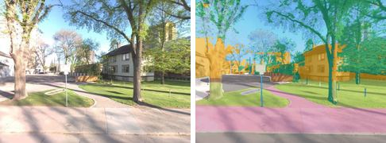</a> P0054 left, 2020 sky 22%, vegetation 20%, sidewalk 19%</td><td width="33%" valign="top"> P0054 right, 2020 sky 29%, road 25%, vegetation 16%</td></tr>
<tr><td width="33%" valign="top"><a href="../Data/cv_study_2026-11/images/P0055_981964145965405_left.jpg">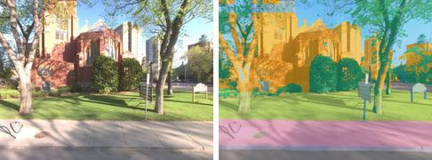</a> P0055 left, 2020 building 26%, vegetation 19%, terrain 17%</td><td width="33%" valign="top"><a href="../Data/cv_study_2026-11/images/P0055_981964145965405_right.jpg">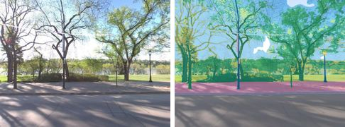</a> P0055 right, 2020 vegetation 28%, road 25%, sky 20%</td><td width="33%" valign="top"><a href="../Data/cv_study_2026-11/images/P0056_974907559988134_left.jpg">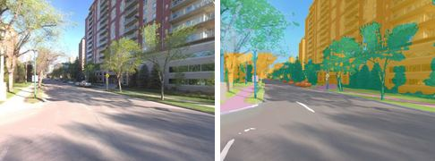</a> P0056 left, 2020 road 38%, building 25%, vegetation 19%</td></tr>
<tr><td width="33%" valign="top"> P0056 right, 2020 sky 37%, road 34%, vegetation 16%</td><td width="33%" valign="top"><a href="../Data/cv_study_2026-11/images/P0057_497016648390704_left.jpg">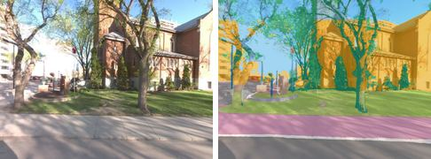</a> P0057 left, 2020 building 25%, sky 15%, vegetation 15%</td><td width="33%" valign="top"><a href="../Data/cv_study_2026-11/images/P0057_497016648390704_right.jpg">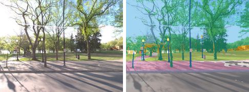</a> P0057 right, 2020 vegetation 29%, sky 25%, road 22%</td></tr>
<tr><td width="33%" valign="top"> P0058 left, 2020 building 24%, vegetation 18%, sidewalk 18%</td><td width="33%" valign="top"> P0058 right, 2020 vegetation 28%, sky 26%, road 13%</td><td width="33%" valign="top"><a href="../Data/cv_study_2026-11/images/P0059_485662436011734_left.jpg">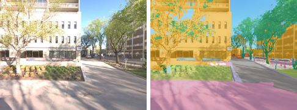</a> P0059 left, 2020 building 34%, sidewalk 25%, vegetation 13%</td></tr>
<tr><td width="33%" valign="top"> P0059 right, 2020 vegetation 34%, road 22%, sky 15%</td><td width="33%" valign="top"><a href="../Data/cv_study_2026-11/images/P0060_303016901485277_left.jpg">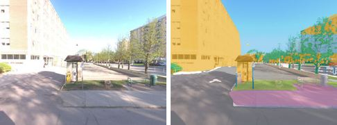</a> P0060 left, 2020 road 28%, building 26%, sky 22%</td><td width="33%" valign="top"><a href="../Data/cv_study_2026-11/images/P0060_303016901485277_right.jpg">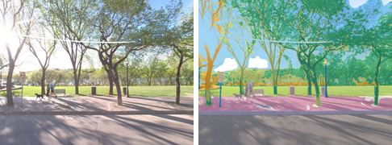</a> P0060 right, 2020 vegetation 27%, road 21%, sky 17%</td></tr>
<tr><td width="33%" valign="top"> P0061 left, 2020 building 21%, vegetation 18%, sidewalk 16%</td><td width="33%" valign="top"><a href="../Data/cv_study_2026-11/images/P0061_485598956058289_right.jpg">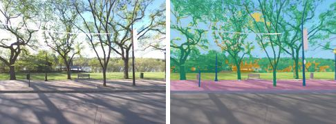</a> P0061 right, 2020 vegetation 31%, road 25%, sky 19%</td><td width="33%" valign="top"> P0062 left, 2020 building 25%, terrain 21%, sidewalk 20%</td></tr>
<tr><td width="33%" valign="top"><a href="../Data/cv_study_2026-11/images/P0062_144358271069016_right.jpg">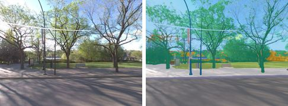</a> P0062 right, 2020 sky 28%, vegetation 27%, road 26%</td><td width="33%" valign="top"><a href="../Data/cv_study_2026-11/images/P0067_925750214874698_left.jpg">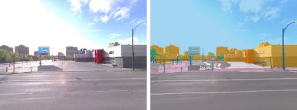</a> P0067 left, 2020 sky 43%, road 35%, building 11%</td><td width="33%" valign="top"> P0067 right, 2020 sky 37%, road 26%, pedestrian area 9%</td></tr>
<tr><td width="33%" valign="top"> P0068 left, 2020 sky 45%, road 34%, building 11%</td><td width="33%" valign="top"> P0068 right, 2020 building 45%, road 22%, sky 18%</td><td width="33%" valign="top"> P0069 left, 2020 sky 43%, road 35%, building 15%</td></tr>
<tr><td width="33%" valign="top"> P0069 right, 2020 building 38%, fence 24%, road 21%</td><td width="33%" valign="top"> P0070 left, 2020 road 32%, building 31%, sky 27%</td><td width="33%" valign="top"> P0070 right, 2020 building 42%, road 23%, sky 15%</td></tr>
<tr><td width="33%" valign="top"><a href="../Data/cv_study_2026-11/images/P0071_2242124815922570_left.jpg">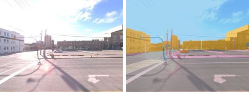</a> P0071 left, 2020 sky 39%, road 36%, building 14%</td><td width="33%" valign="top"><a href="../Data/cv_study_2026-11/images/P0071_2242124815922570_right.jpg">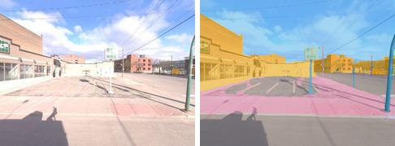</a> P0071 right, 2020 sky 34%, road 28%, building 18%</td><td width="33%" valign="top"> P0072 left, 2020 sky 36%, road 36%, building 18%</td></tr>
<tr><td width="33%" valign="top"><a href="../Data/cv_study_2026-11/images/P0072_163260662423263_right.jpg">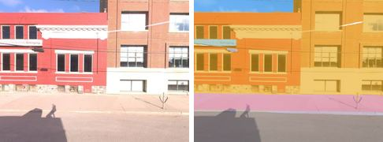</a> P0072 right, 2020 building 61%, road 20%, sidewalk 12%</td><td width="33%" valign="top"><a href="../Data/cv_study_2026-11/images/P0073_2944352705798290_left.jpg">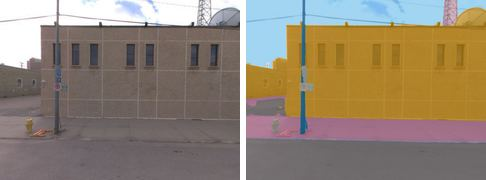</a> P0073 left, 2020 building 47%, road 23%, sky 15%</td><td width="33%" valign="top"><a href="../Data/cv_study_2026-11/images/P0073_2944352705798290_right.jpg">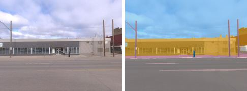</a> P0073 right, 2020 sky 40%, road 35%, building 18%</td></tr>
<tr><td width="33%" valign="top"> P0074 left, 2020 road 35%, sky 31%, building 22%</td><td width="33%" valign="top"><a href="../Data/cv_study_2026-11/images/P0074_825977754791467_right.jpg">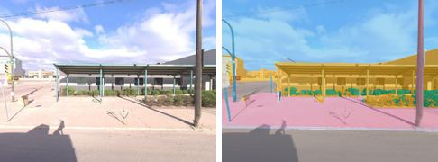</a> P0074 right, 2020 sky 37%, road 22%, building 17%</td><td width="33%" valign="top"><a href="../Data/cv_study_2026-11/images/P0075_262039372095013_left.jpg">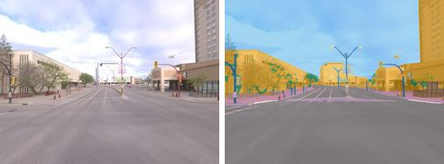</a> P0075 left, 2020 road 40%, sky 34%, building 18%</td></tr>
<tr><td width="33%" valign="top"><a href="../Data/cv_study_2026-11/images/P0075_262039372095013_right.jpg">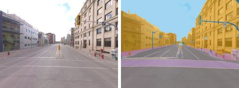</a> P0075 right, 2020 building 34%, road 31%, sky 20%</td><td width="33%" valign="top"><a href="../Data/cv_study_2026-11/images/P0076_2351234121673470_left.jpg">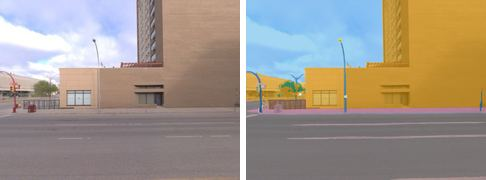</a> P0076 left, 2020 building 36%, road 35%, sky 22%</td><td width="33%" valign="top"> P0076 right, 2020 building 63%, road 20%, sidewalk 11%</td></tr>
<tr><td width="33%" valign="top"><a href="../Data/cv_study_2026-11/images/P0077_297787382058324_left.jpg">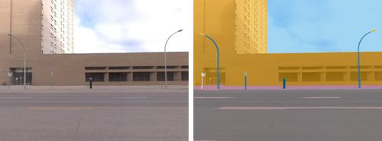</a> P0077 left, 2020 building 37%, road 35%, sky 22%</td><td width="33%" valign="top"> P0077 right, 2020 building 64%, road 20%, sidewalk 10%</td><td width="33%" valign="top"> P0078 left, 2020 sky 37%, road 35%, building 22%</td></tr>
<tr><td width="33%" valign="top"> P0078 right, 2020 building 66%, sidewalk 11%, pole 0%</td><td width="33%" valign="top"><a href="../Data/cv_study_2026-11/images/P0079_1233547920416712_left.jpg">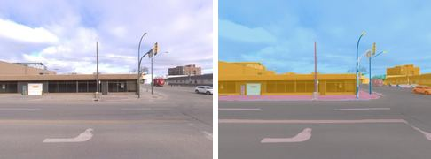</a> P0079 left, 2020 sky 43%, road 36%, building 12%</td><td width="33%" valign="top"><a href="../Data/cv_study_2026-11/images/P0079_1233547920416712_right.jpg">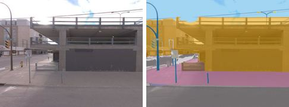</a> P0079 right, 2020 building 43%, road 21%, sky 17%</td></tr>
<tr><td width="33%" valign="top"><a href="../Data/cv_study_2026-11/images/P0093_915684875656335_left.jpg">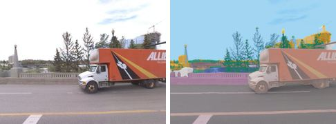</a> P0093 left, 2020 sky 40%, road 28%, truck 15%</td><td width="33%" valign="top"> P0093 right, 2020 sky 37%, vegetation 18%, barrier 15%</td><td width="33%" valign="top"> P0094 left, 2020 sky 34%, road 33%, vegetation 19%</td></tr>
<tr><td width="33%" valign="top"> P0094 right, 2020 building 28%, sidewalk 20%, terrain 16%</td><td width="33%" valign="top"> P0095 left, 2020 sky 35%, road 33%, building 17%</td><td width="33%" valign="top"><a href="../Data/cv_study_2026-11/images/P0095_948476965967962_right.jpg">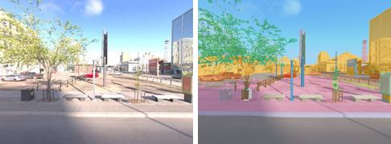</a> P0095 right, 2020 sky 28%, road 20%, sidewalk 16%</td></tr>
<tr><td width="33%" valign="top"> P0096 left, 2020 building 43%, road 23%, sky 17%</td><td width="33%" valign="top"> P0096 right, 2020 building 54%, road 25%, car 7%</td><td width="33%" valign="top"> P0097 left, 2020 building 38%, vegetation 29%, road 13%</td></tr>
<tr><td width="33%" valign="top"> P0097 right, 2020 road 29%, building 26%, sky 17%</td><td width="33%" valign="top"> P0098 left, 2020 building 47%, road 33%, sky 9%</td><td width="33%" valign="top"><a href="../Data/cv_study_2026-11/images/P0098_384351289534667_right.jpg">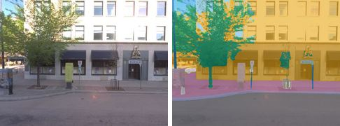</a> P0098 right, 2020 building 43%, road 24%, vegetation 15%</td></tr>
<tr><td width="33%" valign="top"> P0099 left, 2020 building 47%, road 36%, sky 10%</td><td width="33%" valign="top"> P0099 right, 2020 building 49%, road 18%, sidewalk 12%</td><td width="33%" valign="top"> P0100 left, 2020 building 38%, sky 16%, road 15%</td></tr>
<tr><td width="33%" valign="top"> P0100 right, 2020 building 60%, road 27%, sidewalk 9%</td><td width="33%" valign="top"><a href="../Data/cv_study_2026-11/images/P0101_1206854533099644_left.jpg">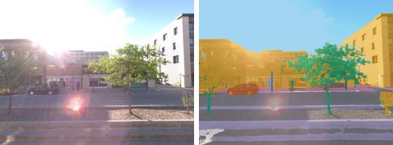</a> P0101 left, 2020 sky 29%, building 26%, road 22%</td><td width="33%" valign="top"> P0101 right, 2020 building 38%, road 20%, sky 14%</td></tr>
<tr><td width="33%" valign="top"> P0102 left, 2020 building 47%, road 32%, sky 10%</td><td width="33%" valign="top"> P0102 right, 2020 building 52%, road 24%, sidewalk 6%</td><td width="33%" valign="top"> P0107 left, 2020 building 39%, sidewalk 23%, sky 16%</td></tr>
<tr><td width="33%" valign="top"><a href="../Data/cv_study_2026-11/images/P0107_499876417883837_right.jpg">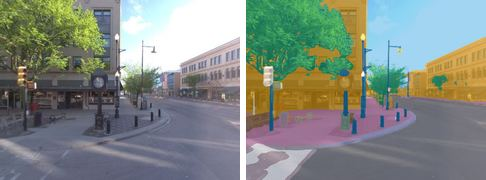</a> P0107 right, 2020 road 24%, building 22%, vegetation 17%</td><td width="33%" valign="top"><a href="../Data/cv_study_2026-11/images/P0108_228038572089663_left.jpg">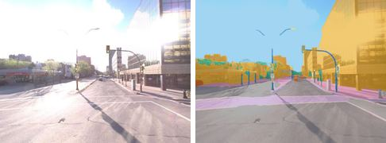</a> P0108 left, 2020 road 31%, sky 28%, building 28%</td><td width="33%" valign="top"> P0108 right, 2020 road 36%, building 27%, sky 24%</td></tr>
<tr><td width="33%" valign="top"><a href="../Data/cv_study_2026-11/images/P0110_157042159730117_left.jpg">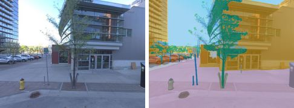</a> P0110 left, 2020 pedestrian area 35%, building 35%, sky 14%</td><td width="33%" valign="top"><a href="../Data/cv_study_2026-11/images/P0110_157042159730117_right.jpg">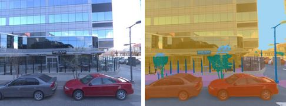</a> P0110 right, 2020 building 49%, car 18%, road 11%</td><td width="33%" valign="top"> P0111 left, 2020 building 43%, vegetation 10%, sky 7%</td></tr>
<tr><td width="33%" valign="top"> P0111 right, 2020 building 40%, sidewalk 19%, road 14%</td><td width="33%" valign="top"> P0112 left, 2020 building 33%, sidewalk 31%, sky 21%</td><td width="33%" valign="top"> P0112 right, 2020 sky 30%, pedestrian area 18%, road 17%</td></tr>
<tr><td width="33%" valign="top"> P0113 left, 2020 bridge 44%, fence 31%, road 7%</td><td width="33%" valign="top"> P0113 right, 2020 building 37%, road 32%, sky 16%</td><td width="33%" valign="top"><a href="../Data/cv_study_2026-11/images/P0114_318709152999803_left.jpg">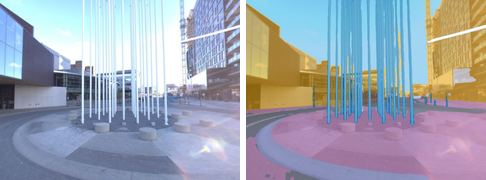</a> P0114 left, 2020 sidewalk 31%, building 29%, sky 15%</td></tr>
<tr><td width="33%" valign="top"><a href="../Data/cv_study_2026-11/images/P0114_318709152999803_right.jpg">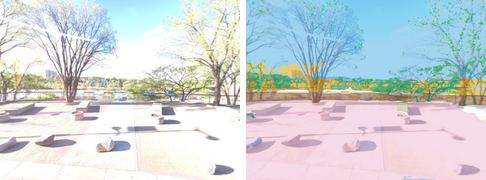</a> P0114 right, 2020 pedestrian area 42%, sky 40%, vegetation 6%</td><td width="33%" valign="top"> P0115 left, 2020 sidewalk 27%, sky 23%, building 17%</td><td width="33%" valign="top"><a href="../Data/cv_study_2026-11/images/P0115_311083940593900_right.jpg">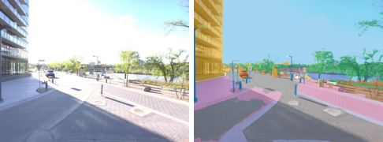</a> P0115 right, 2020 sky 36%, road 26%, sidewalk 11%</td></tr>
<tr><td width="33%" valign="top"> P0116 left, 2020 sidewalk 30%, sky 27%, building 20%</td><td width="33%" valign="top"> P0116 right, 2020 building 67%, pedestrian area 29%, pole 2%</td><td width="33%" valign="top"> P0118 left, 2020 building 33%, sidewalk 25%, sky 17%</td></tr>
<tr><td width="33%" valign="top"> P0118 right, 2020 building 63%, sidewalk 33%, billboard 3%</td><td width="33%" valign="top"> P0130 left, 2020 road 37%, building 37%, sky 17%</td><td width="33%" valign="top"> P0130 right, 2020 sky 24%, road 24%, building 24%</td></tr>
<tr><td width="33%" valign="top"> P0131 left, 2020 road 41%, sky 38%, building 12%</td><td width="33%" valign="top"> P0131 right, 2020 road 39%, building 30%, sky 21%</td><td width="33%" valign="top"> P0132 left, 2020 sky 42%, road 32%, building 10%</td></tr>
<tr><td width="33%" valign="top"> P0132 right, 2020 building 35%, sky 24%, car 13%</td><td width="33%" valign="top"> P0133 left, 2020 building 52%, road 32%, billboard 8%</td><td width="33%" valign="top"> P0133 right, 2020 sky 38%, road 27%, building 14%</td></tr>
<tr><td width="33%" valign="top"> P0134 left, 2020 building 36%, road 30%, sky 20%</td><td width="33%" valign="top"> P0134 right, 2020 building 50%, fence 43%, sidewalk 3%</td><td width="33%" valign="top"> P0135 left, 2020 road 40%, sky 37%, building 16%</td></tr>
<tr><td width="33%" valign="top"> P0135 right, 2020 road 37%, sky 27%, building 24%</td><td width="33%" valign="top"> P0136 left, 2020 sky 36%, road 33%, building 10%</td><td width="33%" valign="top"> P0136 right, 2020 sky 33%, road 19%, vegetation 10%</td></tr>
<tr><td width="33%" valign="top"> P0137 left, 2020 road 35%, building 27%, sky 21%</td><td width="33%" valign="top"> P0137 right, 2020 building 32%, sky 23%, parking 22%</td><td width="33%" valign="top"> P0138 left, 2020 parking 34%, building 29%, sky 25%</td></tr>
<tr><td width="33%" valign="top"> P0138 right, 2020 building 45%, road 14%, sky 12%</td><td width="33%" valign="top"> P0139 left, 2020 building 41%, sidewalk 30%, sky 15%</td><td width="33%" valign="top"> P0139 right, 2020 building 30%, sky 29%, sidewalk 12%</td></tr>
<tr><td width="33%" valign="top"> P0140 left, 2020 road 32%, building 31%, sky 18%</td><td width="33%" valign="top"> P0140 right, 2020 building 55%, sidewalk 23%, rail track 7%</td><td width="33%" valign="top"> P0141 left, 2020 building 39%, road 34%, sky 16%</td></tr>
<tr><td width="33%" valign="top"> P0141 right, 2020 building 38%, road 20%, sky 20%</td><td width="33%" valign="top"> P0142 left, 2020 building 50%, road 30%, sky 6%</td><td width="33%" valign="top"> P0142 right, 2020 building 29%, vegetation 15%, sky 14%</td></tr>
<tr><td width="33%" valign="top"> P0143 left, 2020 building 49%, road 26%, sky 10%</td><td width="33%" valign="top"> P0143 right, 2020 building 39%, sky 19%, road 17%</td><td width="33%" valign="top"> P0144 left, 2020 building 31%, road 27%, sky 16%</td></tr>
<tr><td width="33%" valign="top"> P0144 right, 2020 building 27%, road 24%, sky 24%</td><td width="33%" valign="top"> P0145 left, 2020 sky 33%, road 32%, building 23%</td><td width="33%" valign="top"> P0145 right, 2020 building 57%, road 12%, sidewalk 10%</td></tr>
<tr><td width="33%" valign="top"> P0146 left, 2020 sky 36%, road 31%, building 21%</td><td width="33%" valign="top"> P0146 right, 2020 building 37%, road 24%, sky 21%</td><td width="33%" valign="top"> P0147 left, 2020 building 29%, sky 26%, road 22%</td></tr>
<tr><td width="33%" valign="top"> P0147 right, 2020 building 30%, sky 20%, road 19%</td><td width="33%" valign="top"> P0148 left, 2020 sky 35%, road 27%, building 19%</td><td width="33%" valign="top"> P0148 right, 2020 building 52%, vegetation 17%, pedestrian area 8%</td></tr>
<tr><td width="33%" valign="top"> P0149 left, 2020 building 45%, fence 21%, pedestrian area 17%</td><td width="33%" valign="top"> P0149 right, 2020 building 58%, car 26%, road 6%</td><td width="33%" valign="top"> P0150 left, 2020 building 51%, road 10%, billboard 5%</td></tr>
<tr><td width="33%" valign="top"> P0150 right, 2020 building 27%, road 26%, sky 25%</td><td width="33%" valign="top"> P0151 left, 2020 road 41%, sky 39%, building 12%</td><td width="33%" valign="top"> P0151 right, 2020 sky 34%, road 33%, building 14%</td></tr>
<tr><td width="33%" valign="top"> P0152 left, 2020 road 39%, sky 28%, building 23%</td><td width="33%" valign="top"> P0152 right, 2020 road 42%, sky 25%, building 23%</td><td width="33%" valign="top"> P0153 left, 2020 building 39%, lane marking general 21%, sky 19%</td></tr>
<tr><td width="33%" valign="top"> P0153 right, 2020 building 52%, road 20%, sidewalk 15%</td><td width="33%" valign="top"> P0154 left, 2020 sky 43%, road 38%, building 9%</td><td width="33%" valign="top"> P0154 right, 2020 sky 40%, road 39%, building 8%</td></tr>
<tr><td width="33%" valign="top"> P0164 left, 2020 building 41%, other vehicle 32%, road 13%</td><td width="33%" valign="top"> P0164 right, 2020 sky 43%, road 19%, sidewalk 15%</td><td width="33%" valign="top"> P0165 left, 2020 building 32%, vegetation 24%, sidewalk 16%</td></tr>
<tr><td width="33%" valign="top"> P0165 right, 2020 sky 45%, road 30%, building 8%</td><td width="33%" valign="top"> P0166 left, 2020 sidewalk 22%, bridge 17%, building 15%</td><td width="33%" valign="top"> P0166 right, 2020 road 41%, sky 24%, bridge 24%</td></tr>
<tr><td width="33%" valign="top"> P0170 left, 2020 sky 41%, road 36%, building 10%</td><td width="33%" valign="top"> P0170 right, 2020 building 56%, sidewalk 16%, road 14%</td><td width="33%" valign="top"> P0175 left, 2020 sky 41%, road 39%, building 11%</td></tr>
<tr><td width="33%" valign="top"> P0175 right, 2020 sky 41%, road 25%, sidewalk 11%</td><td width="33%" valign="top"> P0176 left, 2020 road 39%, sky 36%, building 15%</td><td width="33%" valign="top"> P0176 right, 2020 sky 38%, road 27%, sidewalk 12%</td></tr>
<tr><td width="33%" valign="top"> P0177 left, 2020 sky 35%, road 35%, building 18%</td><td width="33%" valign="top"> P0177 right, 2020 sky 37%, road 21%, building 13%</td><td width="33%" valign="top"> P0178 left, 2020 sky 40%, road 31%, building 12%</td></tr>
<tr><td width="33%" valign="top"> P0178 right, 2020 sky 33%, road 21%, building 16%</td><td width="33%" valign="top"> P0179 left, 2020 sky 40%, road 23%, sidewalk 12%</td><td width="33%" valign="top"> P0179 right, 2020 building 49%, road 24%, sidewalk 9%</td></tr>
<tr><td width="33%" valign="top"> P0180 left, 2020 sky 41%, road 29%, building 13%</td><td width="33%" valign="top"> P0180 right, 2020 building 67%, road 20%, sidewalk 10%</td><td width="33%" valign="top"> P0181 left, 2020 road 36%, sky 29%, building 28%</td></tr>
<tr><td width="33%" valign="top"> P0181 right, 2020 building 64%, road 22%, sidewalk 10%</td><td width="33%" valign="top"> P0182 left, 2020 sky 36%, road 26%, building 20%</td><td width="33%" valign="top"> P0182 right, 2020 building 60%, road 20%, sidewalk 7%</td></tr>
<tr><td width="33%" valign="top"> P0188 left, 2020 sky 34%, road 23%, building 20%</td><td width="33%" valign="top"> P0188 right, 2020 building 40%, vegetation 24%, sidewalk 12%</td><td width="33%" valign="top"> P0189 left, 2020 sky 32%, building 19%, road 14%</td></tr>
<tr><td width="33%" valign="top"> P0189 right, 2020 sky 34%, building 28%, sidewalk 15%</td><td width="33%" valign="top"> P0190 left, 2020 sky 34%, road 26%, building 18%</td><td width="33%" valign="top"> P0190 right, 2020 building 38%, sidewalk 17%, sky 16%</td></tr>
<tr><td width="33%" valign="top"> P0191 left, 2020 building 42%, road 29%, sky 15%</td><td width="33%" valign="top"> P0191 right, 2020 building 43%, road 31%, sky 12%</td><td width="33%" valign="top"> P0192 left, 2020 building 55%, road 28%, sky 5%</td></tr>
<tr><td width="33%" valign="top"> P0192 right, 2020 building 34%, road 31%, vegetation 13%</td><td width="33%" valign="top"> P0193 left, 2020 road 34%, building 30%, sky 14%</td><td width="33%" valign="top"> P0193 right, 2020 sky 32%, building 22%, road 19%</td></tr>
<tr><td width="33%" valign="top"> P0194 left, 2020 road 34%, sky 26%, vegetation 18%</td><td width="33%" valign="top"> P0194 right, 2020 building 43%, road 28%, sky 13%</td><td width="33%" valign="top"> P0195 left, 2020 vegetation 24%, road 21%, sky 17%</td></tr>
<tr><td width="33%" valign="top"> P0195 right, 2020 road 30%, sky 29%, building 28%</td><td width="33%" valign="top"> P0196 left, 2020 building 37%, road 21%, sidewalk 12%</td><td width="33%" valign="top"> P0196 right, 2020 sky 37%, building 20%, road 15%</td></tr>
<tr><td width="33%" valign="top"> P0197 left, 2020 road 21%, sky 20%, building 19%</td><td width="33%" valign="top"> P0197 right, 2020 sky 39%, lane marking general 19%, building 19%</td><td width="33%" valign="top"> P0198 left, 2020 vegetation 32%, sky 27%, curb 17%</td></tr>
<tr><td width="33%" valign="top"> P0198 right, 2020 building 62%, sidewalk 20%, curb 6%</td><td width="33%" valign="top"> P0199 left, 2020 building 36%, road 33%, sky 17%</td><td width="33%" valign="top"> P0199 right, 2020 sky 32%, building 26%, road 18%</td></tr>
<tr><td width="33%" valign="top"> P0200 left, 2020 sky 33%, building 18%, curb 16%</td><td width="33%" valign="top"> P0200 right, 2020 building 45%, sidewalk 20%, sky 10%</td><td width="33%" valign="top"> P0201 left, 2020 sky 24%, road 22%, building 21%</td></tr>
<tr><td width="33%" valign="top"> P0201 right, 2020 building 52%, road 16%, sidewalk 10%</td><td width="33%" valign="top"> P0202 left, 2020 building 29%, road 26%, sky 14%</td><td width="33%" valign="top"> P0202 right, 2020 building 51%, sidewalk 28%, sky 6%</td></tr>
<tr><td width="33%" valign="top"> P0203 left, 2020 sky 32%, vegetation 21%, terrain 17%</td><td width="33%" valign="top"> P0203 right, 2020 building 39%, sky 22%, sidewalk 17%</td><td width="33%" valign="top"> P0204 left, 2020 sky 30%, vegetation 23%, curb 20%</td></tr>
<tr><td width="33%" valign="top"> P0204 right, 2020 building 47%, sidewalk 26%, sky 8%</td><td width="33%" valign="top"> P0205 left, 2020 sky 27%, vegetation 26%, curb 19%</td><td width="33%" valign="top"> P0205 right, 2020 building 32%, sidewalk 24%, sky 12%</td></tr>
<tr><td width="33%" valign="top"> P0216 left, 2020 vegetation 25%, sky 20%, sidewalk 18%</td><td width="33%" valign="top"> P0216 right, 2020 building 33%, road 31%, sky 25%</td><td width="33%" valign="top"> P0217 left, 2020 vegetation 27%, road 25%, sky 18%</td></tr>
<tr><td width="33%" valign="top"> P0217 right, 2020 sky 29%, road 27%, building 24%</td><td width="33%" valign="top"> P0218 left, 2020 sky 38%, road 28%, sidewalk 12%</td><td width="33%" valign="top"> P0218 right, 2020 sky 44%, road 36%, building 9%</td></tr>
<tr><td width="33%" valign="top"> P0219 left, 2020 sky 31%, road 31%, building 18%</td><td width="33%" valign="top"> P0219 right, 2020 sky 41%, road 35%, building 13%</td><td width="33%" valign="top"> P0220 left, 2020 road 34%, building 33%, sky 21%</td></tr>
<tr><td width="33%" valign="top"> P0220 right, 2020 building 46%, road 27%, sky 11%</td><td width="33%" valign="top"> P0221 left, 2020 building 50%, road 25%, sidewalk 9%</td><td width="33%" valign="top"> P0221 right, 2020 road 31%, sky 31%, building 24%</td></tr>
<tr><td width="33%" valign="top"> P0222 left, 2020 sky 24%, building 18%, road 16%</td><td width="33%" valign="top"> P0222 right, 2020 building 35%, road 34%, sky 23%</td><td width="33%" valign="top"> P0223 left, 2020 road 35%, sky 31%, building 20%</td></tr>
<tr><td width="33%" valign="top"> P0223 right, 2020 road 39%, building 27%, sky 26%</td><td width="33%" valign="top"> P0224 left, 2020 building 59%, road 32%, car 4%</td><td width="33%" valign="top"> P0224 right, 2020 building 60%, road 16%, sidewalk 10%</td></tr>
<tr><td width="33%" valign="top"> P0225 left, 2020 building 41%, road 31%, sky 19%</td><td width="33%" valign="top"> P0225 right, 2020 sky 36%, road 18%, sidewalk 13%</td><td width="33%" valign="top"> P0226 left, 2020 road 32%, sky 31%, building 22%</td></tr>
<tr><td width="33%" valign="top"> P0226 right, 2020 sky 27%, road 22%, building 17%</td><td width="33%" valign="top"> P0227 left, 2020 sky 43%, road 25%, building 11%</td><td width="33%" valign="top"> P0227 right, 2020 sky 29%, building 23%, road 18%</td></tr>
<tr><td width="33%" valign="top"> P0228 left, 2020 sky 46%, road 34%, fence 6%</td><td width="33%" valign="top"> P0228 right, 2020 sky 32%, road 22%, sidewalk 14%</td><td width="33%" valign="top"> P0230 left, 2020 sky 39%, road 19%, sidewalk 14%</td></tr>
<tr><td width="33%" valign="top"> P0230 right, 2020 sky 33%, sidewalk 16%, building 13%</td><td width="33%" valign="top"> P0231 left, 2020 sky 41%, road 28%, building 13%</td><td width="33%" valign="top"> P0231 right, 2020 sky 36%, sidewalk 29%, building 10%</td></tr>
<tr><td width="33%" valign="top"> P0232 left, 2020 road 41%, sky 40%, building 13%</td><td width="33%" valign="top"> P0232 right, 2020 sky 41%, road 26%, crosswalk plain 12%</td><td width="33%" valign="top"> P0233 left, 2020 sky 43%, road 23%, building 9%</td></tr>
<tr><td width="33%" valign="top"> P0233 right, 2020 sky 36%, pedestrian area 27%, building 12%</td><td width="33%" valign="top"> P0234 left, 2020 sky 37%, road 33%, building 16%</td><td width="33%" valign="top"> P0234 right, 2020 building 59%, sidewalk 21%, road 10%</td></tr>
<tr><td width="33%" valign="top"> P0235 left, 2020 building 31%, sidewalk 25%, sky 21%</td><td width="33%" valign="top"> P0235 right, 2020 road 34%, sky 26%, building 24%</td><td width="33%" valign="top"> P0236 left, 2020 building 31%, sky 26%, sidewalk 17%</td></tr>
<tr><td width="33%" valign="top"> P0236 right, 2020 road 33%, building 31%, sky 23%</td><td width="33%" valign="top"> P0237 left, 2020 building 26%, road 23%, sky 18%</td><td width="33%" valign="top"> P0237 right, 2020 road 33%, sky 29%, building 19%</td></tr>
<tr><td width="33%" valign="top"> P0238 left, 2020 building 32%, road 28%, sky 18%</td><td width="33%" valign="top"> P0238 right, 2020 sky 31%, road 29%, building 24%</td><td width="33%" valign="top"> P0239 left, 2020 building 40%, road 21%, sky 16%</td></tr>
<tr><td width="33%" valign="top"> P0239 right, 2020 sky 37%, road 31%, building 13%</td><td width="33%" valign="top"> P0240 left, 2020 building 31%, road 23%, sky 20%</td><td width="33%" valign="top"> P0240 right, 2020 road 33%, sky 22%, vegetation 21%</td></tr>
<tr><td width="33%" valign="top"> P0241 left, 2020 sky 26%, road 22%, building 15%</td><td width="33%" valign="top"> P0241 right, 2020 road 32%, sky 29%, building 17%</td><td width="33%" valign="top"> P0242 left, 2020 road 36%, building 32%, sky 21%</td></tr>
<tr><td width="33%" valign="top"> P0242 right, 2020 road 34%, sky 27%, vegetation 16%</td><td width="33%" valign="top"> P0243 left, 2020 building 49%, road 32%, sky 7%</td><td width="33%" valign="top"> P0243 right, 2020 road 32%, sky 27%, vegetation 20%</td></tr>
<tr><td width="33%" valign="top"> P0244 left, 2020 road 29%, sky 22%, building 19%</td><td width="33%" valign="top"> P0244 right, 2020 road 36%, sky 24%, building 23%</td><td width="33%" valign="top"> P0245 left, 2020 building 44%, road 31%, sky 13%</td></tr>
<tr><td width="33%" valign="top"> P0245 right, 2020 road 35%, building 34%, sky 20%</td><td width="33%" valign="top"> P0246 left, 2020 building 59%, road 28%, sidewalk 8%</td><td width="33%" valign="top"> P0246 right, 2020 building 42%, road 33%, sky 11%</td></tr>
<tr><td width="33%" valign="top"> P0247 left, 2020 building 33%, road 25%, vegetation 12%</td><td width="33%" valign="top"> P0247 right, 2020 road 34%, building 29%, sky 25%</td><td width="33%" valign="top"> P0248 left, 2020 road 38%, building 34%, sky 16%</td></tr>
<tr><td width="33%" valign="top"> P0248 right, 2020 road 41%, sky 37%, building 16%</td><td width="33%" valign="top"> P0249 left, 2020 sky 28%, road 25%, building 17%</td><td width="33%" valign="top"> P0249 right, 2020 building 33%, road 21%, sky 18%</td></tr>
<tr><td width="33%" valign="top"> P0250 left, 2020 building 30%, terrain 18%, sky 14%</td><td width="33%" valign="top"> P0250 right, 2020 building 42%, road 24%, vegetation 9%</td><td width="33%" valign="top"> P0251 left, 2020 building 48%, road 16%, terrain 10%</td></tr>
<tr><td width="33%" valign="top"> P0251 right, 2020 building 28%, road 28%, sky 22%</td><td width="33%" valign="top"> P0252 left, 2020 building 23%, car 21%, sky 17%</td><td width="33%" valign="top"> P0252 right, 2020 building 36%, road 21%, vegetation 11%</td></tr>
<tr><td width="33%" valign="top"> P0253 left, 2020 sky 29%, car 23%, vegetation 15%</td><td width="33%" valign="top"> P0253 right, 2020 building 32%, road 20%, vegetation 18%</td><td width="33%" valign="top"> P0254 left, 2020 sky 27%, terrain 19%, building 14%</td></tr>
<tr><td width="33%" valign="top"> P0254 right, 2020 building 41%, road 23%, car 10%</td><td width="33%" valign="top"> P0255 left, 2020 building 31%, car 17%, sky 17%</td><td width="33%" valign="top"> P0255 right, 2020 building 39%, road 34%, sky 17%</td></tr>
<tr><td width="33%" valign="top"> P0256 left, 2020 building 25%, vegetation 20%, terrain 17%</td><td width="33%" valign="top"> P0256 right, 2020 sky 27%, road 21%, vegetation 17%</td><td width="33%" valign="top"> P0257 left, 2020 terrain 25%, vegetation 25%, sky 22%</td></tr>
<tr><td width="33%" valign="top"> P0257 right, 2020 road 27%, building 24%, sky 19%</td><td width="33%" valign="top"> P0260 left, 2020 road 42%, bridge 24%, sky 23%</td><td width="33%" valign="top"> P0260 right, 2020 sidewalk 22%, bridge 17%, building 15%</td></tr>
<tr><td width="33%" valign="top"> P0261 left, 2020 sky 45%, road 31%, building 7%</td><td width="33%" valign="top"> P0261 right, 2020 building 32%, vegetation 23%, sidewalk 16%</td><td width="33%" valign="top"> P0262 left, 2020 sky 44%, road 19%, sidewalk 15%</td></tr>
<tr><td width="33%" valign="top"> P0262 right, 2020 building 41%, other vehicle 32%, road 13%</td><td width="33%" valign="top"> P0263 left, 2020 road 36%, sky 32%, building 11%</td><td width="33%" valign="top"> P0263 right, 2020 building 32%, sky 20%, sidewalk 19%</td></tr>
<tr><td width="33%" valign="top"> P0264 left, 2020 road 36%, sky 26%, building 15%</td><td width="33%" valign="top"> P0264 right, 2020 building 43%, road 28%, sky 8%</td><td width="33%" valign="top"> P0265 left, 2020 road 25%, vegetation 24%, sky 18%</td></tr>
<tr><td width="33%" valign="top"> P0265 right, 2020 car 22%, vegetation 19%, building 18%</td><td width="33%" valign="top"> P0271 left, 2020 road 32%, building 24%, sky 20%</td><td width="33%" valign="top"> P0271 right, 2020 road 32%, vegetation 21%, sky 19%</td></tr>
<tr><td width="33%" valign="top"> P0272 left, 2020 building 48%, road 33%, sky 9%</td><td width="33%" valign="top"> P0272 right, 2020 road 34%, sky 25%, building 25%</td><td width="33%" valign="top"> P0279 left, 2020 terrain 32%, sky 26%, vegetation 15%</td></tr>
<tr><td width="33%" valign="top"> P0279 right, 2020 vegetation 31%, terrain 30%, building 17%</td><td width="33%" valign="top"> P0280 left, 2020 terrain 28%, building 27%, sky 16%</td><td width="33%" valign="top"> P0280 right, 2020 sky 33%, building 21%, road 20%</td></tr>
<tr><td width="33%" valign="top"> P0281 left, 2020 building 27%, road 24%, sky 16%</td><td width="33%" valign="top"> P0281 right, 2020 terrain 25%, building 24%, sky 20%</td><td width="33%" valign="top"> P0282 left, 2020 building 28%, sidewalk 21%, sky 13%</td></tr>
<tr><td width="33%" valign="top"> P0282 right, 2020 sky 26%, building 22%, terrain 18%</td><td width="33%" valign="top"> P0283 left, 2020 building 30%, sky 18%, sidewalk 14%</td><td width="33%" valign="top"> P0283 right, 2020 road 33%, sky 32%, vegetation 10%</td></tr>
<tr><td width="33%" valign="top"> P0284 left, 2020 road 33%, sky 30%, vegetation 11%</td><td width="33%" valign="top"> P0284 right, 2020 building 30%, sky 18%, sidewalk 15%</td><td width="33%" valign="top"> P0289 left, 2020 building 31%, road 27%, sky 23%</td></tr>
<tr><td width="33%" valign="top"> P0289 right, 2020 sky 42%, pedestrian area 27%, road 7%</td><td width="33%" valign="top"> P0290 left, 2020 sky 45%, road 30%, vegetation 7%</td><td width="33%" valign="top"> P0290 right, 2020 sky 34%, sidewalk 29%, vegetation 14%</td></tr>
<tr><td width="33%" valign="top"> P0291 left, 2020 sky 47%, sidewalk 23%, curb 8%</td><td width="33%" valign="top"> P0291 right, 2020 building 45%, sidewalk 28%, sky 9%</td><td width="33%" valign="top"> P0292 left, 2020 sky 45%, road 29%, vegetation 8%</td></tr>
<tr><td width="33%" valign="top"> P0292 right, 2020 sky 31%, pedestrian area 28%, vegetation 17%</td><td width="33%" valign="top"> P0293 left, 2020 building 41%, road 24%, sky 11%</td><td width="33%" valign="top"> P0293 right, 2020 sky 39%, sidewalk 22%, road 14%</td></tr>
<tr><td width="33%" valign="top"> P0294 left, 2020 sky 45%, vegetation 10%, road 5%</td><td width="33%" valign="top"> P0294 right, 2020 sky 27%, vegetation 17%, road 16%</td><td width="33%" valign="top"> P0301 left, 2020 road 35%, sky 31%, building 22%</td></tr>
<tr><td width="33%" valign="top"> P0301 right, 2020 building 55%, road 21%, sidewalk 12%</td><td width="33%" valign="top"> P0302 left, 2020 building 36%, lane marking general 25%, sky 22%</td><td width="33%" valign="top"> P0302 right, 2020 building 56%, road 20%, sidewalk 12%</td></tr>
<tr><td width="33%" valign="top"> P0303 left, 2020 building 37%, road 33%, sky 20%</td><td width="33%" valign="top"> P0303 right, 2020 building 62%, road 22%, sidewalk 11%</td><td width="33%" valign="top"> P0304 left, 2020 road 35%, sky 27%, building 26%</td></tr>
<tr><td width="33%" valign="top"> P0304 right, 2020 building 44%, road 38%, sky 15%</td><td width="33%" valign="top"> P0305 left, 2020 road 32%, building 32%, sky 26%</td><td width="33%" valign="top"> P0305 right, 2020 building 59%, road 20%, sidewalk 12%</td></tr>
<tr><td width="33%" valign="top"> P0306 left, 2020 road 36%, sky 33%, building 22%</td><td width="33%" valign="top"> P0306 right, 2020 building 64%, road 17%, sidewalk 13%</td><td width="33%" valign="top"> P0307 left, 2020 building 27%, sidewalk 21%, vegetation 21%</td></tr>
<tr><td width="33%" valign="top"> P0307 right, 2020 building 36%, road 32%, sky 18%</td><td width="33%" valign="top"> P0308 left, 2020 pedestrian area 30%, vegetation 23%, sky 20%</td><td width="33%" valign="top"> P0308 right, 2020 building 36%, car 23%, vegetation 10%</td></tr>
<tr><td width="33%" valign="top"> P0309 left, 2020 sky 42%, road 26%, sidewalk 13%</td><td width="33%" valign="top"> P0309 right, 2020 sky 34%, fence 34%, building 10%</td><td width="33%" valign="top"> P0310 left, 2020 road 39%, bridge 23%, sky 18%</td></tr>
<tr><td width="33%" valign="top"> P0310 right, 2020 sky 39%, road 35%, sidewalk 5%</td><td width="33%" valign="top"> P0312 left, 2020 road 34%, building 30%, sky 25%</td><td width="33%" valign="top"> P0312 right, 2020 building 66%, road 19%, sidewalk 12%</td></tr>
<tr><td width="33%" valign="top"> P0327 left, 2020 building 43%, road 28%, sky 13%</td><td width="33%" valign="top"> P0327 right, 2020 sky 36%, road 31%, building 13%</td><td width="33%" valign="top"> P0330 left, 2020 sky 38%, sidewalk 18%, road 13%</td></tr>
<tr><td width="33%" valign="top"> P0330 right, 2020 sky 44%, road 38%, building 7%</td><td width="33%" valign="top"> P0339 left, 2020 sky 25%, road 25%, vegetation 22%</td><td width="33%" valign="top"> P0339 right, 2020 sky 37%, road 35%, building 21%</td></tr>
<tr><td width="33%" valign="top"> P0340 left, 2020 building 55%, road 24%, sidewalk 8%</td><td width="33%" valign="top"> P0340 right, 2020 building 36%, road 28%, vegetation 16%</td><td width="33%" valign="top"> P0341 left, 2020 building 55%, sidewalk 8%, vegetation 4%</td></tr>
<tr><td width="33%" valign="top"> P0341 right, 2020 building 39%, road 30%, vegetation 16%</td><td width="33%" valign="top"> P0342 left, 2020 building 57%, road 24%, sidewalk 5%</td><td width="33%" valign="top"> P0342 right, 2020 building 32%, road 27%, vegetation 26%</td></tr>
<tr><td width="33%" valign="top"> P0343 left, 2020 building 49%, road 26%, vegetation 8%</td><td width="33%" valign="top"> P0343 right, 2020 road 29%, building 27%, vegetation 25%</td><td width="33%" valign="top"> P0356 left, 2020 terrain 26%, sky 23%, vegetation 18%</td></tr>
<tr><td width="33%" valign="top"> P0356 right, 2020 building 47%, terrain 20%, sidewalk 12%</td><td width="33%" valign="top"> P0357 left, 2020 sky 20%, vegetation 19%, building 14%</td><td width="33%" valign="top"> P0357 right, 2020 building 32%, sidewalk 31%, vegetation 16%</td></tr>
<tr><td width="33%" valign="top"> P0358 left, 2020 terrain 32%, building 26%, sky 15%</td><td width="33%" valign="top"> P0358 right, 2020 building 47%, terrain 16%, vegetation 10%</td><td width="33%" valign="top"> P0359 left, 2020 terrain 32%, vegetation 22%, building 21%</td></tr>
<tr><td width="33%" valign="top"> P0359 right, 2020 sky 28%, terrain 24%, vegetation 15%</td><td width="33%" valign="top"> P0360 left, 2020 building 27%, terrain 22%, sidewalk 19%</td><td width="33%" valign="top"> P0360 right, 2020 sky 35%, road 31%, vegetation 18%</td></tr>
<tr><td width="33%" valign="top"> P0361 left, 2020 sidewalk 27%, sky 20%, building 19%</td><td width="33%" valign="top"> P0361 right, 2020 sky 25%, road 25%, vegetation 18%</td><td width="33%" valign="top"> P0362 left, 2020 building 37%, car 20%, sky 11%</td></tr>
<tr><td width="33%" valign="top"> P0362 right, 2020 sky 39%, road 27%, vegetation 15%</td><td width="33%" valign="top"> P0363 left, 2020 sky 38%, road 29%, building 13%</td><td width="33%" valign="top"> P0363 right, 2020 building 60%, sidewalk 26%, road 6%</td></tr>
<tr><td width="33%" valign="top"> P0373 left, 2020 sky 35%, road 32%, building 19%</td><td width="33%" valign="top"> P0373 right, 2020 building 31%, sky 22%, road 20%</td><td width="33%" valign="top"> P0374 left, 2020 sky 41%, road 32%, building 16%</td></tr>
<tr><td width="33%" valign="top"> P0374 right, 2020 road 26%, sky 26%, building 20%</td><td width="33%" valign="top"> P0375 left, 2020 road 35%, sky 29%, building 26%</td><td width="33%" valign="top"> P0375 right, 2020 building 51%, road 22%, car 14%</td></tr>
<tr><td width="33%" valign="top"> P0376 left, 2020 building 32%, road 26%, sky 25%</td><td width="33%" valign="top"> P0376 right, 2020 building 67%, sidewalk 16%, road 15%</td><td width="33%" valign="top"> P0377 left, 2020 building 50%, road 27%, sky 7%</td></tr>
<tr><td width="33%" valign="top"> P0377 right, 2020 sky 34%, sidewalk 18%, road 17%</td><td width="33%" valign="top"> P0378 left, 2020 building 35%, sky 24%, road 22%</td><td width="33%" valign="top"> P0378 right, 2020 sky 33%, road 24%, sidewalk 13%</td></tr>
<tr><td width="33%" valign="top"> P0379 left, 2020 sky 34%, building 15%, crosswalk plain 10%</td><td width="33%" valign="top"> P0379 right, 2020 sidewalk 22%, building 22%, sky 17%</td><td width="33%" valign="top"> P0380 left, 2020 road 37%, sky 34%, building 18%</td></tr>
<tr><td width="33%" valign="top"> P0380 right, 2020 road 29%, sky 20%, building 19%</td><td width="33%" valign="top"> P0381 left, 2020 sky 36%, fence 22%, sidewalk 11%</td><td width="33%" valign="top"> P0381 right, 2020 sky 42%, road 23%, sidewalk 13%</td></tr>
<tr><td width="33%" valign="top"> P0382 left, 2020 fence 37%, sky 35%, building 15%</td><td width="33%" valign="top"> P0382 right, 2020 sky 39%, sidewalk 24%, wall 8%</td><td width="33%" valign="top"> P0383 left, 2020 sky 36%, wall 32%, sidewalk 13%</td></tr>
<tr><td width="33%" valign="top"> P0383 right, 2020 sky 40%, sidewalk 23%, wall 20%</td><td width="33%" valign="top"> P0384 left, 2020 building 46%, sky 25%, sidewalk 21%</td><td width="33%" valign="top"> P0384 right, 2020 sky 38%, sidewalk 22%, wall 19%</td></tr>
<tr><td width="33%" valign="top"> P0385 left, 2020 sky 25%, road 23%, vegetation 17%</td><td width="33%" valign="top"> P0385 right, 2020 building 27%, road 24%, vegetation 23%</td><td width="33%" valign="top"> P0386 left, 2020 building 24%, sky 21%, car 21%</td></tr>
<tr><td width="33%" valign="top"> P0386 right, 2020 building 37%, road 19%, sky 12%</td><td width="33%" valign="top"> P0387 left, 2020 building 23%, car 22%, sky 20%</td><td width="33%" valign="top"> P0387 right, 2020 building 54%, road 36%, sky 3%</td></tr>
<tr><td width="33%" valign="top"> P0388 left, 2020 vegetation 51%, terrain 18%, road 11%</td><td width="33%" valign="top"> P0388 right, 2020 building 46%, road 23%, sidewalk 12%</td><td width="33%" valign="top"> P0391 left, 2020 sky 31%, vegetation 23%, road 21%</td></tr>
<tr><td width="33%" valign="top"> P0391 right, 2020 sidewalk 24%, vegetation 20%, sky 18%</td><td width="33%" valign="top"> P0392 left, 2020 sky 41%, road 36%, vegetation 9%</td><td width="33%" valign="top"> P0392 right, 2020 terrain 24%, building 21%, vegetation 18%</td></tr>
<tr><td width="33%" valign="top"> P0403 left, 2020 building 38%, road 33%, vegetation 12%</td><td width="33%" valign="top"> P0403 right, 2020 building 29%, road 26%, sky 21%</td><td width="33%" valign="top"> P0404 left, 2020 building 38%, road 34%, sky 12%</td></tr>
<tr><td width="33%" valign="top"> P0404 right, 2020 building 41%, road 27%, sky 12%</td><td width="33%" valign="top"> P0405 left, 2020 building 50%, road 34%, vegetation 5%</td><td width="33%" valign="top"> P0405 right, 2020 building 33%, road 28%, sky 18%</td></tr>
<tr><td width="33%" valign="top"> P0406 left, 2020 building 43%, road 32%, vegetation 8%</td><td width="33%" valign="top"> P0406 right, 2020 road 30%, building 27%, sky 16%</td><td width="33%" valign="top"> P0407 left, 2020 road 37%, sky 32%, building 22%</td></tr>
<tr><td width="33%" valign="top"> P0407 right, 2020 building 50%, road 25%, sidewalk 7%</td><td width="33%" valign="top"> P0408 left, 2020 sky 45%, road 39%, building 7%</td><td width="33%" valign="top"> P0408 right, 2020 sky 36%, road 18%, sidewalk 14%</td></tr>
<tr><td width="33%" valign="top"> P0409 left, 2020 sky 43%, road 38%, building 11%</td><td width="33%" valign="top"> P0409 right, 2020 road 30%, sky 24%, vegetation 21%</td><td width="33%" valign="top"> P0410 left, 2020 road 31%, building 29%, sky 25%</td></tr>
<tr><td width="33%" valign="top"> P0410 right, 2020 road 39%, sky 28%, vegetation 14%</td><td width="33%" valign="top"> P0411 left, 2020 sky 41%, road 30%, vegetation 11%</td><td width="33%" valign="top"> P0411 right, 2020 building 29%, vegetation 21%, barrier 16%</td></tr>
</table>

**2023 photos** (42 side views)

<table>
<tr><td width="33%" valign="top"> P0003 left, 2023 sky 43%, road 25%, vegetation 8%</td><td width="33%" valign="top"> P0003 right, 2023 sky 52%, fence 15%, vegetation 12%</td><td width="33%" valign="top"> P0004 left, 2023 sky 49%, road 23%, car 11%</td></tr>
<tr><td width="33%" valign="top"> P0004 right, 2023 sky 44%, vegetation 22%, building 14% <i>camera roof filled in</i></td><td width="33%" valign="top"> P0005 left, 2023 sky 47%, road 30%, building 12%</td><td width="33%" valign="top"> P0005 right, 2023 sky 43%, building 27%, vegetation 13%</td></tr>
<tr><td width="33%" valign="top"> P0006 left, 2023 sky 50%, road 31%, building 11%</td><td width="33%" valign="top"> P0006 right, 2023 sky 54%, building 21%, fence 14% <i>camera roof filled in</i></td><td width="33%" valign="top"> P0007 left, 2023 sky 49%, road 32%, building 8%</td></tr>
<tr><td width="33%" valign="top"> P0007 right, 2023 sky 50%, building 22%, parking 12%</td><td width="33%" valign="top"> P0008 left, 2023 sky 46%, car 24%, road 11%</td><td width="33%" valign="top"> P0008 right, 2023 sky 47%, building 16%, vegetation 10% <i>camera roof filled in</i></td></tr>
<tr><td width="33%" valign="top"> P0009 left, 2023 sky 48%, road 26%, building 13%</td><td width="33%" valign="top"> P0009 right, 2023 sky 60%, building 18%, fence 7% <i>camera roof filled in</i></td><td width="33%" valign="top"> P0024 left, 2023 sky 48%, road 25%, sidewalk 6%</td></tr>
<tr><td width="33%" valign="top"> P0024 right, 2023 sky 64%, building 9%, road 5%</td><td width="33%" valign="top"> P0026 left, 2023 sky 50%, road 26%, building 7%</td><td width="33%" valign="top"> P0026 right, 2023 sky 49%, building 20%, road 18% <i>camera roof filled in</i></td></tr>
<tr><td width="33%" valign="top"> P0027 left, 2023 sky 43%, road 30%, building 8%</td><td width="33%" valign="top"> P0027 right, 2023 sky 57%, building 18%, sidewalk 7%</td><td width="33%" valign="top"> P0322 left, 2023 sky 46%, road 34%, building 10%</td></tr>
<tr><td width="33%" valign="top"> P0322 right, 2023 sky 54%, building 17%, road 11% <i>camera roof filled in</i></td><td width="33%" valign="top"> P0328 left, 2023 sky 43%, road 30%, building 12%</td><td width="33%" valign="top"> P0328 right, 2023 sky 64%, road 12%, building 9% <i>camera roof filled in</i></td></tr>
<tr><td width="33%" valign="top"> P0329 left, 2023 sky 48%, road 30%, building 16%</td><td width="33%" valign="top"> P0329 right, 2023 sky 62%, road 16%, building 9% <i>camera roof filled in</i></td><td width="33%" valign="top"> P0331 left, 2023 sky 49%, road 31%, building 8%</td></tr>
<tr><td width="33%" valign="top"> P0331 right, 2023 sky 57%, building 16%, car 9%</td><td width="33%" valign="top"> P0332 left, 2023 sky 46%, road 29%, building 8%</td><td width="33%" valign="top"> P0332 right, 2023 sky 57%, building 18%, car 9%</td></tr>
<tr><td width="33%" valign="top"> P0335 left, 2023 sky 46%, road 21%, car 11%</td><td width="33%" valign="top"> P0335 right, 2023 sky 53%, building 18%, road 10%</td><td width="33%" valign="top"> P0419 left, 2023 sky 44%, road 27%, building 17%</td></tr>
<tr><td width="33%" valign="top"> P0419 right, 2023 sky 66%, building 9%, road 8% <i>camera roof filled in</i></td><td width="33%" valign="top"> P0420 left, 2023 sky 51%, barrier 14%, road 13%</td><td width="33%" valign="top"> P0420 right, 2023 sky 58%, building 11%, road 8%</td></tr>
<tr><td width="33%" valign="top"> P0421 left, 2023 sky 48%, road 29%, building 15%</td><td width="33%" valign="top"> P0421 right, 2023 sky 48%, building 18%, vegetation 15% <i>camera roof filled in</i></td><td width="33%" valign="top"> P0422 left, 2023 sky 40%, road 30%, building 25%</td></tr>
<tr><td width="33%" valign="top"> P0422 right, 2023 sky 53%, building 11%, vegetation 10%</td><td width="33%" valign="top"> P0423 left, 2023 sky 42%, building 14%, road 13%</td><td width="33%" valign="top"> P0423 right, 2023 sky 42%, vegetation 24%, building 9% <i>camera roof filled in</i></td></tr>
</table>

<!-- segmentation gallery: end -->

**Step 4, object detection.** The same model also counts objects. It found street lights in 274 of the 492 views,
poles in 466, benches in 92, trash cans in 182, people in 57 and cars in 261 (`object_counts.csv`). Objects found on the
camera car's roof are not counted. Street lights are counted here rather than scored by CLIP, because CLIP is weak at
spotting thin objects. People and cars in the 2020 photos are flagged because they show a single COVID-19 day.

<!-- detection details: start (written by Scripts/reporting/embed_model_details.py) -->

The table gives the full counts. A view counts once for a class if the model found at least one object of that class in it. The last column is the label check from step 7, which exists for street lights, benches (as seating) and people; a check passes at an F1 of 0.7 or more.

| Object | Views with at least one (of 492) | 2020 views (of 450) | 2023 views (of 42) | Objects counted | Most in one view | Label check (F1) |
|---|---|---|---|---|---|---|
| pole | 466 (95%) | 426 | 40 | 2314 | 21 | not checked |
| billboard | 306 (62%) | 272 | 34 | 686 | 8 | not checked |
| street light | 274 (56%) | 246 | 28 | 472 | 7 | 0.92 for street lights (passes) |
| car | 261 (53%) | 223 | 38 | 935 | 20 | not checked |
| trash can | 182 (37%) | 178 | 4 | 237 | 6 | not checked |
| traffic light | 132 (27%) | 110 | 22 | 301 | 7 | not checked |
| utility pole | 101 (21%) | 81 | 20 | 189 | 7 | not checked |
| bench | 92 (19%) | 91 | 1 | 136 | 4 | 0.72 for seating (passes) |
| fire hydrant | 65 (13%) | 60 | 5 | 74 | 5 | not checked |
| person | 57 (12%) | 53 | 4 | 71 | 4 | 0.46 for people (fails) |
| bike rack | 24 (5%) | 24 | 0 | 29 | 3 | not checked |
| CCTV camera | 4 (1%) | 4 | 0 | 4 | 1 | not checked |
| mailbox | 1 (0%) | 1 | 0 | 1 | 1 | not checked |
| bicyclist | 1 (0%) | 1 | 0 | 1 | 1 | not checked |
| phone booth | 0 (0%) | 0 | 0 | 0 | 0 | not checked |

Street lights pass with an F1 of 0.92: of the views where the model found a street light, 91% had one in the labels, and it found 93% of the views that had one. Benches pass as a measure of seating (0.72, precision 0.63, recall 0.85). People do not pass (0.46): the model finds 67% of the views with people, but only 35% of the views where it finds a person have one in the labels.

*The views with the most street lights, benches, people and trash cans, picked by that rule; each box is one object the model counted, and the box counts match `object_counts.csv`.*

<!-- detection details: end -->

**Step 5, CLIP scoring.** CLIP is a model that compares a photo with written descriptions and scores how well each one
fits. It covers what the segmentation model has no class for: the land-use type of the street, and nine CPTED cues such
as graffiti, litter, boarded windows and active storefronts (`clip_scores.csv`). Its land-use label looks unreliable.
It calls 230 of the 492 views surface parking and only 8 a commercial street, and 109 of its labels are low-confidence.

<!-- clip details: start (written by Scripts/reporting/embed_model_details.py) -->

CLIP gives each view a probability for each of the eight land-use types, and a score from 0 to 1 for each cue. The tables give its results on all 492 views and, for the 150 labelled views, how often it agrees with the labels. A land-use label is low-confidence when CLIP's top probability is under 0.40 or less than 0.10 ahead of the second.

| Land-use type | CLIP's label (of 492) | Of those, low-confidence | Labels say (of 150) | CLIP agrees |
|---|---|---|---|---|
| surface parking | 230 | 43 | 26 | 19 |
| transit node | 70 | 21 | 2 | 2 |
| park open space | 62 | 15 | 13 | 12 |
| road corridor | 48 | 13 | 16 | 11 |
| institutional | 42 | 8 | 22 | 7 |
| residential | 18 | 2 | 17 | 3 |
| riverfront walkway | 14 | 6 | 2 | 2 |
| commercial street | 8 | 1 | 51 | 2 |

On the labelled views CLIP's land-use label matches 39% of the time. Of its 91 mistakes, 49 are on the 51 views labelled commercial street: it calls 30 of them surface parking and 12 transit node, and gets 2 right.

A cue counts as present when its score is 0.5 or more, the rule fixed before the label check.

| Cue | CLIP marks present (of 492) | Median score | Present in labels (of 150) | Precision | Recall | F1 |
|---|---|---|---|---|---|---|
| graffiti | 1 | 0.06 | 4 | – | 0.00 | – |
| litter | 157 | 0.34 | 4 | 0.04 | 0.50 | 0.07 |
| boarded windows | 405 | 0.68 | 1 | 0.01 | 1.00 | 0.02 |
| vacant lot | 366 | 0.73 | 11 | 0.10 | 1.00 | 0.18 |
| active storefront | 9 | 0.03 | 44 | 0.33 | 0.02 | 0.04 |
| windows overlook the street | 31 | 0.26 | 95 | 1.00 | 0.10 | 0.19 |
| people present | 100 | 0.23 | 9 | 0.09 | 0.22 | 0.12 |
| fences or barriers | 3 | 0.09 | 31 | 0.00 | 0.00 | – |
| seating | 279 | 0.55 | 26 | 0.24 | 0.81 | 0.36 |

By that rule CLIP marks boarded windows in 405 of the 492 views and a vacant lot in 366, far more than the labels show (1 and 11 of 150). It almost never marks active storefronts (9 views) or windows overlooking the street (31), which the labels find in 44 and 95 of 150. Its scores do not follow these cues on Downtown's streets, so no cue passes the check and none is used.

*Four labelled views picked by fixed rules: where CLIP is most sure and right about land use, the two most common land-use mistakes (each where CLIP is most sure), and where CLIP is most sure of boarded windows that the label does not show.*

<!-- clip details: end -->

## Step 6: CPTED indicators per segment

Status: first version done.

Because the correlations are made per segment, each measure is averaged first over the two side views of a point and
then over the points of a segment (`segment_indicators.csv`, 121 segments). This way, a segment with more points does
not count for more than one with fewer. Combining the measures into one indicator for each CPTED principle waits until
step 7 shows which measures can be trusted.

## Step 7: validation

Status: scored; the second coder has not started.

Before any model output is used, it is compared with a labelled sample of views. 150 of the 492 side views were drawn
by a fixed rule, spread across land-use types and photo years in proportion to how common each is, so they were not
hand-picked. The labelling sheet shows no model output, so the labels are blind to the model's scores, and its
`labelled_by` column records who labelled each view. A cue is used only if the model agrees well with the labels,
measured by an F1 score of at least 0.7, where 1 means perfect agreement. A second coder will label 30 of the views
without seeing the first sheet, to check that the labels themselves are consistent (`validation_plan.md`).

Two of the twelve checks pass, both from the object counts in step 4: street lights (F1 0.92) and seating from bench
counts (0.72). People from the person counts do not pass (0.46). No CLIP cue passes, and CLIP's land-use label matches
the labels for only 39% of views. The results are in `Data/cv_study_2026-11/validation/validation_results.csv`, made
by `Scripts/cv_study/validation.py score`.

All 150 labelled views are below, grouped by their land-use label, with the cues marked present under each picture
(made by `Scripts/reporting/embed_label_gallery.py` from `validation/validation_blind.csv`).

<!-- label gallery: start (written by Scripts/reporting/embed_label_gallery.py) -->

> [!TIP]
> **All 150 labelled views are in the section below.** Click its heading to open it. They are grouped by land-use label, with the cues marked present under each; click a picture for the full view.

<h3>Click to open: all 150 labelled views</h3>

**Commercial street** (51 views)

<table>
<tr><td width="20%" valign="top"> P0005 left active storefront, street light <i>camera car fills the lower third</i></td><td width="20%" valign="top"> P0005 right active storefront <i>camera car fills the lower third</i></td><td width="20%" valign="top"> P0007 right no cues marked <i>camera car fills the lower part</i></td><td width="20%" valign="top"> P0021 left active storefront, windows overlook, street light</td><td width="20%" valign="top"> P0051 right windows overlook, fences <i>construction fencing at left</i></td></tr>
<tr><td width="20%" valign="top"> P0053 left active storefront, windows overlook</td><td width="20%" valign="top"> P0059 left active storefront, windows overlook</td><td width="20%" valign="top"> P0069 right boarded windows, vacant lot, windows overlook, fences <i>construction site with fencing</i></td><td width="20%" valign="top"> P0072 left active storefront, windows overlook, fences, street light <i>sun glare</i></td><td width="20%" valign="top"> P0074 left graffiti, active storefront, windows overlook, street light</td></tr>
<tr><td width="20%" valign="top"> P0097 left active storefront, windows overlook</td><td width="20%" valign="top"> P0100 left active storefront, windows overlook</td><td width="20%" valign="top"> P0100 right litter, active storefront, windows overlook</td><td width="20%" valign="top"> P0107 left active storefront, windows overlook, street light</td><td width="20%" valign="top"> P0137 left active storefront, windows overlook</td></tr>
<tr><td width="20%" valign="top"> P0142 left active storefront, windows overlook, street light</td><td width="20%" valign="top"> P0142 right active storefront, windows overlook</td><td width="20%" valign="top"> P0144 right active storefront, people <i>sun glare</i></td><td width="20%" valign="top"> P0147 left active storefront, windows overlook, street light</td><td width="20%" valign="top"> P0147 right active storefront, windows overlook, fences</td></tr>
<tr><td width="20%" valign="top"> P0177 left active storefront, windows overlook, people <i>parked vans block the storefronts; sun glare</i></td><td width="20%" valign="top"> P0181 right windows overlook <i>empty ground-floor shop windows</i></td><td width="20%" valign="top"> P0189 right active storefront <i>sun glare</i></td><td width="20%" valign="top"> P0192 left active storefront, windows overlook, street light <i>sun glare</i></td><td width="20%" valign="top"> P0192 right active storefront, windows overlook</td></tr>
<tr><td width="20%" valign="top"> P0194 right windows overlook, street light</td><td width="20%" valign="top"> P0197 right active storefront, street light</td><td width="20%" valign="top"> P0205 right active storefront, windows overlook, fences, street light</td><td width="20%" valign="top"> P0221 right graffiti, active storefront, windows overlook</td><td width="20%" valign="top"> P0226 left active storefront, windows overlook, street light</td></tr>
<tr><td width="20%" valign="top"> P0234 right windows overlook, street light</td><td width="20%" valign="top"> P0235 right windows overlook, street light</td><td width="20%" valign="top"> P0238 right active storefront, windows overlook</td><td width="20%" valign="top"> P0244 right active storefront, street light</td><td width="20%" valign="top"> P0247 left active storefront, windows overlook</td></tr>
<tr><td width="20%" valign="top"> P0263 right windows overlook</td><td width="20%" valign="top"> P0272 left active storefront, windows overlook <i>overexposed</i></td><td width="20%" valign="top"> P0301 left windows overlook, street light <i>overexposed building front</i></td><td width="20%" valign="top"> P0304 right active storefront, windows overlook, street light</td><td width="20%" valign="top"> P0340 left active storefront, windows overlook, seating</td></tr>
<tr><td width="20%" valign="top"> P0341 left active storefront, windows overlook, seating</td><td width="20%" valign="top"> P0343 left active storefront, windows overlook</td><td width="20%" valign="top"> P0363 left active storefront, street light <i>mural on the store wall (art, not tagging)</i></td><td width="20%" valign="top"> P0363 right active storefront, windows overlook</td><td width="20%" valign="top"> P0376 right active storefront, windows overlook</td></tr>
<tr><td width="20%" valign="top"> P0378 left active storefront, windows overlook, street light</td><td width="20%" valign="top"> P0382 left vacant lot, windows overlook, fences <i>construction site behind fencing</i></td><td width="20%" valign="top"> P0403 left active storefront, windows overlook</td><td width="20%" valign="top"> P0403 right active storefront, windows overlook, people</td><td width="20%" valign="top"> P0404 left windows overlook, seating, street light</td></tr>
<tr><td width="20%" valign="top"> P0410 left no cues marked</td></tr>
</table>

**Surface parking** (26 views)

<table>
<tr><td width="20%" valign="top"> P0002 right graffiti, litter, windows overlook, fences, street light <i>lane behind a building with a dumpster</i></td><td width="20%" valign="top"> P0009 right windows overlook, fences <i>camera car fills the lower third</i></td><td width="20%" valign="top"> P0016 left windows overlook <i>parked car blocks the lower view</i></td><td width="20%" valign="top"> P0060 left windows overlook, seating</td><td width="20%" valign="top"> P0095 right vacant lot, windows overlook, fences, seating</td></tr>
<tr><td width="20%" valign="top"> P0097 right windows overlook, fences <i>lane with dumpsters</i></td><td width="20%" valign="top"> P0132 left windows overlook, street light</td><td width="20%" valign="top"> P0133 right vacant lot, fences <i>parked truck at lower right</i></td><td width="20%" valign="top"> P0165 right vacant lot, fences, street light <i>road-work cones in the street</i></td><td width="20%" valign="top"> P0204 right windows overlook <i>hotel parkade entrance</i></td></tr>
<tr><td width="20%" valign="top"> P0218 left vacant lot</td><td width="20%" valign="top"> P0226 right windows overlook, fences, street light <i>sun glare</i></td><td width="20%" valign="top"> P0238 left vacant lot, windows overlook, fences</td><td width="20%" valign="top"> P0242 left vacant lot, fences <i>overexposed sky</i></td><td width="20%" valign="top"> P0244 left vacant lot, windows overlook, fences, seating <i>sun glare</i></td></tr>
<tr><td width="20%" valign="top"> P0252 left windows overlook, fences, street light <i>parked cars block the lower view; sun glare</i></td><td width="20%" valign="top"> P0254 left fences <i>parked car blocks the lower right; sun glare</i></td><td width="20%" valign="top"> P0262 left litter, street light <i>debris on the sidewalk</i></td><td width="20%" valign="top"> P0264 right windows overlook, people, fences <i>entrance to underground parking</i></td><td width="20%" valign="top"> P0378 right vacant lot <i>mural on the back wall (art, not tagging)</i></td></tr>
<tr><td width="20%" valign="top"> P0382 right fences, street light</td><td width="20%" valign="top"> P0386 left windows overlook, seating <i>parked car blocks the lower view; sun glare</i></td><td width="20%" valign="top"> P0386 right windows overlook, fences <i>multi-storey parkade</i></td><td width="20%" valign="top"> P0411 right windows overlook, people</td><td width="20%" valign="top"> P0419 right no cues marked <i>camera car fills the lower part</i></td></tr>
<tr><td width="20%" valign="top"> P0420 right no cues marked <i>camera car fills the lower third</i></td></tr>
</table>

**Institutional** (22 views)

<table>
<tr><td width="20%" valign="top"> P0002 left windows overlook</td><td width="20%" valign="top"> P0055 left street light</td><td width="20%" valign="top"> P0062 left windows overlook</td><td width="20%" valign="top"> P0095 left windows overlook, seating, street light</td><td width="20%" valign="top"> P0110 left windows overlook</td></tr>
<tr><td width="20%" valign="top"> P0112 left street light</td><td width="20%" valign="top"> P0114 left windows overlook, seating</td><td width="20%" valign="top"> P0194 left no cues marked</td><td width="20%" valign="top"> P0219 left windows overlook, street light</td><td width="20%" valign="top"> P0221 left windows overlook</td></tr>
<tr><td width="20%" valign="top"> P0240 left windows overlook, seating <i>sun glare</i></td><td width="20%" valign="top"> P0242 right windows overlook, seating</td><td width="20%" valign="top"> P0247 right windows overlook, street light</td><td width="20%" valign="top"> P0256 left windows overlook</td><td width="20%" valign="top"> P0304 left windows overlook, fences, seating, street light</td></tr>
<tr><td width="20%" valign="top"> P0362 left windows overlook <i>parked truck blocks the lower right</i></td><td width="20%" valign="top"> P0375 left windows overlook</td><td width="20%" valign="top"> P0388 left no cues marked <i>trees block most of the building</i></td><td width="20%" valign="top"> P0388 right windows overlook, fences, seating</td><td width="20%" valign="top"> P0392 right windows overlook</td></tr>
<tr><td width="20%" valign="top"> P0406 right windows overlook, fences, street light</td><td width="20%" valign="top"> P0422 left windows overlook, street light <i>camera car fills the lower part</i></td></tr>
</table>

**Residential** (17 views)

<table>
<tr><td width="20%" valign="top"> P0020 left windows overlook <i>sun glare; parked truck</i></td><td width="20%" valign="top"> P0058 left windows overlook, fences</td><td width="20%" valign="top"> P0076 left fences, street light</td><td width="20%" valign="top"> P0170 right windows overlook <i>parked truck blocks the lower left</i></td><td width="20%" valign="top"> P0189 left windows overlook</td></tr>
<tr><td width="20%" valign="top"> P0202 left windows overlook, seating, street light</td><td width="20%" valign="top"> P0234 left windows overlook, street light</td><td width="20%" valign="top"> P0235 left windows overlook, street light <i>sun glare</i></td><td width="20%" valign="top"> P0249 left windows overlook, street light</td><td width="20%" valign="top"> P0249 right active storefront, windows overlook, street light</td></tr>
<tr><td width="20%" valign="top"> P0254 right active storefront, windows overlook <i>parked cars block the lower view</i></td><td width="20%" valign="top"> P0256 right people, fences</td><td width="20%" valign="top"> P0279 left windows overlook, street light</td><td width="20%" valign="top"> P0308 right windows overlook, street light <i>pickup truck blocks the lower view</i></td><td width="20%" valign="top"> P0357 left litter, windows overlook, street light</td></tr>
<tr><td width="20%" valign="top"> P0376 left windows overlook, street light</td><td width="20%" valign="top"> P0377 left windows overlook, street light</td></tr>
</table>

**Road corridor** (16 views)

<table>
<tr><td width="20%" valign="top"> P0006 left active storefront, street light <i>camera car fills the lower part</i></td><td width="20%" valign="top"> P0007 left active storefront, street light <i>camera car fills the lower part</i></td><td width="20%" valign="top"> P0012 left street light</td><td width="20%" valign="top"> P0012 right street light</td><td width="20%" valign="top"> P0024 left windows overlook <i>camera car fills the lower third</i></td></tr>
<tr><td width="20%" valign="top"> P0024 right graffiti, windows overlook, fences, street light <i>camera car fills the lower third</i></td><td width="20%" valign="top"> P0154 left street light</td><td width="20%" valign="top"> P0170 left street light <i>sun glare</i></td><td width="20%" valign="top"> P0219 right vacant lot, people, street light <i>mural on the side wall (art, not tagging)</i></td><td width="20%" valign="top"> P0232 left active storefront, windows overlook, fences, street light</td></tr>
<tr><td width="20%" valign="top"> P0306 left seating, street light</td><td width="20%" valign="top"> P0310 right seating, street light <i>road closure barriers in the street</i></td><td width="20%" valign="top"> P0322 right street light <i>camera car fills the lower third</i></td><td width="20%" valign="top"> P0329 right street light <i>camera car fills the lower third</i></td><td width="20%" valign="top"> P0335 left street light <i>camera car fills the lower part</i></td></tr>
<tr><td width="20%" valign="top"> P0411 left street light <i>view over a bridge parapet</i></td></tr>
</table>

**Park open space** (13 views)

<table>
<tr><td width="20%" valign="top"> P0016 right seating, street light</td><td width="20%" valign="top"> P0053 right people, seating, street light</td><td width="20%" valign="top"> P0059 right seating, street light</td><td width="20%" valign="top"> P0060 right people, seating, street light <i>sun glare</i></td><td width="20%" valign="top"> P0203 left street light</td></tr>
<tr><td width="20%" valign="top"> P0204 left street light</td><td width="20%" valign="top"> P0205 left seating</td><td width="20%" valign="top"> P0240 right seating</td><td width="20%" valign="top"> P0294 left no cues marked <i>sun glare</i></td><td width="20%" valign="top"> P0308 left seating, street light</td></tr>
<tr><td width="20%" valign="top"> P0360 right street light</td><td width="20%" valign="top"> P0362 right street light</td><td width="20%" valign="top"> P0392 left seating, street light</td></tr>
</table>

**Riverfront walkway** (2 views)

<table>
<tr><td width="20%" valign="top"> P0114 right fences, seating</td><td width="20%" valign="top"> P0289 right fences, street light <i>sun glare</i></td></tr>
</table>

**Transit node** (2 views)

<table>
<tr><td width="20%" valign="top"> P0074 right street light</td><td width="20%" valign="top"> P0203 right windows overlook, seating</td></tr>
</table>

**No land-use label** (1 view)

<table>
<tr><td width="20%" valign="top"> P0078 right no cues marked <i>only a blank brick wall is visible</i></td></tr>
</table>

<!-- label gallery: end -->

## Step 8: integration

Status: crime join done; Reddit waits on Decision D2.

The last step joins X with the crime and Reddit data on the same street segments. The crime records are already placed
on the same 218 segments (`crime_data.md`). The 121 segments with a photo hold 164 of the 255 placed records (64%) and 6
of the 11 crime hot spots. Reddit posts rarely name a street, so how Reddit is matched to segments is still open
(Decision D2 in `reddit_pipeline.md`).

Images: © Mapillary contributors, CC BY-SA 4.0. Map data © OpenStreetMap contributors (ODbL).
