# Computer-vision pipeline (built environment, X)

The study correlates three measures on Downtown's street segments: the CPTED features of each street, measured from
street photos (X); recorded crime from the Saskatoon Police Service (Y1); and perceived safety from Reddit (Y2). This
document describes the pipeline that produces X. It follows the eight steps in the revised work plan (p. 5), and each
step works on the output of the step before it.

In short, the pipeline places sample points along every street segment (step 1) and finds a street photo at each
point (step 2). It then runs image models on the photos: a segmentation model measures how much of each view is
building, trees, sky and so on (step 3), the same model counts objects such as street lights and benches (step 4), and
CLIP scores cues that are hard to outline, such as graffiti and litter (step 5). The results are averaged per street
segment to give the CPTED indicators (step 6) and checked against a labelled sample of views (step 7). Finally, they are
joined with the crime and Reddit data on the same segments (step 8). Nothing from the models is used in the
correlations until it has passed the check in step 7.

The code is in `Scripts/cv_pilot/` (steps 1 and 2, and the October pilot) and `Scripts/cv_study/` (steps 2 to 7), and
their READMEs explain how to run it. The data is in `Data/cv_pilot_2026-10/` and `Data/cv_study_2026-11/`.

## Step 1: sample points

Status: done.

Because the street segment is the unit of analysis, the points are laid out segment by segment, so that long and short
streets are measured in the same way. Roads were taken from OpenStreetMap, covering nine road types from freeways to
pedestrian streets. Alleys, driveways and parking aisles were left out for now; they matter for CPTED and can be added
later. Each road was split wherever it meets another road, which gives block-length segments. Points were then spaced
about every 50 m along each segment, with a single point in the middle of any segment shorter than 75 m. Only points
inside the outline of the Central Business District (CBD) were kept
(`Data/boundaries/central_business_district_osm.geojson`), and a point closer than 10 m to one already kept was
dropped, since it would sample the same spot twice, as happens at junctions.

This gave 423 points on 218 segments (`Data/cv_pilot_2026-10/cbd/sample_points.csv`). The points are a median of
45.6 m apart, no two are closer than 10.1 m, and all lie inside the CBD. 107 segments have only one point. Eleven
points are on bridges or the freeway, where there are no buildings to look at.

An earlier run used a hand-drawn box from the August prototype instead of the CBD outline. Only 212 of its 595 points
were in the CBD, and it missed almost half of the CBD's points, so the tool now uses the outline by default.

## Step 2: image collection

Status: done.

**What photos exist.** Each point needs a photo that shows the building fronts and the street edge, because that is
where the CPTED features are judged. A coverage check listed every Mapillary photo within 30 m of every point. None of
the 423 points has a photo from the study period, June to August 2026, and a separate search found no Mapillary photos
of the CBD taken after 2023. The newest photo at a point is from 2023 at 27 points, from 2020 at 261 points, from 2017
to 2019 at 21 points and from 2014 at 88 points, and 26 points have no photo within 30 m. Google Street View cannot be
used instead, because its terms forbid downloading its images in bulk and using them with models (Google Maps
Platform Terms of Service 3.2.3, read 16 Oct 2026). The work plan allowed Street View only if its terms permitted
this kind of analysis.

**The October pilot.** In October the task was to show that street photos could be collected as secondary data and
that CLIP could read them. The method follows the street-view crime studies in `Reference/Literature/Computer_Vision/`
(He, Páez & Liu 2017; Hipp et al. 2022; Zhou et al. 2021; Yue et al. 2022; Su, Li & Qiu 2023). Ten points, chosen by a
fixed rule before any photo was seen, each got their newest photo within 30 m, and CLIP scored them
(`Data/cv_pilot_2026-10/cbd_latest_imagery/`). The pilot worked, and it also showed three problems, each of which
became a rule for the full set. Two of the ten photos were taken from the cross street, so their side views looked
down the road instead of at the buildings; a photo is now used only if its camera faced within 30° of the point's own
road. Points on bridges and the freeway have no building fronts, so those 11 points stay in the point list but get no
photo. Some of CLIP's land-use labels were plainly wrong, so nothing from CLIP is used until it has been checked
against labels (step 7). The pilot also showed that the 2014 photos came from a road-survey vehicle, so it is worth
asking the City whether newer survey photos exist.

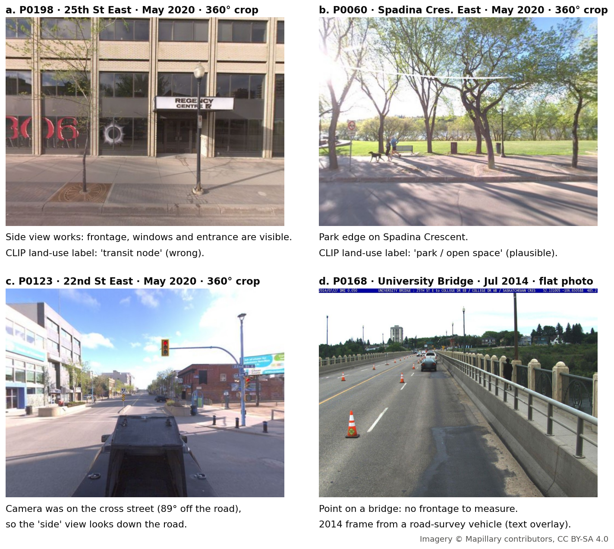

**Decision D1: which photo dates to use (November 2026).** Published street-view crime studies keep their photos
within one to three years of the crime data (Hipp et al. 2022; Zhou et al. 2021; Yue et al. 2022), or show that the
streets did not change over a longer gap (He, Páez & Liu 2017). No open source has photos of the CBD from summer
2026: on Mapillary the newest CBD photo is from May 2023, Panoramax has no Downtown photos, and KartaView's newest is
from 2019.

Four options were weighed. The first was to use the newest Mapillary photo at each point with the 2026 crime and
Reddit data, accepting a gap of three to six years. The second was to ask the City for recent road-survey photos,
which depends on the City and its data-sharing terms. The third was to take new photos, but the plan uses secondary
data only and summer 2026 has passed. The fourth was to match the outcomes to the photos by using 2023 crime and
Reddit data. That option fails on coverage, because 2023 photos exist at only 27 points on 19 of the 218 segments. It
would also need a new police extract, although the police crime map warns against comparing its data across years,
and a new Reddit collection, which would find fewer posts: the same search found 122 posts for June to August 2023
against 168 for 2026 (7 Nov 2026). The first option was chosen. Each point uses its newest Mapillary photo from 2020 on,
within 30 m and facing along its road, and the crime and Reddit data stay at June to August 2026.

**What step 2 produced.** Photos were found for 246 points on 121 of the 218 segments (56%): 225 taken on 21 May 2020
and 21 taken on 13–14 May 2023 (`Data/cv_study_2026-11/image_manifest.csv`, made by `Scripts/cv_study/images.py`). Each
is a 360° panorama, cut into two side views, one facing each side of the street, which gives 492 side views. The
camera-direction rule removed 66 points whose only photos were taken from the cross street. Most of these are on the
east–west streets (19th to 25th Street), because the 2020 survey car drove the avenues. The 97 segments without a
photo have no X value and are left out of the correlations, and every result says that it covers 121 segments. The
year of each photo is kept with its scores.

**Assumption and limitations.** Every result that uses X assumes that the measured features (building fronts,
greenery, lighting, fences and walls, sidewalks and signs of disorder) did not change much between the photo year and
summer 2026. X therefore describes the typical built form of each segment, not its exact state in 2026. This comes
with five limitations. The photos are three (2023) or six (2020) years older than the crime and Reddit data, so changes
in between, such as new buildings or closed businesses, are not seen. All the photos were taken in May, when trees have
fewer leaves than in summer, so greenery is likely undercounted. The 2020 photos were all taken on a single day during
COVID-19 restrictions, so people, open shops and parked cars describe that day rather than a normal summer; these are
flagged and not treated as fixed features of the street. The 97 segments without a photo are mostly east–west streets,
so X describes mainly the avenues. Finally, the photos mix two years, and the 2023 photos were taken from a car roof,
which is left out of every measurement.

The assumption will be tested on the 2014 and 2020 photos, which exist together at 243 points on 144 segments. If the
measured features stayed stable over those six years, stability over the six years to 2026 is plausible, and any
features that changed will be reported. A 2020-against-2023 comparison is not possible, because only 3 points have
both.

## Steps 3 to 5: the image models

Status: done; only street lights and seating have passed the check in step 7 so far.

All three steps run in `Scripts/cv_study/models.py` on the 492 side views and write their tables to
`Data/cv_study_2026-11/`. A full run takes about 13 minutes on the Mac's GPU, and running it again gives identical
files.

**Step 3, segmentation.** A segmentation model labels every pixel of a view with what it shows, such as building,
tree, sky or sidewalk. The share of the view taken by each class then measures things like how much of the street is
building frontage or greenery. The model is Mask2Former trained on Mapillary Vistas, a large set of labelled street
photos, and it is fixed to one version so that the results can be repeated. It sorts each view into 63 classes
(`segmentation_shares.csv`). Across all 492 views, buildings take up 25% of the picture, sky 24%, road 21%,
sidewalk 7%, vegetation 7% and fences 1.3%.

Two fixes were needed. First, the model outlines each tree crown as one solid shape, but in May most trees are bare, so
the sky and walls seen between the branches were being counted as vegetation. Inside each crown, a pixel now counts as
vegetation only if its colour looks like part of the tree (a trunk or branch, a green leaf, or a branch in shade).
Sky-coloured gaps become sky, and the rest take the class next to the tree, usually the building behind it. These
colour rules were set by eye on five views and are not part of the step 7 check. Second, the 2023 photos were taken
from a car roof that fills about 26% of each side view, so the car is left out of every share. The roof's shiny paint
reflects the scene above it, and in 11 of the 42 views from 2023 the model labelled the reflection instead of the car.
In those views, the roof's usual position on that side of the car is used instead.

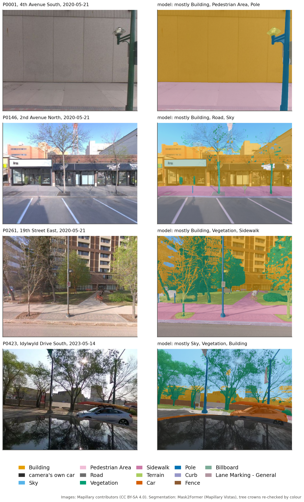

**Step 4, object detection.** The same model also counts objects. It found street lights in 274 of the 492 views,
poles in 466, benches in 92, trash cans in 182, people in 57 and cars in 261 (`object_counts.csv`). Objects found on the
camera car's roof are not counted. Street lights are counted here rather than scored by CLIP, because CLIP is weak at
spotting thin objects. People and cars in the 2020 photos are flagged because they show a single COVID-19 day.

**Step 5, CLIP scoring.** CLIP is a model that compares a photo with written descriptions and scores how well each one
fits. It covers what the segmentation model has no class for: the land-use type of the street, and nine CPTED cues such
as graffiti, litter, boarded windows and active storefronts (`clip_scores.csv`). Its land-use label looks unreliable.
It calls 230 of the 492 views surface parking and only 8 a commercial street, and 109 of its labels are low-confidence.

## Step 6: CPTED indicators per segment

Status: first version done.

Because the correlations are made per segment, each measure is averaged first over the two side views of a point and
then over the points of a segment (`segment_indicators.csv`, 121 segments). This way, a segment with more points does
not count for more than one with fewer. Combining the measures into one indicator for each CPTED principle waits until
step 7 shows which measures can be trusted.

## Step 7: validation

Status: scored; the second coder has not started.

Before any model output is used, it is compared with a labelled sample of views. 150 of the 492 side views were drawn
by a fixed rule, spread across land-use types and photo years in proportion to how common each is, so they were not
hand-picked. The labelling sheet shows no model output, so the labels are blind to the model's scores, and its
`labelled_by` column records who labelled each view. A cue is used only if the model agrees well with the labels,
measured by an F1 score of at least 0.7, where 1 means perfect agreement. A second coder will label 30 of the views
without seeing the first sheet, to check that the labels themselves are consistent (`validation_plan.md`).

Two of the twelve checks pass, both from the object counts in step 4: street lights (F1 0.92) and seating from bench
counts (0.72). People from the person counts do not pass (0.46). No CLIP cue passes, and CLIP's land-use label matches
the labels for only 39% of views. The results are in `Data/cv_study_2026-11/validation/validation_results.csv`, made
by `Scripts/cv_study/validation.py score`.

All 150 labelled views are below, grouped by their land-use label, with the cues marked present under each picture
(made by `Scripts/reporting/embed_label_gallery.py` from `validation/validation_blind.csv`).

<!-- label gallery: start (written by Scripts/reporting/embed_label_gallery.py) -->

<b>Show all 150 labelled views</b> (grouped by land-use label; click a picture for the full view)

**Commercial street** (51 views)

<table>
<tr><td width="20%" valign="top"><a href="../Data/cv_study_2026-11/images/P0005_253276920571507_left.jpg">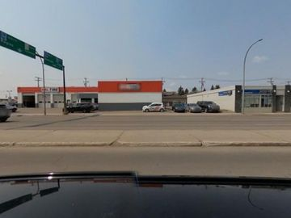</a> P0005 left active storefront, street light <i>camera car fills the lower third</i></td><td width="20%" valign="top"><a href="../Data/cv_study_2026-11/images/P0005_253276920571507_right.jpg">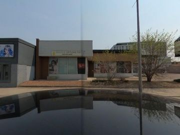</a> P0005 right active storefront <i>camera car fills the lower third</i></td><td width="20%" valign="top"> P0007 right no cues marked <i>camera car fills the lower part</i></td><td width="20%" valign="top"><a href="../Data/cv_study_2026-11/images/P0021_872877086641447_left.jpg">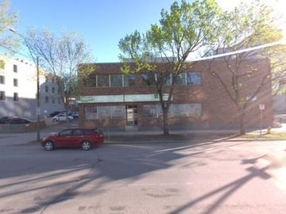</a> P0021 left active storefront, windows overlook, street light</td><td width="20%" valign="top"> P0051 right windows overlook, fences <i>construction fencing at left</i></td></tr>
<tr><td width="20%" valign="top"> P0053 left active storefront, windows overlook</td><td width="20%" valign="top"> P0059 left active storefront, windows overlook</td><td width="20%" valign="top"> P0069 right boarded windows, vacant lot, windows overlook, fences <i>construction site with fencing</i></td><td width="20%" valign="top"> P0072 left active storefront, windows overlook, fences, street light <i>sun glare</i></td><td width="20%" valign="top"> P0074 left graffiti, active storefront, windows overlook, street light</td></tr>
<tr><td width="20%" valign="top"> P0097 left active storefront, windows overlook</td><td width="20%" valign="top"><a href="../Data/cv_study_2026-11/images/P0100_905576056671388_left.jpg">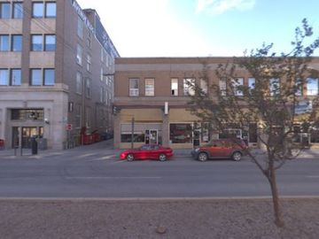</a> P0100 left active storefront, windows overlook</td><td width="20%" valign="top"> P0100 right litter, active storefront, windows overlook</td><td width="20%" valign="top"><a href="../Data/cv_study_2026-11/images/P0107_499876417883837_left.jpg">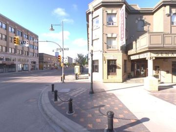</a> P0107 left active storefront, windows overlook, street light</td><td width="20%" valign="top"><a href="../Data/cv_study_2026-11/images/P0137_873275466590838_left.jpg">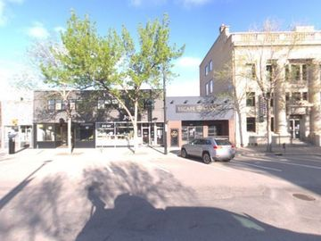</a> P0137 left active storefront, windows overlook</td></tr>
<tr><td width="20%" valign="top"><a href="../Data/cv_study_2026-11/images/P0142_141408374645297_left.jpg">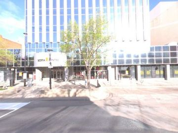</a> P0142 left active storefront, windows overlook, street light</td><td width="20%" valign="top"> P0142 right active storefront, windows overlook</td><td width="20%" valign="top"><a href="../Data/cv_study_2026-11/images/P0144_502201497750583_right.jpg">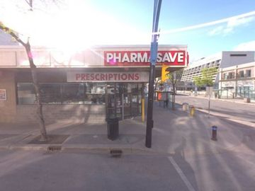</a> P0144 right active storefront, people <i>sun glare</i></td><td width="20%" valign="top"><a href="../Data/cv_study_2026-11/images/P0147_937975283689026_left.jpg">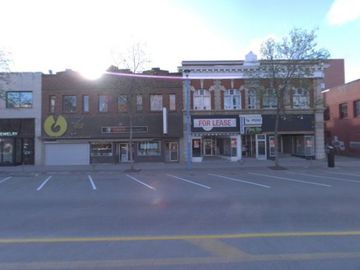</a> P0147 left active storefront, windows overlook, street light</td><td width="20%" valign="top"><a href="../Data/cv_study_2026-11/images/P0147_937975283689026_right.jpg">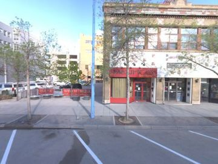</a> P0147 right active storefront, windows overlook, fences</td></tr>
<tr><td width="20%" valign="top"> P0177 left active storefront, windows overlook, people <i>parked vans block the storefronts; sun glare</i></td><td width="20%" valign="top"> P0181 right windows overlook <i>empty ground-floor shop windows</i></td><td width="20%" valign="top"> P0189 right active storefront <i>sun glare</i></td><td width="20%" valign="top"><a href="../Data/cv_study_2026-11/images/P0192_317212386511194_left.jpg">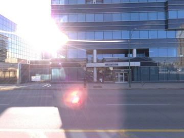</a> P0192 left active storefront, windows overlook, street light <i>sun glare</i></td><td width="20%" valign="top"> P0192 right active storefront, windows overlook</td></tr>
<tr><td width="20%" valign="top"> P0194 right windows overlook, street light</td><td width="20%" valign="top"> P0197 right active storefront, street light</td><td width="20%" valign="top"> P0205 right active storefront, windows overlook, fences, street light</td><td width="20%" valign="top"> P0221 right graffiti, active storefront, windows overlook</td><td width="20%" valign="top"><a href="../Data/cv_study_2026-11/images/P0226_1097872344053834_left.jpg">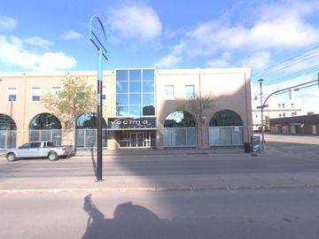</a> P0226 left active storefront, windows overlook, street light</td></tr>
<tr><td width="20%" valign="top"> P0234 right windows overlook, street light</td><td width="20%" valign="top"> P0235 right windows overlook, street light</td><td width="20%" valign="top"> P0238 right active storefront, windows overlook</td><td width="20%" valign="top"> P0244 right active storefront, street light</td><td width="20%" valign="top"><a href="../Data/cv_study_2026-11/images/P0247_546657296743990_left.jpg">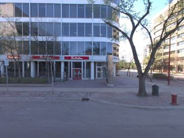</a> P0247 left active storefront, windows overlook</td></tr>
<tr><td width="20%" valign="top"><a href="../Data/cv_study_2026-11/images/P0263_153017760139694_right.jpg">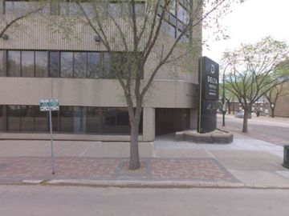</a> P0263 right windows overlook</td><td width="20%" valign="top"> P0272 left active storefront, windows overlook <i>overexposed</i></td><td width="20%" valign="top"> P0301 left windows overlook, street light <i>overexposed building front</i></td><td width="20%" valign="top"> P0304 right active storefront, windows overlook, street light</td><td width="20%" valign="top"><a href="../Data/cv_study_2026-11/images/P0340_809998019947286_left.jpg">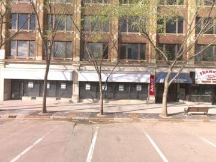</a> P0340 left active storefront, windows overlook, seating</td></tr>
<tr><td width="20%" valign="top"> P0341 left active storefront, windows overlook, seating</td><td width="20%" valign="top"> P0343 left active storefront, windows overlook</td><td width="20%" valign="top"><a href="../Data/cv_study_2026-11/images/P0363_2570234179952909_left.jpg">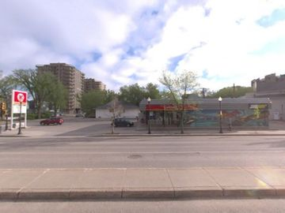</a> P0363 left active storefront, street light <i>mural on the store wall (art, not tagging)</i></td><td width="20%" valign="top"> P0363 right active storefront, windows overlook</td><td width="20%" valign="top"><a href="../Data/cv_study_2026-11/images/P0376_500654717650809_right.jpg">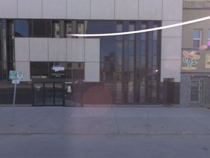</a> P0376 right active storefront, windows overlook</td></tr>
<tr><td width="20%" valign="top"> P0378 left active storefront, windows overlook, street light</td><td width="20%" valign="top"> P0382 left vacant lot, windows overlook, fences <i>construction site behind fencing</i></td><td width="20%" valign="top"> P0403 left active storefront, windows overlook</td><td width="20%" valign="top"> P0403 right active storefront, windows overlook, people</td><td width="20%" valign="top"> P0404 left windows overlook, seating, street light</td></tr>
<tr><td width="20%" valign="top"> P0410 left no cues marked</td></tr>
</table>

**Surface parking** (26 views)

<table>
<tr><td width="20%" valign="top"> P0002 right graffiti, litter, windows overlook, fences, street light <i>lane behind a building with a dumpster</i></td><td width="20%" valign="top"><a href="../Data/cv_study_2026-11/images/P0009_3425633317690199_right.jpg">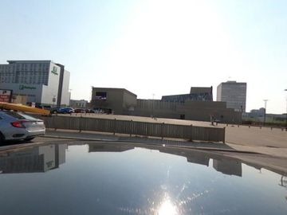</a> P0009 right windows overlook, fences <i>camera car fills the lower third</i></td><td width="20%" valign="top"><a href="../Data/cv_study_2026-11/images/P0016_750924818909089_left.jpg">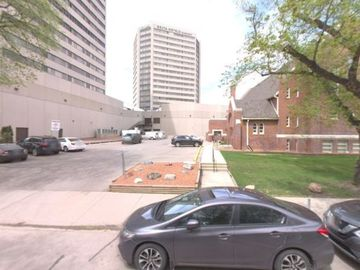</a> P0016 left windows overlook <i>parked car blocks the lower view</i></td><td width="20%" valign="top"><a href="../Data/cv_study_2026-11/images/P0060_303016901485277_left.jpg">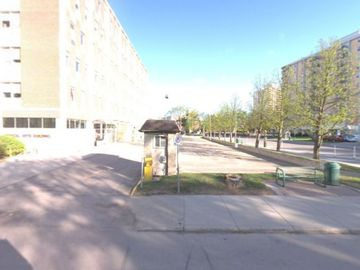</a> P0060 left windows overlook, seating</td><td width="20%" valign="top"> P0095 right vacant lot, windows overlook, fences, seating</td></tr>
<tr><td width="20%" valign="top"> P0097 right windows overlook, fences <i>lane with dumpsters</i></td><td width="20%" valign="top"> P0132 left windows overlook, street light</td><td width="20%" valign="top"> P0133 right vacant lot, fences <i>parked truck at lower right</i></td><td width="20%" valign="top"> P0165 right vacant lot, fences, street light <i>road-work cones in the street</i></td><td width="20%" valign="top"><a href="../Data/cv_study_2026-11/images/P0204_326927055620245_right.jpg">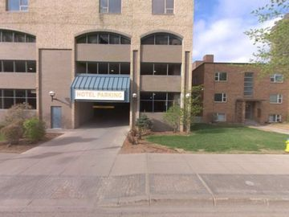</a> P0204 right windows overlook <i>hotel parkade entrance</i></td></tr>
<tr><td width="20%" valign="top"><a href="../Data/cv_study_2026-11/images/P0218_203333724944009_left.jpg">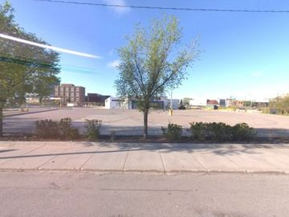</a> P0218 left vacant lot</td><td width="20%" valign="top"> P0226 right windows overlook, fences, street light <i>sun glare</i></td><td width="20%" valign="top"><a href="../Data/cv_study_2026-11/images/P0238_2960019830922566_left.jpg">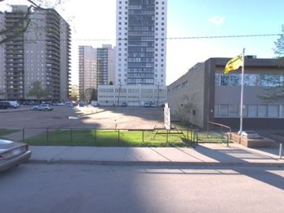</a> P0238 left vacant lot, windows overlook, fences</td><td width="20%" valign="top"> P0242 left vacant lot, fences <i>overexposed sky</i></td><td width="20%" valign="top"> P0244 left vacant lot, windows overlook, fences, seating <i>sun glare</i></td></tr>
<tr><td width="20%" valign="top"> P0252 left windows overlook, fences, street light <i>parked cars block the lower view; sun glare</i></td><td width="20%" valign="top"> P0254 left fences <i>parked car blocks the lower right; sun glare</i></td><td width="20%" valign="top"><a href="../Data/cv_study_2026-11/images/P0262_871504730456264_left.jpg">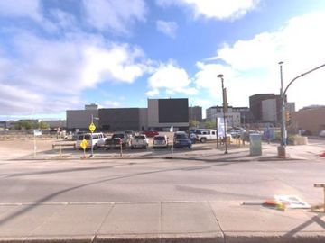</a> P0262 left litter, street light <i>debris on the sidewalk</i></td><td width="20%" valign="top"> P0264 right windows overlook, people, fences <i>entrance to underground parking</i></td><td width="20%" valign="top"> P0378 right vacant lot <i>mural on the back wall (art, not tagging)</i></td></tr>
<tr><td width="20%" valign="top"> P0382 right fences, street light</td><td width="20%" valign="top"><a href="../Data/cv_study_2026-11/images/P0386_2818819101704893_left.jpg">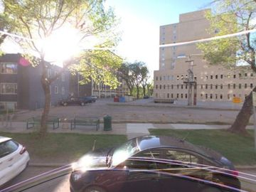</a> P0386 left windows overlook, seating <i>parked car blocks the lower view; sun glare</i></td><td width="20%" valign="top"> P0386 right windows overlook, fences <i>multi-storey parkade</i></td><td width="20%" valign="top"> P0411 right windows overlook, people</td><td width="20%" valign="top"> P0419 right no cues marked <i>camera car fills the lower part</i></td></tr>
<tr><td width="20%" valign="top"> P0420 right no cues marked <i>camera car fills the lower third</i></td></tr>
</table>

**Institutional** (22 views)

<table>
<tr><td width="20%" valign="top"> P0002 left windows overlook</td><td width="20%" valign="top"><a href="../Data/cv_study_2026-11/images/P0055_981964145965405_left.jpg">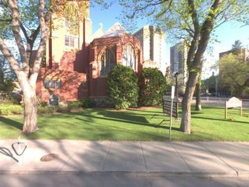</a> P0055 left street light</td><td width="20%" valign="top"> P0062 left windows overlook</td><td width="20%" valign="top"> P0095 left windows overlook, seating, street light</td><td width="20%" valign="top"> P0110 left windows overlook</td></tr>
<tr><td width="20%" valign="top"><a href="../Data/cv_study_2026-11/images/P0112_893857761175746_left.jpg">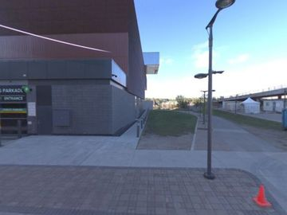</a> P0112 left street light</td><td width="20%" valign="top"> P0114 left windows overlook, seating</td><td width="20%" valign="top"> P0194 left no cues marked</td><td width="20%" valign="top"> P0219 left windows overlook, street light</td><td width="20%" valign="top"> P0221 left windows overlook</td></tr>
<tr><td width="20%" valign="top"> P0240 left windows overlook, seating <i>sun glare</i></td><td width="20%" valign="top"> P0242 right windows overlook, seating</td><td width="20%" valign="top"> P0247 right windows overlook, street light</td><td width="20%" valign="top"><a href="../Data/cv_study_2026-11/images/P0256_867441783843802_left.jpg">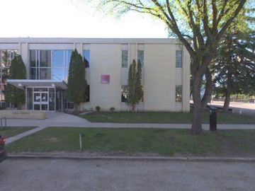</a> P0256 left windows overlook</td><td width="20%" valign="top"> P0304 left windows overlook, fences, seating, street light</td></tr>
<tr><td width="20%" valign="top"> P0362 left windows overlook <i>parked truck blocks the lower right</i></td><td width="20%" valign="top"> P0375 left windows overlook</td><td width="20%" valign="top"> P0388 left no cues marked <i>trees block most of the building</i></td><td width="20%" valign="top"> P0388 right windows overlook, fences, seating</td><td width="20%" valign="top"> P0392 right windows overlook</td></tr>
<tr><td width="20%" valign="top"> P0406 right windows overlook, fences, street light</td><td width="20%" valign="top"> P0422 left windows overlook, street light <i>camera car fills the lower part</i></td></tr>
</table>

**Residential** (17 views)

<table>
<tr><td width="20%" valign="top"> P0020 left windows overlook <i>sun glare; parked truck</i></td><td width="20%" valign="top"> P0058 left windows overlook, fences</td><td width="20%" valign="top"> P0076 left fences, street light</td><td width="20%" valign="top"> P0170 right windows overlook <i>parked truck blocks the lower left</i></td><td width="20%" valign="top"> P0189 left windows overlook</td></tr>
<tr><td width="20%" valign="top"> P0202 left windows overlook, seating, street light</td><td width="20%" valign="top"> P0234 left windows overlook, street light</td><td width="20%" valign="top"> P0235 left windows overlook, street light <i>sun glare</i></td><td width="20%" valign="top"> P0249 left windows overlook, street light</td><td width="20%" valign="top"><a href="../Data/cv_study_2026-11/images/P0249_473361193920767_right.jpg">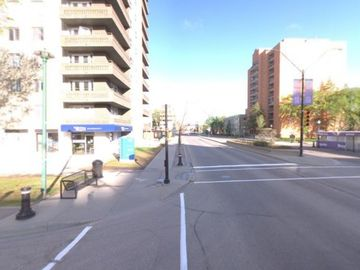</a> P0249 right active storefront, windows overlook, street light</td></tr>
<tr><td width="20%" valign="top"> P0254 right active storefront, windows overlook <i>parked cars block the lower view</i></td><td width="20%" valign="top"><a href="../Data/cv_study_2026-11/images/P0256_867441783843802_right.jpg">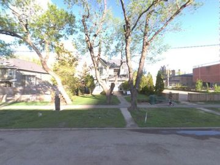</a> P0256 right people, fences</td><td width="20%" valign="top"> P0279 left windows overlook, street light</td><td width="20%" valign="top"> P0308 right windows overlook, street light <i>pickup truck blocks the lower view</i></td><td width="20%" valign="top"> P0357 left litter, windows overlook, street light</td></tr>
<tr><td width="20%" valign="top"> P0376 left windows overlook, street light</td><td width="20%" valign="top"> P0377 left windows overlook, street light</td></tr>
</table>

**Road corridor** (16 views)

<table>
<tr><td width="20%" valign="top"> P0006 left active storefront, street light <i>camera car fills the lower part</i></td><td width="20%" valign="top"> P0007 left active storefront, street light <i>camera car fills the lower part</i></td><td width="20%" valign="top"> P0012 left street light</td><td width="20%" valign="top"> P0012 right street light</td><td width="20%" valign="top"> P0024 left windows overlook <i>camera car fills the lower third</i></td></tr>
<tr><td width="20%" valign="top"> P0024 right graffiti, windows overlook, fences, street light <i>camera car fills the lower third</i></td><td width="20%" valign="top"> P0154 left street light</td><td width="20%" valign="top"> P0170 left street light <i>sun glare</i></td><td width="20%" valign="top"><a href="../Data/cv_study_2026-11/images/P0219_305692234384062_right.jpg">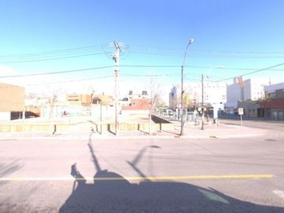</a> P0219 right vacant lot, people, street light <i>mural on the side wall (art, not tagging)</i></td><td width="20%" valign="top"> P0232 left active storefront, windows overlook, fences, street light</td></tr>
<tr><td width="20%" valign="top"><a href="../Data/cv_study_2026-11/images/P0306_341724883968242_left.jpg">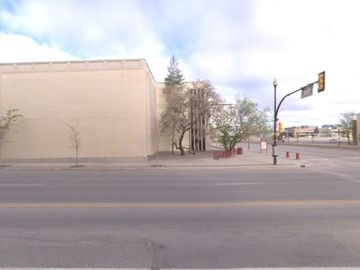</a> P0306 left seating, street light</td><td width="20%" valign="top"> P0310 right seating, street light <i>road closure barriers in the street</i></td><td width="20%" valign="top"> P0322 right street light <i>camera car fills the lower third</i></td><td width="20%" valign="top"> P0329 right street light <i>camera car fills the lower third</i></td><td width="20%" valign="top"> P0335 left street light <i>camera car fills the lower part</i></td></tr>
<tr><td width="20%" valign="top"><a href="../Data/cv_study_2026-11/images/P0411_309205004011278_left.jpg">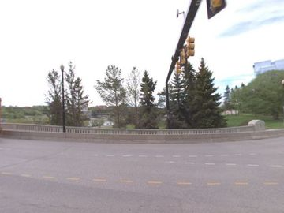</a> P0411 left street light <i>view over a bridge parapet</i></td></tr>
</table>

**Park open space** (13 views)

<table>
<tr><td width="20%" valign="top"> P0016 right seating, street light</td><td width="20%" valign="top"> P0053 right people, seating, street light</td><td width="20%" valign="top"><a href="../Data/cv_study_2026-11/images/P0059_485662436011734_right.jpg">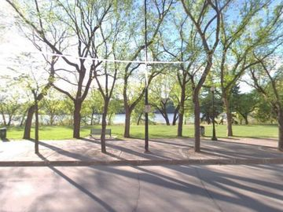</a> P0059 right seating, street light</td><td width="20%" valign="top"> P0060 right people, seating, street light <i>sun glare</i></td><td width="20%" valign="top"> P0203 left street light</td></tr>
<tr><td width="20%" valign="top"> P0204 left street light</td><td width="20%" valign="top"><a href="../Data/cv_study_2026-11/images/P0205_502422247626182_left.jpg">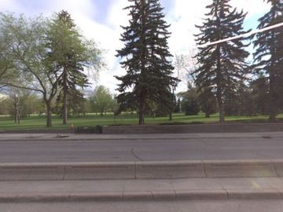</a> P0205 left seating</td><td width="20%" valign="top"> P0240 right seating</td><td width="20%" valign="top"> P0294 left no cues marked <i>sun glare</i></td><td width="20%" valign="top"> P0308 left seating, street light</td></tr>
<tr><td width="20%" valign="top"><a href="../Data/cv_study_2026-11/images/P0360_251494236729918_right.jpg">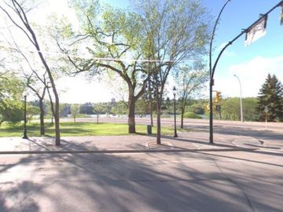</a> P0360 right street light</td><td width="20%" valign="top"> P0362 right street light</td><td width="20%" valign="top"> P0392 left seating, street light</td></tr>
</table>

**Riverfront walkway** (2 views)

<table>
<tr><td width="20%" valign="top"> P0114 right fences, seating</td><td width="20%" valign="top"> P0289 right fences, street light <i>sun glare</i></td></tr>
</table>

**Transit node** (2 views)

<table>
<tr><td width="20%" valign="top"> P0074 right street light</td><td width="20%" valign="top"> P0203 right windows overlook, seating</td></tr>
</table>

**No land-use label** (1 view)

<table>
<tr><td width="20%" valign="top"> P0078 right no cues marked <i>only a blank brick wall is visible</i></td></tr>
</table>

<!-- label gallery: end -->

## Step 8: integration

Status: crime join done; Reddit waits on Decision D2.

The last step joins X with the crime and Reddit data on the same street segments. The crime records are already placed
on the same 218 segments (`crime_data.md`). The 121 segments with a photo hold 164 of the 255 placed records (64%) and 6
of the 11 crime hot spots. Reddit posts rarely name a street, so how Reddit is matched to segments is still open
(Decision D2 in `reddit_pipeline.md`).

Images: © Mapillary contributors, CC BY-SA 4.0. Map data © OpenStreetMap contributors (ODbL).
