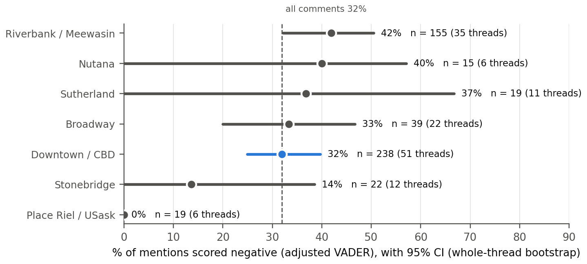

# Reddit pipeline (perceived safety, Y2)

Reddit replaces the survey as the study's source of crime and safety narratives (work plan, p. 1).
Code: `Scripts/reddit_collection/` (collect) and `Scripts/reddit_analysis/` (clean, tag, analyse, verify).
Data: `Data/reddit_2026-06-01_2026-08-31/` (study period, current) and `Data/reddit_2025-06-11_2026-06-11/` (earlier).

## Collection (`reddit_scraper.py`, version 2026-10)

| Setting | Value | Why |
|---|---|---|
| Subreddit | r/saskatoon | as in June |
| Window | 1 Jun – 31 Aug 2026, Saskatoon time (`--start/--end`) | the study period |
| Seed terms | 12 safety terms (unchanged from June, for comparability) + 19 crime terms | crime terms added Oct 2026 so crime narratives are captured, aligned with the crime categories |
| Search | every term × 4 sort orders (relevance, new, top, comments) + the year's top listing | Reddit search returns ≤ ~250 results per query and cannot filter by date |
| Comments | depth ≤ 4, ≤ 200 per post, collapsed "load more" stubs not expanded | rate limits and run time |
| Privacy | authors replaced by HMAC-SHA-256 hashes with a private salt; deleted/removed content dropped; emails, phone numbers and street addresses scrubbed from `cleaned_text` | ethics |
| Tagging | 22 areas and 5 environmental cues, whole words, from `Scripts/reddit_analysis/scripts/common.py` | one definition shared by collector and analysis |
| Sentiment | stock VADER and adjusted VADER (`safety` neutral; `unsafe`, `afraid`, `sketchy` negative) | the search words should not bias tone |
| Provenance | `collection_code/` saves the exact scraper and `common.py` used | reproducibility |

## Analysis (`run_all.sh`)

Steps 01–08 are described in `Scripts/reddit_analysis/README.md`. In short: audit the location and cue tags
(raw → whole word → final), merge hand-reviewed exclusions of other cities' downtowns, build cleaned row-level
files that keep every original column, compute per-area tables with 95% CIs from a bootstrap that resamples
whole threads, test sensitivity to the sentiment scorer, draw charts, and verify.

## What changed for the October task ("extend Reddit to June–August")

1. Window moved from 11 Jun 2025–11 Jun 2026 (12 months) to the study period, in local time.
2. Crime seed terms added; four sort orders instead of one.
3. Whole-word tags and adjusted sentiment applied at collection time (in June they were added afterwards).
4. Comments written after 31 August flagged and excluded from analysis (49 of 6,452).
5. The analysis pipeline made dataset-aware (`run_all.sh <dataset>`), so both collections run through the
   same code. The version that produced the Jun–Aug tables had been lost; it was rebuilt and reproduces every
   published table byte-for-byte.

## Verification (16–17 Oct 2026)

From `Docs/verification/october_2026_checks.md`:

| Check | Result |
|---|---|
| Posts inside the window | 195 of 195 (1 Jun to 31 Aug) |
| Late comments flagged | 49; 6,403 of 6,452 in window |
| Unique ids; every comment linked to a post | yes |
| Usernames removed; no emails/phones in `cleaned_text` | yes; 0 found |
| Query saturation | 124 queries, largest 184 results (< ~250 cap) |
| Recall vs the June collection on the overlapping days (1–10 Jun) | 12 of 14 posts re-found; 8 more found |
| Comment threads collected | 6,452 of Reddit's 7,703 (84%) |
| Posts whose own text contains a seed term | 117 of 195 (60%) |
| Pipeline self-checks | 30 pass, 0 fail |
| Reproduction from raw files | 22 of 22 tables (Jun–Aug); 23 of 23 (June collection) |

## Results so far (descriptive only)

Areas with at least 15 mentions, June–August 2026 (`02_derived_analysis/neighbourhood_summary.csv`,
adjusted VADER, 95% CI from resampling threads):

| Area | Records | Threads | % negative (95% CI) |
|---|---|---|---|
| Downtown / CBD | 238 | 51 | 31.9 (24.9–39.7) |
| Riverbank / Meewasin | 155 | 35 | 41.9 (32.2–50.5) |
| Broadway | 39 | 22 | 33.3 (20.0–46.7) |
| Stonebridge | 22 | 12 | 13.6 (0.0–38.5) |
| Sutherland | 19 | 11 | 36.8 (0.0–66.7) |
| Place Riel / USask | 19 | 6 | 0.0 |
| Nutana | 15 | 6 | 40.0 (0.0–57.1) |
| All comments | 6,403 | 195 | 31.9 |

Downtown sits at the corpus average in summer 2026; the 12-month collection had it at 41.8%, but the windows and
search terms differ, so this is not a trend. Small areas have very wide intervals.

## Limitations to carry into the analysis

- **Corpus relevance:** 40% of posts contain no seed term in their own text. Keep `text_has_*_term`; code relevance
  in Dec–Jan. Dropping those threads moves Downtown from 31.9% to 31.2% negative.
- **`people` cue:** 16 of 26 Downtown hits are "homeless"/"homelessness". Split presence-of-people (natural
  surveillance) from mentions of a group before H4, and handle the latter carefully (territorial stigma).
- **`lighting` cue:** 50% precise on a held-out sample; do not use for H3.
- **Precision samples** (30 per cue) were judged on June-collection records; definitions are identical, but a
  Jun–Aug sample should be added in the coding step.
- **Spatial resolution:** Reddit locates to neighbourhoods, not segments (the most-named Downtown street has 8
  records). See Decision 2.
- **Who posts:** Reddit users are not the population of Saskatoon, and a seed-term corpus describes how safety is
  talked about, not how safe places are.
- **Other-city review:** the 68 Jun–Aug decisions (17 exclude, 51 keep) were reconstructed from the run's changelog
  after the review file was lost; they are still to be confirmed by hand (`Scripts/reddit_analysis/manual_review/`).
