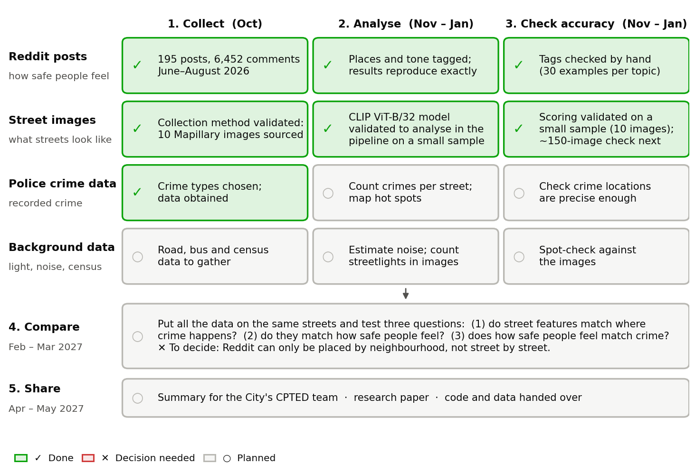
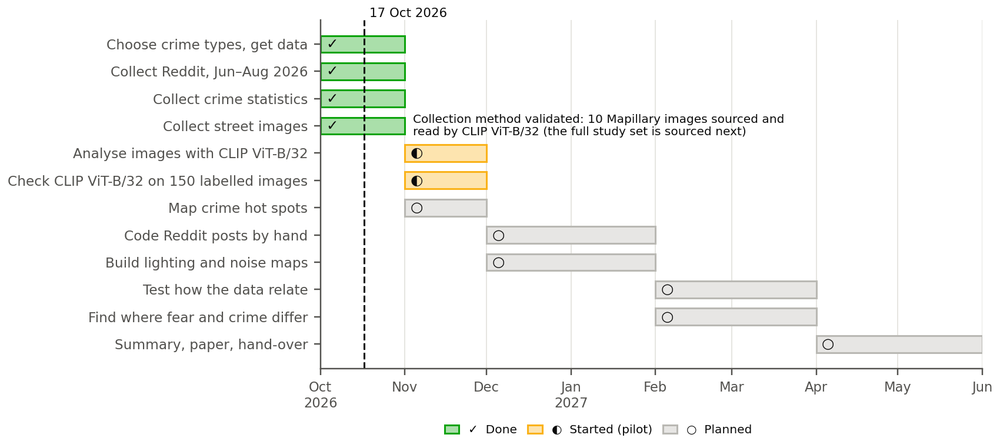

# Research workflow

## The framework

The AIRI 2026 seed grant (`Plan/AIRI_2026_grant_application.pdf`) proposed *a privacy-preserving GeoAI framework for
urban CPTED decision support*, built on environmental sensors and community narratives. The revised work plan
(`Plan/workplan_revised_2026-10.pdf`) keeps the framework and swaps its inputs for open secondary data:

| Role | Grant (Jan 2026) | Revised plan (Oct 2026) | Variable |
|---|---|---|---|
| Built environment | IoT sensors: light, noise, weather, activity | Street-level imagery (Mapillary) scored by computer vision; lighting from imagery; noise modelled from OSM + GTFS | X |
| Recorded crime | (not in the grant) | Saskatoon Police Service data, selected categories | Y1 |
| Perceived safety | Collected narratives, surveys | Reddit r/saskatoon posts and comments | Y2 |
| Unit | Pilot sites | Street segments from points ~50 m apart, Downtown/CBD (+ comparison areas) | — |
| Period | 12 months | 1 June – 31 August 2026 | — |

Research questions: **RQ1** X ↔ Y1 (does the built environment co-vary with where crime clusters?), **RQ2** X ↔ Y2
(does it co-vary with how people talk about safety?), **RQ3** Y1 ↔ Y2 (does perceived danger line up with recorded
crime, and where does it not?). Hypotheses H1–H5 are in the work plan, p. 2. The study is correlational and describes
places; it does not predict crime or label communities.



## Timeline and status (17 October 2026)



## Pipeline: step, code, output, status

| # | Step (work plan) | Code | Output | Status |
|---|---|---|---|---|
| R1 | Collect Reddit for the study window | `Scripts/reddit_collection/reddit_scraper.py` | `Data/reddit_2026-06-01_2026-08-31/01_raw_collection/` | done, verified |
| R2 | Clean, tag places and cues, score sentiment, audit | `Scripts/reddit_analysis/run_all.sh` | same dataset folder, `02`–`05`, `charts/` | done, reproduces exactly |
| R3 | Code Reddit by place, crime type and cues (Dec–Jan) | to write | — | planned |
| C1 | Sample points every ~50 m on OSM streets, clipped to the study area | `Scripts/cv_pilot/pilot.py points` | `Data/cv_pilot_2026-10/cbd/sample_points.*` | generated and checked; being refined (about two more weeks) |
| C2 | Image collection (Mapillary) | `pilot.py coverage`, `pilot.py images` | `cbd/coverage_*.csv`, `cbd_latest_imagery/images/` | method validated on 10 images (Oct goal); full study set next |
| C3 | Semantic segmentation (Mapillary Vistas model) | to write (Nov) | — | planned |
| C4 | Object detection (streetlights, people, cars, benches, transit stops) | to write (Nov) | — | planned |
| C5 | CLIP zero-shot cue scoring | `pilot.py score`, `clip_prompts.json` | `cbd_latest_imagery/clip_scores.csv` | runs in the pipeline on 10 images; accuracy check (C7) to come |
| C6 | CPTED indicators per segment | to write | — | planned |
| C7 | Validation against ~150 hand-labelled images | `validation_template_blind.csv` | — | started (10) |
| K1 | Crime categories | work plan p. 4; `Docs/crime_data.md` | — | done |
| K2 | SPS data: clean, then counts per segment, hot spots (Nov) | `Scripts/crime_data/clean_sps_crime.py`; counts to write | `Data/sps_crime_2026-06-01_2026-08-31/02_cleaned/` | cleaned (9,650 records, 2,982 in the study categories); counts per segment next |
| L1 | Lighting and noise layers (Dec–Jan) | to write | — | planned |
| I1 | Integration: join on segments/zones; Spearman, bivariate Moran's I, LISA, perception–crime gap (Feb–Mar) | to write | — | planned |
| V | Verification of everything above | `Scripts/verification/verify_october_2026.py` | `Docs/verification/` | done for October |

## Running everything

From the repository root, with the environment from `requirements.txt` (`python3 -m venv .venv &&
.venv/bin/pip install -r requirements.txt`) and credentials in the git-ignored `.env`
(`PRAW_CLIENT_ID`, `PRAW_CLIENT_SECRET`, `PRAW_USER_AGENT`, `URBANSENTINEL_HASH_SALT`, `MAPILLARY_TOKEN`):

```bash
# Reddit: collect (network), then analyse (offline; scratch first, then publish)
.venv/bin/python Scripts/reddit_collection/reddit_scraper.py --start 2026-06-01 --end 2026-08-31
bash Scripts/reddit_analysis/run_all.sh reddit_2026-06-01_2026-08-31
bash Scripts/reddit_analysis/run_all.sh reddit_2026-06-01_2026-08-31 --publish

# Crime: clean the SPS extract (offline; raw file is checked by hash, outputs reproduce byte for byte)
.venv/bin/python Scripts/crime_data/clean_sps_crime.py

# Points, imagery coverage, pilot (network for points/coverage/images)
.venv/bin/python Scripts/cv_pilot/pilot.py points   --out Data/cv_pilot_2026-10/cbd
.venv/bin/python Scripts/cv_pilot/pilot.py coverage --out Data/cv_pilot_2026-10/cbd
.venv/bin/python Scripts/cv_pilot/pilot.py images   --out Data/cv_pilot_2026-10/cbd    # study period: 0 found
# 10-image validation on the newest imagery (cbd_latest_imagery/ already holds a copy of the points and run_meta.json)
for s in images score reddit report; do
  .venv/bin/python Scripts/cv_pilot/pilot.py $s --any-date --out Data/cv_pilot_2026-10/cbd_latest_imagery
done

# Checks, figures, report
.venv/bin/python Scripts/verification/verify_october_2026.py [--rerun-pipeline] [--network]
.venv/bin/python Scripts/reporting/make_figures.py
.venv/bin/python Scripts/reporting/report_numbers.py
(cd Scripts/reporting && npm install && node build_october_report.js)

# Tests (offline)
.venv/bin/python Scripts/cv_pilot/tests/test_pilot.py
```

The report build writes the generated base, `Deliverables/2026-10_october_update/UrbanSentinel_October2026_Progress_Report.docx`.
The report as sent, `CPTED_ComputerVis_2026.docx` (and its PDF), was edited by hand after that, so a rebuild neither
reproduces nor overwrites it.

**Related data, outside this pipeline.** `Data/climate_2010_2025/`, `Data/crime/` and `Data/reddit_2009_2025/` hold
data collected for the related Sentinel climate–crime research (2010–2025, four prairie cities), with their scripts
in `Scripts/reddit_collection/reddit_acquistion_2025/` and `Scripts/sentiment_analysis_2025/`. None of the commands
above use or regenerate them. `Data/crime/` is Statistics Canada annual counts, not the SPS extract for step K2
(`Data/sps_crime_2026-06-01_2026-08-31/`).

## Conventions

- **One folder per dataset** in `Data/`, named by source and window (`reddit_<start>_<end>`, `cv_pilot_<yyyy-mm>`).
  Raw files are never edited; everything else in the folder is regenerated by code.
- **Scratch before publish:** pipelines write to a git-ignored `output/` first; `--publish` overwrites tracked
  outputs, and `git diff` shows what changed.
- **Every number in a deliverable comes from a script** (`Scripts/reporting/report_numbers.py`), never typed by hand.
- **Version control:** work on a branch, one commit per logical step; `.env` and Reddit text snippets are never committed.
