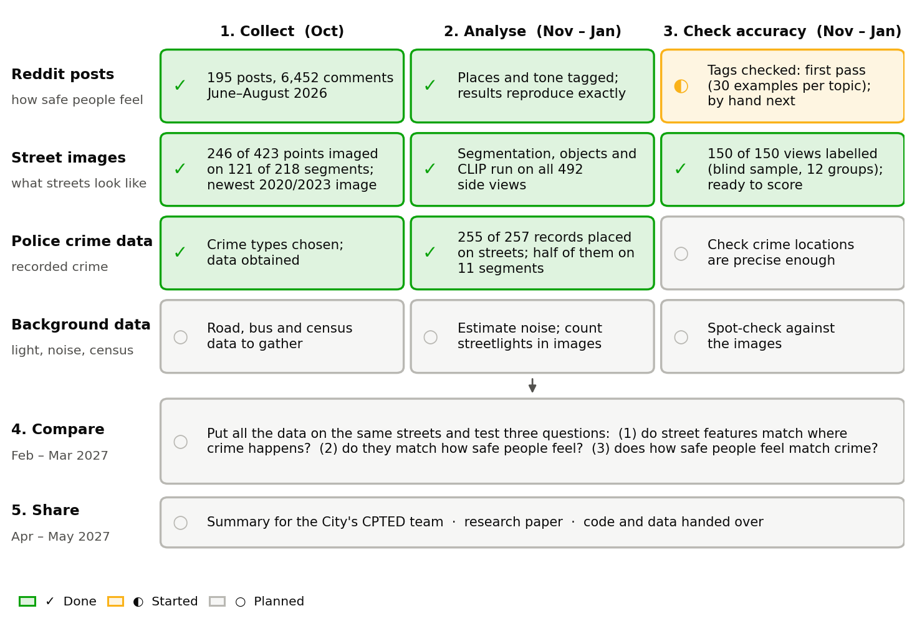

# CPTED Computer Vision and Correlational Sentiment analysis of Public Safety - A Study on Crime Patterns - Saskatoon

**ComputerVision_Sentinel**, a University of Saskatchewan (AIRI 2026) research project.

## The project

**Is the way Downtown Saskatoon's streets are built linked to where crime happens, and to how safe people feel
there?**

The project tests Crime Prevention Through Environmental Design (**CPTED**), the idea that storefronts, windows
overlooking the street, lighting and upkeep discourage crime. Instead of walking the streets with a checklist, it
measures these features from street photos with computer vision, then compares them street by street with police
records and Reddit discussion from summer 2026 (1 June – 31 August).

Three public data sources:

| What is measured | Where it comes from | How |
|---|---|---|
| What the streets look like | street photos on Mapillary (a crowd-sourced site like Street View) | image models measure buildings, trees, sky, street lights, people and signs of disorder in each photo |
| Where crime is recorded | Saskatoon Police Service (SPS) records | each record is placed on the street it names |
| How safe people feel | posts and comments on Reddit's r/saskatoon | posts are tagged by place and scored for tone (negative, neutral, positive) |

Downtown is split into **218 short street segments**, with **423 sample points** about 50 m apart. Each segment gets
street measures from the photos and a crime count; Reddit can only be placed by neighbourhood, not street by street.
The plan is in `Plan/workplan_revised_2026-10.pdf`.

## Where it stands (8 November 2026)



| Step | Status | In numbers |
|---|---|---|
| Crime categories | Done (October) | 5 kinds of crime included, assault conditional, 4 excluded; 9,650 police records for June–August 2026, 2,982 in the study categories |
| Reddit data | Done (October) | 195 posts and 6,452 comments; every table reproduces exactly; 30 automatic checks pass |
| Sample points | Done (October, refined in November) | 423 points on 218 segments; 11 points on bridges or freeways get no photo |
| Street photos | Done (November) | no photos from summer 2026 exist, so each point uses its newest photo from 2020 on that faces along its street: 246 points on 121 of the 218 segments (225 photos from 2020, 21 from 2023) |
| Image models | Done, accuracy not yet checked (November) | segmentation, object counts and CLIP scores for all 492 side views (two per point) |
| Accuracy check | Waiting for hand labels | 150 side views drawn for labelling, 30 of them for a second person; none labelled yet |
| Crime hot spots | Done (November) | 255 of the 257 Downtown study-category records placed on segments; half of them lie on 11 segments |
| Compare streets, crime and Reddit | Next (February–March 2027) | |

Known gaps: the photos are 3–6 years older than the crime and Reddit data, and 97 segments (mostly east–west
streets) have no usable photo, including 5 of the 11 crime hot spots. Details in `Docs/cv_pipeline.md` and
`Docs/crime_data.md`.

| Where crime clusters (heat map; hot-spot streets dashed) | Points with a usable street photo |
|---|---|
|  |  |

All November figures are in `Docs/figures/mid_point_november/`; the October figures, as sent, in
`Docs/figures/mid_point_october/`.


|---|---|
| Segment | a piece of street between two intersections; the unit the study compares |
| Sample point | a spot on a segment, about every 50 m, where a photo is looked for |
| Side view | a picture cut from a 360° photo that looks at one side of the street (the building fronts) |
| Segmentation | an image model (Mask2Former) that labels every pixel as building, tree, sky, road and so on, giving the share of each |
| CLIP | an image model that scores a photo against a written description, such as "graffiti on a wall" |
| Hot spot | one of the segments that, together, hold half of the recorded crime |
| Flight | the one command (`./flight`) that re-runs the whole project and checks every result against the saved copy |

## Start here

| To find | Open |
|---|---|
| The latest progress update | `Deliverables/2026-10_october_update/` (October). The November midpoint update is kept local until it is sent; `./flight` rebuilds it into `RESULTS_FINAL/EXECUTION-<n>/report/` |
| The literature review (CPTED evidence, crime and perception, pilot sites) | [`Docs/literature review/Master_lit_review.docx`](Docs/literature%20review/Master_lit_review.docx) |
| How the whole study fits together, and how to run it | `Docs/workflow.md` |
| The results, step by step, in notebooks | `Notebooks/` (start with `00_replicate_system.ipynb`) |
| What has been checked, and how | `Docs/verification/october_2026_checks.md`; every number in the updates: `Docs/verification/` |
| Decisions and known problems | image source (Decision D1) in `Docs/cv_pipeline.md`; Reddit's place problem (Decision D2) and limits in `Docs/reddit_pipeline.md`; gaps in the crime data in `Docs/crime_data.md` |
| Any other documentation | `Docs/README.md` |

## Folder map

```
Plan/            governing documents: revised work plan, grant application
Docs/            detailed documentation, verification checks, figures, the literature review
Data/
  reddit_2026-06-01_2026-08-31/   CURRENT  study-period Reddit: raw, cleaned, tables, audits, charts
  reddit_2025-06-11_2026-06-11/   earlier  12-month collection behind the July/August reports (corrected)
  sps_crime_2026-06-01_2026-08-31/ CURRENT  SPS recorded crime (Y1): raw extract, cleaned rows, category counts, per segment
  cv_pilot_2026-10/               CURRENT  CBD sample points, imagery coverage audit, 10-image pilot
  cv_study_2026-11/               CURRENT  study image set (246 points), segmentation/detection/CLIP outputs, labelling sheet
  boundaries/                              CBD polygon (interim, from OSM) and map context
  climate_2010_2025/                       ECCC climate 2010–2025, four prairie cities; kept for possible use
flight           ./flight --execute_flight: the whole pipeline in one command (Scripts/flight/)
Scripts/
  flight/              the flight: execute_flight.py (stages, comparisons, summary), load_models.py, run_notebook.py
  reddit_collection/   Reddit collector (reddit_scraper.py)
  reddit_analysis/     cleaning, tagging, analysis and self-checks (run_all.sh <dataset>)
  crime_data/          cleans the SPS extract into study categories (clean_sps_crime.py); crime per segment (hotspots.py)
  climate_data/        ECCC download scripts behind Data/climate_2010_2025/
  cv_pilot/            sample points, Mapillary imagery, CLIP scoring, Reddit link (pilot.py)
  cv_study/            November: full image set (images.py), segmentation/detection/CLIP (models.py), labelling (validation.py)
  verification/        independent checks of every October claim
  reporting/           figures, report numbers, the October and November .docx builders
  make_handoff.sh      builds a shareable zip without credentials or private text
Notebooks/       notebooks on top of the scripts: replicate the system, Reddit, crime, street images (outputs never committed)
Deliverables/    dated copies of what was sent (2026-08, 2026-10; 2026-11 is kept local until sent); later edits noted in each README
Reference/       literature (incl. computer-vision papers), presentations, maps
Archive/         surveys dropped in the revised plan (the August CV prototype is in git history)
RESULTS_FINAL/   one EXECUTION-<n>/ folder per flight run, plus executions.csv (git-ignored)
```

## Running

**One command runs the whole pipeline** (repository root):

```bash
./flight --execute_flight             # everything, with fresh Reddit and Mapillary downloads (needs the keys)
./flight --execute_flight --offline   # everything from the saved data, no downloads (about 13 min)
./flight --execute_flight --offline --skip-models   # quick check (about 2–3 min): all but re-running the image models
```

Each run writes everything it produces (results, JSON, status logs, figures, the report, file-by-file comparisons
with the published outputs) into a new `RESULTS_FINAL/EXECUTION-<n>/` and nothing anywhere else. Open its
`FLIGHT_SUMMARY.md` first. Details and options: `Docs/workflow.md` ("One command") and `./flight --help`.

Environment: `python3 -m venv .venv && .venv/bin/pip install -r requirements.txt` (Python 3.14; the flight does
this itself). Credentials live outside the repository, in `~/.config/computervision_sentinel/secrets.env`
(setup in `Docs/data_ethics.md`): `PRAW_CLIENT_ID`, `PRAW_CLIENT_SECRET`, `PRAW_USER_AGENT`,
`COMPUTERVISION_SENTINEL_HASH_SALT`, `MAPILLARY_TOKEN`. Single steps, to run one on its own, are listed in `Docs/workflow.md`; the most used:

```bash
bash Scripts/reddit_analysis/run_all.sh reddit_2026-06-01_2026-08-31            # Reddit analysis (scratch)
.venv/bin/python Scripts/crime_data/clean_sps_crime.py                            # clean the SPS crime extract
.venv/bin/python Scripts/cv_pilot/pilot.py coverage --out Data/cv_pilot_2026-10/cbd
.venv/bin/python Scripts/verification/verify_october_2026.py                      # re-check October claims
.venv/bin/python Scripts/reporting/make_figures.py                                # rebuild figures
.venv/bin/python Scripts/crime_data/hotspots.py                                   # crime per street segment
.venv/bin/python Scripts/cv_study/models.py                                       # image models (~11 min)
```

**Notebooks** (`Notebooks/`, see its README): open them in VS Code with the `.venv` kernel. They read `Data/` and
never write there, the flight runs 01–03 on every run, and a git filter keeps their outputs out of commits
(after cloning, run `.venv/bin/nbstripout --install` once).

## Ground rules

- Raw data in `Data/*/01_raw_collection/` is never edited; everything else is regenerated by code.
- Numbers in deliverables come from scripts (`Scripts/reporting/report_numbers.py`, `november_numbers.py`).
- Reddit text is not quoted outside the team; images credit Mapillary (CC BY-SA 4.0); maps credit OpenStreetMap.
  See `Docs/data_ethics.md`.

## Team

Co-leads Dr. Varuni Jayasooriya (SENS) and Dr. Timothy Kang (Sociology); collaborators Dr. Khan Wahid (ECE) and
Elisabeth Miller (City of Saskatoon, Neighbourhood Safety and CPTED); research assistant Ryan Ocampo.
