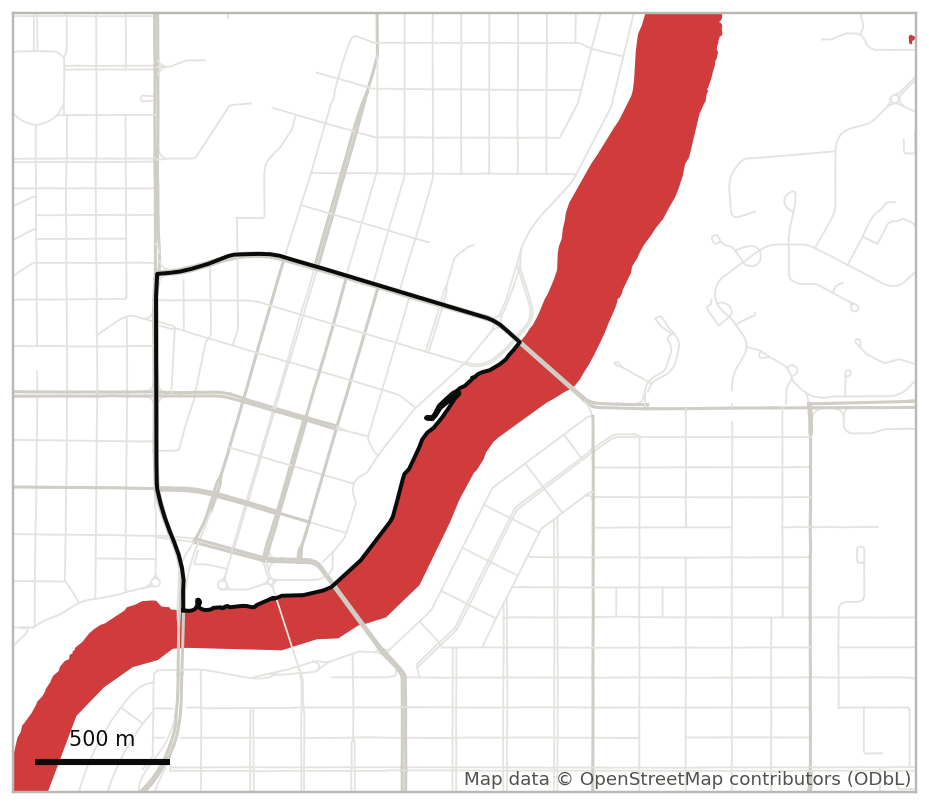
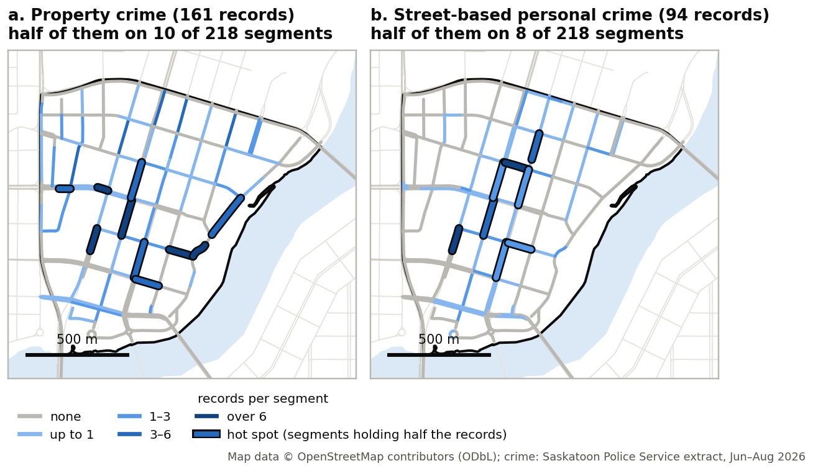

# CPTED Computer Vision and Correlational Sentiment analysis of Public Safety - A Study on Crime Patterns - Saskatoon

**ComputerVision_Sentinel**, a University of Saskatchewan (AIRI 2026) research project.

## The project

**Research aim:** To examine the correlations between built-environment features of public space in Saskatoon, measured from street-level imagery using computer vision, and (a) crime hotspots and (b) public perceptions of safety expressed on Reddit, using only openly available secondary data. The study is correlational: it identifies associations and spatial patterns rather than testing cause and effect.

**Research questions:**

- **RQ1:** To what extent are CPTED features measured from street-level imagery correlated with the locations of selected crime types?
- **RQ2:** To what extent are the same CPTED features correlated with perceptions of safety expressed on Reddit?
- **RQ3:** How strongly are perceived danger on Reddit and recorded crime correlated across space, and where do they diverge?

The project tests Crime Prevention Through Environmental Design (**CPTED**), the idea that storefronts, windows
overlooking the street, lighting and upkeep discourage crime. Instead of walking the streets with a checklist, it
measures these features from street photos with computer vision, then compares them street by street with police
records and Reddit discussion from summer 2026 (1 June – 31 August).

Three public data sources:

| What is measured | Where it comes from | How |
|---|---|---|
| What the streets look like | street photos on Mapillary | image models measure buildings, trees, sky, street lights, people and signs of disorder in each photo |
| Where crime is recorded | Saskatoon Police Service (SPS) records | each record is placed on the street it names |
| How safe people feel | posts and comments on Reddit's r/saskatoon | posts are tagged by place and scored for tone (negative, neutral, positive) |

<!-- boundary maps: start (written by Scripts/reporting/embed_boundary_maps.py) -->

<table><tr><td width="50%" valign="top">

**Study area: the Central Business District** ([`central_business_district_osm.geojson`](Data/boundaries/central_business_district_osm.geojson))

```geojson
{"type":"FeatureCollection","features":[{"type":"Feature","geometry":{"type":"Polygon","coordinates":[[[-106.668757,52.1220542],[-106.668759,52.1222658],[-106.6687635,52.1227122],[-106.6687361,52.1230633],[-106.6688269,52.123471],[-106.6689998,52.1238998],[-106.6692582,52.1243443],[-106.6694893,52.124688],[-106.669782,52.1251934],[-106.6699754,52.1255886],[-106.6701723,52.126094],[-106.6701979,52.1263105],[-106.6702151,52.1269977],[-106.6702202,52.1278636],[-106.6702237,52.1293031],[-106.6702332,52.1304864],[-106.6702366,52.1325395],[-106.6701749,52.1332794],[-106.6696122,52.1333075],[-106.6689312,52.1333588],[-106.6683032,52.1334489],[-106.6673877,52.1336177],[-106.6663246,52.1338729],[-106.666019,52.1339201],[-106.6655226,52.1339348],[-106.6646428,52.1339474],[-106.6644363,52.1339441],[-106.6640403,52.1339369],[-106.6635028,52.1338823],[-106.6628421,52.1337562],[-106.6609969,52.1334284],[-106.6572346,52.1327307],[-106.6533764,52.1320183],[-106.6522262,52.1318061],[-106.6519283,52.1317283],[-106.651562,52.1315959],[-106.6511855,52.1314005],[-106.6504642,52.1310048],[-106.6508007,52.1307411],[-106.6510647,52.1305647],[-106.6512163,52.1304297],[-106.6515265,52.1302771],[-106.6521,52.1300667],[-106.6525205,52.1299976],[-106.6527741,52.1299222],[-106.6529273,52.1298255],[-106.6530039,52.1298259],[-106.6530603,52.1298135],[-106.6530654,52.1297768],[-106.6530986,52.1297425],[-106.653457,52.1295421],[-106.6537132,52.1294704],[-106.6538887,52.1293746],[-106.6541119,52.129301],[-106.6545237,52.1290777],[-106.6548627,52.1288773],[-106.6550892,52.1286024],[-106.6552302,52.1284997],[-106.6555093,52.1285072],[-106.6555658,52.1284745],[-106.6555103,52.1284449],[-106.6552067,52.1284346],[-106.6550172,52.12857],[-106.654787,52.1288003],[-106.6543173,52.1290405],[-106.6540598,52.129185],[-106.6537715,52.1293214],[-106.6537588,52.1293205],[-106.6537521,52.1293115],[-106.6537544,52.1292911],[-106.6537554,52.1292722],[-106.6537718,52.1292571],[-106.6540078,52.1291104],[-106.6543656,52.1287725],[-106.6546906,52.1284861],[-106.6551473,52.1281452],[-106.6554949,52.1279824],[-106.6557703,52.1277537],[-106.6559378,52.1274851],[-106.6564808,52.1267719],[-106.6567309,52.126608],[-106.6568254,52.1264309],[-106.657123,52.1257238],[-106.657364,52.1251796],[-106.6575124,52.1250106],[-106.6591023,52.1237297],[-106.6607163,52.1228253],[-106.6611626,52.1227146],[-106.6622355,52.1225618],[-106.6634028,52.1225407],[-106.6635853,52.1224924],[-106.6637984,52.122446],[-106.6638443,52.1224413],[-106.6638724,52.1224717],[-106.6647844,52.1222263],[-106.6647844,52.1222099],[-106.6648796,52.1221662],[-106.6649477,52.122156],[-106.6650851,52.1221666],[-106.6653168,52.1221982],[-106.6655485,52.1222034],[-106.6662421,52.1221572],[-106.6663427,52.1221992],[-106.666505,52.1221753],[-106.6665313,52.1221469],[-106.6665633,52.122131],[-106.6666386,52.1221244],[-106.6666981,52.1221564],[-106.6671246,52.1221366],[-106.6672346,52.122088],[-106.6674116,52.1220683],[-106.6675913,52.1220664],[-106.6677201,52.1220875],[-106.6678831,52.1221402],[-106.6679317,52.1221739],[-106.6678986,52.1222469],[-106.6678401,52.1223091],[-106.6678576,52.1223594],[-106.6679142,52.1224085],[-106.6679922,52.1224049],[-106.6680019,52.1223451],[-106.6679861,52.1222561],[-106.6680548,52.1221455],[-106.6681492,52.1220822],[-106.6683123,52.1220454],[-106.6684798,52.1220374],[-106.668757,52.1220542]]]},"properties":{"name":"Central Business District","source":"OpenStreetMap relation 13754152 (boundary=administrative, admin_level=10)","license":"ODbL, (c) OpenStreetMap contributors","retrieved":"2026-10-16","note":"Interim study-area boundary. Confirm against the City of Saskatoon's official neighbourhood polygon before final sampling."}}]}
```

</td><td width="50%" valign="top">

**Street segments** ([`osm_roads_downtown_context.geojson`](Data/boundaries/osm_roads_downtown_context.geojson))

```geojson
{"type":"FeatureCollection","features":[{"type":"Feature","properties":{"id":4319939,"highway":"secondary","name":"2nd Avenue North","bridge":""},"geometry":{"type":"LineString","coordinates":[[-106.6582025,52.1405511],[-106.6584198,52.1400595],[-106.658541,52.1398105],[-106.6586617,52.139576],[-106.6586952,52.1394986],[-106.6587697,52.1393327]]}},{"type":"Feature","properties":{"id":4319940,"highway":"primary","name":"University Bridge","bridge":"yes"},"geometry":{"type":"LineString","coordinates":[[-106.6469834,52.1291508],[-106.6513003,52.131489]]}},{"type":"Feature","properties":{"id":4319941,"highway":"primary","name":"25th Street East","bridge":""},"geometry":{"type":"LineString","coordinates":[[-106.6632983,52.1337366],[-106.6630949,52.1337021],[-106.6627653,52.1336432],[-106.6624263,52.1335903],[-106.6621286,52.1335405],[-106.6617992,52.133481],[-106.6617663,52.1334751],[-106.6616404,52.1334495],[-106.6614849,52.1334255],[-106.6613602,52.1334029],[-106.6610331,52.1333426],[-106.6608547,52.1333101],[-106.6607372,52.1332889],[-106.6601048,52.1331757],[-106.6600646,52.1331685],[-106.6599041,52.1331407]]}},{"type":"Feature","properties":{"id":4319943,"highway":"secondary","name":"4th Avenue North","bridge":""},"geometry":{"type":"LineString","coordinates":[[-106.658124,52.1329258],[-106.6581745,52.1328192],[-106.6582046,52.132757],[-106.6582143,52.1327366],[-106.6585106,52.132114],[-106.6588426,52.1314196],[-106.658857,52.1313896],[-106.6589023,52.1312954],[-106.6589458,52.1312045],[-106.6589589,52.1311769],[-106.6591759,52.1307197],[-106.6593702,52.1303204],[-106.6595871,52.1298661],[-106.6595991,52.1298411],[-106.6596549,52.1297259],[-106.6597047,52.129615],[-106.6597173,52.1295883],[-106.6598867,52.1292291],[-106.6603514,52.128297],[-106.6603654,52.1282679],[-106.6604033,52.1281931],[-106.6604451,52.1281032]]}},{"type":"Feature","properties":{"id":4319947,"highway":"tertiary","name":"5th Avenue North","bridge":""},"geometry":{"type":"LineString","coordinates":[[-106.6564197,52.132611],[-106.6564707,52.132503],[-106.6564971,52.1324477],[-106.6565103,52.1324196],[-106.6567124,52.1319897],[-106.6571431,52.1310892],[-106.6571545,52.1310664],[-106.6571925,52.1309857],[-106.6572315,52.1309072],[-106.6572427,52.1308835],[-106.6577616,52.1297871],[-106.6578963,52.1295133],[-106.6579064,52.1294927],[-106.6579478,52.1294111]]}},{"type":"Feature","properties":{"id":4319948,"highway":"secondary","name":"Broadway Avenue","bridge":"yes"},"geometry":{"type":"LineString","coordinates":[[-106.6580916,52.1208693],[-106.6612381,52.1234841]]}},{"type":"Feature","properties":{"id":4319949,"highway":"secondary","name":"19th Street East","bridge":""},"geometry":{"type":"LineString","coordinates":[[-106.6681877,52.1243312],[-106.6680409,52.1243074],[-106.6663423,52.12403],[-106.6662994,52.124023],[-106.6661007,52.1239903]]}},{"type":"Feature","properties":{"id":4319959,"highway":"residential","name":"Main Street","bridge":""},"geometry":{"type":"LineString","coordinates":[[-106.6694622,52.116807],[-106.6694616,52.1167051]]}},{"type":"Feature","properties":{"id":4323690,"highway":"secondary","name":"3rd Avenue North","bridge":""},"geometry":{"type":"LineString","coordinates":[[-106.6582177,52.1419702],[-106.6582168,52.1417283],[-106.6582114,52.1410813],[-106.6582075,52.1409901],[-106.6582068,52.1409243],[-106.6582055,52.1408148],[-106.6582025,52.1405511]]}},{"type":"Feature","properties":{"id":4323692,"highway":"tertiary","name":"20th Street East","bridge":""},"geometry":{"type":"LineString","coordinates":[[-106.6619129,52.1250001],[-106.6617258,52.1249663],[-106.6616826,52.1249585],[-106.6609507,52.1248261],[-106.6608237,52.1248005],[-106.6600663,52.1246659],[-106.6600158,52.1246569],[-106.6599045,52.1246368]]}},{"type":"Feature","properties":{"id":4323707,"highway":"tertiary","name":"Spadina Crescent","bridge":""},"geometry":{"type":"LineString","coordinates":[[-106.6631052,52.1230729],[-106.661783,52.1230598],[-106.6614598,52.1230781],[-106.661258,52.1231214],[-106.6611379,52.1231633],[-106.6608432,52.1232822],[-106.6607624,52.1233394],[-106.6606973,52.1233926],[-106.660655,52.1234399]]}},{"type":"Feature","properties":{"id":4325398,"highway":"unclassified","name":"Research Drive","bridge":""},"geometry":{"type":"LineString","coordinates":[[-106.6319563,52.1412548],[-106.6319055,52.1413363],[-106.631836,52.1414329],[-106.6318103,52.1414981],[-106.6318,52.1415542],[-106.6318032,52.1416011],[-106.6318162,52.1416421],[-106.6319087,52.1418622],[-106.6319203,52.141923],[-106.6319116,52.1419883],[-106.6318915,52.1420418],[-106.6318593,52.1420947],[-106.631812,52.1421457],[-106.6317355,52.1421947],[-106.6316525,52.1422297],[-106.631557,52.14226],[-106.6314615,52.1422769],[-106.6313742,52.1422849],[-106.6312879,52.1422833],[-106.6311525,52.1422675],[-106.63103,52.1422502],[-106.6308789,52.1422288],[-106.6307092,52.1422062],[-106.6305659,52.1421926],[-106.630424,52.1421861],[-106.630235,52.1421839],[-106.6300687,52.1421883],[-106.6299328,52.1421968],[-106.6298351,52.1422101],[-106.6297277,52.1422248],[-106.629592,52.1422569],[-106.6295407,52.1422622],[-106.6294272,52.1422739],[-106.6293008,52.1422856],[-106.629184,52.1422926],[-106.6290353,52.1422949],[-106.6289072,52.1422924],[-106.6277093,52.1422225],[-106.6276942,52.1422208],[-106.6274805,52.1422182],[-106.6273421,52.1422106],[-106.6272027,52.1421993],[-106.6271256,52.1421973],[-106.62693,52.1421982],[-106.6267458,52.1422071],[-106.6266053,52.1422144],[-106.6264758,52.1422357],[-106.6263137,52.1422666],[-106.6261651,52.1422979],[-106.6260396,52.1423336],[-106.6259347,52.1423715]]}},{"type":"Feature","properties":{"id":4325405,"highway":"unclassified","name":"Innovation Boulevard","bridge":""},"geometry":{"type":"LineString","coordinates":[[-106.6281514,52.1401364],[-106.6280716,52.1401312],[-106.6279935,52.1401427],[-106.6279262,52.1401697]]}},{"type":"Feature","properties":{"id":4326418,"highway":"unclassified","name":"1st Avenue North","bridge":""},"geometry":{"type":"LineString","coordinates":[[-106.6593799,52.1412129],[-106.659463,52.1412079],[-106.659533,52.1411869],[-106.6595819,52.1411539],[-106.6596242,52.1411119],[-106.6597024,52.141013],[-106.6597821,52.1408971],[-106.6598771,52.1407377],[-106.6600933,52.1403341],[-106.6603055,52.139876],[-106.6603448,52.1397912]]}},{"type":"Feature","properties":{"id":4326419,"highway":"motorway","name":"Idylwyld Freeway","bridge":""},"geometry":{"type":"LineString","coordinates":[[-106.6694366,52.1246917],[-106.6696208,52.1249901],[-106.6697508,52.1252343]]}},{"type":"Feature","properties":{"id":4327769,"highway":"unclassified","name":"Campus Drive","bridge":""},"geometry":{"type":"LineString","coordinates":[[-106.6381346,52.1308467],[-106.6381383,52.1308771],[-106.6381514,52.1309378],[-106.6381664,52.1309974],[-106.6381926,52.1310575],[-106.6382202,52.131112],[-106.6382512,52.1311561],[-106.6382946,52.1312029],[-106.6387171,52.1315737],[-106.6388255,52.131668],[-106.638871,52.1317046],[-106.6389188,52.13174],[-106.6389352,52.1317515],[-106.6390771,52.1318501],[-106.6393224,52.1319712],[-106.6394097,52.1320192],[-106.6394788,52.1320628],[-106.6395407,52.1321086],[-106.6395989,52.1321555],[-106.6396553,52.1322068],[-106.6397216,52.132281],[-106.6397517,52.1323241],[-106.6397942,52.1323816],[-106.639826,52.1324567],[-106.6398439,52.1325218],[-106.639852,52.1325971],[-106.6398507,52.1326697],[-106.6398329,52.1327407],[-106.6397971,52.1328328],[-106.6397666,52.1328861],[-106.6397102,52.1329577],[-106.6396527,52.1330124],[-106.6395973,52.1330614],[-106.6395154,52.1331182],[-106.6394283,52.133169],[-106.6393294,52.1332194],[-106.6384189,52.1336308],[-106.6383172,52.1336769],[-106.6381776,52.1337385],[-106.6380394,52.133799],[-106.6377641,52.1339259],[-106.6376506,52.1339792],[-106.6375435,52.1340243],[-106.6374374,52.134063],[-106.6373147,52.1341096],[-106.6371857,52.1341521],[-106.6370757,52.1341867],[-106.6369657,52.1342122],[-106.6368644,52.1342293],[-106.6367543,52.1342447],[-106.6366684,52.1342516],[-106.6365753,52.1342561],[-106.6364577,52.1342619],[-106.6360127,52.1342642],[-106.635848,52.1342593],[-106.6350444,52.1342602],[-106.6349018,52.1342476],[-106.6347649,52.134228],[-106.6346324,52.1342025],[-106.6345091,52.1341627],[-106.6344143,52.134135]]}},{"type":"Feature","properties":{"id":4329770,"highway":"secondary","name":"4th Avenue South","bridge":""},"geometry":{"type":"LineString","coordinates":[[-106.6619129,52.1250001],[-106.6618577,52.1251166],[-106.6618431,52.1251475],[-106.6617228,52.1254014],[-106.6616796,52.1254931],[-106.6615097,52.1258651],[-106.6614523,52.125977],[-106.6614027,52.1260778]]}},{"type":"Feature","properties":{"id":4331058,"highway":"residential","name":"Avenue E North","bridge":""},"geometry":{"type":"LineString","coordinates":[[-106.6767734,52.1382447],[-106.6767734,52.1381766],[-106.6767736,52.1372302],[-106.6767736,52.1371964],[-106.6767733,52.1371252],[-106.6767695,52.1370082],[-106.6767691,52.1369538],[-106.6767688,52.1369186],[-106.6767664,52.1365746],[-106.6767623,52.1361985],[-106.6767615,52.1361372],[-106.6767611,52.1360725],[-106.6767598,52.1358474],[-106.6767594,52.1356876],[-106.6767598,52.1352904],[-106.67676,52.1352378],[-106.6767591,52.1351848],[-106.6767562,52.1348631],[-106.676756,52.1348405],[-106.6767564,52.1348058],[-106.6767548,52.1346964],[-106.6767509,52.1344987],[-106.6767498,52.1344455],[-106.676748,52.1343921],[-106.6767365,52.1340589],[-106.6767361,52.1337347],[-106.676736,52.1336496],[-106.6767351,52.1335758],[-106.6767312,52.1332652],[-106.6767304,52.1331506],[-106.6767279,52.1328051],[-106.6767245,52.1324868],[-106.6767238,52.1324237],[-106.6767229,52.1323672],[-106.6767008,52.1309389],[-106.6766998,52.1308741]]}},{"type":"Feature","properties":{"id":4331061,"highway":"residential","name":"Avenue C North","bridge":""},"geometry":{"type":"LineString","coordinates":[[-106.673479,52.1336463],[-106.6734759,52.133581],[-106.6734689,52.1332749],[-106.6734636,52.1328107],[-106.6734629,52.1324951],[-106.6734602,52.1324398],[-106.6734608,52.132258],[-106.6734613,52.1321185],[-106.6734618,52.1319654],[-106.6734634,52.1315283],[-106.6734579,52.1314075],[-106.6734549,52.1313386],[-106.6734498,52.1312451]]}},{"type":"Feature","properties":{"id":4331062,"highway":"residential","name":"Avenue C South","bridge":""},"geometry":{"type":"LineString","coordinates":[[-106.6734304,52.1293369],[-106.6734323,52.129204],[-106.6734333,52.1291397],[-106.6734337,52.1291233],[-106.6734402,52.1288252],[-106.6734411,52.1287827],[-106.6734455,52.1285758],[-106.6734558,52.1281094],[-106.673461,52.1278734],[-106.673463,52.1277805],[-106.6734645,52.127708],[-106.6734647,52.1276264],[-106.6734663,52.1270615],[-106.6734741,52.1266406],[-106.6734792,52.1262457],[-106.6734794,52.1262279],[-106.6734807,52.1261478],[-106.6734824,52.1260378],[-106.6734828,52.1260103],[-106.6734872,52.1257355],[-106.6734886,52.1256468],[-106.6734991,52.1249799],[-106.6735041,52.1246783],[-106.6735044,52.1246468],[-106.6735056,52.1245692]]}},{"type":"Feature","properties":{"id":4332886,"highway":"motorway","name":"Idylwyld Freeway","bridge":"yes"},"geometry":{"type":"LineString","coordinates":[[-106.6688305,52.1199469],[-106.668712,52.1225832]]}},{"type":"Feature","properties":{"id":4333499,"highway":"residential","name":"14th Street East","bridge":""},"geometry":{"type":"LineString","coordinates":[[-106.6464731,52.1218221],[-106.6463489,52.121825],[-106.6458599,52.1218364],[-106.6452249,52.1218407],[-106.6445823,52.1218395],[-106.6440759,52.1218314],[-106.6439739,52.1218296],[-106.6438631,52.1218288],[-106.643334,52.1218256],[-106.6427869,52.1218251],[-106.6427048,52.121825],[-106.6426296,52.1218241],[-106.6420812,52.1218182],[-106.6415648,52.1218221],[-106.6414425,52.1218232],[-106.6413349,52.1218229],[-106.6390652,52.1218175],[-106.638939,52.121817],[-106.6388331,52.1218168],[-106.6368984,52.1218139],[-106.6367971,52.1218138],[-106.6367162,52.1218144],[-106.6362716,52.121818],[-106.6361791,52.1218189],[-106.6360832,52.1218182],[-106.6354374,52.1218152],[-106.6349985,52.1218153],[-106.6348037,52.1218153],[-106.6346816,52.1218153]]}},{"type":"Feature","properties":{"id":4333723,"highway":"motorway","name":"Idylwyld Freeway","bridge":"yes"},"geometry":{"type":"LineString","coordinates":[[-106.6689084,52.1224429],[-106.6689352,52.1221481],[-106.6690049,52.1215684]]}},{"type":"Feature","properties":{"id":4335066,"highway":"tertiary","name":"Spadina Crescent","bridge":""},"geometry":{"type":"LineString","coordinates":[[-106.6534636,52.1302982],[-106.6533357,52.130248],[-106.65303,52.1302012],[-106.6527937,52.130196],[-106.6525555,52.1302118],[-106.6523109,52.1302544],[-106.6520631,52.1303074],[-106.6519361,52.1303524],[-106.6514296,52.1306123],[-106.6510915,52.1308088],[-106.6507848,52.1310066],[-106.6504644,52.1312333]]}},{"type":"Feature","properties":{"id":4335067,"highway":"tertiary","name":"6th Avenue North","bridge":""},"geometry":{"type":"LineString","coordinates":[[-106.6554255,52.130656],[-106.6553841,52.1307398],[-106.6552857,52.1309387],[-106.6551305,52.1312525],[-106.6547192,52.1320842],[-106.654704,52.1321149],[-106.6546706,52.1321837],[-106.6546252,52.1322829]]}},{"type":"Feature","properties":{"id":4335068,"highway":"residential","name":"6th Avenue North","bridge":""},"geometry":{"type":"LineString","coordinates":[[-106.6547645,52.1323078],[-106.6548152,52.1322102]]}},{"type":"Feature","properties":{"id":4335069,"highway":"primary","name":"25th Street East","bridge":""},"geometry":{"type":"LineString","coordinates":[[-106.6547645,52.1323078],[-106.6548569,52.1323239],[-106.655247,52.1323946],[-106.6562273,52.1325752],[-106.6562611,52.1325814],[-106.6564197,52.132611],[-106.6565788,52.1326399],[-106.6566882,52.1326608],[-106.6569956,52.132717],[-106.6576885,52.1328455],[-106.6579515,52.132894],[-106.6579902,52.1329011],[-106.658124,52.1329258],[-106.6582913,52.1329567],[-106.6584311,52.1329827],[-106.6591406,52.1331137],[-106.6596417,52.1332062],[-106.659697,52.1332162],[-106.6597414,52.1332242],[-106.6598703,52.1332459]]}},{"type":"Feature","properties":{"id":4335070,"highway":"primary","name":"College Drive","bridge":""},"geometry":{"type":"LineString","coordinates":[[-106.6470339,52.1290971],[-106.6469356,52.129027],[-106.6468476,52.1289841],[-106.6467654,52.1289479],[-106.6467438,52.1289384],[-106.646636,52.1289008],[-106.6464713,52.1288522]]}},{"type":"Feature","properties":{"id":4335146,"highway":"primary_link","name":"","bridge":""},"geometry":{"type":"LineString","coordinates":[[-106.6514201,52.1315644],[-106.6514628,52.131634],[-106.6514808,52.1316781],[-106.6514912,52.1317354],[-106.6514865,52.1318112],[-106.6514635,52.1318677]]}},{"type":"Feature","properties":{"id":4335150,"highway":"tertiary","name":"Spadina Crescent","bridge":""},"geometry":{"type":"LineString","coordinates":[[-106.65058,52.1312496],[-106.6506363,52.1312116],[-106.6507168,52.1311558],[-106.651112,52.130875],[-106.6513432,52.1307386],[-106.6519249,52.130434],[-106.6522584,52.1303332],[-106.6524451,52.130292],[-106.6526302,52.1302714],[-106.6528796,52.1302699],[-106.6530295,52.1302738],[-106.6532235,52.1303],[-106.6532657,52.1303057],[-106.6534636,52.1302982]]}},{"type":"Feature","properties":{"id":4349117,"highway":"residential","name":"12 Street East","bridge":""},"geometry":{"type":"LineString","coordinates":[[-106.6586519,52.1198163],[-106.6593978,52.1198198],[-106.6595283,52.1198186],[-106.6596605,52.1198181],[-106.6603938,52.1198183],[-106.6605836,52.1198183],[-106.6606732,52.1198183]]}},{"type":"Feature","properties":{"id":4349118,"highway":"residential","name":"11th Street East","bridge":""},"geometry":{"type":"LineString","coordinates":[[-106.6685707,52.1188078],[-106.6679503,52.1188128],[-106.6677887,52.118813],[-106.6676839,52.1187985],[-106.6676173,52.1187875],[-106.6669017,52.1187879],[-106.6658804,52.1187907],[-106.6651049,52.1187975],[-106.6649498,52.1187978],[-106.6648808,52.1187978],[-106.6641522,52.1187953],[-106.6634176,52.118793],[-106.6631644,52.1187932],[-106.6625952,52.1188121],[-106.6624364,52.1188121],[-106.6624059,52.1188116],[-106.6623243,52.118813]]}},{"type":"Feature","properties":{"id":4349119,"highway":"residential","name":"10th Street","bridge":""},"geometry":{"type":"LineString","coordinates":[[-106.6688812,52.1177982],[-106.6687286,52.1178033],[-106.6678836,52.1178024],[-106.6677847,52.1178027],[-106.6677026,52.1178033],[-106.6668955,52.1178048],[-106.6659221,52.1178036],[-106.6651976,52.1178031],[-106.6651174,52.117803],[-106.6649377,52.1178028],[-106.6648502,52.1178026],[-106.6641316,52.1178013],[-106.6631581,52.1178012],[-106.6624823,52.1178007],[-106.6624301,52.117801],[-106.6623523,52.1178006],[-106.6621833,52.1178002],[-106.6620992,52.1177992],[-106.6620792,52.1178002],[-106.6615748,52.1177987],[-106.6613736,52.1177997],[-106.6603972,52.1177989],[-106.6596752,52.1178086],[-106.6595233,52.1178113],[-106.6593735,52.1178123],[-106.6586103,52.1178154],[-106.6576652,52.1178049],[-106.6570185,52.1178014],[-106.6569779,52.1178012],[-106.6568504,52.1178017],[-106.6566743,52.1178002],[-106.6565682,52.1177997],[-106.6565181,52.1177998],[-106.655875,52.1178007],[-106.6548973,52.1177943],[-106.6542116,52.117795],[-106.6541203,52.1177951],[-106.6539255,52.1178049],[-106.6538101,52.1178056],[-106.6531295,52.1178105],[-106.6521319,52.1178063],[-106.6514507,52.117808],[-106.6513673,52.1178082],[-106.6511591,52.1178065],[-106.6510748,52.1178078],[-106.6503693,52.1178114],[-106.6493945,52.1178138],[-106.6487098,52.117809],[-106.6485956,52.1178082],[-106.6484106,52.1178054],[-106.648298,52.1178054],[-106.6466205,52.1178057],[-106.646487,52.1178055],[-106.6463548,52.1178046],[-106.6440426,52.1177923],[-106.6439715,52.1177925]]}},{"type":"Feature","properties":{"id":4349122,"highway":"motorway","name":"Idylwyld Freeway","bridge":""},"geometry":{"type":"LineString","coordinates":[[-106.6707835,52.1160535],[-106.6704172,52.1163078],[-106.6701409,52.116545],[-106.6695371,52.1171733]]}},{"type":"Feature","properties":{"id":4349123,"highway":"motorway_link","name":"","bridge":""},"geometry":{"type":"LineString","coordinates":[[-106.6691581,52.1185272],[-106.6692031,52.1184314],[-106.6694865,52.117935],[-106.6696179,52.1177489],[-106.6698968,52.1174475],[-106.6702241,52.1171774],[-106.6705513,52.1169106],[-106.6707873,52.116713],[-106.6709805,52.1164906],[-106.6711199,52.116293],[-106.6711682,52.1161217],[-106.671183,52.1159656],[-106.671137,52.1157841]]}},{"type":"Feature","properties":{"id":4367170,"highway":"residential","name":"Munroe Avenue","bridge":""},"geometry":{"type":"LineString","coordinates":[[-106.6414465,52.1233194],[-106.6414432,52.1228645],[-106.6414429,52.1228175],[-106.6414427,52.1227434],[-106.6414417,52.1223321],[-106.6414417,52.1218888],[-106.6414425,52.1218232]]}},{"type":"Feature","properties":{"id":4367307,"highway":"residential","name":"Science Place","bridge":""},"geometry":{"type":"LineString","coordinates":[[-106.635848,52.1342593],[-106.6358404,52.1341829],[-106.6358381,52.1340485],[-106.6358352,52.1338221],[-106.6358368,52.1336088],[-106.635834,52.1333911],[-106.6358361,52.1333307],[-106.635826,52.1332311],[-106.6358079,52.1331655],[-106.6357518,52.1331085],[-106.6356775,52.1330648],[-106.6355895,52.1330291],[-106.6355062,52.1330035],[-106.6353808,52.1329665],[-106.6352698,52.1329465],[-106.6351324,52.13294],[-106.6347322,52.1329484],[-106.6345484,52.1329444],[-106.6343675,52.1329353],[-106.6342069,52.1328999],[-106.6335527,52.1326819],[-106.6334696,52.1326541],[-106.633349,52.1326139],[-106.6333211,52.1326047],[-106.6331854,52.132559],[-106.6329514,52.1324801],[-106.6325448,52.13235]]}},{"type":"Feature","properties":{"id":4367308,"highway":"residential","name":"Science Place","bridge":""},"geometry":{"type":"LineString","coordinates":[[-106.6324529,52.1321091],[-106.6324234,52.1320802],[-106.6323456,52.1320496],[-106.6322872,52.1320331],[-106.6322291,52.1320337],[-106.632179,52.1320409],[-106.6321361,52.1320543],[-106.6320981,52.1320713],[-106.6320712,52.132096],[-106.6320561,52.1321196],[-106.6320481,52.1321464],[-106.6320529,52.132169],[-106.6320648,52.132191],[-106.6321036,52.1322161],[-106.6321711,52.1322435],[-106.6322479,52.1322669],[-106.6323029,52.1322812],[-106.6324656,52.1323218],[-106.6325448,52.13235],[-106.6324792,52.1322909],[-106.6324511,52.1322425],[-106.6324406,52.1322069],[-106.6324467,52.1321737],[-106.6324572,52.1321426],[-106.6324529,52.1321091]]}},{"type":"Feature","properties":{"id":4367517,"highway":"unclassified","name":"Campus Drive","bridge":""},"geometry":{"type":"LineString","coordinates":[[-106.6283582,52.1290337],[-106.6283471,52.1288321]]}},{"type":"Feature","properties":{"id":4369793,"highway":"secondary","name":"3rd Avenue North","bridge":""},"geometry":{"type":"LineString","coordinates":[[-106.6582177,52.1419702],[-106.6581838,52.1421493],[-106.6581852,52.1423335],[-106.6581841,52.1424579],[-106.6581834,52.1425396],[-106.658179,52.1426204],[-106.6581573,52.1430228],[-106.6581366,52.1431072],[-106.6581087,52.1432192],[-106.6580691,52.1433524],[-106.6580226,52.143495],[-106.6580008,52.1435649],[-106.6579833,52.1436166],[-106.6579681,52.1436607],[-106.6579184,52.1437499]]}},{"type":"Feature","properties":{"id":4371839,"highway":"residential","name":"Avenue C North","bridge":""},"geometry":{"type":"LineString","coordinates":[[-106.6734775,52.1438695],[-106.6734767,52.1437921],[-106.6734721,52.1433925],[-106.6734844,52.1424211],[-106.6734898,52.1420555],[-106.6734909,52.1419895],[-106.6734877,52.1418749],[-106.6734851,52.1418056],[-106.6734836,52.1414444],[-106.6734781,52.1406506],[-106.6734847,52.1402877],[-106.673486,52.1402173],[-106.6734843,52.1401032],[-106.6734808,52.1400436],[-106.67347,52.1396374]]}},{"type":"Feature","properties":{"id":4373672,"highway":"unclassified","name":"Princess Street","bridge":""},"geometry":{"type":"LineString","coordinates":[[-106.6615085,52.1399929],[-106.6611641,52.1399326],[-106.6611232,52.1399255],[-106.6605325,52.1398237],[-106.6603448,52.1397912],[-106.6602271,52.1397722],[-106.6595585,52.1396641],[-106.6588889,52.1395368],[-106.6586952,52.1394986]]}},{"type":"Feature","properties":{"id":4373673,"highway":"secondary","name":"22nd Street East","bridge":""},"geometry":{"type":"LineString","coordinates":[[-106.6681254,52.1292055],[-106.6680355,52.1292048],[-106.6678625,52.129206],[-106.6673322,52.1292096],[-106.6669463,52.129208],[-106.6666174,52.1291906],[-106.6662168,52.129138],[-106.66578,52.1290658],[-106.6657393,52.1290591],[-106.6655263,52.1290211]]}},{"type":"Feature","properties":{"id":4373674,"highway":"tertiary","name":"","bridge":""},"geometry":{"type":"LineString","coordinates":[[-106.6638582,52.122959],[-106.6638445,52.1229754],[-106.6638367,52.1229903],[-106.6638323,52.1230113],[-106.6638325,52.123019],[-106.6638343,52.1230297],[-106.6638367,52.1230372],[-106.6638415,52.1230475],[-106.6638476,52.1230573],[-106.6638538,52.1230643],[-106.6638634,52.1230736],[-106.6638708,52.1230795],[-106.663888,52.1230904],[-106.663892,52.1230925],[-106.6639166,52.1231031],[-106.6639263,52.1231062],[-106.6639462,52.1231112],[-106.6639653,52.1231144],[-106.6639729,52.1231153],[-106.6640028,52.1231166],[-106.6640327,52.1231146],[-106.6640402,52.1231135],[-106.6640614,52.1231093],[-106.6640748,52.1231056],[-106.6640882,52.123101],[-106.6641096,52.1230913],[-106.6641324,52.1230764],[-106.6641399,52.1230699],[-106.6641484,52.1230608],[-106.6641552,52.1230516],[-106.6641597,52.1230437],[-106.6641659,52.1230247],[-106.6641665,52.1230073],[-106.6641633,52.1229929],[-106.6641619,52.1229891],[-106.6641578,52.1229805],[-106.6641521,52.1229717],[-106.6641389,52.122957],[-106.6641182,52.1229415],[-106.6641136,52.1229387],[-106.6640953,52.1229296],[-106.6640765,52.1229227],[-106.6640692,52.1229205],[-106.6640409,52.1229144],[-106.6640323,52.1229132],[-106.6640113,52.1229114],[-106.6639934,52.1229114],[-106.6639813,52.1229118],[-106.6639505,52.1229157],[-106.6639241,52.1229222],[-106.6638986,52.122932],[-106.6638911,52.1229357],[-106.6638764,52.1229444],[-106.6638582,52.122959]]}},{"type":"Feature","properties":{"id":4373675,"highway":"tertiary","name":"3rd Avenue South","bridge":""},"geometry":{"type":"LineString","coordinates":[[-106.6639653,52.1231144],[-106.6640672,52.1232317],[-106.6640958,52.1233182],[-106.664125,52.1233869]]}},{"type":"Feature","properties":{"id":4373677,"highway":"tertiary","name":"3rd Avenue South","bridge":""},"geometry":{"type":"LineString","coordinates":[[-106.6640409,52.1229144],[-106.6638964,52.1228118]]}},{"type":"Feature","properties":{"id":4376151,"highway":"residential","name":"King Street","bridge":""},"geometry":{"type":"LineString","coordinates":[[-106.6639045,52.1388216],[-106.6626321,52.1385918],[-106.6621976,52.1385133],[-106.6620296,52.138483]]}},{"type":"Feature","properties":{"id":4376152,"highway":"tertiary","name":"Queen Street","bridge":""},"geometry":{"type":"LineString","coordinates":[[-106.6618048,52.1366539],[-106.6609913,52.1366401],[-106.6602953,52.1366387],[-106.6602551,52.1366386],[-106.6601601,52.1366374],[-106.6599852,52.1366364]]}},{"type":"Feature","properties":{"id":4376153,"highway":"residential","name":"4th Avenue North","bridge":""},"geometry":{"type":"LineString","coordinates":[[-106.6567219,52.1366208],[-106.6567311,52.1365407],[-106.6575779,52.1347912],[-106.6576077,52.1347299],[-106.6576322,52.1346764],[-106.6582985,52.1332649],[-106.6584042,52.133041],[-106.6584311,52.1329827]]}},{"type":"Feature","properties":{"id":4376154,"highway":"tertiary","name":"12th Street East","bridge":""},"geometry":{"type":"LineString","coordinates":[[-106.6568595,52.1198046],[-106.6567018,52.1198114]]}},{"type":"Feature","properties":{"id":4376155,"highway":"residential","name":"Garrison Crescent","bridge":""},"geometry":{"type":"LineString","coordinates":[[-106.6346745,52.1198185],[-106.6345506,52.1198196],[-106.6339152,52.1198141],[-106.6332609,52.1198139],[-106.6331371,52.1198128],[-106.6330101,52.1198131],[-106.6300661,52.1198178],[-106.6295732,52.1198147],[-106.6292117,52.1198037]]}},{"type":"Feature","properties":{"id":4377217,"highway":"tertiary","name":"Spadina Crescent","bridge":""},"geometry":{"type":"LineString","coordinates":[[-106.6504644,52.1312333],[-106.6499991,52.1315586],[-106.6499071,52.1316633],[-106.6498248,52.1317763],[-106.6497909,52.1318753],[-106.6497749,52.1319674],[-106.6497669,52.1320604],[-106.6497899,52.1321824],[-106.6499297,52.1324815],[-106.6501596,52.1329468],[-106.6503754,52.1333514],[-106.6503869,52.1333729],[-106.6504211,52.1334399],[-106.6504426,52.1336318]]}},{"type":"Feature","properties":{"id":4399841,"highway":"motorway_link","name":"","bridge":"yes"},"geometry":{"type":"LineString","coordinates":[[-106.668712,52.1225832],[-106.6686375,52.1227331]]}},{"type":"Feature","properties":{"id":4402925,"highway":"motorway","name":"Idylwyld Freeway","bridge":""},"geometry":{"type":"LineString","coordinates":[[-106.6694891,52.1175398],[-106.6697339,52.1171585],[-106.6699478,52.1168958],[-106.6701275,52.1167179],[-106.6704386,52.1164363],[-106.6708168,52.1161645]]}},{"type":"Feature","properties":{"id":4402926,"highway":"motorway","name":"Idylwyld Freeway","bridge":"yes"},"geometry":{"type":"LineString","coordinates":[[-106.6708168,52.1161645],[-106.6714964,52.1157402]]}},{"type":"Feature","properties":{"id":4402928,"highway":"motorway","name":"Idylwyld Freeway","bridge":"yes"},"geometry":{"type":"LineString","coordinates":[[-106.6715066,52.1155755],[-106.6707835,52.1160535]]}},{"type":"Feature","properties":{"id":4410034,"highway":"residential","name":"Wiggins Avenue","bridge":""},"geometry":{"type":"LineString","coordinates":[[-106.6389401,52.1233126],[-106.6389432,52.1228893],[-106.6389437,52.122823],[-106.638944,52.1227365],[-106.6389456,52.1223183],[-106.6389399,52.1218891],[-106.638939,52.121817],[-106.63894,52.1217302],[-106.6389446,52.1213173],[-106.6389343,52.120886],[-106.6389324,52.1208096],[-106.6389335,52.120743],[-106.6389409,52.1203094],[-106.6389472,52.1198949],[-106.6389487,52.119809],[-106.6389462,52.1197381],[-106.6389313,52.1193217],[-106.6389434,52.1188769],[-106.6389452,52.1188092],[-106.6389445,52.1187456],[-106.6389398,52.1183069],[-106.6389408,52.1178725],[-106.6389409,52.1178165],[-106.6389404,52.1177464],[-106.6389372,52.1173077],[-106.6389389,52.1168642],[-106.6389389,52.1168161],[-106.6389424,52.1166957],[-106.6389433,52.1166399],[-106.6389508,52.1162165],[-106.638945,52.1157596],[-106.6389448,52.1157186],[-106.6389463,52.1152661],[-106.6389462,52.115227],[-106.6389465,52.1150618],[-106.6389475,52.1148942],[-106.638948,52.114829]]}},{"type":"Feature","properties":{"id":4410036,"highway":"residential","name":"McKinnon Avenue","bridge":""},"geometry":{"type":"LineString","coordinates":[[-106.6439538,52.1278535],[-106.6439551,52.1277609],[-106.643961,52.1273237],[-106.6439569,52.126908],[-106.643956,52.1268169],[-106.6439561,52.1267467],[-106.6439608,52.1263268],[-106.6439626,52.1258806],[-106.6439633,52.1258302],[-106.643963,52.1257658],[-106.6439607,52.1253231],[-106.6439635,52.1249007],[-106.6439644,52.1248208],[-106.6439638,52.1247486],[-106.6439601,52.1243317],[-106.6439606,52.1238931],[-106.6439615,52.1238238],[-106.643963,52.1237447],[-106.6439633,52.12332],[-106.6439682,52.1228629],[-106.6439674,52.1228183],[-106.6439679,52.1227468],[-106.6439735,52.1219061],[-106.6439739,52.1218296],[-106.6439725,52.1217546],[-106.6439649,52.1213172],[-106.6439654,52.1208917],[-106.6439653,52.1208102],[-106.6439649,52.1207316],[-106.6439627,52.1203071],[-106.6439634,52.1199013],[-106.6439635,52.1198165],[-106.6439642,52.1197246],[-106.6439672,52.1193169],[-106.6439685,52.1188984],[-106.6439707,52.1188107],[-106.6439702,52.1187413],[-106.6439747,52.1183106],[-106.643972,52.1181364],[-106.6439716,52.1178838],[-106.6439715,52.1177925],[-106.6439703,52.1177692],[-106.643968,52.1177218],[-106.6439707,52.117312],[-106.643969,52.1168822],[-106.6439687,52.1168056],[-106.6439674,52.1167011],[-106.6439682,52.116631],[-106.6439736,52.1162072],[-106.6439694,52.1157769],[-106.6439688,52.11571],[-106.6439677,52.1156448],[-106.6439653,52.1152057],[-106.6439713,52.1148879],[-106.6439735,52.1148245]]}},{"type":"Feature","properties":{"id":4410044,"highway":"motorway","name":"Idylwyld Freeway","bridge":""},"geometry":{"type":"LineString","coordinates":[[-106.6693508,52.124339],[-106.6691642,52.1240215],[-106.6690757,52.1238338],[-106.6690125,52.1236859]]}},{"type":"Feature","properties":{"id":4410045,"highway":"motorway","name":"Idylwyld Freeway","bridge":"yes"},"geometry":{"type":"LineString","coordinates":[[-106.6695574,52.1246463],[-106.6693508,52.124339]]}},{"type":"Feature","properties":{"id":4410046,"highway":"motorway","name":"Idylwyld Freeway","bridge":"yes"},"geometry":{"type":"LineString","coordinates":[[-106.668712,52.1225832],[-106.6687381,52.1226995],[-106.668742,52.1230433],[-106.6687849,52.1233249],[-106.6688816,52.123696],[-106.6690066,52.1239895]]}},{"type":"Feature","properties":{"id":4410047,"highway":"motorway","name":"Idylwyld Freeway","bridge":"yes"},"geometry":{"type":"LineString","coordinates":[[-106.6692003,52.1243039],[-106.6694366,52.1246917]]}},{"type":"Feature","properties":{"id":4410048,"highway":"tertiary","name":"19th Street East","bridge":""},"geometry":{"type":"LineString","coordinates":[[-106.6702378,52.1245317],[-106.6701375,52.1244991],[-106.6700912,52.1244849],[-106.6689495,52.124394],[-106.6684873,52.124358],[-106.668386,52.1243502],[-106.6683205,52.1243451],[-106.6681877,52.1243312]]}},{"type":"Feature","properties":{"id":4410049,"highway":"secondary","name":"1st Avenue South","bridge":""},"geometry":{"type":"LineString","coordinates":[[-106.6667266,52.1265181],[-106.6663642,52.1272334],[-106.6663079,52.1273581],[-106.6662951,52.1273864],[-106.6662487,52.127489],[-106.6661916,52.1276054],[-106.6661802,52.1276288],[-106.6661392,52.1277124],[-106.6659869,52.1280341],[-106.6656928,52.1286474],[-106.6655624,52.1289399],[-106.6655551,52.1289565],[-106.6655263,52.1290211]]}},{"type":"Feature","properties":{"id":4410051,"highway":"tertiary","name":"22nd Street East","bridge":""},"geometry":{"type":"LineString","coordinates":[[-106.6587074,52.1278507],[-106.6587068,52.1277654],[-106.6586708,52.1276933],[-106.6584097,52.1273819],[-106.6583077,52.1272934],[-106.6582786,52.1272798],[-106.6581631,52.1272187]]}},{"type":"Feature","properties":{"id":4411136,"highway":"residential","name":"Elliott Street","bridge":""},"geometry":{"type":"LineString","coordinates":[[-106.6439538,52.1278535],[-106.643865,52.1278393],[-106.6431827,52.1278354],[-106.64152,52.1278365],[-106.6414424,52.1278366],[-106.6413637,52.1278365],[-106.6390147,52.1278337],[-106.638917,52.1278338]]}},{"type":"Feature","properties":{"id":4411137,"highway":"residential","name":"Osler Street","bridge":""},"geometry":{"type":"LineString","coordinates":[[-106.646471,52.1268157],[-106.6463474,52.1268195],[-106.6457166,52.1268194],[-106.6440389,52.1268169],[-106.643956,52.1268169],[-106.6438854,52.1268173],[-106.6415811,52.1268293],[-106.6414305,52.1268301],[-106.6413321,52.1268306],[-106.6410243,52.126832],[-106.6393345,52.1268311],[-106.6390539,52.1268305],[-106.6389223,52.12683],[-106.6388056,52.1268299],[-106.6363012,52.1268288],[-106.6361872,52.1268288],[-106.6360629,52.12683],[-106.6354379,52.1268345],[-106.6348072,52.1268366],[-106.6346649,52.1268369]]}},{"type":"Feature","properties":{"id":4411138,"highway":"residential","name":"Temperance Street","bridge":""},"geometry":{"type":"LineString","coordinates":[[-106.6464759,52.1258386],[-106.6463507,52.1258382],[-106.6463176,52.1258381],[-106.6440498,52.1258305],[-106.6439633,52.1258302],[-106.6438745,52.1258301],[-106.6415191,52.1258285],[-106.6414389,52.1258284],[-106.6413652,52.1258281],[-106.6397511,52.1258242],[-106.6390566,52.1258248],[-106.6389354,52.125825],[-106.6388315,52.1258254],[-106.638036,52.1258274],[-106.6377564,52.125826]]}},{"type":"Feature","properties":{"id":4411139,"highway":"residential","name":"Aird Street","bridge":""},"geometry":{"type":"LineString","coordinates":[[-106.6435729,52.1248228],[-106.64152,52.1248234],[-106.6414422,52.1248235],[-106.6413162,52.1248235],[-106.6390553,52.1248227],[-106.6389422,52.12482]]}},{"type":"Feature","properties":{"id":4411140,"highway":"residential","name":"Aird Street","bridge":""},"geometry":{"type":"LineString","coordinates":[[-106.6346822,52.1248293],[-106.6345314,52.1248281],[-106.6335952,52.1248337],[-106.6326824,52.1248249],[-106.6322571,52.1248323],[-106.6318715,52.1248325],[-106.6315464,52.1248348],[-106.6313033,52.1248339],[-106.6310187,52.1248352]]}},{"type":"Feature","properties":{"id":4411141,"highway":"residential","name":"Bottomley Avenue North","bridge":""},"geometry":{"type":"LineString","coordinates":[[-106.6361882,52.1263277],[-106.6361898,52.1258872],[-106.6361899,52.1258248],[-106.6361898,52.1257614],[-106.6361881,52.1248875],[-106.636188,52.1248251]]}},{"type":"Feature","properties":{"id":4411142,"highway":"residential","name":"Colony Street","bridge":""},"geometry":{"type":"LineString","coordinates":[[-106.6500375,52.1238683],[-106.6499208,52.1238438],[-106.6498872,52.123831],[-106.6487085,52.1238262],[-106.6485946,52.123826]]}},{"type":"Feature","properties":{"id":4411146,"highway":"residential","name":"Bottomley Road","bridge":""},"geometry":{"type":"LineString","coordinates":[[-106.6356756,52.1297807],[-106.6357519,52.1297041],[-106.6358282,52.1296313],[-106.6358908,52.1295561],[-106.6359366,52.1294946],[-106.6359655,52.1294367]]}},{"type":"Feature","properties":{"id":4411147,"highway":"unclassified","name":"Campus Drive","bridge":""},"geometry":{"type":"LineString","coordinates":[[-106.6359459,52.1301436],[-106.6358543,52.1300638],[-106.6357821,52.1299754],[-106.6357673,52.1299571],[-106.6357299,52.1299057],[-106.6357043,52.1298613],[-106.6356756,52.1297807]]}},{"type":"Feature","properties":{"id":4411455,"highway":"residential","name":"21st Street West","bridge":""},"geometry":{"type":"LineString","coordinates":[[-106.6797631,52.1277556],[-106.6796367,52.1277544],[-106.6789804,52.1277506],[-106.678366,52.1277459],[-106.6782318,52.1277449],[-106.6781244,52.127744],[-106.6774603,52.1277389],[-106.6768622,52.1277343],[-106.6767141,52.1277331],[-106.6765902,52.1277321],[-106.6758966,52.1277268],[-106.6752064,52.1277215],[-106.6750867,52.1277206],[-106.674976,52.1277198],[-106.6742644,52.1277142],[-106.6735813,52.1277089],[-106.6734645,52.127708],[-106.673337,52.1277071],[-106.6732065,52.127707],[-106.6726654,52.1277019],[-106.6721135,52.1276981],[-106.671977,52.1276971],[-106.6718341,52.1276915],[-106.6717114,52.1276946],[-106.6710161,52.1276892],[-106.670933,52.1276896],[-106.6704831,52.1276915],[-106.6703486,52.1276922]]}},{"type":"Feature","properties":{"id":4414754,"highway":"residential","name":"10th Avenue","bridge":""},"geometry":{"type":"LineString","coordinates":[[-106.647442,52.1409873],[-106.6474402,52.1410506],[-106.6474128,52.1424584],[-106.6474102,52.1425383]]}},{"type":"Feature","properties":{"id":4414755,"highway":"tertiary","name":"Spadina Crescent","bridge":""},"geometry":{"type":"LineString","coordinates":[[-106.6505193,52.1334051],[-106.6504711,52.1333021],[-106.6500268,52.1324235],[-106.6499285,52.1322138],[-106.649895,52.1321119],[-106.6498825,52.1320143],[-106.6498961,52.1318981],[-106.6499466,52.1317894],[-106.6500114,52.1316775],[-106.6500974,52.1315894],[-106.6502068,52.1315063],[-106.6503621,52.1314032],[-106.6504721,52.1313281],[-106.65058,52.1312496]]}},{"type":"Feature","properties":{"id":4420553,"highway":"residential","name":"Princess Street","bridge":""},"geometry":{"type":"LineString","coordinates":[[-106.6586952,52.1394986],[-106.6585427,52.1394748],[-106.6585016,52.139468],[-106.6582137,52.1394576],[-106.6581026,52.1394573],[-106.6574759,52.1394553],[-106.6568253,52.1394505],[-106.6567275,52.1394495],[-106.656657,52.1394492],[-106.655965,52.1394468],[-106.6553189,52.139437],[-106.6551907,52.139435],[-106.6550716,52.1394357],[-106.6544176,52.1394396],[-106.6537771,52.1394368],[-106.6536503,52.1394362],[-106.6535319,52.1394356],[-106.6528857,52.1394323],[-106.6522489,52.1394263],[-106.6521274,52.1394251]]}},{"type":"Feature","properties":{"id":4420554,"highway":"residential","name":"5th Avenue North","bridge":""},"geometry":{"type":"LineString","coordinates":[[-106.6551857,52.1425343],[-106.6551864,52.1424825],[-106.6552045,52.1410647],[-106.6552044,52.1409894],[-106.6552042,52.1409118],[-106.6552037,52.1406077],[-106.6551918,52.1395229],[-106.6551907,52.139435],[-106.6551901,52.1393567],[-106.6551855,52.1379125],[-106.6551852,52.1378252],[-106.6551851,52.137753],[-106.6551816,52.136694],[-106.6551813,52.1366267]]}},{"type":"Feature","properties":{"id":4420555,"highway":"primary_link","name":"","bridge":""},"geometry":{"type":"LineString","coordinates":[[-106.6519571,52.1314011],[-106.651805,52.1314595],[-106.6516967,52.1314859],[-106.6515861,52.1314973],[-106.6514933,52.1314903],[-106.6513855,52.1314565]]}},{"type":"Feature","properties":{"id":4420556,"highway":"residential","name":"26th Street East","bridge":""},"geometry":{"type":"LineString","coordinates":[[-106.6606191,52.1352659],[-106.6605126,52.1352473],[-106.6600235,52.1351585],[-106.6598432,52.1351254],[-106.6591566,52.1350034],[-106.6590558,52.1349846],[-106.6589667,52.1349708],[-106.6583139,52.1348548],[-106.6576779,52.1347408],[-106.6576077,52.1347299],[-106.6575267,52.1347133],[-106.6568894,52.1345941]]}},{"type":"Feature","properties":{"id":4420559,"highway":"residential","name":"5th Avenue North","bridge":""},"geometry":{"type":"LineString","coordinates":[[-106.6569956,52.132717],[-106.6569641,52.1327838],[-106.6566287,52.1334901],[-106.6561624,52.1344029],[-106.6561319,52.134462]]}},{"type":"Feature","properties":{"id":4421003,"highway":"unclassified","name":"Duke Street","bridge":""},"geometry":{"type":"LineString","coordinates":[[-106.6593799,52.1412129],[-106.6589048,52.1411123],[-106.658429,52.1409999],[-106.6583619,52.1409969],[-106.6582075,52.1409901]]}},{"type":"Feature","properties":{"id":4430579,"highway":"residential","name":"Duke Street","bridge":""},"geometry":{"type":"LineString","coordinates":[[-106.647442,52.1409873],[-106.6472865,52.1409838],[-106.6471634,52.1409681],[-106.6465639,52.1407928],[-106.6464474,52.1407747],[-106.6456882,52.1406575]]}},{"type":"Feature","properties":{"id":4433332,"highway":"residential","name":"Kinsmen Avenue","bridge":""},"geometry":{"type":"LineString","coordinates":[[-106.6544617,52.1328586],[-106.6543764,52.1330377],[-106.6542984,52.1331946],[-106.6542246,52.13335],[-106.6541483,52.1335157],[-106.6540562,52.1337084],[-106.6540389,52.1337412],[-106.6540124,52.1337944]]}},{"type":"Feature","properties":{"id":4433333,"highway":"residential","name":"Kinsmen Avenue","bridge":""},"geometry":{"type":"LineString","coordinates":[[-106.6546252,52.1322829],[-106.6545951,52.1323489],[-106.6544745,52.132614],[-106.6544673,52.1326297],[-106.6544481,52.1326999],[-106.6544424,52.1327731],[-106.6544617,52.1328586]]}},{"type":"Feature","properties":{"id":4433334,"highway":"residential","name":"Kinsmen Avenue","bridge":""},"geometry":{"type":"LineString","coordinates":[[-106.6544617,52.1328586],[-106.6545261,52.1327957],[-106.6545701,52.1327348],[-106.6546151,52.1326616],[-106.6547258,52.1323912],[-106.6547323,52.1323752],[-106.6547645,52.1323078]]}},{"type":"Feature","properties":{"id":4433335,"highway":"residential","name":"Duke Street","bridge":""},"geometry":{"type":"LineString","coordinates":[[-106.6582075,52.1409901],[-106.6580973,52.1409902],[-106.657465,52.1409911],[-106.6568281,52.1409888],[-106.6567268,52.1409884],[-106.6566588,52.1409885],[-106.6559574,52.1409896],[-106.6553207,52.1409894],[-106.6552044,52.1409894],[-106.6550734,52.1409893],[-106.6544054,52.1409893],[-106.6537855,52.1409865],[-106.6536429,52.1409858],[-106.6535348,52.1409862],[-106.6528872,52.1409889],[-106.6522361,52.1409888],[-106.652125,52.1409884],[-106.6520248,52.1409888],[-106.6513397,52.1409886],[-106.6512089,52.1409885],[-106.6506734,52.1409833],[-106.6505561,52.1409821],[-106.6504406,52.1409824],[-106.6497677,52.1409827]]}},{"type":"Feature","properties":{"id":4446217,"highway":"secondary_link","name":"","bridge":""},"geometry":{"type":"LineString","coordinates":[[-106.664125,52.1233869],[-106.6640352,52.1235349],[-106.6640147,52.1235671],[-106.663976,52.1236013],[-106.6639347,52.1236222],[-106.6637858,52.1236845]]}},{"type":"Feature","properties":{"id":4447372,"highway":"secondary","name":"1st Avenue South","bridge":""},"geometry":{"type":"LineString","coordinates":[[-106.6672531,52.1253682],[-106.6670157,52.1257632],[-106.6670005,52.1257915],[-106.6669555,52.1258627]]}},{"type":"Feature","properties":{"id":4447373,"highway":"secondary","name":"1st Avenue South","bridge":""},"geometry":{"type":"LineString","coordinates":[[-106.6680912,52.1244378],[-106.6681877,52.1243312]]}},{"type":"Feature","properties":{"id":4447374,"highway":"motorway","name":"Idylwyld Freeway","bridge":"yes"},"geometry":{"type":"LineString","coordinates":[[-106.6690125,52.1236859],[-106.6689319,52.1234152],[-106.6688864,52.1230795]]}},{"type":"Feature","properties":{"id":4447375,"highway":"motorway","name":"Idylwyld Freeway","bridge":""},"geometry":{"type":"LineString","coordinates":[[-106.6688864,52.1230795],[-106.6688762,52.1228618],[-106.6689084,52.1224429]]}},{"type":"Feature","properties":{"id":4447376,"highway":"motorway","name":"Idylwyld Freeway","bridge":""},"geometry":{"type":"LineString","coordinates":[[-106.6690066,52.1239895],[-106.66907,52.1240878],[-106.6692003,52.1243039]]}},{"type":"Feature","properties":{"id":4447378,"highway":"secondary","name":"1st Avenue South","bridge":""},"geometry":{"type":"LineString","coordinates":[[-106.6667266,52.1265181],[-106.666902,52.1263494],[-106.6670483,52.1260698],[-106.667059,52.1260493],[-106.6670935,52.1259782]]}},{"type":"Feature","properties":{"id":4447380,"highway":"motorway_link","name":"","bridge":"yes"},"geometry":{"type":"LineString","coordinates":[[-106.6690542,52.1224218],[-106.669066,52.1222236],[-106.6690694,52.1220269],[-106.66906,52.1217427],[-106.6690049,52.1215684]]}},{"type":"Feature","properties":{"id":4469020,"highway":"unclassified","name":"Pacific Avenue","bridge":""},"geometry":{"type":"LineString","coordinates":[[-106.6673062,52.1335707],[-106.6673066,52.1334895],[-106.6672929,52.1330864],[-106.6672908,52.1330241],[-106.6672881,52.1329504],[-106.6672864,52.1328964],[-106.6672812,52.1327915],[-106.667272,52.1324742],[-106.6672697,52.1323994],[-106.6672673,52.1323202],[-106.6672603,52.1320846],[-106.6672527,52.1318274],[-106.6672637,52.1312672],[-106.6672644,52.1312327],[-106.667385,52.131131]]}},{"type":"Feature","properties":{"id":4469021,"highway":"secondary","name":"Cumberland Avenue North","bridge":""},"geometry":{"type":"LineString","coordinates":[[-106.634663,52.1279327],[-106.6346162,52.1279684],[-106.6346163,52.1283725]]}},{"type":"Feature","properties":{"id":4470301,"highway":"residential","name":"13th Street East","bridge":""},"geometry":{"type":"LineString","coordinates":[[-106.6559108,52.121684],[-106.6558638,52.1216529],[-106.6553861,52.1213365],[-106.6549021,52.1210185],[-106.6548442,52.1209805],[-106.6547676,52.1208955],[-106.6547093,52.1208389],[-106.6546804,52.120812]]}},{"type":"Feature","properties":{"id":4476674,"highway":"residential","name":"25th Street West","bridge":""},"geometry":{"type":"LineString","coordinates":[[-106.676736,52.1336496],[-106.6766072,52.1336495],[-106.6752419,52.1336496],[-106.6751178,52.1336515],[-106.6749848,52.133651],[-106.6736033,52.1336467],[-106.673479,52.1336463],[-106.6733445,52.1336464],[-106.6719481,52.133652],[-106.6718536,52.1336524]]}},{"type":"Feature","properties":{"id":4479627,"highway":"unclassified","name":"","bridge":""},"geometry":{"type":"LineString","coordinates":[[-106.6687385,52.1323999],[-106.6687392,52.1324797],[-106.6687442,52.1330771]]}},{"type":"Feature","properties":{"id":4479631,"highway":"residential","name":"Saskatchewan Crescent East","bridge":""},"geometry":{"type":"LineString","coordinates":[[-106.6575454,52.1207429],[-106.6569438,52.1210863],[-106.6560816,52.1215887],[-106.6559108,52.121684],[-106.6558,52.1217461],[-106.6554223,52.1219801],[-106.6552594,52.1220822],[-106.6551579,52.1222061],[-106.6548014,52.1226374]]}},{"type":"Feature","properties":{"id":4479632,"highway":"unclassified","name":"","bridge":""},"geometry":{"type":"LineString","coordinates":[[-106.6663111,52.1435151],[-106.6663201,52.1434229],[-106.6663204,52.1434126],[-106.6663219,52.1432948],[-106.6663184,52.1430374],[-106.6663212,52.1428821],[-106.6663246,52.1426534],[-106.6663269,52.1422754],[-106.6663291,52.1422046],[-106.6663284,52.1421573],[-106.6663273,52.1420812],[-106.666331,52.1418076]]}},{"type":"Feature","properties":{"id":4483254,"highway":"residential","name":"University Drive","bridge":""},"geometry":{"type":"LineString","coordinates":[[-106.6464823,52.1274544],[-106.6466003,52.127396],[-106.6470307,52.1271832],[-106.6471222,52.127138],[-106.6472224,52.1270919],[-106.6491065,52.1262254],[-106.6492095,52.126178],[-106.6493184,52.1261276],[-106.650587,52.1255416],[-106.6507348,52.1254609]]}},{"type":"Feature","properties":{"id":4483255,"highway":"residential","name":"Temperance Street","bridge":""},"geometry":{"type":"LineString","coordinates":[[-106.6525141,52.1208199],[-106.6524589,52.12089],[-106.6517478,52.1217927],[-106.6516965,52.1218551],[-106.6513511,52.1222753]]}},{"type":"Feature","properties":{"id":4486395,"highway":"tertiary","name":"24th Street East","bridge":""},"geometry":{"type":"LineString","coordinates":[[-106.6657953,52.132396],[-106.6656683,52.1323948],[-106.6656266,52.1323948],[-106.6653063,52.1323912]]}},{"type":"Feature","properties":{"id":4489435,"highway":"tertiary","name":"Spadina Crescent","bridge":""},"geometry":{"type":"LineString","coordinates":[[-106.6504426,52.1336318],[-106.6504312,52.1337846],[-106.6503731,52.13414]]}},{"type":"Feature","properties":{"id":4489436,"highway":"tertiary","name":"Spadina Crescent","bridge":""},"geometry":{"type":"LineString","coordinates":[[-106.6506084,52.1336347],[-106.6510194,52.132802],[-106.6511179,52.1325809],[-106.6512417,52.1323696],[-106.651541,52.1319441],[-106.6515934,52.1318918]]}},{"type":"Feature","properties":{"id":4489449,"highway":"residential","name":"King Crescent","bridge":""},"geometry":{"type":"LineString","coordinates":[[-106.6475993,52.1386307],[-106.6473011,52.1389784],[-106.6471611,52.1393388],[-106.647132,52.1394111],[-106.6465639,52.1407928],[-106.6465382,52.1408542],[-106.6463718,52.1412476],[-106.6459005,52.1423669],[-106.6458817,52.1424115],[-106.6458616,52.1424618],[-106.6457259,52.1428021],[-106.6455706,52.1431931],[-106.6455514,52.1432057],[-106.6455347,52.1432255],[-106.6455284,52.1432446],[-106.6455268,52.1432651],[-106.6455309,52.1432954],[-106.6455491,52.143317],[-106.6455816,52.1433336],[-106.6456164,52.1433372],[-106.6456536,52.1433355],[-106.6456883,52.1433253],[-106.6457115,52.1433092],[-106.6457254,52.1432859],[-106.6457189,52.1432593],[-106.6456961,52.1432341],[-106.6456691,52.1432156],[-106.6456304,52.1432014],[-106.645604,52.1431966],[-106.6455706,52.1431931]]}},{"type":"Feature","properties":{"id":4489450,"highway":"residential","name":"9th Avenue North","bridge":""},"geometry":{"type":"LineString","coordinates":[[-106.6490135,52.1394138],[-106.6490136,52.1393455],[-106.6490159,52.1378972],[-106.649016,52.137826],[-106.6490159,52.1377677],[-106.6490141,52.1366823],[-106.6490141,52.1366202]]}},{"type":"Feature","properties":{"id":4493795,"highway":"residential","name":"Hugo Avenue","bridge":""},"geometry":{"type":"LineString","coordinates":[[-106.6427071,52.1228218],[-106.6427069,52.1227416],[-106.642705,52.1219122],[-106.6427048,52.121825]]}},{"type":"Feature","properties":{"id":4493796,"highway":"residential","name":"Arthur Avenue","bridge":""},"geometry":{"type":"LineString","coordinates":[[-106.6452203,52.122818],[-106.6452249,52.1218407]]}},{"type":"Feature","properties":{"id":4496854,"highway":"residential","name":"King Street","bridge":""},"geometry":{"type":"LineString","coordinates":[[-106.6582097,52.1378328],[-106.658102,52.1378337],[-106.6574756,52.1378378],[-106.6568152,52.1378363],[-106.6567355,52.1378361],[-106.6566576,52.137836],[-106.6559537,52.1378354],[-106.6553221,52.137827],[-106.6551852,52.1378252],[-106.655072,52.1378255],[-106.6544152,52.1378267],[-106.6537748,52.1378288],[-106.6536518,52.1378292],[-106.6535303,52.1378288],[-106.6528838,52.1378268],[-106.6522453,52.1378265],[-106.6521268,52.1378265],[-106.6520279,52.1378266],[-106.651342,52.1378274],[-106.6506967,52.1378223],[-106.6505702,52.1378213],[-106.6504503,52.1378225],[-106.6497834,52.1378289],[-106.6491442,52.1378265],[-106.649016,52.137826]]}},{"type":"Feature","properties":{"id":4496857,"highway":"residential","name":"18th Street East","bridge":""},"geometry":{"type":"LineString","coordinates":[[-106.6480672,52.1279179],[-106.6480157,52.1278753],[-106.6476191,52.1275485],[-106.647188,52.1271922],[-106.6471222,52.127138],[-106.647045,52.1270796]]}},{"type":"Feature","properties":{"id":4496858,"highway":"residential","name":"17th Street East","bridge":""},"geometry":{"type":"LineString","coordinates":[[-106.6501729,52.1269536],[-106.6501209,52.1269116],[-106.6496976,52.1265759],[-106.6492685,52.1262253],[-106.6492095,52.126178],[-106.6491325,52.1261117],[-106.6490711,52.1260623],[-106.6486289,52.1257054],[-106.6482225,52.1253685],[-106.6481489,52.1253074]]}},{"type":"Feature","properties":{"id":4496859,"highway":"residential","name":"16th Street East","bridge":""},"geometry":{"type":"LineString","coordinates":[[-106.6524126,52.1255821],[-106.6523354,52.1255565],[-106.6517254,52.125363],[-106.6510875,52.1251633],[-106.6509979,52.1251361],[-106.650879,52.1250992],[-106.6507883,52.1250723],[-106.6501317,52.1248773],[-106.6495267,52.1246869],[-106.6494055,52.1246487]]}},{"type":"Feature","properties":{"id":4496860,"highway":"residential","name":"14th Street East","bridge":""},"geometry":{"type":"LineString","coordinates":[[-106.6513415,52.1217935],[-106.6511613,52.1218178],[-106.6510555,52.1218189],[-106.6503549,52.1218224],[-106.6493833,52.1218171],[-106.6487043,52.1218163],[-106.6485857,52.1218162],[-106.6484209,52.1218174],[-106.6482922,52.1218179],[-106.6474492,52.1218207],[-106.6466175,52.1218219],[-106.6464731,52.1218221]]}},{"type":"Feature","properties":{"id":4496861,"highway":"residential","name":"Lansdowne Avenue","bridge":""},"geometry":{"type":"LineString","coordinates":[[-106.6513415,52.1217935],[-106.6513394,52.12174],[-106.6513387,52.1217235],[-106.6513404,52.1208867],[-106.6513404,52.1208679],[-106.6513422,52.1208178],[-106.6513434,52.1207396],[-106.6513571,52.119881],[-106.651358,52.119812]]}},{"type":"Feature","properties":{"id":4496862,"highway":"residential","name":"University Drive","bridge":""},"geometry":{"type":"LineString","coordinates":[[-106.6560332,52.1201378],[-106.6558633,52.1202459],[-106.6549063,52.1208143],[-106.6547676,52.1208955],[-106.6546637,52.1209573],[-106.6540905,52.1212866],[-106.6538901,52.1214121],[-106.6537886,52.1215249],[-106.6532647,52.1221536],[-106.6532046,52.1222257],[-106.6531485,52.1222965],[-106.6521106,52.1235957],[-106.6520733,52.1236433],[-106.6520512,52.1236701],[-106.6520017,52.1237305],[-106.6509362,52.1250294],[-106.650879,52.1250992],[-106.6508201,52.1251698],[-106.6506553,52.1253675]]}},{"type":"Feature","properties":{"id":4496864,"highway":"residential","name":"Albert Avenue","bridge":""},"geometry":{"type":"LineString","coordinates":[[-106.6486099,52.1250837],[-106.6486106,52.1249842],[-106.648599,52.12429],[-106.6485952,52.1239013],[-106.6485946,52.123826]]}},{"type":"Feature","properties":{"id":4496865,"highway":"secondary_link","name":"","bridge":""},"geometry":{"type":"LineString","coordinates":[[-106.6469437,52.1258731],[-106.6466852,52.1258823],[-106.6466561,52.1258788],[-106.6466246,52.125868],[-106.646567,52.1258416],[-106.6464735,52.1257431]]}},{"type":"Feature","properties":{"id":4496866,"highway":"unclassified","name":"Fieldhouse Road","bridge":""},"geometry":{"type":"LineString","coordinates":[[-106.6226332,52.1265741],[-106.6228288,52.1265701],[-106.6230077,52.1265733],[-106.6230488,52.126573],[-106.6235285,52.1265788],[-106.6243099,52.1265816],[-106.6243116,52.1266953],[-106.6243179,52.12712],[-106.6243179,52.1273802],[-106.6243074,52.1277417],[-106.6243021,52.1280432],[-106.6243098,52.1280918],[-106.6243326,52.1281368],[-106.6243623,52.1281776],[-106.6244094,52.1282184],[-106.6244654,52.1282506],[-106.6245388,52.1282806],[-106.6246174,52.1282967],[-106.6247083,52.1283085],[-106.6266709,52.1283064],[-106.6267718,52.1283043],[-106.6268577,52.1282963],[-106.6269462,52.1282815],[-106.6276704,52.1281185],[-106.6277576,52.1281078],[-106.6278461,52.1281045],[-106.6283126,52.128106]]}},{"type":"Feature","properties":{"id":4496902,"highway":"residential","name":"6th Avenue North","bridge":""},"geometry":{"type":"LineString","coordinates":[[-106.65365,52.142533],[-106.6536498,52.1424855],[-106.6536433,52.1410627],[-106.6536429,52.1409858],[-106.6536434,52.1409059],[-106.6536499,52.1395182],[-106.6536503,52.1394362],[-106.6536504,52.1393535],[-106.6536516,52.1379108],[-106.6536518,52.1378292],[-106.6536514,52.1377536],[-106.6536461,52.1366967],[-106.6536457,52.1366223]]}},{"type":"Feature","properties":{"id":4496903,"highway":"unclassified","name":"Hospital Drive","bridge":""},"geometry":{"type":"LineString","coordinates":[[-106.6423967,52.1310565],[-106.6422914,52.1309469],[-106.6422602,52.1308864],[-106.6422378,52.1308059],[-106.6422286,52.1307476],[-106.6422359,52.1306856],[-106.6423026,52.1305431],[-106.6423516,52.1304581],[-106.6424576,52.1302596],[-106.6425347,52.1301377],[-106.6425879,52.1300809],[-106.6426661,52.1300245],[-106.6427817,52.1299785],[-106.6430634,52.1298826],[-106.6431823,52.1298416],[-106.6432816,52.1297946],[-106.6433744,52.1297406],[-106.6434661,52.1296773]]}},{"type":"Feature","properties":{"id":4517305,"highway":"residential","name":"4th Avenue North","bridge":""},"geometry":{"type":"LineString","coordinates":[[-106.6567244,52.142539],[-106.6567245,52.1424717],[-106.656727,52.1410703],[-106.6567268,52.1409884],[-106.6567268,52.1409131],[-106.6567275,52.1395251],[-106.6567275,52.1394495],[-106.6567279,52.1393602],[-106.6567348,52.1379126],[-106.6567355,52.1378361],[-106.6567342,52.1377798],[-106.6567228,52.136695],[-106.6567219,52.1366208]]}},{"type":"Feature","properties":{"id":4571002,"highway":"residential","name":"Ewart Avenue","bridge":""},"geometry":{"type":"LineString","coordinates":[[-106.6367971,52.1218138],[-106.6367977,52.1217273],[-106.6368004,52.1213192],[-106.6368042,52.1208794],[-106.6368049,52.120818],[-106.6368047,52.1207658],[-106.6368034,52.1203092],[-106.6368019,52.119887],[-106.6368033,52.1198102],[-106.6368035,52.1197356],[-106.6368058,52.1193128],[-106.636801,52.1188704],[-106.6368006,52.1188098],[-106.6368006,52.1187349],[-106.6368005,52.1183178],[-106.6368061,52.1178863],[-106.636807,52.1178134],[-106.6368068,52.1177447],[-106.636806,52.1173124],[-106.6368067,52.116888],[-106.6368068,52.1168136],[-106.6368027,52.1166892],[-106.6368025,52.116636],[-106.6368007,52.1162289],[-106.636807,52.1157581],[-106.6368075,52.1157229],[-106.6368065,52.1155901],[-106.6368111,52.1152613],[-106.6368064,52.1150286],[-106.6368056,52.114904],[-106.6368051,52.1148368]]}},{"type":"Feature","properties":{"id":4594683,"highway":"residential","name":"Louise Avenue","bridge":""},"geometry":{"type":"LineString","coordinates":[[-106.6308978,52.1168158],[-106.6308974,52.1167057],[-106.6308972,52.1166682],[-106.6308934,52.1162255],[-106.6309065,52.1155177],[-106.6309064,52.1153811],[-106.6309061,52.1150178],[-106.6309057,52.1149678],[-106.6309055,52.1149444],[-106.6309048,52.1148541]]}},{"type":"Feature","properties":{"id":4594898,"highway":"residential","name":"31st Street West","bridge":""},"geometry":{"type":"LineString","coordinates":[[-106.674443,52.1401001],[-106.6736021,52.1401028],[-106.6734843,52.1401032],[-106.6733542,52.1401029],[-106.6720091,52.1401003],[-106.6718798,52.1401001],[-106.6717503,52.1401002],[-106.6704363,52.1401011],[-106.6703997,52.1401011],[-106.6702899,52.1401012]]}},{"type":"Feature","properties":{"id":4594899,"highway":"residential","name":"Avenue B North","bridge":""},"geometry":{"type":"LineString","coordinates":[[-106.6718899,52.1438662],[-106.6718901,52.1437859],[-106.6718921,52.1434025],[-106.6718805,52.1424314],[-106.6718828,52.1420574],[-106.6718833,52.1419838],[-106.6718852,52.1418799],[-106.6718837,52.1418046],[-106.6718768,52.1414539],[-106.6718742,52.1406579],[-106.6718814,52.1402851],[-106.6718825,52.1402253],[-106.6718798,52.1401001]]}},{"type":"Feature","properties":{"id":4614330,"highway":"residential","name":"10th Street East","bridge":""},"geometry":{"type":"LineString","coordinates":[[-106.6405323,52.1178116],[-106.6390731,52.1178161],[-106.6389409,52.1178165],[-106.638799,52.1178163],[-106.6369148,52.1178139],[-106.636807,52.1178134],[-106.636701,52.117814],[-106.636313,52.1178134],[-106.6360483,52.1178134],[-106.634801,52.1178123],[-106.6346691,52.117812]]}},{"type":"Feature","properties":{"id":4648068,"highway":"residential","name":"Avenue D South","bridge":""},"geometry":{"type":"LineString","coordinates":[[-106.6744316,52.1222983],[-106.6744814,52.1223636],[-106.6744978,52.1223851],[-106.6746554,52.1225592],[-106.6751204,52.1229821],[-106.675194,52.123049],[-106.6751927,52.123093],[-106.6751505,52.1244954],[-106.6751483,52.1245777],[-106.6751473,52.1246525],[-106.6751332,52.1256575],[-106.6751246,52.1260264],[-106.6751241,52.1260484],[-106.6751216,52.126156],[-106.6751173,52.1262441],[-106.6751165,52.1262612],[-106.6751126,52.1263495],[-106.6750994,52.1266455],[-106.6750915,52.1273682],[-106.6750878,52.1276383],[-106.6750867,52.1277206],[-106.6750861,52.1277907],[-106.6750814,52.1284604],[-106.6750781,52.128934],[-106.6750771,52.1290785],[-106.6750744,52.1291413],[-106.6750755,52.1292041]]}},{"type":"Feature","properties":{"id":4648071,"highway":"residential","name":"Leslie Avenue","bridge":""},"geometry":{"type":"LineString","coordinates":[[-106.6331352,52.1218162],[-106.6331361,52.1217503],[-106.6331417,52.1213146],[-106.6331456,52.12089],[-106.6331463,52.1208201],[-106.6331454,52.1207434],[-106.6331407,52.120317],[-106.6331382,52.1198909],[-106.6331371,52.1198128],[-106.6331354,52.1197318],[-106.6331269,52.119319]]}},{"type":"Feature","properties":{"id":4648072,"highway":"residential","name":"Lake Crescent","bridge":""},"geometry":{"type":"LineString","coordinates":[[-106.6331463,52.1208201],[-106.6330139,52.1208197],[-106.6300883,52.1208184],[-106.6284487,52.1208184]]}},{"type":"Feature","properties":{"id":4648073,"highway":"residential","name":"Isbister Street","bridge":""},"geometry":{"type":"LineString","coordinates":[[-106.6281625,52.1194883],[-106.6280928,52.1195337],[-106.6276161,52.1198426],[-106.6271139,52.1201473],[-106.6270266,52.1201997],[-106.6269543,52.1202441],[-106.6264536,52.1205557],[-106.6259746,52.1208569],[-106.6258784,52.1209178]]}},{"type":"Feature","properties":{"id":4716390,"highway":"residential","name":"McPherson Avenue","bridge":""},"geometry":{"type":"LineString","coordinates":[[-106.6678048,52.1200749],[-106.6678042,52.1200143],[-106.6677952,52.1191653],[-106.6677992,52.118872],[-106.6677887,52.118813],[-106.6677783,52.1187291],[-106.6677813,52.1178679],[-106.6677847,52.1178027],[-106.6677846,52.1177348],[-106.6677869,52.1173011],[-106.6677923,52.1168727],[-106.6677925,52.1168156],[-106.6677912,52.1166986],[-106.6677911,52.1166282],[-106.6677914,52.1162103],[-106.6677893,52.1158004],[-106.6677878,52.1157159],[-106.6677875,52.1156281],[-106.6677845,52.1147692],[-106.6677843,52.1146997],[-106.6677839,52.1145671],[-106.6677839,52.1144842],[-106.6677856,52.1141014],[-106.6677821,52.1137184],[-106.6677816,52.1136295],[-106.6677826,52.1135569],[-106.6677877,52.1131837]]}},{"type":"Feature","properties":{"id":4734661,"highway":"unclassified","name":"Brian Towriss Crescent","bridge":""},"geometry":{"type":"LineString","coordinates":[[-106.6328602,52.1285018],[-106.6328593,52.1284796],[-106.6328485,52.128223],[-106.6328322,52.1281715],[-106.632802,52.12812],[-106.6327572,52.128075],[-106.6326889,52.1280311],[-106.6326115,52.1280001],[-106.6325248,52.1279775],[-106.6324121,52.1279602],[-106.6319795,52.1279608],[-106.6318139,52.1279611],[-106.6314485,52.1279615],[-106.6313175,52.1279715],[-106.6311792,52.1279905],[-106.6310338,52.12802],[-106.6308458,52.1280581],[-106.6307277,52.1280804],[-106.6306218,52.1280952],[-106.6305091,52.1281018],[-106.6292931,52.1281109],[-106.6291216,52.1281095],[-106.6285019,52.1281051],[-106.6283126,52.128106]]}},{"type":"Feature","properties":{"id":4775697,"highway":"tertiary","name":"29th Street West","bridge":""},"geometry":{"type":"LineString","coordinates":[[-106.6701623,52.137097],[-106.670298,52.137131]]}},{"type":"Feature","properties":{"id":4775699,"highway":"residential","name":"Avenue D North","bridge":""},"geometry":{"type":"LineString","coordinates":[[-106.6756206,52.1385779],[-106.6755425,52.1386298],[-106.6754284,52.1387526],[-106.6753552,52.1388362],[-106.6753023,52.1388872],[-106.6752499,52.1389737]]}},{"type":"Feature","properties":{"id":4775701,"highway":"residential","name":"31st Street West","bridge":""},"geometry":{"type":"LineString","coordinates":[[-106.6783178,52.140439],[-106.6782812,52.1404842],[-106.6782552,52.1405233],[-106.6782132,52.1405617],[-106.678162,52.1405923],[-106.6780969,52.1406229],[-106.6780175,52.140658],[-106.6779194,52.1406845],[-106.6777288,52.1407061],[-106.6769691,52.1407133],[-106.6768814,52.1407142],[-106.6766848,52.1407149],[-106.6765909,52.1407154],[-106.6758806,52.1407075],[-106.6757395,52.1407006],[-106.6756222,52.1406707],[-106.6755193,52.1406401],[-106.6754326,52.1406021],[-106.6753541,52.1405578],[-106.6752411,52.1404918]]}},{"type":"Feature","properties":{"id":4781057,"highway":"residential","name":"32nd Street West","bridge":""},"geometry":{"type":"LineString","coordinates":[[-106.682937,52.1418733],[-106.6827868,52.1418728],[-106.6816009,52.141871],[-106.6815384,52.1418709],[-106.6813767,52.1418706],[-106.6812111,52.1418704],[-106.6799509,52.1418745],[-106.6798218,52.1418749],[-106.6797278,52.1418762],[-106.6785079,52.1418818],[-106.6784356,52.1418821],[-106.6783297,52.1418826],[-106.6781852,52.1418824],[-106.6769689,52.1418809],[-106.6768771,52.1418808],[-106.6767003,52.141884],[-106.676612,52.1418841],[-106.6752303,52.1418857],[-106.6750911,52.1418858],[-106.6749634,52.1418849],[-106.6736279,52.1418758],[-106.6734877,52.1418749],[-106.6733585,52.1418753],[-106.6720079,52.1418795],[-106.6718852,52.1418799],[-106.6717614,52.1418799],[-106.6704012,52.1418809],[-106.6703152,52.1418836]]}},{"type":"Feature","properties":{"id":4781058,"highway":"residential","name":"31st Street West","bridge":""},"geometry":{"type":"LineString","coordinates":[[-106.6701426,52.1401929],[-106.6702896,52.1402279]]}},{"type":"Feature","properties":{"id":4781059,"highway":"residential","name":"Avenue B North","bridge":""},"geometry":{"type":"LineString","coordinates":[[-106.6718946,52.1381335],[-106.6718888,52.137635],[-106.6718833,52.137204],[-106.6718824,52.1371281],[-106.6718824,52.1370161],[-106.6718823,52.1369569],[-106.6718813,52.1365818],[-106.6718763,52.1361873],[-106.6718756,52.1361352],[-106.6718753,52.1360897],[-106.6718742,52.135704],[-106.6718704,52.1353256],[-106.6718697,52.1352402],[-106.6718691,52.1351964],[-106.6718645,52.1348641],[-106.6718603,52.134506],[-106.6718597,52.1344546],[-106.6718599,52.1343771],[-106.6718606,52.1340587],[-106.6718549,52.1337288],[-106.6718536,52.1336524],[-106.6718514,52.1335752],[-106.6718431,52.1332808],[-106.6718458,52.1328196],[-106.6718415,52.1325502],[-106.6718501,52.1324824]]}},{"type":"Feature","properties":{"id":4781060,"highway":"residential","name":"Avenue E north","bridge":""},"geometry":{"type":"LineString","coordinates":[[-106.676898,52.1438642],[-106.6768965,52.1437829],[-106.6768921,52.1433873],[-106.6768842,52.1424291],[-106.6768813,52.1420524],[-106.6768782,52.1419847],[-106.6768771,52.1418808],[-106.6768771,52.1417974],[-106.6768733,52.1412686]]}},{"type":"Feature","properties":{"id":4781061,"highway":"residential","name":"Avenue E north","bridge":""},"geometry":{"type":"LineString","coordinates":[[-106.6766885,52.1412492],[-106.6766988,52.141801],[-106.6767003,52.141884],[-106.6766976,52.1419866],[-106.6766975,52.1420535],[-106.6766976,52.1424294],[-106.6767059,52.1433971],[-106.6767097,52.1437825],[-106.6767104,52.1438629]]}},{"type":"Feature","properties":{"id":4781199,"highway":"residential","name":"28th Street West","bridge":""},"geometry":{"type":"LineString","coordinates":[[-106.682938,52.1361274],[-106.6827822,52.1361277],[-106.6821988,52.136129],[-106.6815209,52.1361338],[-106.6813224,52.1361352],[-106.6811992,52.136135],[-106.6799442,52.1361321],[-106.6798143,52.1361318],[-106.6796852,52.1361318],[-106.6784137,52.1361315],[-106.6782855,52.1361315],[-106.6781598,52.136132],[-106.6769037,52.1361371],[-106.6767615,52.1361372],[-106.6766448,52.1361369],[-106.6752468,52.1361361],[-106.6751329,52.1361354],[-106.6750062,52.1361356],[-106.673634,52.1361378],[-106.673514,52.136138],[-106.673385,52.1361373],[-106.6719686,52.1361353],[-106.6718756,52.1361352],[-106.6717669,52.1361353],[-106.6703931,52.1361364],[-106.6702729,52.1361365]]}},{"type":"Feature","properties":{"id":4781200,"highway":"residential","name":"27th Street West","bridge":""},"geometry":{"type":"LineString","coordinates":[[-106.67676,52.1352378],[-106.6766287,52.135238],[-106.6752606,52.1352401],[-106.6752355,52.1352404],[-106.67513,52.1352385],[-106.6750152,52.1352393],[-106.6736267,52.1352491],[-106.6735028,52.1352501],[-106.6733742,52.1352494],[-106.6719579,52.1352407],[-106.6718697,52.1352402],[-106.6717935,52.1352409],[-106.670367,52.1352514],[-106.6702712,52.1352523],[-106.6701265,52.1352525]]}},{"type":"Feature","properties":{"id":4781209,"highway":"residential","name":"26th Street West","bridge":""},"geometry":{"type":"LineString","coordinates":[[-106.6767498,52.1344455],[-106.6766093,52.1344456],[-106.6752475,52.1344471],[-106.6751151,52.1344473],[-106.6749973,52.1344484],[-106.6736178,52.1344529],[-106.6734974,52.1344544],[-106.673368,52.134454],[-106.6719448,52.134455],[-106.6718597,52.1344546]]}},{"type":"Feature","properties":{"id":4781210,"highway":"residential","name":"24th Street West","bridge":""},"geometry":{"type":"LineString","coordinates":[[-106.6782396,52.1324185],[-106.6781117,52.1324201],[-106.6774671,52.1324209],[-106.6768608,52.1324232],[-106.6767238,52.1324237],[-106.6765944,52.1324228],[-106.675892,52.1324203],[-106.675231,52.1324274],[-106.6750902,52.1324288],[-106.6749702,52.1324292],[-106.6736203,52.1324398],[-106.6734602,52.1324398],[-106.6726434,52.1324418],[-106.6719409,52.1324426]]}},{"type":"Feature","properties":{"id":4781211,"highway":"residential","name":"23rd Street West","bridge":""},"geometry":{"type":"LineString","coordinates":[[-106.6828907,52.1308659],[-106.6827548,52.1308661],[-106.6827119,52.1308662],[-106.6821709,52.1308669],[-106.6820753,52.130867],[-106.6814605,52.1308678],[-106.681279,52.130868],[-106.6811312,52.1308682],[-106.681019,52.1308714],[-106.6804864,52.1308691],[-106.6798704,52.1308699],[-106.6797468,52.1308686],[-106.679624,52.1308701],[-106.6789886,52.1308707],[-106.6783528,52.1308719],[-106.6782287,52.130871],[-106.678102,52.1308723],[-106.6774563,52.1308731]]}},{"type":"Feature","properties":{"id":4781213,"highway":"residential","name":"Walmer Road","bridge":""},"geometry":{"type":"LineString","coordinates":[[-106.6812818,52.1313099],[-106.6810905,52.1313792],[-106.6810381,52.1313985],[-106.6809488,52.1314309],[-106.6799723,52.1319676],[-106.6798862,52.1320109],[-106.6797628,52.1320984],[-106.6796292,52.132214],[-106.6790142,52.1326445],[-106.6784213,52.1329768],[-106.678382,52.1330046],[-106.6782458,52.1330869],[-106.678166,52.1331362],[-106.6780878,52.1331709],[-106.6776269,52.1333653],[-106.6770645,52.133591],[-106.6768813,52.1336412],[-106.676736,52.1336496]]}},{"type":"Feature","properties":{"id":4781214,"highway":"residential","name":"Bedford Road","bridge":""},"geometry":{"type":"LineString","coordinates":[[-106.6850724,52.1318229],[-106.6845085,52.1318142],[-106.6843619,52.131812],[-106.6842441,52.1318128],[-106.68365,52.131817],[-106.6830759,52.1318173],[-106.6829102,52.1318174],[-106.6827606,52.1318549],[-106.6824585,52.1319305],[-106.6821794,52.132056],[-106.6815087,52.1324297],[-106.6814843,52.1324505],[-106.6812959,52.1325631],[-106.6811385,52.1326721],[-106.6810772,52.1327145],[-106.6803992,52.1331788],[-106.6799073,52.1334932],[-106.679794,52.1335689],[-106.6796786,52.1336389],[-106.6796105,52.1336783],[-106.678393,52.1342291],[-106.6782577,52.1342903],[-106.67818,52.1343246],[-106.6779289,52.134427],[-106.6773635,52.1346195],[-106.6768933,52.1347638],[-106.6767564,52.1348058]]}},{"type":"Feature","properties":{"id":4781215,"highway":"residential","name":"Rusholme Road","bridge":""},"geometry":{"type":"LineString","coordinates":[[-106.6798078,52.1348727],[-106.6796676,52.1349258],[-106.6784078,52.1353982],[-106.6782682,52.1354505],[-106.6781424,52.1354902],[-106.6775832,52.1356666],[-106.6769453,52.1358407],[-106.6769061,52.1358421],[-106.6767598,52.1358474]]}},{"type":"Feature","properties":{"id":4781219,"highway":"residential","name":"Jamison Street","bridge":""},"geometry":{"type":"LineString","coordinates":[[-106.6734498,52.1312451],[-106.6726572,52.1315656],[-106.6723062,52.1317173],[-106.6722078,52.1317598],[-106.6718265,52.1318559],[-106.6716373,52.1318823]]}},{"type":"Feature","properties":{"id":4781220,"highway":"residential","name":"Avenue B North","bridge":""},"geometry":{"type":"LineString","coordinates":[[-106.6718265,52.1318559],[-106.671823,52.1315891],[-106.6718225,52.1315523],[-106.6718207,52.1314154],[-106.6718145,52.130944],[-106.6718138,52.1308627],[-106.6718133,52.13078],[-106.6718081,52.13028],[-106.6718035,52.1298416],[-106.6718068,52.1297834],[-106.6718094,52.1293967],[-106.6718099,52.1293381]]}},{"type":"Feature","properties":{"id":4781281,"highway":"unclassified","name":"Education Court","bridge":""},"geometry":{"type":"LineString","coordinates":[[-106.6354778,52.1359384],[-106.6354816,52.1359767],[-106.6355111,52.1360047],[-106.6355594,52.1360203],[-106.6356069,52.136035],[-106.6356792,52.1360274],[-106.6357534,52.1360057],[-106.6358328,52.1359733],[-106.6359202,52.1359322],[-106.6359713,52.1359017],[-106.6360271,52.1358605],[-106.6360617,52.1358128],[-106.6360825,52.1357661],[-106.6360908,52.1357236],[-106.6360858,52.1356731],[-106.636072,52.1356303],[-106.6360489,52.1355989],[-106.6360073,52.135552],[-106.6359604,52.1355124],[-106.6358893,52.1354639],[-106.6358196,52.1354277],[-106.6357391,52.1353931],[-106.6356875,52.1353735],[-106.6355913,52.1353516]]}},{"type":"Feature","properties":{"id":4781282,"highway":"unclassified","name":"Education Road","bridge":""},"geometry":{"type":"LineString","coordinates":[[-106.635848,52.1342593],[-106.6358519,52.1343611],[-106.6358513,52.1344153],[-106.6358382,52.1345107],[-106.6358194,52.1346421],[-106.6357976,52.1347646],[-106.6357597,52.1348923],[-106.6356286,52.135245],[-106.6356154,52.1352793],[-106.6356039,52.1353196]]}},{"type":"Feature","properties":{"id":4781283,"highway":"unclassified","name":"Diefenbaker Place","bridge":""},"geometry":{"type":"LineString","coordinates":[[-106.6395829,52.1343792],[-106.6395138,52.1343513],[-106.639491,52.1343365],[-106.6394465,52.1343099],[-106.6393897,52.1342766],[-106.6393407,52.1342555],[-106.6392711,52.1342366],[-106.6391821,52.134219],[-106.6390904,52.1342095],[-106.6390152,52.1341966],[-106.6389364,52.1341744],[-106.6388759,52.134145],[-106.6388149,52.1341047],[-106.6387553,52.1340545]]}},{"type":"Feature","properties":{"id":4781284,"highway":"unclassified","name":"Diefenbaker Place","bridge":""},"geometry":{"type":"LineString","coordinates":[[-106.6395829,52.1343792],[-106.6395879,52.1344096],[-106.6396011,52.1344417],[-106.6396937,52.1345342],[-106.6397282,52.1345567],[-106.6397722,52.1345724],[-106.6398166,52.1345764],[-106.6398631,52.1345735],[-106.6400014,52.1345199],[-106.640022,52.134495],[-106.6400323,52.1344674],[-106.6400264,52.1344422],[-106.6400123,52.134416],[-106.6399058,52.1343174],[-106.6398716,52.1342977],[-106.6398285,52.1342869],[-106.639781,52.1342841],[-106.6397412,52.1342898],[-106.6396339,52.1343323],[-106.6396012,52.1343533],[-106.6395829,52.1343792]]}},{"type":"Feature","properties":{"id":4781286,"highway":"unclassified","name":"Innovation Boulevard","bridge":""},"geometry":{"type":"LineString","coordinates":[[-106.6333565,52.1353825],[-106.6333394,52.1354297],[-106.6333262,52.1354706],[-106.6333154,52.1355231],[-106.6333054,52.1355929],[-106.6333049,52.1356832],[-106.6333168,52.1361078],[-106.6333171,52.1362455],[-106.633317,52.1365423],[-106.633319,52.1367066],[-106.6333169,52.1367602],[-106.6333062,52.1370313],[-106.6333034,52.1373724],[-106.6332978,52.1374491],[-106.6332906,52.1374878],[-106.6332816,52.1375282],[-106.6332642,52.1375924],[-106.6332418,52.1376526],[-106.6332078,52.1377175],[-106.6331649,52.1377784],[-106.6331126,52.1378377],[-106.6330576,52.1378937],[-106.6329933,52.1379439],[-106.6329231,52.1379853],[-106.6328431,52.1380213],[-106.6327519,52.1380567],[-106.6326546,52.1380875],[-106.6325732,52.1381124],[-106.6324797,52.1381353],[-106.632404,52.1381506],[-106.6322665,52.1381709],[-106.6317233,52.1382551],[-106.6316038,52.1382815],[-106.6314936,52.1383104],[-106.6313856,52.1383465],[-106.6312854,52.1383877],[-106.6311882,52.1384378],[-106.6310911,52.1384916],[-106.6304552,52.1388855]]}},{"type":"Feature","properties":{"id":4781287,"highway":"unclassified","name":"Seminary Crescent","bridge":""},"geometry":{"type":"LineString","coordinates":[[-106.6376612,52.1353581],[-106.6380753,52.1352785],[-106.6385075,52.1351919],[-106.6386038,52.1351755],[-106.6386818,52.1351714],[-106.6387473,52.1351754],[-106.6388096,52.1351935],[-106.6388697,52.1352204],[-106.6389048,52.1352475],[-106.6389382,52.135287],[-106.6389635,52.1353363],[-106.6389847,52.1354013],[-106.6389952,52.1354608],[-106.6390143,52.1356085],[-106.6390627,52.1360053],[-106.6390791,52.1361318],[-106.6390787,52.1361854],[-106.6390765,52.136243],[-106.6390619,52.1363111],[-106.6390451,52.1363947],[-106.6390209,52.1364711],[-106.6390074,52.1365045],[-106.6389925,52.1365356],[-106.6389488,52.1365977],[-106.6388907,52.1366622],[-106.6387903,52.1367564],[-106.6386742,52.1368675],[-106.6385136,52.1369911],[-106.6383379,52.137082],[-106.6382459,52.1371051],[-106.6381519,52.137125],[-106.6379982,52.1371374],[-106.637916,52.1371405],[-106.6373197,52.1371609],[-106.6363001,52.1372128],[-106.6354532,52.1372584],[-106.635288,52.1372662],[-106.6344658,52.1373112],[-106.6333034,52.1373724]]}},{"type":"Feature","properties":{"id":4781288,"highway":"unclassified","name":"Veterinary Road","bridge":""},"geometry":{"type":"LineString","coordinates":[[-106.6281035,52.134588],[-106.6280013,52.1347156],[-106.6270155,52.1358959],[-106.6269327,52.1360315],[-106.626851,52.1361454],[-106.6267579,52.136283],[-106.6267162,52.1363555],[-106.6266831,52.136422],[-106.6266544,52.1364863],[-106.6266392,52.1365365],[-106.6266287,52.1365902],[-106.6266217,52.136649],[-106.62661,52.1368991],[-106.6266,52.1372295],[-106.6266141,52.1372868],[-106.6266374,52.1373399],[-106.6266678,52.1373865],[-106.6267629,52.1374157],[-106.626868,52.137435],[-106.6269725,52.1374538],[-106.6273072,52.1374543],[-106.6273996,52.1374547],[-106.6281137,52.137453],[-106.6282354,52.1374554],[-106.6283388,52.1374611],[-106.6284386,52.137478],[-106.6285003,52.1375118],[-106.6285526,52.1375595],[-106.6285703,52.1375865],[-106.6285888,52.1376147],[-106.6288215,52.1380882],[-106.6288517,52.1381497],[-106.6288839,52.1382147],[-106.628908,52.1382773],[-106.6289214,52.1383415],[-106.6289201,52.1384073],[-106.6289053,52.1384748],[-106.6288852,52.1385357],[-106.6288674,52.1385724],[-106.6288317,52.1386742]]}},{"type":"Feature","properties":{"id":4781351,"highway":"residential","name":"Willingdon Place","bridge":""},"geometry":{"type":"LineString","coordinates":[[-106.6702965,52.1392062],[-106.6704254,52.1392061],[-106.6707717,52.139217],[-106.6708926,52.1392318],[-106.6709431,52.1392323],[-106.6709836,52.1392237],[-106.671014,52.1392119],[-106.671054,52.1391788],[-106.6710749,52.1391394],[-106.6710716,52.1391115],[-106.6710526,52.1390863],[-106.6710093,52.1390474],[-106.6709152,52.1390286],[-106.6708499,52.1390378],[-106.6707678,52.1390542],[-106.6704165,52.139062],[-106.6702964,52.1390616]]}},{"type":"Feature","properties":{"id":4824395,"highway":"tertiary","name":"Spadina Crescent East","bridge":""},"geometry":{"type":"LineString","coordinates":[[-106.6534636,52.1302982],[-106.6533196,52.1303822],[-106.6532944,52.1304013],[-106.6525258,52.1309846],[-106.6523095,52.1311343],[-106.6522579,52.1311687]]}},{"type":"Feature","properties":{"id":4842532,"highway":"residential","name":"Saskatchewan Crescent West","bridge":""},"geometry":{"type":"LineString","coordinates":[[-106.6748483,52.1147163],[-106.6748343,52.1147972],[-106.6747845,52.1150658],[-106.6747076,52.1152911],[-106.6746576,52.1154529],[-106.6745949,52.1156302],[-106.6744652,52.1159135],[-106.6743216,52.1162155],[-106.6741846,52.1164705],[-106.6740422,52.1167212],[-106.6738919,52.1169653],[-106.6737155,52.1171965],[-106.6736291,52.1173169],[-106.673585,52.1173682],[-106.6735342,52.1174372],[-106.673323,52.117683],[-106.6730993,52.1179341],[-106.6728636,52.1181633],[-106.6726295,52.1184021],[-106.6723647,52.1186343],[-106.6722422,52.1187329],[-106.6721423,52.1188135],[-106.6720608,52.1188815],[-106.6718332,52.1190714],[-106.6715743,52.119254],[-106.6711216,52.1194922],[-106.6708655,52.1195762],[-106.6706313,52.1196201],[-106.6704693,52.1196381],[-106.6703749,52.119647]]}},{"type":"Feature","properties":{"id":4935983,"highway":"residential","name":"Eastlake Avenue","bridge":""},"geometry":{"type":"LineString","coordinates":[[-106.6595204,52.1192952],[-106.659511,52.1188582],[-106.6595095,52.1188117],[-106.6595121,52.1187606],[-106.6595243,52.1178788],[-106.6595233,52.1178113]]}},{"type":"Feature","properties":{"id":23164761,"highway":"motorway_link","name":"","bridge":""},"geometry":{"type":"LineString","coordinates":[[-106.6704213,52.1156529],[-106.6703743,52.1158022],[-106.6703287,52.1159339],[-106.6701356,52.1162749],[-106.6695696,52.1170259],[-106.6695371,52.1171733]]}},{"type":"Feature","properties":{"id":23173834,"highway":"unclassified","name":"","bridge":""},"geometry":{"type":"LineString","coordinates":[[-106.6357043,52.1298613],[-106.6355709,52.1298953],[-106.6354848,52.1299367],[-106.6354008,52.1300024],[-106.6353681,52.130061],[-106.6353862,52.1301347],[-106.635481,52.1301877],[-106.635563,52.1302203],[-106.6356428,52.1302363]]}},{"type":"Feature","properties":{"id":23173880,"highway":"primary_link","name":"","bridge":""},"geometry":{"type":"LineString","coordinates":[[-106.6333981,52.1288151],[-106.6333003,52.1287804],[-106.6332037,52.128764],[-106.633113,52.1287431],[-106.6330352,52.1287102],[-106.6329728,52.1286705],[-106.6329225,52.1286213],[-106.6328903,52.1285653],[-106.6328602,52.1285018]]}},{"type":"Feature","properties":{"id":23173883,"highway":"primary_link","name":"","bridge":""},"geometry":{"type":"LineString","coordinates":[[-106.6328602,52.1285018],[-106.632838,52.1285826],[-106.6328286,52.1286155],[-106.6328166,52.1286517],[-106.6328005,52.1286896],[-106.6327777,52.1287176],[-106.6327468,52.1287423],[-106.6326852,52.1287695],[-106.6326114,52.1287909],[-106.6325417,52.1288189]]}},{"type":"Feature","properties":{"id":23174190,"highway":"primary_link","name":"","bridge":""},"geometry":{"type":"LineString","coordinates":[[-106.6469356,52.129027],[-106.6468145,52.1289266],[-106.646757,52.1288732],[-106.6466981,52.1288077],[-106.6466437,52.1287379],[-106.6466142,52.1286941],[-106.646561,52.1286111],[-106.6464851,52.1285221]]}},{"type":"Feature","properties":{"id":23174208,"highway":"primary_link","name":"","bridge":""},"geometry":{"type":"LineString","coordinates":[[-106.643653,52.1293573],[-106.6437113,52.1292298],[-106.6437508,52.1291611],[-106.6437891,52.129083],[-106.6438273,52.129045],[-106.6438542,52.1290269],[-106.6439682,52.1289773],[-106.6440693,52.1289546],[-106.6441712,52.1289389],[-106.6443604,52.1289188]]}},{"type":"Feature","properties":{"id":23185323,"highway":"residential","name":"University Drive","bridge":""},"geometry":{"type":"LineString","coordinates":[[-106.6560332,52.1201378],[-106.656013,52.1200806],[-106.6560063,52.1200616],[-106.6559585,52.1199266],[-106.6559444,52.1198951],[-106.6559043,52.1198178]]}},{"type":"Feature","properties":{"id":23187052,"highway":"residential","name":"Poplar Crescent","bridge":""},"geometry":{"type":"LineString","coordinates":[[-106.6717988,52.1174776],[-106.6715443,52.1177418],[-106.6713307,52.1179438],[-106.6710387,52.1182065],[-106.6709542,52.1182714],[-106.6708755,52.1183405],[-106.6704834,52.1186243],[-106.6703886,52.1186399]]}},{"type":"Feature","properties":{"id":23187114,"highway":"residential","name":"Cherry Street","bridge":""},"geometry":{"type":"LineString","coordinates":[[-106.6721423,52.1188135],[-106.672078,52.1187842],[-106.6715608,52.1185481],[-106.6710102,52.1183025],[-106.6709542,52.1182714]]}},{"type":"Feature","properties":{"id":23187117,"highway":"residential","name":"Idylwyld Crescent","bridge":""},"geometry":{"type":"LineString","coordinates":[[-106.6704156,52.1172069],[-106.6704064,52.1178008],[-106.6704048,52.1178778],[-106.6703997,52.1181325],[-106.6703886,52.1186399],[-106.6703871,52.1187189],[-106.6703859,52.1187876],[-106.6703847,52.1188406],[-106.6703746,52.119222],[-106.6703739,52.1192894],[-106.6703748,52.1195484],[-106.6703749,52.119647]]}},{"type":"Feature","properties":{"id":23187122,"highway":"residential","name":"11th Street East","bridge":""},"geometry":{"type":"LineString","coordinates":[[-106.6693502,52.1187715],[-106.6694581,52.1187821],[-106.6696641,52.1187831],[-106.67031,52.1187872],[-106.6703859,52.1187876]]}},{"type":"Feature","properties":{"id":23187128,"highway":"residential","name":"Idylwyld Place","bridge":""},"geometry":{"type":"LineString","coordinates":[[-106.6697828,52.1178094],[-106.6704064,52.1178008]]}},{"type":"Feature","properties":{"id":23187291,"highway":"residential","name":"Saskatchewan Crescent East","bridge":""},"geometry":{"type":"LineString","coordinates":[[-106.6580966,52.1207542],[-106.6581954,52.1207119],[-106.6583184,52.1206544]]}},{"type":"Feature","properties":{"id":23187302,"highway":"residential","name":"Saskatchewan Crescent East","bridge":""},"geometry":{"type":"LineString","coordinates":[[-106.6583184,52.1206544],[-106.6581142,52.1206245],[-106.6580988,52.1206233],[-106.6579306,52.1206189]]}},{"type":"Feature","properties":{"id":23187398,"highway":"residential","name":"Saskatchewan Crescent East","bridge":""},"geometry":{"type":"LineString","coordinates":[[-106.6583184,52.1206544],[-106.6591914,52.1206822],[-106.6595142,52.1206152],[-106.659548,52.1206082],[-106.6599919,52.1205128],[-106.6608098,52.1203419],[-106.6610011,52.1203217],[-106.6614472,52.1203602],[-106.6616791,52.120347]]}},{"type":"Feature","properties":{"id":23187418,"highway":"residential","name":"Saskatchewan Crescent East","bridge":""},"geometry":{"type":"LineString","coordinates":[[-106.6693496,52.1200678],[-106.6686129,52.1200718],[-106.6684464,52.1200772],[-106.6682187,52.120079],[-106.6678048,52.1200749],[-106.6676752,52.1200719],[-106.6674568,52.120049],[-106.666954,52.120001],[-106.6656021,52.1198408],[-106.6652316,52.1198038],[-106.6650502,52.1197965]]}},{"type":"Feature","properties":{"id":23187448,"highway":"residential","name":"Saskatchewan Crescent East","bridge":""},"geometry":{"type":"LineString","coordinates":[[-106.6650502,52.1197965],[-106.6647706,52.1197794],[-106.6644268,52.119788],[-106.6641125,52.1198183],[-106.6639528,52.1198557],[-106.663838,52.1199042],[-106.6637337,52.1199532],[-106.6636258,52.1200039]]}},{"type":"Feature","properties":{"id":23187464,"highway":"residential","name":"","bridge":""},"geometry":{"type":"LineString","coordinates":[[-106.6624338,52.1199823],[-106.6624896,52.1199633],[-106.6625349,52.1199549],[-106.6633331,52.1199088],[-106.6636824,52.1199018],[-106.663838,52.1199042],[-106.6640286,52.1199493]]}},{"type":"Feature","properties":{"id":23187471,"highway":"residential","name":"Saskatchewan Crescent East","bridge":""},"geometry":{"type":"LineString","coordinates":[[-106.6636258,52.1200039],[-106.6638289,52.119978],[-106.6640286,52.1199493],[-106.6647591,52.1198513],[-106.6650502,52.1197965]]}},{"type":"Feature","properties":{"id":23187486,"highway":"residential","name":"","bridge":""},"geometry":{"type":"LineString","coordinates":[[-106.6616791,52.120347],[-106.6614993,52.1203049],[-106.6614367,52.1202691],[-106.6613941,52.1202448],[-106.6613754,52.1200995],[-106.6615604,52.1200084],[-106.6622443,52.1199614],[-106.6622869,52.1199647],[-106.6623683,52.119987]]}},{"type":"Feature","properties":{"id":23187511,"highway":"residential","name":"","bridge":""},"geometry":{"type":"LineString","coordinates":[[-106.6608098,52.1203419],[-106.6610962,52.120219],[-106.6613754,52.1200995]]}},{"type":"Feature","properties":{"id":23187571,"highway":"residential","name":"Saskatchewan Crescent East","bridge":""},"geometry":{"type":"LineString","coordinates":[[-106.6575454,52.1207429],[-106.6577378,52.1207446],[-106.657916,52.1207527]]}},{"type":"Feature","properties":{"id":23187604,"highway":"residential","name":"Saskatchewan Crescent East","bridge":""},"geometry":{"type":"LineString","coordinates":[[-106.6576909,52.1206033],[-106.657642,52.120666],[-106.6575454,52.1207429]]}},{"type":"Feature","properties":{"id":23329756,"highway":"residential","name":"Science Place","bridge":""},"geometry":{"type":"LineString","coordinates":[[-106.6334696,52.1326541],[-106.6334226,52.1327037],[-106.6333349,52.1328024],[-106.6332651,52.132881],[-106.6331591,52.1329174],[-106.6330842,52.1329431],[-106.6329095,52.1329797]]}},{"type":"Feature","properties":{"id":23329925,"highway":"unclassified","name":"Campus Drive","bridge":""},"geometry":{"type":"LineString","coordinates":[[-106.6283582,52.1290337],[-106.6283096,52.1290641],[-106.6282835,52.1290961],[-106.628277,52.1291401],[-106.6282933,52.1292969]]}},{"type":"Feature","properties":{"id":23329928,"highway":"unclassified","name":"Campus Drive","bridge":""},"geometry":{"type":"LineString","coordinates":[[-106.6287829,52.1302614],[-106.6288466,52.1302315],[-106.6288677,52.1301935],[-106.6288645,52.1301575],[-106.6288323,52.1300427],[-106.628803,52.1299359],[-106.6287746,52.1298412],[-106.6287562,52.1297843],[-106.6287445,52.129757]]}},{"type":"Feature","properties":{"id":23329935,"highway":"unclassified","name":"","bridge":""},"geometry":{"type":"LineString","coordinates":[[-106.6349211,52.1293219],[-106.6348804,52.1292613],[-106.6348495,52.1292103],[-106.6348234,52.1291483],[-106.634799,52.1290713],[-106.6347882,52.129021],[-106.63477,52.1289458]]}},{"type":"Feature","properties":{"id":23329969,"highway":"unclassified","name":"Administration Place","bridge":""},"geometry":{"type":"LineString","coordinates":[[-106.6327753,52.1291947],[-106.6327749,52.1293165],[-106.632768,52.1295936],[-106.6327631,52.1296878],[-106.6327578,52.1297564],[-106.6327619,52.1298661],[-106.6326902,52.1298611],[-106.6326287,52.1298636],[-106.6325648,52.1298781],[-106.6325111,52.1299011],[-106.6324818,52.1299311],[-106.6324753,52.1299661],[-106.6324785,52.1300041],[-106.6324997,52.1300351],[-106.6325469,52.130061],[-106.6326055,52.130074],[-106.632669,52.130068],[-106.6327163,52.1300541],[-106.6327537,52.1300231],[-106.6327733,52.1299741],[-106.6327765,52.1299171],[-106.6327619,52.1298661]]}},{"type":"Feature","properties":{"id":23330000,"highway":"unclassified","name":"Gymnasium Place","bridge":""},"geometry":{"type":"LineString","coordinates":[[-106.6287829,52.1302614],[-106.6288603,52.1302646],[-106.6289261,52.1302672],[-106.6290145,52.130281],[-106.6293799,52.1303483],[-106.6296369,52.1303981],[-106.6297579,52.13042],[-106.629843,52.1304257],[-106.6299184,52.13042],[-106.6299921,52.1304081],[-106.6303458,52.1303482],[-106.6305121,52.1303197],[-106.6305818,52.1303056],[-106.6306596,52.1303055],[-106.6307248,52.1303229],[-106.6307946,52.130345],[-106.6308717,52.1303682],[-106.6311339,52.130452],[-106.6313722,52.1305274],[-106.6314503,52.1305493],[-106.6315574,52.1305873],[-106.6316265,52.1306207],[-106.631705,52.1306638],[-106.6319783,52.1308359]]}},{"type":"Feature","properties":{"id":23332735,"highway":"residential","name":"Copland Crescent","bridge":""},"geometry":{"type":"LineString","coordinates":[[-106.6331341,52.1188044],[-106.6318958,52.1188118],[-106.6317668,52.118812]]}},{"type":"Feature","properties":{"id":23332741,"highway":"residential","name":"Copland Court","bridge":""},"geometry":{"type":"LineString","coordinates":[[-106.6317668,52.118812],[-106.6317639,52.118732],[-106.6317649,52.1173792],[-106.6317423,52.117312],[-106.6316732,52.117277],[-106.6315742,52.1172757]]}},{"type":"Feature","properties":{"id":23447808,"highway":"residential","name":"18th Street West","bridge":""},"geometry":{"type":"LineString","coordinates":[[-106.675194,52.123049],[-106.675295,52.1230142],[-106.6760232,52.1230219],[-106.6767072,52.1230239],[-106.6768208,52.1230243],[-106.676933,52.1230255],[-106.6775713,52.1230322],[-106.6782154,52.1230385],[-106.6783345,52.1230397],[-106.6784524,52.1230401],[-106.6790935,52.1230424],[-106.6797279,52.1230478],[-106.67986,52.1230489],[-106.6799758,52.1230503],[-106.6806024,52.1230585],[-106.6812342,52.1230604],[-106.6813827,52.1230609],[-106.681567,52.1230619],[-106.6822244,52.1230654],[-106.6828411,52.1230645],[-106.6829671,52.1230642],[-106.6830984,52.1230649],[-106.6836882,52.1230678]]}},{"type":"Feature","properties":{"id":23447916,"highway":"residential","name":"Spadina Crescent","bridge":""},"geometry":{"type":"LineString","coordinates":[[-106.680661,52.1200609],[-106.6800293,52.1200664],[-106.6800004,52.1200686],[-106.6799202,52.1200745],[-106.6795126,52.1201897],[-106.6791274,52.1202834],[-106.6788713,52.1203605],[-106.6777482,52.1210151]]}},{"type":"Feature","properties":{"id":23447942,"highway":"residential","name":"Avenue E South","bridge":""},"geometry":{"type":"LineString","coordinates":[[-106.6768357,52.1215179],[-106.6768346,52.1215725],[-106.6768346,52.1215875],[-106.67683,52.1225318],[-106.676822,52.1229637],[-106.6768208,52.1230243],[-106.6768196,52.1230907],[-106.6767947,52.1245034],[-106.6767933,52.1245889],[-106.6767902,52.1246609],[-106.6767466,52.1256709],[-106.6767488,52.1260737],[-106.6767493,52.1261641],[-106.6767478,52.126232],[-106.6767396,52.1266555],[-106.676716,52.1276479],[-106.6767141,52.1277331]]}},{"type":"Feature","properties":{"id":23448314,"highway":"primary_link","name":"","bridge":""},"geometry":{"type":"LineString","coordinates":[[-106.6708222,52.1292059],[-106.6706261,52.1291616],[-106.6705334,52.1291245],[-106.6704979,52.1291033],[-106.6704211,52.1290573],[-106.6703317,52.1289569]]}},{"type":"Feature","properties":{"id":23448322,"highway":"primary_link","name":"","bridge":""},"geometry":{"type":"LineString","coordinates":[[-106.6697443,52.1293253],[-106.6699088,52.1293657],[-106.6699953,52.1294201],[-106.6700598,52.1294699],[-106.6701466,52.129562]]}},{"type":"Feature","properties":{"id":23448328,"highway":"primary_link","name":"","bridge":""},"geometry":{"type":"LineString","coordinates":[[-106.6701595,52.1289344],[-106.6700554,52.1290465],[-106.6699895,52.1291107],[-106.6699154,52.1291459],[-106.6698367,52.1291769],[-106.6697155,52.1292059]]}},{"type":"Feature","properties":{"id":23448336,"highway":"primary_link","name":"","bridge":""},"geometry":{"type":"LineString","coordinates":[[-106.6703466,52.1295886],[-106.6704246,52.1295086],[-106.6704974,52.1294548],[-106.6705177,52.1294398],[-106.6706345,52.129385],[-106.6708059,52.1293443]]}},{"type":"Feature","properties":{"id":23448374,"highway":"residential","name":"Auditorium Avenue","bridge":""},"geometry":{"type":"LineString","coordinates":[[-106.6703401,52.1273723],[-106.6701765,52.1273722],[-106.6700175,52.1273753],[-106.6694921,52.1273832],[-106.6692908,52.1273798],[-106.6691899,52.1273781],[-106.6690555,52.1273973],[-106.6689641,52.1274604],[-106.668658,52.1281751],[-106.6682161,52.1290094],[-106.668153,52.1291249],[-106.6681395,52.1291496],[-106.6681254,52.1292055]]}},{"type":"Feature","properties":{"id":23448384,"highway":"secondary","name":"20th Street East","bridge":""},"geometry":{"type":"LineString","coordinates":[[-106.6702882,52.1261188],[-106.6700883,52.126047]]}},{"type":"Feature","properties":{"id":23448592,"highway":"secondary","name":"4th Avenue South","bridge":""},"geometry":{"type":"LineString","coordinates":[[-106.6623233,52.1241959],[-106.6624443,52.1240932],[-106.662486,52.1239827],[-106.6625066,52.1238507],[-106.6625095,52.1238323],[-106.6625182,52.123754],[-106.6625252,52.1236602]]}},{"type":"Feature","properties":{"id":23448608,"highway":"secondary","name":"Broadway Avenue","bridge":""},"geometry":{"type":"LineString","coordinates":[[-106.6612381,52.1234841],[-106.6613643,52.123587]]}},{"type":"Feature","properties":{"id":23448629,"highway":"secondary","name":"4th Avenue South","bridge":""},"geometry":{"type":"LineString","coordinates":[[-106.6623651,52.1237519],[-106.6623546,52.1238291],[-106.6623466,52.1239801],[-106.662324,52.1240667],[-106.6623233,52.1241959]]}},{"type":"Feature","properties":{"id":23448720,"highway":"residential","name":"Spadina Crescent","bridge":""},"geometry":{"type":"LineString","coordinates":[[-106.6606206,52.1240094],[-106.6609455,52.1238075],[-106.6611493,52.1236804]]}},{"type":"Feature","properties":{"id":23448739,"highway":"secondary_link","name":"","bridge":""},"geometry":{"type":"LineString","coordinates":[[-106.663774,52.1237668],[-106.6639426,52.1238368],[-106.6639787,52.1238636],[-106.6640356,52.1239003],[-106.6640832,52.1239538],[-106.6641162,52.1240759]]}},{"type":"Feature","properties":{"id":23449050,"highway":"secondary","name":"3rd Avenue South","bridge":""},"geometry":{"type":"LineString","coordinates":[[-106.6621201,52.1284143],[-106.6622379,52.1283509],[-106.6622456,52.1283328],[-106.6623512,52.1281109],[-106.662405,52.1279978],[-106.6626437,52.1274875],[-106.6626825,52.1274047],[-106.6628541,52.1270378],[-106.6628651,52.1270142],[-106.6629212,52.1268912],[-106.6629725,52.1267848],[-106.6630871,52.1265414],[-106.6631617,52.1263804],[-106.6634348,52.1257966],[-106.663602,52.1254406],[-106.6636097,52.1254228],[-106.6636411,52.1253556]]}},{"type":"Feature","properties":{"id":23449168,"highway":"residential","name":"21st Street East","bridge":""},"geometry":{"type":"LineString","coordinates":[[-106.6594891,52.1262813],[-106.6596992,52.1263182],[-106.6597512,52.1263273],[-106.6601521,52.1263997],[-106.6608688,52.1265231],[-106.6609058,52.1265296],[-106.6611663,52.1265779],[-106.6614134,52.126623],[-106.661449,52.1266292],[-106.6625403,52.1268223],[-106.6625615,52.1268255],[-106.6625976,52.1268324],[-106.6627857,52.1268675],[-106.6629212,52.1268912]]}},{"type":"Feature","properties":{"id":23449207,"highway":"secondary","name":"3rd Avenue North","bridge":""},"geometry":{"type":"LineString","coordinates":[[-106.6598703,52.1332459],[-106.6599041,52.1331407]]}},{"type":"Feature","properties":{"id":23449281,"highway":"residential","name":"Wall Street","bridge":""},"geometry":{"type":"LineString","coordinates":[[-106.6692128,52.1314691],[-106.6692262,52.1313388],[-106.6692565,52.1309878]]}},{"type":"Feature","properties":{"id":23495286,"highway":"residential","name":"Saunders Place","bridge":""},"geometry":{"type":"LineString","coordinates":[[-106.6663712,52.1234388],[-106.6665601,52.1234645],[-106.6673107,52.1235665],[-106.667506,52.1235849],[-106.6677543,52.1235946],[-106.6680466,52.1235898],[-106.668175,52.1235945],[-106.6679523,52.1240441]]}},{"type":"Feature","properties":{"id":23495326,"highway":"residential","name":"Spadina Crescent","bridge":""},"geometry":{"type":"LineString","coordinates":[[-106.6643255,52.1229414],[-106.6641182,52.1229415]]}},{"type":"Feature","properties":{"id":23495332,"highway":"residential","name":"Spadina Crescent","bridge":""},"geometry":{"type":"LineString","coordinates":[[-106.6666874,52.1227518],[-106.6666584,52.1227482],[-106.6666289,52.1227468],[-106.6666187,52.1227468],[-106.6665993,52.1227475],[-106.6665701,52.1227504],[-106.6665504,52.1227536],[-106.6665417,52.1227554],[-106.66652,52.1227607],[-106.6665144,52.1227624],[-106.6664887,52.1227713],[-106.6664648,52.122782],[-106.6664432,52.1227944],[-106.6664343,52.1228005],[-106.6664241,52.1228083],[-106.6664079,52.1228235],[-106.6663963,52.1228374],[-106.6663846,52.1228568],[-106.666378,52.1228745],[-106.6663767,52.1228795],[-106.6663748,52.1228925],[-106.6663751,52.1229107],[-106.6663765,52.1229193],[-106.6663789,52.1229287],[-106.6663861,52.1229463],[-106.666393,52.122958],[-106.6663967,52.1229632],[-106.6664105,52.1229793],[-106.6664252,52.1229926],[-106.6664468,52.1230079],[-106.6664708,52.1230209],[-106.666493,52.1230304],[-106.6665191,52.123039],[-106.6665444,52.1230452],[-106.6665752,52.1230503],[-106.6666045,52.1230528],[-106.6666268,52.1230532],[-106.666634,52.1230531],[-106.6666635,52.1230513],[-106.6666923,52.1230474],[-106.6667101,52.1230438],[-106.6667203,52.1230414],[-106.6667468,52.1230334],[-106.6667717,52.1230236],[-106.6667834,52.123018],[-106.6667944,52.123012],[-106.6668148,52.1229988],[-106.6668325,52.1229843],[-106.6668384,52.1229786],[-106.6668473,52.1229686],[-106.6668589,52.1229519],[-106.6668673,52.1229345],[-106.6668688,52.1229302],[-106.6668722,52.1229166],[-106.6668736,52.1228984],[-106.6668713,52.1228788],[-106.6668661,52.1228625],[-106.6668571,52.1228452],[-106.6668449,52.1228286],[-106.6668416,52.1228248],[-106.6668296,52.1228131],[-106.6668114,52.1227988],[-106.6668051,52.1227945],[-106.6667906,52.1227859],[-106.6667675,52.1227746],[-106.6667511,52.1227681],[-106.6667423,52.1227651],[-106.6667155,52.1227574],[-106.6666874,52.1227518]]}},{"type":"Feature","properties":{"id":23495597,"highway":"primary_link","name":"","bridge":""},"geometry":{"type":"LineString","coordinates":[[-106.6703658,52.1320794],[-106.6705048,52.1318783],[-106.6705969,52.1318348],[-106.6706339,52.1318173],[-106.6708822,52.1317794]]}},{"type":"Feature","properties":{"id":23496037,"highway":"unclassified","name":"29th Street East","bridge":""},"geometry":{"type":"LineString","coordinates":[[-106.669704,52.137118],[-106.6695292,52.1371306],[-106.6691554,52.1371314],[-106.6681851,52.1371288],[-106.6680341,52.1372041],[-106.6679718,52.1372721],[-106.6679277,52.1373133],[-106.6666714,52.1384862],[-106.6663395,52.1388146],[-106.6662451,52.1388831],[-106.666082,52.13892],[-106.6650829,52.1389678]]}},{"type":"Feature","properties":{"id":23496084,"highway":"primary_link","name":"","bridge":""},"geometry":{"type":"LineString","coordinates":[[-106.669704,52.137118],[-106.6699188,52.1372136],[-106.6699853,52.1372608],[-106.6700157,52.1372824],[-106.6701438,52.1374275]]}},{"type":"Feature","properties":{"id":23496135,"highway":"residential","name":"31st Street West","bridge":""},"geometry":{"type":"LineString","coordinates":[[-106.669697,52.1401868],[-106.669461,52.1401979],[-106.6689354,52.1403214]]}},{"type":"Feature","properties":{"id":23496181,"highway":"residential","name":"Avenue D North","bridge":""},"geometry":{"type":"LineString","coordinates":[[-106.6750979,52.1438712],[-106.675098,52.1437843],[-106.6750977,52.1437576],[-106.675094,52.1433966],[-106.6750917,52.1424351],[-106.6750964,52.1420519],[-106.6750971,52.1419941],[-106.6750911,52.1418858],[-106.6750915,52.1418002],[-106.6750915,52.1414526],[-106.675088,52.1411929]]}},{"type":"Feature","properties":{"id":23496185,"highway":"residential","name":"Avenue E North","bridge":""},"geometry":{"type":"LineString","coordinates":[[-106.6766929,52.1293417],[-106.6766918,52.1293928],[-106.6766907,52.1294514],[-106.676693,52.1297859],[-106.6766935,52.1298432],[-106.676693,52.1300206]]}},{"type":"Feature","properties":{"id":39074872,"highway":"residential","name":"Farm Lane","bridge":""},"geometry":{"type":"LineString","coordinates":[[-106.6282877,52.1309989],[-106.6279159,52.1308886],[-106.6278461,52.1308728],[-106.6277771,52.130867],[-106.6276894,52.1308593],[-106.6276115,52.1308588],[-106.6275427,52.1308606],[-106.6274851,52.1308672],[-106.62741,52.1308856],[-106.6273266,52.1309076]]}},{"type":"Feature","properties":{"id":39074877,"highway":"residential","name":"Presidents Place","bridge":""},"geometry":{"type":"LineString","coordinates":[[-106.6432854,52.1296215],[-106.6434661,52.1296773],[-106.6435729,52.1297137],[-106.6449913,52.1301968],[-106.6449929,52.1302258],[-106.6450206,52.1302687],[-106.6450744,52.1303038],[-106.6451427,52.1303267],[-106.6452144,52.1303357],[-106.6452702,52.1303348],[-106.6453104,52.1303157],[-106.6453088,52.1302837],[-106.6452665,52.1302577],[-106.6452111,52.1302338],[-106.6451367,52.1302078],[-106.6450585,52.1301968],[-106.6449913,52.1301968]]}},{"type":"Feature","properties":{"id":39074928,"highway":"unclassified","name":"Nutrien Way","bridge":""},"geometry":{"type":"LineString","coordinates":[[-106.6383172,52.1336769],[-106.6382504,52.1336176],[-106.6381262,52.1335678],[-106.6380135,52.1335461],[-106.6378964,52.133536],[-106.6377738,52.13354],[-106.6376557,52.1335658],[-106.6375596,52.1336044],[-106.6374789,52.1336512],[-106.637427,52.1337027],[-106.6373917,52.1337529],[-106.6373762,52.1338085],[-106.6373718,52.1338668],[-106.6373791,52.1339406],[-106.6373893,52.1339926],[-106.6374063,52.1340257],[-106.6374374,52.134063]]}},{"type":"Feature","properties":{"id":39074929,"highway":"unclassified","name":"Diefenbaker Court","bridge":""},"geometry":{"type":"LineString","coordinates":[[-106.6374374,52.134063],[-106.6375167,52.1341179],[-106.6375943,52.1341547],[-106.6376652,52.1341821],[-106.6377458,52.1342005],[-106.6378331,52.1342099],[-106.6379292,52.1342106],[-106.6380496,52.1342025],[-106.6381668,52.1341869],[-106.638306,52.1341626],[-106.6384284,52.1341375],[-106.6385507,52.1341089],[-106.6386439,52.1340829],[-106.6387553,52.1340545]]}},{"type":"Feature","properties":{"id":39074944,"highway":"residential","name":"Maintenance Road","bridge":""},"geometry":{"type":"LineString","coordinates":[[-106.632643,52.1335779],[-106.6325517,52.1336963],[-106.6324054,52.1338516],[-106.6320917,52.1342218],[-106.6320316,52.1342906],[-106.6318987,52.1344428],[-106.6318288,52.1345228],[-106.6317994,52.1345705],[-106.6316612,52.1347501],[-106.6314972,52.1349591],[-106.6313909,52.1350822],[-106.6313315,52.1351394],[-106.6312762,52.1351914],[-106.6312464,52.1352139],[-106.6311615,52.1352641],[-106.6311254,52.135287],[-106.6307731,52.1354723],[-106.6306582,52.135559],[-106.6305914,52.1356154],[-106.6305544,52.1356349]]}},{"type":"Feature","properties":{"id":39074949,"highway":"unclassified","name":"Maintenance Place","bridge":""},"geometry":{"type":"LineString","coordinates":[[-106.6318288,52.1345228],[-106.631038,52.1342828]]}},{"type":"Feature","properties":{"id":39074956,"highway":"unclassified","name":"Maintenance Place","bridge":""},"geometry":{"type":"LineString","coordinates":[[-106.6301936,52.1350345],[-106.6300748,52.1350428],[-106.6299683,52.1350429],[-106.6298772,52.1350577],[-106.6298153,52.1350707],[-106.6297567,52.1350867],[-106.6297029,52.1351082],[-106.6296386,52.1351182],[-106.629582,52.1351112],[-106.6292608,52.1350237]]}},{"type":"Feature","properties":{"id":39074999,"highway":"residential","name":"McEown Place","bridge":""},"geometry":{"type":"LineString","coordinates":[[-106.6331352,52.1218162],[-106.6331281,52.1218911],[-106.6331291,52.1221232],[-106.6331147,52.1221636],[-106.6330879,52.122199],[-106.6330557,52.1222303],[-106.6330101,52.1222591],[-106.6329565,52.1222863],[-106.6328961,52.1223086],[-106.632821,52.1223283],[-106.6327459,52.1223382],[-106.6321007,52.1223354],[-106.6320275,52.122343],[-106.6319631,52.122357],[-106.6318987,52.1223792],[-106.6318424,52.1224047],[-106.6318022,52.122436],[-106.631774,52.1224722],[-106.6317539,52.1225085],[-106.6317428,52.1225497],[-106.6317428,52.123197],[-106.6317458,52.1235178],[-106.6317427,52.1236423],[-106.6317427,52.1241228],[-106.6317791,52.1241432],[-106.631822,52.1241605],[-106.631869,52.1241728],[-106.6319238,52.1241798],[-106.631983,52.1241786],[-106.6320393,52.1241687],[-106.6320889,52.1241523],[-106.6321315,52.1241269],[-106.6321346,52.1238542],[-106.6321359,52.1237458],[-106.6321171,52.123701],[-106.6320972,52.1236426],[-106.6320658,52.1236453],[-106.6320205,52.1236508],[-106.6319437,52.1236413],[-106.6317427,52.1236423]]}},{"type":"Feature","properties":{"id":39075021,"highway":"unclassified","name":"Education Road","bridge":""},"geometry":{"type":"LineString","coordinates":[[-106.6356039,52.1353196],[-106.6355913,52.1353516],[-106.6355527,52.1354658],[-106.6355101,52.1356146],[-106.6354862,52.1357345],[-106.6354817,52.1358364],[-106.6354778,52.1359384]]}},{"type":"Feature","properties":{"id":39075167,"highway":"unclassified","name":"Elders Court","bridge":""},"geometry":{"type":"LineString","coordinates":[[-106.6390771,52.1318501],[-106.6390092,52.1318892],[-106.63897,52.1319334],[-106.6389494,52.131972],[-106.6389502,52.1320189],[-106.6389592,52.1320724],[-106.6389779,52.1321109],[-106.6390056,52.1321509],[-106.6390409,52.1321846],[-106.6390911,52.1322182],[-106.6391578,52.1322512],[-106.6392327,52.1322776],[-106.6393051,52.1322966],[-106.6393748,52.1323089],[-106.6394378,52.1323163],[-106.6395504,52.1323249],[-106.6395948,52.1323167],[-106.6396552,52.132301],[-106.6397216,52.132281]]}},{"type":"Feature","properties":{"id":39075170,"highway":"unclassified","name":"Medical Court","bridge":""},"geometry":{"type":"LineString","coordinates":[[-106.6400382,52.1324292],[-106.6400745,52.1322977],[-106.6400876,52.1322772],[-106.6401116,52.1322599],[-106.6402466,52.1322043],[-106.640277,52.1321788],[-106.640296,52.1321455],[-106.6402903,52.1321142],[-106.6396587,52.1315557],[-106.6394563,52.1316539],[-106.639269,52.1317538],[-106.6392221,52.1317783],[-106.6390771,52.1318501]]}},{"type":"Feature","properties":{"id":56004674,"highway":"residential","name":"Latham Place","bridge":""},"geometry":{"type":"LineString","coordinates":[[-106.6299424,52.1166971],[-106.6299423,52.1166546],[-106.629941,52.116203],[-106.6299258,52.116157],[-106.6298781,52.1161173],[-106.6297901,52.1160933],[-106.6296879,52.1160939],[-106.6292969,52.1160924],[-106.6287539,52.1160904],[-106.62867,52.1161133],[-106.6286299,52.1161576],[-106.6286157,52.1166564],[-106.6286143,52.1167045]]}},{"type":"Feature","properties":{"id":79277936,"highway":"primary","name":"Idylwyld Drive South","bridge":""},"geometry":{"type":"LineString","coordinates":[[-106.6701386,52.1264311],[-106.6701732,52.1272698],[-106.6701744,52.1272991],[-106.6701765,52.1273722],[-106.6701568,52.1286079]]}},{"type":"Feature","properties":{"id":127585932,"highway":"primary","name":"Idylwyld Drive South","bridge":""},"geometry":{"type":"LineString","coordinates":[[-106.6703317,52.1289569],[-106.670335,52.1287071],[-106.6703397,52.1283594],[-106.6703486,52.1276922]]}},{"type":"Feature","properties":{"id":132501100,"highway":"motorway","name":"Idylwyld Freeway","bridge":""},"geometry":{"type":"LineString","coordinates":[[-106.6690371,52.1199181],[-106.6690412,52.1196446],[-106.6690493,52.1194618],[-106.6690788,52.1190122],[-106.6691581,52.1185272]]}},{"type":"Feature","properties":{"id":132501101,"highway":"motorway","name":"Idylwyld Freeway","bridge":""},"geometry":{"type":"LineString","coordinates":[[-106.6695371,52.1171733],[-106.6694216,52.1173392],[-106.6692826,52.1175398],[-106.6690922,52.1178988],[-106.6690144,52.1181739],[-106.6689286,52.1184934],[-106.6688991,52.1187141],[-106.6688642,52.1190616],[-106.6688615,52.1193399],[-106.6688508,52.1196298],[-106.6688305,52.1199469]]}},{"type":"Feature","properties":{"id":132501102,"highway":"motorway","name":"Idylwyld Freeway","bridge":"yes"},"geometry":{"type":"LineString","coordinates":[[-106.6690049,52.1215684],[-106.6690371,52.1199181]]}},{"type":"Feature","properties":{"id":165531228,"highway":"residential","name":"Avenue B South","bridge":""},"geometry":{"type":"LineString","coordinates":[[-106.6718061,52.1292035],[-106.6718068,52.1291416],[-106.6718116,52.1287745],[-106.6718116,52.1287418],[-106.6718191,52.1285596],[-106.6718193,52.1284368],[-106.6718203,52.1282083],[-106.6718302,52.1278434],[-106.6718325,52.1277594],[-106.6718341,52.1276915],[-106.6718345,52.1276051],[-106.6718533,52.1268828],[-106.6718542,52.1267107],[-106.6718547,52.1266209],[-106.6718576,52.1262392],[-106.6718578,52.1262143],[-106.6718593,52.1261364],[-106.6718618,52.12603],[-106.6718623,52.1260054],[-106.6718701,52.1256326],[-106.6718791,52.1248947],[-106.6718778,52.1246595],[-106.6718777,52.1246382],[-106.6718779,52.1245559],[-106.6718791,52.1244562],[-106.6718793,52.1244397],[-106.671886,52.1238669],[-106.6718876,52.1237766]]}},{"type":"Feature","properties":{"id":165531421,"highway":"primary","name":"Idylwyld Drive North","bridge":""},"geometry":{"type":"LineString","coordinates":[[-106.6703162,52.1516024],[-106.6703164,52.1515085],[-106.6703123,52.1510749],[-106.6703113,52.1509359],[-106.6703107,52.150718],[-106.6703098,52.150619],[-106.6703055,52.1501461],[-106.6703048,52.1500559],[-106.6703043,52.1499822],[-106.6703026,52.1497194],[-106.6702957,52.1486206],[-106.6702956,52.1486],[-106.6702951,52.148523],[-106.6702962,52.1484355],[-106.6702978,52.1483178],[-106.6703012,52.148054],[-106.6703055,52.147629],[-106.6703145,52.1470455],[-106.6703155,52.1469694],[-106.6703162,52.1468798],[-106.6703249,52.1454169],[-106.6702928,52.1443654],[-106.6703087,52.1439748],[-106.6703096,52.1439522],[-106.6703133,52.1438629],[-106.6703132,52.1437785],[-106.6703104,52.1433962],[-106.6703158,52.1424271],[-106.6703145,52.142089],[-106.6703143,52.1420562],[-106.6703163,52.1419967],[-106.6703152,52.1418836],[-106.6703191,52.141449],[-106.6703062,52.1406681],[-106.6702907,52.140303],[-106.6702895,52.1402738],[-106.6702896,52.1402279]]}},{"type":"Feature","properties":{"id":165531476,"highway":"motorway","name":"Idylwyld Freeway","bridge":""},"geometry":{"type":"LineString","coordinates":[[-106.6697955,52.1250495],[-106.6696987,52.1248826],[-106.6695574,52.1246463]]}},{"type":"Feature","properties":{"id":165531483,"highway":"unclassified","name":"Downey Road","bridge":""},"geometry":{"type":"LineString","coordinates":[[-106.6282578,52.1403753],[-106.6284091,52.1404802],[-106.6286499,52.1406279],[-106.6286972,52.1406534],[-106.6287694,52.1406867],[-106.6288497,52.1407159],[-106.6289361,52.1407371],[-106.6290285,52.1407532],[-106.6291335,52.1407584],[-106.6293316,52.1407593],[-106.629936,52.140756],[-106.6300323,52.1407559],[-106.6301412,52.1407529],[-106.6307544,52.1407588],[-106.6310474,52.1407562],[-106.6311281,52.14076],[-106.6312259,52.1407673],[-106.6313055,52.1407867],[-106.6313689,52.1408043],[-106.6314244,52.1408295],[-106.6314851,52.1408563],[-106.6315386,52.1408842],[-106.6315985,52.1409213],[-106.6316446,52.1409808],[-106.6316761,52.1410303],[-106.6317081,52.1410821],[-106.6317513,52.1411243],[-106.6318174,52.1411775],[-106.6318886,52.1412233],[-106.6319563,52.1412548],[-106.6320278,52.1412768],[-106.6321015,52.1412901],[-106.6321961,52.1412979],[-106.6322936,52.1413027],[-106.632664,52.1413038],[-106.632752,52.1413012],[-106.6328111,52.1412896],[-106.6328766,52.141275],[-106.6329712,52.1412497]]}},{"type":"Feature","properties":{"id":165531563,"highway":"tertiary","name":"Spadina Crescent East","bridge":""},"geometry":{"type":"LineString","coordinates":[[-106.6561325,52.1288055],[-106.6560599,52.1288438],[-106.6560183,52.1288658],[-106.6559681,52.1288937],[-106.6544815,52.1297214]]}},{"type":"Feature","properties":{"id":165531564,"highway":"tertiary","name":"Spadina Crescent East","bridge":""},"geometry":{"type":"LineString","coordinates":[[-106.6535905,52.1302279],[-106.6534636,52.1302982]]}},{"type":"Feature","properties":{"id":165531565,"highway":"tertiary","name":"Spadina Crescent East","bridge":""},"geometry":{"type":"LineString","coordinates":[[-106.6581631,52.1272187],[-106.6580851,52.1272899],[-106.6580522,52.1273198],[-106.6580249,52.1273446],[-106.6571681,52.1280157],[-106.6568248,52.1282823],[-106.656684,52.1283924],[-106.6563976,52.1286083],[-106.6562647,52.1287122],[-106.6562347,52.1287357],[-106.6561325,52.1288055]]}},{"type":"Feature","properties":{"id":165531566,"highway":"tertiary","name":"Spadina Crescent East","bridge":""},"geometry":{"type":"LineString","coordinates":[[-106.6544815,52.1297214],[-106.6538608,52.1300771],[-106.6536207,52.1302111],[-106.6535905,52.1302279]]}},{"type":"Feature","properties":{"id":165531567,"highway":"tertiary","name":"Spadina Crescent East","bridge":""},"geometry":{"type":"LineString","coordinates":[[-106.6593907,52.125613],[-106.6593914,52.1256499],[-106.6593919,52.1256791],[-106.6594177,52.125749],[-106.6594894,52.1258616],[-106.6595372,52.1260134],[-106.6595348,52.1261146],[-106.6595195,52.1261692],[-106.6594891,52.1262813]]}},{"type":"Feature","properties":{"id":165531568,"highway":"tertiary","name":"Spadina Crescent East","bridge":""},"geometry":{"type":"LineString","coordinates":[[-106.6594891,52.1262813],[-106.6594129,52.1263627],[-106.6593959,52.1263788],[-106.6593244,52.1264305],[-106.6592327,52.1264937],[-106.6591603,52.1265226],[-106.6590757,52.1265456],[-106.658991,52.1265724],[-106.6588983,52.1266042],[-106.6587837,52.1266509],[-106.6587215,52.1266943],[-106.658643,52.1267633]]}},{"type":"Feature","properties":{"id":165531782,"highway":"secondary","name":"1st Avenue North","bridge":""},"geometry":{"type":"LineString","coordinates":[[-106.6632983,52.1337366],[-106.6633274,52.1336729],[-106.6633391,52.1336501],[-106.663401,52.1335296],[-106.6636184,52.1330787],[-106.6638038,52.1326828],[-106.6639455,52.1323802],[-106.6639616,52.1323458],[-106.664019,52.1322233],[-106.664072,52.1321112],[-106.6640827,52.1320886],[-106.664319,52.131589],[-106.664429,52.131359],[-106.6646937,52.1307986],[-106.6647079,52.1307684],[-106.6647635,52.1306472]]}},{"type":"Feature","properties":{"id":165531798,"highway":"secondary","name":"1 Avenue North","bridge":""},"geometry":{"type":"LineString","coordinates":[[-106.6655263,52.1290211],[-106.6654735,52.1291253],[-106.6654432,52.1291884],[-106.6654296,52.1292147],[-106.6653187,52.1294292],[-106.6652841,52.1295034],[-106.6650823,52.129956],[-106.6648299,52.1305044],[-106.6648164,52.1305337],[-106.6647635,52.1306472]]}},{"type":"Feature","properties":{"id":165531857,"highway":"secondary","name":"22nd Street East","bridge":""},"geometry":{"type":"LineString","coordinates":[[-106.6621201,52.1284143],[-106.6619242,52.1283772],[-106.6606507,52.1281362],[-106.6606212,52.1281306],[-106.6604451,52.1281032]]}},{"type":"Feature","properties":{"id":165531917,"highway":"primary","name":"22nd Street West","bridge":""},"geometry":{"type":"LineString","coordinates":[[-106.6708059,52.1293443],[-106.6710094,52.1293434],[-106.671309,52.1293421],[-106.6718099,52.1293381]]}},{"type":"Feature","properties":{"id":165531984,"highway":"tertiary","name":"23rd Street East","bridge":""},"geometry":{"type":"LineString","coordinates":[[-106.6561325,52.1288055],[-106.6562184,52.1288586],[-106.6562509,52.1288742],[-106.6567016,52.1290908],[-106.6570087,52.1292216],[-106.657125,52.1292583],[-106.6575291,52.1293418],[-106.6577859,52.1293871],[-106.6579478,52.1294111]]}},{"type":"Feature","properties":{"id":174978686,"highway":"motorway_link","name":"","bridge":"yes"},"geometry":{"type":"LineString","coordinates":[[-106.6686375,52.1227331],[-106.6684888,52.1232762],[-106.6683189,52.1236708],[-106.6681713,52.123959],[-106.6679481,52.1242895],[-106.6677893,52.1245342]]}},{"type":"Feature","properties":{"id":243601041,"highway":"unclassified","name":"Campus Drive","bridge":""},"geometry":{"type":"LineString","coordinates":[[-106.6359459,52.1301436],[-106.6360074,52.1301801],[-106.6360503,52.1302023],[-106.6361097,52.1302296],[-106.6361537,52.1302452],[-106.6362737,52.1302937],[-106.636517,52.1303786],[-106.6366377,52.1304205],[-106.63683,52.1304857],[-106.6369288,52.1305153]]}},{"type":"Feature","properties":{"id":243601048,"highway":"primary_link","name":"","bridge":""},"geometry":{"type":"LineString","coordinates":[[-106.6346163,52.1283725],[-106.6345797,52.128467],[-106.6345448,52.1285294],[-106.634515,52.1285796],[-106.6344825,52.1286207],[-106.6344176,52.1286728],[-106.6343692,52.1286996],[-106.6343035,52.1287268],[-106.6342128,52.1287566],[-106.6341488,52.1287803],[-106.6340543,52.1288144]]}},{"type":"Feature","properties":{"id":249895480,"highway":"residential","name":"32nd Street West","bridge":""},"geometry":{"type":"LineString","coordinates":[[-106.6703163,52.1419967],[-106.6704108,52.1419952],[-106.6717635,52.1419848],[-106.6718833,52.1419838],[-106.6720053,52.1419843],[-106.6733603,52.141989],[-106.6734909,52.1419895],[-106.6736276,52.1419899],[-106.6749641,52.1419937],[-106.6750971,52.1419941],[-106.6752318,52.1419935],[-106.6766126,52.141987],[-106.6766976,52.1419866],[-106.6768782,52.1419847],[-106.6769708,52.1419847],[-106.6781133,52.1419842],[-106.678184,52.1419838],[-106.6783307,52.1419841],[-106.6784393,52.1419836],[-106.6797077,52.1419815],[-106.67982,52.1419813],[-106.679955,52.1419815],[-106.6811469,52.1419831],[-106.6812112,52.1419832],[-106.6813837,52.1419836],[-106.68154,52.1419826],[-106.6827641,52.141975]]}},{"type":"Feature","properties":{"id":251587646,"highway":"tertiary","name":"22nd Street East","bridge":""},"geometry":{"type":"LineString","coordinates":[[-106.6587074,52.1278507],[-106.6588598,52.1278786],[-106.658921,52.1278885],[-106.6599782,52.1280591]]}},{"type":"Feature","properties":{"id":251587647,"highway":"secondary","name":"22nd Street East","bridge":""},"geometry":{"type":"LineString","coordinates":[[-106.6604033,52.1281931],[-106.6605631,52.1282323],[-106.6617853,52.1284409],[-106.6618554,52.128455],[-106.6618835,52.1284606],[-106.6620803,52.1285]]}},{"type":"Feature","properties":{"id":251587648,"highway":"secondary","name":"22nd Street East","bridge":""},"geometry":{"type":"LineString","coordinates":[[-106.6620803,52.1285],[-106.6622704,52.1285325],[-106.6630887,52.1286726],[-106.6635691,52.1287591],[-106.6636077,52.128766],[-106.6637549,52.1287969],[-106.6638512,52.1288181],[-106.6639788,52.1288421],[-106.6646319,52.1289624],[-106.665267,52.1290719],[-106.6653085,52.1290798],[-106.6654735,52.1291253]]}},{"type":"Feature","properties":{"id":251671403,"highway":"primary","name":"25th Street East","bridge":""},"geometry":{"type":"LineString","coordinates":[[-106.6632414,52.1338516],[-106.6634108,52.1338806],[-106.6636089,52.1339111],[-106.6639595,52.1339494],[-106.6641883,52.1339603],[-106.6645402,52.1339788],[-106.6649348,52.1339861],[-106.6653214,52.1339732],[-106.6655967,52.1339632],[-106.6656419,52.1339616],[-106.6658095,52.1339505],[-106.6659894,52.1339262],[-106.6662091,52.1338949],[-106.6663777,52.1338658],[-106.667146,52.1337215]]}},{"type":"Feature","properties":{"id":251671404,"highway":"primary","name":"25th Street East","bridge":""},"geometry":{"type":"LineString","coordinates":[[-106.6673062,52.1335707],[-106.6665454,52.1337155],[-106.6663602,52.1337419],[-106.6661622,52.13377],[-106.666019,52.1337892],[-106.6659814,52.1337942],[-106.665807,52.1338194]]}},{"type":"Feature","properties":{"id":254080499,"highway":"secondary","name":"19th Street East","bridge":""},"geometry":{"type":"LineString","coordinates":[[-106.664242,52.1237906],[-106.6644026,52.1238144]]}},{"type":"Feature","properties":{"id":254080500,"highway":"secondary","name":"19th Street East","bridge":""},"geometry":{"type":"LineString","coordinates":[[-106.6623651,52.1237519],[-106.6625182,52.123754]]}},{"type":"Feature","properties":{"id":254080502,"highway":"secondary","name":"3rd Avenue South","bridge":""},"geometry":{"type":"LineString","coordinates":[[-106.664242,52.1237906],[-106.6642148,52.1238653],[-106.6641162,52.1240759]]}},{"type":"Feature","properties":{"id":256388776,"highway":"residential","name":"Avenue A South","bridge":""},"geometry":{"type":"LineString","coordinates":[[-106.670298,52.1256134],[-106.670272,52.1254837],[-106.6702299,52.1253211],[-106.6702365,52.1246489],[-106.6702368,52.1246235],[-106.6702378,52.1245317]]}},{"type":"Feature","properties":{"id":256388781,"highway":"primary_link","name":"Idylwyld Drive South","bridge":""},"geometry":{"type":"LineString","coordinates":[[-106.6702634,52.1259833],[-106.670298,52.1256134]]}},{"type":"Feature","properties":{"id":256388788,"highway":"residential","name":"Sonnenschein Way","bridge":""},"geometry":{"type":"LineString","coordinates":[[-106.673517,52.1237885],[-106.672081,52.1237778],[-106.6718876,52.1237766],[-106.6717718,52.123775],[-106.671072,52.1237709]]}},{"type":"Feature","properties":{"id":256388790,"highway":"residential","name":"Spadina Crescent West","bridge":""},"geometry":{"type":"LineString","coordinates":[[-106.6735343,52.1224339],[-106.6733622,52.1224521],[-106.673024,52.122488],[-106.6723834,52.1225671],[-106.6720703,52.1226174],[-106.6718475,52.1226662],[-106.671686,52.1226898],[-106.6707495,52.1228255]]}},{"type":"Feature","properties":{"id":256402002,"highway":"secondary","name":"Broadway Avenue","bridge":"yes"},"geometry":{"type":"LineString","coordinates":[[-106.6613156,52.1234575],[-106.6581775,52.1208272]]}},{"type":"Feature","properties":{"id":256402006,"highway":"secondary","name":"Clarence Avenue","bridge":""},"geometry":{"type":"LineString","coordinates":[[-106.6464749,52.1271348],[-106.6464752,52.1270413],[-106.6464698,52.1268947],[-106.6464696,52.126888],[-106.646471,52.1268157],[-106.646471,52.1267751],[-106.6464712,52.126635],[-106.6464742,52.1263189],[-106.6464713,52.1261312],[-106.646471,52.1261103],[-106.6464741,52.1259971]]}},{"type":"Feature","properties":{"id":256402009,"highway":"secondary","name":"Cumberland Avenue South","bridge":""},"geometry":{"type":"LineString","coordinates":[[-106.6346734,52.1167058],[-106.6347108,52.1166452],[-106.6347099,52.1164712],[-106.6347174,52.1162255],[-106.6347463,52.1160916],[-106.6348381,52.1158649]]}},{"type":"Feature","properties":{"id":256402010,"highway":"secondary","name":"Cumberland Avenue South","bridge":""},"geometry":{"type":"LineString","coordinates":[[-106.6348381,52.1158649],[-106.6346986,52.1160043],[-106.6346409,52.1161093],[-106.6346281,52.1162257],[-106.6346245,52.1166469],[-106.6346734,52.1167058]]}},{"type":"Feature","properties":{"id":256402012,"highway":"residential","name":"Dufferin Avenue","bridge":""},"geometry":{"type":"LineString","coordinates":[[-106.6541023,52.1208113],[-106.6541058,52.1207351],[-106.6541085,52.1205955],[-106.6541067,52.1203121],[-106.6541091,52.1198871],[-106.6541077,52.1198128],[-106.6541085,52.1197313],[-106.6541168,52.1188876],[-106.6541175,52.1188169],[-106.6541177,52.1187301],[-106.6541201,52.1178875],[-106.6541203,52.1177951],[-106.6541199,52.1177366],[-106.6541174,52.1173055],[-106.6541209,52.1168888],[-106.6541215,52.1168158],[-106.6541216,52.1168135],[-106.6541208,52.1167105],[-106.654122,52.116707],[-106.6541215,52.1166383],[-106.6541214,52.1165318],[-106.6541211,52.1163365],[-106.654121,52.1162078],[-106.6541326,52.1157925],[-106.6541353,52.1157049],[-106.654136,52.1156338],[-106.6541434,52.1148349]]}},{"type":"Feature","properties":{"id":256402014,"highway":"residential","name":"Eastlake Avenue","bridge":""},"geometry":{"type":"LineString","coordinates":[[-106.6594389,52.114563],[-106.6594342,52.1147048],[-106.659432,52.1147734],[-106.6594312,52.1156421],[-106.6594318,52.1157023],[-106.6594323,52.1157768],[-106.6594348,52.1162235],[-106.6594335,52.1166379],[-106.6594342,52.116695],[-106.6594467,52.1168136],[-106.6594496,52.1168808],[-106.6594416,52.117301],[-106.6594417,52.1176367],[-106.6594875,52.1177323],[-106.6595233,52.1178113]]}},{"type":"Feature","properties":{"id":256402015,"highway":"residential","name":"Eastlake Avenue","bridge":""},"geometry":{"type":"LineString","coordinates":[[-106.6595233,52.1178113],[-106.6595529,52.117731],[-106.6596109,52.1176188],[-106.6596083,52.1173049],[-106.6596044,52.1168813],[-106.6596039,52.1168223],[-106.6596276,52.1166949],[-106.6596265,52.1166373],[-106.6596223,52.1162059],[-106.6596248,52.1157786],[-106.6596233,52.1157028],[-106.6596224,52.1156439],[-106.6596226,52.1147735],[-106.659618,52.1147045],[-106.6596091,52.114563]]}},{"type":"Feature","properties":{"id":256402018,"highway":"residential","name":"Melrose Avenue","bridge":""},"geometry":{"type":"LineString","coordinates":[[-106.6651049,52.1187975],[-106.6651058,52.1187314],[-106.6651164,52.1178793],[-106.6651174,52.117803],[-106.6651183,52.1177313],[-106.6651238,52.1173071],[-106.6651225,52.116878],[-106.6651222,52.1168228],[-106.6651175,52.1166933],[-106.6651182,52.1166348],[-106.6651229,52.1162158],[-106.665122,52.115775],[-106.6651218,52.1157106],[-106.6651219,52.1156423],[-106.6651226,52.1147681],[-106.6651227,52.1146996]]}},{"type":"Feature","properties":{"id":256402022,"highway":"unclassified","name":"Wiggins Road","bridge":""},"geometry":{"type":"LineString","coordinates":[[-106.6389272,52.1293977],[-106.6389297,52.129435],[-106.6389305,52.1295437],[-106.63892,52.1296233],[-106.6389016,52.1297011],[-106.6388847,52.1297728],[-106.638846,52.1298762],[-106.6387911,52.1299873],[-106.6387575,52.1300363],[-106.6387165,52.1300977],[-106.6386637,52.1301544],[-106.6385993,52.1302238],[-106.6385064,52.1303123],[-106.6384254,52.1303971],[-106.638285,52.1305526],[-106.6382215,52.1306337],[-106.6381643,52.1307295],[-106.6381472,52.130775],[-106.6381346,52.1308467]]}},{"type":"Feature","properties":{"id":256496806,"highway":"tertiary","name":"2nd Avenue South","bridge":""},"geometry":{"type":"LineString","coordinates":[[-106.6661007,52.1239903],[-106.665998,52.1240866],[-106.6659688,52.1241477],[-106.6657889,52.124533],[-106.6657464,52.1246213],[-106.6655064,52.1251193],[-106.6653423,52.125466],[-106.6653321,52.1254882],[-106.6652803,52.1255808],[-106.6652393,52.1256608],[-106.6651954,52.1257567],[-106.6650422,52.1260887],[-106.6648696,52.126465],[-106.6647622,52.1266747],[-106.6645764,52.1270619],[-106.6645247,52.127181],[-106.6644755,52.1272998],[-106.66428,52.1277016],[-106.6640877,52.1280998],[-106.6640034,52.1282801],[-106.6638615,52.1285689],[-106.6638469,52.1286032],[-106.6637968,52.1287076]]}},{"type":"Feature","properties":{"id":256496809,"highway":"secondary","name":"2nd Avenue North","bridge":""},"geometry":{"type":"LineString","coordinates":[[-106.6587697,52.1393327],[-106.6590416,52.1389489],[-106.6593276,52.138413],[-106.6594821,52.1381133],[-106.6595179,52.1380438]]}},{"type":"Feature","properties":{"id":256496811,"highway":"tertiary","name":"2nd Avenue North","bridge":""},"geometry":{"type":"LineString","coordinates":[[-106.6629989,52.1303397],[-106.6629323,52.1304403],[-106.6628444,52.1306273]]}},{"type":"Feature","properties":{"id":256496812,"highway":"tertiary","name":"2nd Avenue North","bridge":""},"geometry":{"type":"LineString","coordinates":[[-106.6631035,52.1303522],[-106.6631592,52.1302363],[-106.6632793,52.1299889],[-106.6634412,52.1296448],[-106.663785,52.1289513],[-106.663797,52.1289274],[-106.6638512,52.1288181]]}},{"type":"Feature","properties":{"id":256496814,"highway":"tertiary","name":"2nd Avenue North","bridge":""},"geometry":{"type":"LineString","coordinates":[[-106.6637968,52.1287076],[-106.6637549,52.1287969],[-106.6637006,52.1289078],[-106.6635264,52.1292561],[-106.6633565,52.1296288],[-106.6632619,52.1298216],[-106.6630916,52.1301895],[-106.6630774,52.1302201],[-106.6629989,52.1303397]]}},{"type":"Feature","properties":{"id":256496816,"highway":"residential","name":"2nd Avenue South","bridge":""},"geometry":{"type":"LineString","coordinates":[[-106.6661007,52.1239903],[-106.6661313,52.1239287],[-106.6661423,52.1239064],[-106.6663125,52.123561],[-106.6663434,52.1235023],[-106.6663535,52.1234757],[-106.6663712,52.1234388],[-106.6663812,52.1234174],[-106.6664155,52.123342],[-106.6664888,52.1231809]]}},{"type":"Feature","properties":{"id":256518484,"highway":"residential","name":"Avenue D North","bridge":""},"geometry":{"type":"LineString","coordinates":[[-106.6750817,52.1380675],[-106.6750825,52.1376434],[-106.6750788,52.1371983],[-106.6750883,52.137133],[-106.6751057,52.1370119],[-106.6751131,52.1369574],[-106.675112,52.136575],[-106.6751308,52.1361841],[-106.6751329,52.1361354],[-106.6751333,52.1360844],[-106.6751363,52.1356893],[-106.6751307,52.1352904],[-106.67513,52.1352385],[-106.675128,52.1351945],[-106.6751121,52.1348507],[-106.6751148,52.1344983],[-106.6751151,52.1344473],[-106.6751146,52.1344032],[-106.6751095,52.1340587],[-106.6751163,52.1337109],[-106.6751178,52.1336515],[-106.6751166,52.1335782],[-106.6751117,52.1332683],[-106.6751066,52.1328064],[-106.6750929,52.1324903],[-106.6750902,52.1324288],[-106.6750897,52.1323467],[-106.6750815,52.1309409],[-106.6750787,52.1308653],[-106.6750748,52.1307731],[-106.6750744,52.1306739],[-106.6750744,52.1306569],[-106.6750736,52.1297909],[-106.6750738,52.1295944],[-106.675074,52.129486],[-106.6750741,52.1294003],[-106.675074,52.1293393]]}},{"type":"Feature","properties":{"id":258988650,"highway":"unclassified","name":"Innovation Boulevard","bridge":""},"geometry":{"type":"LineString","coordinates":[[-106.6298406,52.1391316],[-106.6298029,52.1391838],[-106.6297739,52.1392306],[-106.6297507,52.1392505],[-106.6297115,52.1392867],[-106.6294131,52.1394723],[-106.629108,52.1396599],[-106.6284497,52.140064],[-106.628407,52.1400881],[-106.6283437,52.1401194],[-106.628259,52.1401398],[-106.6281514,52.1401364]]}},{"type":"Feature","properties":{"id":258988651,"highway":"unclassified","name":"Innovation Boulevard","bridge":""},"geometry":{"type":"LineString","coordinates":[[-106.6283221,52.1402865],[-106.6283719,52.1402255],[-106.6284292,52.1401801],[-106.6284838,52.1401454],[-106.6285116,52.1401284],[-106.628598,52.1400758],[-106.6291932,52.1397099],[-106.629767,52.1393602],[-106.6298248,52.1393346],[-106.6298653,52.1393172],[-106.6299301,52.1392926],[-106.6300451,52.1392554]]}},{"type":"Feature","properties":{"id":258988652,"highway":"unclassified","name":"Perimeter Road","bridge":""},"geometry":{"type":"LineString","coordinates":[[-106.6288317,52.1386742],[-106.6285626,52.138644],[-106.6284086,52.1386344],[-106.628258,52.1386322],[-106.6280969,52.1386344],[-106.6279611,52.1386484],[-106.6278171,52.1386638],[-106.62714,52.1387531],[-106.627029,52.1387656],[-106.6269152,52.1387729],[-106.6268076,52.1387795],[-106.6266384,52.1387853],[-106.6264418,52.1387929],[-106.6257054,52.1387928],[-106.6255848,52.1387929],[-106.6242007,52.1387957],[-106.6230024,52.1387983],[-106.6229513,52.1387984],[-106.6227998,52.1387972],[-106.6226133,52.1387972]]}},{"type":"Feature","properties":{"id":258988654,"highway":"unclassified","name":"","bridge":""},"geometry":{"type":"LineString","coordinates":[[-106.6301292,52.1389714],[-106.6300281,52.1389734],[-106.6299587,52.1389958],[-106.629912,52.1390212],[-106.6298725,52.1390524],[-106.629845,52.139098],[-106.6298406,52.1391316]]}},{"type":"Feature","properties":{"id":261161916,"highway":"residential","name":"3rd Avenue North","bridge":""},"geometry":{"type":"LineString","coordinates":[[-106.6582137,52.1394576],[-106.6582088,52.1379077],[-106.6582097,52.1378328],[-106.6582102,52.1377781],[-106.6582114,52.1367301],[-106.6582245,52.1367023],[-106.6582529,52.1366358]]}},{"type":"Feature","properties":{"id":261161933,"highway":"secondary","name":"1st Avenue South","bridge":""},"geometry":{"type":"LineString","coordinates":[[-106.6670935,52.1259782],[-106.6671336,52.1258931]]}},{"type":"Feature","properties":{"id":261161936,"highway":"secondary","name":"20th Street East","bridge":""},"geometry":{"type":"LineString","coordinates":[[-106.6635317,52.125293],[-106.6636411,52.1253556]]}},{"type":"Feature","properties":{"id":261161938,"highway":"secondary","name":"1st Avenue South","bridge":""},"geometry":{"type":"LineString","coordinates":[[-106.6669135,52.1259486],[-106.6668771,52.1260201],[-106.6667758,52.1262201],[-106.6667392,52.1262982],[-106.6667266,52.1265181]]}},{"type":"Feature","properties":{"id":261161943,"highway":"secondary","name":"1st Avenue North","bridge":""},"geometry":{"type":"LineString","coordinates":[[-106.6632414,52.1338516],[-106.6632983,52.1337366]]}},{"type":"Feature","properties":{"id":261161944,"highway":"tertiary","name":"23rd Street East","bridge":""},"geometry":{"type":"LineString","coordinates":[[-106.6629989,52.1303397],[-106.6628555,52.130314],[-106.6628225,52.1303082],[-106.6622028,52.1301997],[-106.6615697,52.1300775],[-106.6615259,52.130069],[-106.6613459,52.1300364]]}},{"type":"Feature","properties":{"id":261161946,"highway":"unclassified","name":"Ontario Avenue","bridge":""},"geometry":{"type":"LineString","coordinates":[[-106.6657953,52.132396],[-106.6657939,52.1323198],[-106.6657934,52.1322928],[-106.6657842,52.1317541],[-106.6657792,52.1314636],[-106.6657949,52.1314181],[-106.6658513,52.1313122],[-106.665909,52.1312041],[-106.6659632,52.1311024],[-106.6660153,52.1310046],[-106.6660733,52.1308924]]}},{"type":"Feature","properties":{"id":261161949,"highway":"residential","name":"Ontario Avenue","bridge":""},"geometry":{"type":"LineString","coordinates":[[-106.6658095,52.1339505],[-106.6658133,52.1340435],[-106.6658139,52.1340664],[-106.6658352,52.1349341],[-106.6658456,52.1351454]]}},{"type":"Feature","properties":{"id":261161956,"highway":"tertiary","name":"19th Street East","bridge":""},"geometry":{"type":"LineString","coordinates":[[-106.6680912,52.1244378],[-106.6682194,52.1244489],[-106.6685558,52.1244752],[-106.6693229,52.1245164],[-106.6700896,52.1245499],[-106.6701383,52.1245443],[-106.6702378,52.1245317]]}},{"type":"Feature","properties":{"id":261161960,"highway":"residential","name":"Avenue A South","bridge":""},"geometry":{"type":"LineString","coordinates":[[-106.6702378,52.1245317],[-106.6702395,52.1244156],[-106.6702398,52.124395],[-106.6702428,52.1242004],[-106.6702476,52.1238958],[-106.6702482,52.1238554],[-106.6702493,52.1237881],[-106.6702494,52.1237623],[-106.6702514,52.1236476],[-106.6702589,52.1232323]]}},{"type":"Feature","properties":{"id":261161964,"highway":"tertiary","name":"19th Street West","bridge":""},"geometry":{"type":"LineString","coordinates":[[-106.6813571,52.1246155],[-106.6812021,52.1246154],[-106.6805602,52.1246145],[-106.6799242,52.1246101],[-106.6798171,52.1246094],[-106.679701,52.1246086],[-106.6790316,52.1246041],[-106.6784283,52.1245999],[-106.678283,52.124599],[-106.6781822,52.1245982],[-106.6777197,52.1245952],[-106.6775338,52.1245939],[-106.6768983,52.1245896],[-106.6767933,52.1245889],[-106.6766767,52.1245881],[-106.6759704,52.1245831],[-106.6752818,52.1245786],[-106.6751483,52.1245777],[-106.6750318,52.1245776],[-106.6743284,52.1245761],[-106.6736996,52.1245708],[-106.6736469,52.1245704],[-106.6735056,52.1245692]]}},{"type":"Feature","properties":{"id":261161971,"highway":"secondary","name":"19th Street East","bridge":""},"geometry":{"type":"LineString","coordinates":[[-106.6661007,52.1239903],[-106.6659151,52.1239602],[-106.6645944,52.1237443],[-106.6645548,52.1237378],[-106.6644186,52.1237156]]}},{"type":"Feature","properties":{"id":261161974,"highway":"secondary","name":"19th Street East","bridge":""},"geometry":{"type":"LineString","coordinates":[[-106.6660906,52.1241015],[-106.6662421,52.1241273],[-106.6667273,52.1242099],[-106.6676196,52.1243611],[-106.6679406,52.124417],[-106.6679641,52.1244211],[-106.6680912,52.1244378]]}},{"type":"Feature","properties":{"id":261161976,"highway":"tertiary","name":"2nd Avenue South","bridge":""},"geometry":{"type":"LineString","coordinates":[[-106.6638512,52.1288181],[-106.6638895,52.1287246],[-106.6639358,52.1286185],[-106.6641633,52.1281165],[-106.6645523,52.1273123],[-106.664604,52.1271984],[-106.6646573,52.1270769],[-106.6649511,52.1264815],[-106.6652834,52.1258022],[-106.6652955,52.1257767],[-106.6653386,52.1256782],[-106.6653817,52.1255968],[-106.6654237,52.1255065],[-106.665836,52.1246377],[-106.6660439,52.1241998],[-106.6660603,52.1241652],[-106.6660906,52.1241015]]}},{"type":"Feature","properties":{"id":261163751,"highway":"residential","name":"11th Street East","bridge":""},"geometry":{"type":"LineString","coordinates":[[-106.6548981,52.118818],[-106.6547754,52.1188181],[-106.6542063,52.1188172],[-106.6541175,52.1188169],[-106.6539236,52.1188068],[-106.6538069,52.1188078],[-106.6531271,52.1188089],[-106.6521342,52.1188074],[-106.6514598,52.1188116],[-106.6513628,52.1188106],[-106.651147,52.1188105],[-106.6510539,52.1188116],[-106.6503689,52.1188194],[-106.6493907,52.1188197],[-106.6487068,52.1188186],[-106.6485987,52.1188184],[-106.6484099,52.1188182],[-106.6482926,52.1188185],[-106.6474472,52.1188197],[-106.6466163,52.1188111],[-106.646483,52.1188096],[-106.6463539,52.1188081],[-106.6462105,52.1188067],[-106.6457096,52.1188079],[-106.6441009,52.1188101],[-106.6439707,52.1188107],[-106.6438545,52.1188106],[-106.6415694,52.118808],[-106.6414455,52.1188079],[-106.6413339,52.118808],[-106.6390791,52.1188092],[-106.6389452,52.1188092],[-106.6387994,52.1188092],[-106.6369146,52.1188098],[-106.6368006,52.1188098],[-106.6366994,52.1188101],[-106.6348043,52.1188154],[-106.634673,52.1188158]]}},{"type":"Feature","properties":{"id":261163757,"highway":"tertiary","name":"Victoria Avenue","bridge":""},"geometry":{"type":"LineString","coordinates":[[-106.6623743,52.1198372],[-106.662348,52.1197593],[-106.6623314,52.1196684],[-106.6623276,52.1195689],[-106.6623202,52.1188974],[-106.6623243,52.118813],[-106.6623267,52.1187761],[-106.6623282,52.118753],[-106.662352,52.117857],[-106.6623523,52.1178006],[-106.6623514,52.1177574],[-106.6623439,52.1173031],[-106.6623404,52.1169086],[-106.6623399,52.1168793],[-106.6623396,52.1168141]]}},{"type":"Feature","properties":{"id":271848148,"highway":"unclassified","name":"Innovation Boulevard","bridge":""},"geometry":{"type":"LineString","coordinates":[[-106.6303081,52.1391181],[-106.630328,52.1390369],[-106.630359,52.138988],[-106.6304552,52.1388855]]}},{"type":"Feature","properties":{"id":271848149,"highway":"unclassified","name":"Innovation Boulevard","bridge":""},"geometry":{"type":"LineString","coordinates":[[-106.6304552,52.1388855],[-106.630319,52.1389199],[-106.6302182,52.138945],[-106.6301292,52.1389714]]}},{"type":"Feature","properties":{"id":274547836,"highway":"primary_link","name":"","bridge":""},"geometry":{"type":"LineString","coordinates":[[-106.6278285,52.1290487],[-106.6279377,52.1290772],[-106.6279919,52.1290905],[-106.6280385,52.1291041],[-106.6280991,52.1291232],[-106.6281492,52.12915],[-106.6281948,52.129184],[-106.6282241,52.129218],[-106.6282607,52.1292586],[-106.6282933,52.1292969]]}},{"type":"Feature","properties":{"id":274547837,"highway":"primary_link","name":"","bridge":""},"geometry":{"type":"LineString","coordinates":[[-106.6286265,52.1295649],[-106.6286184,52.1295196],[-106.628597,52.1294459],[-106.6285873,52.1293924],[-106.6285779,52.1293511],[-106.6285746,52.1293167],[-106.6285793,52.1292805],[-106.6285927,52.1292447],[-106.6286218,52.1292219],[-106.6286482,52.1291948],[-106.6286966,52.1291555],[-106.6287438,52.1291272],[-106.6287903,52.1291085],[-106.6288518,52.1290956],[-106.6289186,52.1290825],[-106.6292692,52.1290737],[-106.6293795,52.1290595],[-106.6294224,52.129051],[-106.6295858,52.1290204]]}},{"type":"Feature","properties":{"id":274767580,"highway":"unclassified","name":"Canadian Wildlife Crescent","bridge":""},"geometry":{"type":"LineString","coordinates":[[-106.6295927,52.1377553],[-106.6295862,52.1375175],[-106.6295825,52.1373686],[-106.6295664,52.1373414],[-106.6295409,52.1373175],[-106.629498,52.1373035],[-106.6294463,52.1372976],[-106.6290875,52.1372974],[-106.6290493,52.1373039],[-106.6290118,52.1373155],[-106.6289809,52.1373369],[-106.6289615,52.1373661],[-106.6289712,52.1375842],[-106.6289794,52.1377684],[-106.6289903,52.1380147],[-106.6289727,52.1380431],[-106.6289351,52.1380648],[-106.6288215,52.1380882]]}},{"type":"Feature","properties":{"id":274894204,"highway":"unclassified","name":"","bridge":""},"geometry":{"type":"LineString","coordinates":[[-106.6431003,52.1317921],[-106.6428891,52.1316102]]}},{"type":"Feature","properties":{"id":275385021,"highway":"unclassified","name":"Campus Drive","bridge":""},"geometry":{"type":"LineString","coordinates":[[-106.6373455,52.1306879],[-106.6374182,52.1306348],[-106.6374492,52.1305924],[-106.6374528,52.13055],[-106.6374328,52.1305086],[-106.63738,52.1304829],[-106.6373127,52.1304762],[-106.6372017,52.1304785],[-106.6370653,52.1304908],[-106.6369288,52.1305153]]}},{"type":"Feature","properties":{"id":277744016,"highway":"primary","name":"University Bridge","bridge":"yes"},"geometry":{"type":"LineString","coordinates":[[-106.6513855,52.1314565],[-106.6507968,52.1311449],[-106.6470339,52.1290971]]}},{"type":"Feature","properties":{"id":277744017,"highway":"residential","name":"Saskatchewan Crescent East","bridge":""},"geometry":{"type":"LineString","coordinates":[[-106.6474707,52.1281935],[-106.6467838,52.1285058],[-106.6467236,52.1285232],[-106.6466921,52.128524],[-106.6466531,52.1285252],[-106.6464851,52.1285221]]}},{"type":"Feature","properties":{"id":277744018,"highway":"primary","name":"College Drive","bridge":""},"geometry":{"type":"LineString","coordinates":[[-106.6464474,52.1289821],[-106.6465542,52.1290027],[-106.646657,52.129027],[-106.646746,52.1290501],[-106.6468369,52.1290774],[-106.646907,52.1291125],[-106.6469834,52.1291508]]}},{"type":"Feature","properties":{"id":277744019,"highway":"primary","name":"College Drive","bridge":""},"geometry":{"type":"LineString","coordinates":[[-106.6464713,52.1288522],[-106.6463464,52.1288383],[-106.6462262,52.128824],[-106.6459459,52.1288189],[-106.6440324,52.1287843],[-106.6437583,52.1287828],[-106.6436575,52.1287823]]}},{"type":"Feature","properties":{"id":278604736,"highway":"unclassified","name":"","bridge":""},"geometry":{"type":"LineString","coordinates":[[-106.6387171,52.1315737],[-106.6386414,52.131611],[-106.6384436,52.1316862],[-106.6383242,52.1317242],[-106.6381335,52.131776],[-106.6378848,52.1318507],[-106.6377058,52.1318843],[-106.637681,52.1319187],[-106.6376863,52.1319744]]}},{"type":"Feature","properties":{"id":280301202,"highway":"tertiary","name":"Victoria Avenue","bridge":""},"geometry":{"type":"LineString","coordinates":[[-106.6623396,52.1168141],[-106.6623371,52.1167017],[-106.6623371,52.1166323],[-106.6623369,52.1162118],[-106.6623362,52.1157748],[-106.6623362,52.1157015],[-106.6623358,52.1156425],[-106.6623309,52.1147864],[-106.6623308,52.1147691],[-106.662345,52.1147023]]}},{"type":"Feature","properties":{"id":280301203,"highway":"residential","name":"Main Street","bridge":""},"geometry":{"type":"LineString","coordinates":[[-106.6623396,52.1168141],[-106.66242,52.1168132],[-106.6624689,52.1168145],[-106.6648324,52.1168219],[-106.6649368,52.1168222],[-106.6651222,52.1168228],[-106.6652312,52.1168225],[-106.667709,52.1168158],[-106.6677925,52.1168156],[-106.6678846,52.1168151],[-106.6694622,52.116807]]}},{"type":"Feature","properties":{"id":280301204,"highway":"residential","name":"Main Street","bridge":""},"geometry":{"type":"LineString","coordinates":[[-106.6566618,52.1167146],[-106.6565638,52.1167145],[-106.6558903,52.1167138],[-106.6546304,52.1167114],[-106.6541782,52.1167106],[-106.6541208,52.1167105],[-106.6539234,52.1167117],[-106.653814,52.1167112],[-106.6514628,52.1167005],[-106.6513639,52.1167001],[-106.6511573,52.1167035],[-106.6510937,52.1167036],[-106.6487053,52.1167079],[-106.6485987,52.1167081],[-106.6484198,52.1167059],[-106.6483572,52.1167059],[-106.6466907,52.1167029],[-106.6466277,52.1167039],[-106.6464961,52.1167038],[-106.6463597,52.1167036],[-106.6441016,52.1167012],[-106.6439674,52.1167011],[-106.6438406,52.1167011],[-106.6415892,52.1167003],[-106.6414525,52.1167003],[-106.6413156,52.1167],[-106.6390476,52.1166959],[-106.6389424,52.1166957],[-106.6388386,52.1166954],[-106.6368845,52.1166894],[-106.6368027,52.1166892],[-106.6367323,52.1166898],[-106.6347878,52.116705],[-106.6346734,52.1167058]]}},{"type":"Feature","properties":{"id":280301205,"highway":"tertiary","name":"Victoria Avenue","bridge":""},"geometry":{"type":"LineString","coordinates":[[-106.6621921,52.1168162],[-106.6621925,52.1168804],[-106.6621845,52.1173041],[-106.6621845,52.1177593],[-106.6621833,52.1178002],[-106.6621833,52.1178584],[-106.662174,52.1184407],[-106.6621802,52.1185809],[-106.6622063,52.1187225],[-106.6622118,52.1187526],[-106.6622199,52.1188122],[-106.6622351,52.1189015],[-106.6622582,52.119684],[-106.662267,52.1197508],[-106.6622906,52.119829]]}},{"type":"Feature","properties":{"id":280301206,"highway":"tertiary","name":"Victoria Avenue","bridge":""},"geometry":{"type":"LineString","coordinates":[[-106.6621899,52.1147033],[-106.6621899,52.1147699],[-106.6621893,52.1156452],[-106.6621896,52.1157019],[-106.6621898,52.1157761],[-106.6621913,52.1162141],[-106.66219,52.1166054],[-106.6621899,52.1166353],[-106.6621901,52.116704],[-106.6621921,52.1168162]]}},{"type":"Feature","properties":{"id":285829164,"highway":"tertiary","name":"12th Street East","bridge":""},"geometry":{"type":"LineString","coordinates":[[-106.6464863,52.1198076],[-106.6463505,52.1198086],[-106.6463227,52.1198085],[-106.6461037,52.119808],[-106.6460194,52.1198072],[-106.6449092,52.1198119],[-106.6440551,52.1198161],[-106.6439635,52.1198165],[-106.6438822,52.1198163],[-106.6415431,52.1198067],[-106.6414398,52.1198064],[-106.6413557,52.1198067],[-106.6390748,52.1198089],[-106.6389487,52.119809],[-106.6389088,52.1198088],[-106.6388144,52.1198094],[-106.6369112,52.1198102],[-106.6368033,52.1198102],[-106.6367058,52.1198105],[-106.6347997,52.1198179],[-106.6346745,52.1198185]]}},{"type":"Feature","properties":{"id":285829166,"highway":"secondary","name":"Clarence Avenue","bridge":""},"geometry":{"type":"LineString","coordinates":[[-106.6464863,52.1198076],[-106.6464854,52.1197339],[-106.6464858,52.1197071],[-106.6464831,52.1191389],[-106.6464867,52.118913],[-106.6464856,52.1188823],[-106.6464845,52.1188503],[-106.646483,52.1188096],[-106.6464866,52.1183069],[-106.6464866,52.1182088],[-106.6464838,52.1180602],[-106.6464861,52.1178806],[-106.646487,52.1178055],[-106.6464882,52.1177274],[-106.64649,52.1176132],[-106.6464918,52.1173067],[-106.646497,52.1170162],[-106.6464971,52.1169115],[-106.6464971,52.1168849],[-106.6464971,52.1168085],[-106.6464961,52.1167038],[-106.6464965,52.1166302],[-106.6464967,52.1166056],[-106.6464974,52.1165113],[-106.6465019,52.1162093],[-106.6464919,52.1157697],[-106.6464904,52.1157072],[-106.6464894,52.115647],[-106.6464871,52.1155036],[-106.6464899,52.1152146],[-106.6464858,52.1151268],[-106.6464849,52.1150708],[-106.6464846,52.1149592],[-106.6464844,52.1149013],[-106.6464842,52.1148162],[-106.6464842,52.1147994],[-106.646489,52.1147478]]}},{"type":"Feature","properties":{"id":285829173,"highway":"unclassified","name":"17th Street West","bridge":""},"geometry":{"type":"LineString","coordinates":[[-106.6814249,52.1215156],[-106.6812653,52.1215143],[-106.6806229,52.1215097],[-106.6800094,52.1215025],[-106.6798652,52.1215013],[-106.6797579,52.1215006],[-106.6791147,52.1214963],[-106.6785335,52.121491],[-106.6783551,52.1214895],[-106.6782179,52.1214883],[-106.6775887,52.1214777],[-106.6775712,52.1214758]]}},{"type":"Feature","properties":{"id":285832947,"highway":"motorway_link","name":"","bridge":""},"geometry":{"type":"LineString","coordinates":[[-106.6681877,52.1243312],[-106.6682592,52.1242652],[-106.6684682,52.124072],[-106.6686346,52.123892],[-106.6688815,52.1235874],[-106.6689848,52.1233476],[-106.6690135,52.1229903],[-106.6690542,52.1224218]]}},{"type":"Feature","properties":{"id":285835114,"highway":"tertiary","name":"Spadina Crescent","bridge":""},"geometry":{"type":"LineString","coordinates":[[-106.6599045,52.1246368],[-106.6598343,52.1247569],[-106.6598147,52.1247904],[-106.6596897,52.1250043]]}},{"type":"Feature","properties":{"id":285835115,"highway":"tertiary","name":"3rd Avenue South","bridge":""},"geometry":{"type":"LineString","coordinates":[[-106.6644186,52.1237156],[-106.6643638,52.1235869],[-106.664267,52.12336],[-106.6641759,52.1232129],[-106.6641096,52.1230913]]}},{"type":"Feature","properties":{"id":285835116,"highway":"secondary","name":"19th Street East","bridge":""},"geometry":{"type":"LineString","coordinates":[[-106.6637858,52.1236845],[-106.6630739,52.1236728],[-106.6627036,52.1236661],[-106.6626555,52.1236653],[-106.6625252,52.1236602],[-106.6623742,52.1236569]]}},{"type":"Feature","properties":{"id":285835875,"highway":"secondary","name":"19th Street East","bridge":""},"geometry":{"type":"LineString","coordinates":[[-106.6644026,52.1238144],[-106.6645139,52.1238333],[-106.6658265,52.1240565],[-106.665861,52.1240624],[-106.665998,52.1240866],[-106.6660906,52.1241015]]}},{"type":"Feature","properties":{"id":285838645,"highway":"residential","name":"12 Street E","bridge":""},"geometry":{"type":"LineString","coordinates":[[-106.6571775,52.1201438],[-106.6571914,52.1200528],[-106.6571982,52.1199353]]}},{"type":"Feature","properties":{"id":288402775,"highway":"residential","name":"Spadina Crescent West","bridge":""},"geometry":{"type":"LineString","coordinates":[[-106.670477,52.1229225],[-106.6704375,52.122887],[-106.6703829,52.1228601],[-106.6703099,52.122843],[-106.6702318,52.1228413],[-106.6701569,52.1228552],[-106.6700934,52.1228832],[-106.6700479,52.1229224],[-106.6700256,52.1229685],[-106.6700288,52.1230166],[-106.6700572,52.1230615],[-106.6701078,52.1230983],[-106.6701575,52.1231181],[-106.6702516,52.123133],[-106.6703519,52.1231212],[-106.6703918,52.1231098],[-106.6704436,52.123082],[-106.6704804,52.1230464],[-106.6704991,52.1230057],[-106.6705009,52.1229826],[-106.670477,52.1229225]]}},{"type":"Feature","properties":{"id":288403166,"highway":"unclassified","name":"17th Street West","bridge":""},"geometry":{"type":"LineString","coordinates":[[-106.6773307,52.1214789],[-106.6773858,52.1214933],[-106.6775115,52.1214924],[-106.6775712,52.1214758]]}},{"type":"Feature","properties":{"id":288728534,"highway":"primary_link","name":"","bridge":""},"geometry":{"type":"LineString","coordinates":[[-106.667146,52.1337215],[-106.6672564,52.1336611],[-106.6673062,52.1335707]]}},{"type":"Feature","properties":{"id":288837162,"highway":"tertiary","name":"2nd Avenue North","bridge":""},"geometry":{"type":"LineString","coordinates":[[-106.6616404,52.1334495],[-106.6616727,52.1333829],[-106.6618621,52.1329521],[-106.6619451,52.1327569],[-106.6620775,52.1325062],[-106.6623137,52.132071],[-106.6623269,52.1320466],[-106.6623844,52.1319251],[-106.6624349,52.1318147],[-106.66304,52.1304884],[-106.6630534,52.130459],[-106.6631035,52.1303522]]}},{"type":"Feature","properties":{"id":288837163,"highway":"secondary","name":"2nd Avenue North","bridge":""},"geometry":{"type":"LineString","coordinates":[[-106.6614369,52.1335267],[-106.661409,52.1335835],[-106.6613631,52.1336762],[-106.6606592,52.1351769],[-106.6606455,52.1352061],[-106.6606191,52.1352659],[-106.6605904,52.1353255],[-106.6602144,52.1361684],[-106.6600338,52.1365304],[-106.6600241,52.1365498],[-106.6599852,52.1366364]]}},{"type":"Feature","properties":{"id":307365502,"highway":"residential","name":"Manitoba Avenue","bridge":""},"geometry":{"type":"LineString","coordinates":[[-106.6655633,52.1351501],[-106.6651335,52.1351476]]}},{"type":"Feature","properties":{"id":307365503,"highway":"residential","name":"Manitoba Avenue","bridge":""},"geometry":{"type":"LineString","coordinates":[[-106.6658456,52.1351454],[-106.6655633,52.1351501]]}},{"type":"Feature","properties":{"id":311557424,"highway":"unclassified","name":"Campus Drive","bridge":""},"geometry":{"type":"LineString","coordinates":[[-106.6373455,52.1306879],[-106.6374152,52.1307234],[-106.6375923,52.1307587],[-106.6377964,52.1307876],[-106.6378756,52.1308038],[-106.6379761,52.1308199],[-106.6381346,52.1308467]]}},{"type":"Feature","properties":{"id":311557427,"highway":"primary","name":"College Drive","bridge":""},"geometry":{"type":"LineString","coordinates":[[-106.6346641,52.1289454],[-106.63477,52.1289458]]}},{"type":"Feature","properties":{"id":311557428,"highway":"secondary","name":"Cumberland Avenue","bridge":""},"geometry":{"type":"LineString","coordinates":[[-106.634673,52.1168148],[-106.6346734,52.1167058]]}},{"type":"Feature","properties":{"id":311557429,"highway":"residential","name":"Main Street","bridge":""},"geometry":{"type":"LineString","coordinates":[[-106.634673,52.1168148],[-106.6347879,52.1168147],[-106.6367301,52.1168137],[-106.6368068,52.1168136],[-106.6368867,52.1168137],[-106.6388273,52.116816],[-106.6389389,52.1168161],[-106.6390461,52.1168156],[-106.6413173,52.1168038],[-106.6414527,52.1168031],[-106.641588,52.1168033],[-106.6438412,52.1168055],[-106.6439687,52.1168056],[-106.6441018,52.1168058],[-106.6462933,52.1168082],[-106.6463617,52.1168083],[-106.6464971,52.1168085],[-106.6466222,52.1168086],[-106.6483527,52.1168106],[-106.6484197,52.1168107],[-106.6485995,52.1168058],[-106.6487065,52.1168061],[-106.6510931,52.1168137],[-106.6511553,52.1168139],[-106.6513678,52.1168146],[-106.6514627,52.1168147],[-106.653813,52.1168169],[-106.6539245,52.116817],[-106.6541215,52.1168158],[-106.6541771,52.1168159],[-106.6558723,52.1168192],[-106.6562076,52.1168196],[-106.6565202,52.11682],[-106.6565646,52.11682],[-106.6566634,52.1168201],[-106.656857,52.1168203],[-106.6569725,52.1168204],[-106.6576563,52.11682],[-106.6593303,52.1168167],[-106.6594467,52.1168136],[-106.6596039,52.1168223],[-106.6597207,52.1168219],[-106.662058,52.1168156],[-106.6620987,52.1168159],[-106.6621921,52.1168162],[-106.6623396,52.1168141]]}},{"type":"Feature","properties":{"id":311568084,"highway":"unclassified","name":"Campus Drive","bridge":""},"geometry":{"type":"LineString","coordinates":[[-106.6369288,52.1305153],[-106.6369658,52.1305367],[-106.6370409,52.1305767],[-106.6370969,52.1306031],[-106.6371576,52.1306261],[-106.6372355,52.1306511],[-106.6373455,52.1306879]]}},{"type":"Feature","properties":{"id":311682932,"highway":"unclassified","name":"Campus Drive","bridge":""},"geometry":{"type":"LineString","coordinates":[[-106.6347093,52.1292485],[-106.634576,52.1292107],[-106.6344474,52.1291859],[-106.6343037,52.1291694],[-106.6341757,52.1291579],[-106.6340503,52.1291509],[-106.6339221,52.1291487],[-106.6337879,52.1291545],[-106.6334793,52.1291856],[-106.6333495,52.129193],[-106.6327753,52.1291947],[-106.6315463,52.1291965],[-106.6312787,52.1291981],[-106.6307531,52.1291974],[-106.6304674,52.1291981],[-106.6302562,52.1292042],[-106.630121,52.1292172],[-106.6299985,52.1292391],[-106.6298735,52.1292671],[-106.6297416,52.1293061],[-106.6296146,52.1293491],[-106.6295638,52.1293706],[-106.6294892,52.1294021],[-106.6293948,52.1294531],[-106.6293019,52.129507],[-106.6291875,52.129582],[-106.6291082,52.129632],[-106.62903,52.129671],[-106.6289584,52.129699],[-106.6289159,52.1297102],[-106.6288753,52.129721],[-106.6287445,52.129757]]}},{"type":"Feature","properties":{"id":311682933,"highway":"secondary","name":"Cumberland Avenue North","bridge":""},"geometry":{"type":"LineString","coordinates":[[-106.634663,52.1279327],[-106.6346633,52.1279148],[-106.6346648,52.1278374],[-106.6346639,52.1277536],[-106.6346626,52.1276365],[-106.6346619,52.1270063],[-106.6346641,52.1268846],[-106.6346649,52.1268369]]}},{"type":"Feature","properties":{"id":311682934,"highway":"secondary","name":"Cumberland Avenue North","bridge":""},"geometry":{"type":"LineString","coordinates":[[-106.63477,52.1289458],[-106.6347477,52.1288129],[-106.6347397,52.1287368],[-106.6347063,52.1284062],[-106.6347044,52.1282607],[-106.6347007,52.1279729],[-106.634663,52.1279327]]}},{"type":"Feature","properties":{"id":311682935,"highway":"tertiary","name":"Main Street","bridge":""},"geometry":{"type":"LineString","coordinates":[[-106.6346734,52.1167058],[-106.6345504,52.1167047],[-106.6342157,52.1167018],[-106.6310273,52.1167055],[-106.6308974,52.1167057],[-106.6299424,52.1166971],[-106.6286143,52.1167045],[-106.6277777,52.1167079],[-106.6276542,52.1167086],[-106.6274955,52.1167087],[-106.6258918,52.1167124],[-106.6245221,52.1167157],[-106.6243985,52.116716],[-106.6242672,52.1167154],[-106.6229509,52.1167132],[-106.6228907,52.1167131],[-106.6227782,52.1167129]]}},{"type":"Feature","properties":{"id":311797948,"highway":"secondary","name":"Cumberland Avenue","bridge":""},"geometry":{"type":"LineString","coordinates":[[-106.6346816,52.1218153],[-106.6346797,52.1217374],[-106.634673,52.1214862],[-106.6346755,52.1213228],[-106.6346789,52.1208792],[-106.6346773,52.1208134],[-106.6346786,52.1207483],[-106.6346721,52.1203109],[-106.6346718,52.1199781],[-106.6346733,52.1198909],[-106.6346745,52.1198185],[-106.6346747,52.1197271],[-106.6346752,52.1195237],[-106.6346746,52.1193214],[-106.634673,52.1188158],[-106.6346713,52.1187437],[-106.6346669,52.1183129],[-106.63467,52.1178816],[-106.6346691,52.117812],[-106.6346705,52.1173175],[-106.6346691,52.1170093],[-106.6346718,52.116877],[-106.634673,52.1168148]]}},{"type":"Feature","properties":{"id":334297028,"highway":"residential","name":"Avenue D","bridge":""},"geometry":{"type":"LineString","coordinates":[[-106.6750755,52.1292041],[-106.675074,52.1293393]]}},{"type":"Feature","properties":{"id":334297029,"highway":"unclassified","name":"Pacific Avenue","bridge":""},"geometry":{"type":"LineString","coordinates":[[-106.667385,52.131131],[-106.6675239,52.1310165],[-106.6675384,52.1309774],[-106.6676186,52.1307606],[-106.6677594,52.1303464],[-106.6678807,52.1299858],[-106.6680715,52.1294217],[-106.668081,52.1293975],[-106.6680972,52.1293261]]}},{"type":"Feature","properties":{"id":334816397,"highway":"secondary","name":"Broadway Avenue","bridge":""},"geometry":{"type":"LineString","coordinates":[[-106.6579306,52.1206189],[-106.6571775,52.1201438],[-106.6569989,52.1200011],[-106.6569063,52.1199137]]}},{"type":"Feature","properties":{"id":411314839,"highway":"residential","name":"8th Avenue North","bridge":""},"geometry":{"type":"LineString","coordinates":[[-106.6505809,52.1366204],[-106.6505793,52.1366852],[-106.650571,52.1370226],[-106.6505702,52.1377706],[-106.6505702,52.1378213],[-106.6505745,52.1378989],[-106.6505932,52.1382372],[-106.6505742,52.1393452],[-106.6505729,52.139421],[-106.650572,52.1395018],[-106.6505571,52.1408995],[-106.6505561,52.1409821],[-106.6505564,52.141048],[-106.6505551,52.1414766],[-106.6505547,52.1415272],[-106.6505535,52.1421099],[-106.6505579,52.142532]]}},{"type":"Feature","properties":{"id":427620074,"highway":"secondary","name":"Broadway Avenue","bridge":""},"geometry":{"type":"LineString","coordinates":[[-106.6566684,52.1157025],[-106.6566703,52.1157865],[-106.6566683,52.1160186],[-106.6566669,52.1162109],[-106.6566629,52.1166108],[-106.6566626,52.1166361],[-106.6566618,52.1167146]]}},{"type":"Feature","properties":{"id":427620075,"highway":"secondary","name":"Broadway Avenue","bridge":""},"geometry":{"type":"LineString","coordinates":[[-106.6566618,52.1167146],[-106.6566634,52.1168201],[-106.6566638,52.1168787],[-106.6566625,52.1169863],[-106.6566653,52.1171657],[-106.6566725,52.1177006],[-106.6566728,52.1177252],[-106.6566743,52.1178002],[-106.6566734,52.1178756],[-106.6566704,52.1187128],[-106.6566703,52.1187432],[-106.65667,52.1188256]]}},{"type":"Feature","properties":{"id":427624844,"highway":"secondary","name":"19th Street East","bridge":""},"geometry":{"type":"LineString","coordinates":[[-106.663774,52.1237668],[-106.6640176,52.1237792],[-106.6640565,52.1237812],[-106.664242,52.1237906]]}},{"type":"Feature","properties":{"id":427624845,"highway":"secondary","name":"3rd Avenue South","bridge":""},"geometry":{"type":"LineString","coordinates":[[-106.6641162,52.1240759],[-106.6639395,52.1244411],[-106.6637603,52.1247983],[-106.6635973,52.1251509],[-106.6635838,52.1251801],[-106.6635317,52.125293]]}},{"type":"Feature","properties":{"id":427624849,"highway":"secondary","name":"3rd Avenue North","bridge":""},"geometry":{"type":"LineString","coordinates":[[-106.6599041,52.1331407],[-106.6599355,52.1330682],[-106.6599494,52.133039],[-106.6600079,52.1329123],[-106.6603128,52.1322209],[-106.660514,52.1317814],[-106.6605341,52.1317383],[-106.6605495,52.1317051],[-106.6605999,52.1315971],[-106.6606386,52.1315065],[-106.6606548,52.1314725],[-106.6607435,52.1312867],[-106.6608095,52.1311422],[-106.6611285,52.1304723]]}},{"type":"Feature","properties":{"id":427624850,"highway":"primary","name":"25th Street East","bridge":""},"geometry":{"type":"LineString","coordinates":[[-106.6590514,52.1329824],[-106.6583666,52.1328562],[-106.658336,52.1328505],[-106.6581745,52.1328192],[-106.6580371,52.1327968],[-106.6575922,52.132716],[-106.6573145,52.1326634],[-106.6566847,52.1325436],[-106.6566352,52.1325342],[-106.6564707,52.132503],[-106.6563096,52.1324741],[-106.6560614,52.1324305],[-106.6556076,52.132352],[-106.6549762,52.1322391],[-106.6549245,52.1322298],[-106.6548152,52.1322102],[-106.6546706,52.1321837],[-106.6545974,52.1321704],[-106.6542497,52.1321116],[-106.6539117,52.1320517],[-106.6528859,52.131874],[-106.6523515,52.1317793]]}},{"type":"Feature","properties":{"id":427626777,"highway":"residential","name":"Bottomley Road","bridge":""},"geometry":{"type":"LineString","coordinates":[[-106.6359877,52.1290251],[-106.6359912,52.1289389]]}},{"type":"Feature","properties":{"id":427626778,"highway":"primary","name":"College Drive","bridge":""},"geometry":{"type":"LineString","coordinates":[[-106.6325417,52.1288189],[-106.6303222,52.1288192],[-106.6284901,52.1288312],[-106.6283471,52.1288321],[-106.6278239,52.1288405],[-106.6274118,52.128851],[-106.6269672,52.128867],[-106.626508,52.1288852],[-106.6260895,52.128906],[-106.6256493,52.1289307],[-106.6251494,52.1289607],[-106.6234984,52.1290608]]}},{"type":"Feature","properties":{"id":427851821,"highway":"primary","name":"25th Street East","bridge":""},"geometry":{"type":"LineString","coordinates":[[-106.6598703,52.1332459],[-106.660024,52.1332756],[-106.6606833,52.1333932],[-106.6612849,52.1334997],[-106.6613123,52.1335045],[-106.6614369,52.1335267]]}},{"type":"Feature","properties":{"id":428032926,"highway":"secondary","name":"Broadway Avenue","bridge":""},"geometry":{"type":"LineString","coordinates":[[-106.6568564,52.1167148],[-106.6568566,52.1166362],[-106.6568568,52.1165648],[-106.6568567,52.1163536],[-106.6568592,52.115816],[-106.6568593,52.1157833],[-106.6568614,52.1157024]]}},{"type":"Feature","properties":{"id":428045601,"highway":"tertiary","name":"23rd Street East","bridge":""},"geometry":{"type":"LineString","coordinates":[[-106.6629989,52.1303397],[-106.6631035,52.1303522],[-106.6632434,52.1303737],[-106.6632932,52.1303833],[-106.6638119,52.1304828],[-106.6638988,52.1304985],[-106.6640737,52.1305302],[-106.6643729,52.130581],[-106.6645404,52.1306075],[-106.6645745,52.1306129],[-106.6647635,52.1306472]]}},{"type":"Feature","properties":{"id":428045602,"highway":"tertiary","name":"23rd Street East","bridge":""},"geometry":{"type":"LineString","coordinates":[[-106.6647635,52.1306472],[-106.6649515,52.1306829],[-106.6650054,52.1306926],[-106.6654417,52.1307711],[-106.6660733,52.1308924],[-106.6661259,52.1309019],[-106.6664607,52.1309627],[-106.6666273,52.1309944],[-106.667132,52.1310836],[-106.6671778,52.1310917],[-106.667385,52.131131],[-106.6676227,52.1311721],[-106.6676548,52.1311782],[-106.6681109,52.1312653],[-106.6683189,52.1313031],[-106.6687305,52.1313844],[-106.6689733,52.1314295],[-106.6692128,52.1314691]]}},{"type":"Feature","properties":{"id":428045603,"highway":"secondary","name":"20th Street East","bridge":""},"geometry":{"type":"LineString","coordinates":[[-106.6670935,52.1259782],[-106.6672734,52.1260025],[-106.667622,52.1260495],[-106.6681021,52.1260967],[-106.6685389,52.1261289],[-106.6687271,52.1261313],[-106.6691083,52.1261354],[-106.6695801,52.1261389]]}},{"type":"Feature","properties":{"id":428072590,"highway":"secondary","name":"20th Street West","bridge":""},"geometry":{"type":"LineString","coordinates":[[-106.6782672,52.1261723],[-106.6781638,52.1261716],[-106.6781404,52.1261715],[-106.6779138,52.1261704],[-106.6771136,52.1261661],[-106.6769026,52.126165],[-106.6768557,52.1261647],[-106.6767493,52.1261641],[-106.676658,52.1261635],[-106.6766079,52.1261633],[-106.6764372,52.1261625],[-106.6762612,52.1261616],[-106.6756608,52.1261585],[-106.6752884,52.1261568],[-106.6752496,52.1261566],[-106.6751216,52.126156],[-106.6749889,52.1261553],[-106.6749582,52.1261551],[-106.6745348,52.126153],[-106.6736627,52.1261489],[-106.6736211,52.1261487],[-106.6734807,52.1261478],[-106.6733628,52.1261474],[-106.6733228,52.1261473],[-106.6723172,52.1261436],[-106.6720293,52.1261392],[-106.6719913,52.1261386],[-106.6718593,52.1261364],[-106.6717344,52.1261342],[-106.6716939,52.1261335],[-106.6713448,52.1261272],[-106.6705406,52.1261208],[-106.6705023,52.1261205],[-106.6702882,52.1261188]]}},{"type":"Feature","properties":{"id":428274101,"highway":"secondary","name":"3rd Avenue South","bridge":""},"geometry":{"type":"LineString","coordinates":[[-106.6635317,52.125293],[-106.6634829,52.1253966],[-106.6633703,52.1256393],[-106.6632941,52.1257956],[-106.6630212,52.1263726],[-106.6628524,52.1267297],[-106.662838,52.1267601],[-106.6627857,52.1268675],[-106.6627287,52.1269913],[-106.6626392,52.1271806],[-106.6622759,52.1279488],[-106.6621117,52.1282991],[-106.6621006,52.1283233],[-106.6621201,52.1284143]]}},{"type":"Feature","properties":{"id":428274102,"highway":"secondary","name":"3rd Avenue North","bridge":""},"geometry":{"type":"LineString","coordinates":[[-106.6613459,52.1300364],[-106.6614014,52.1299135],[-106.6614166,52.1298816],[-106.6614642,52.1297819],[-106.6616086,52.1295165],[-106.6618781,52.1289359],[-106.6620304,52.1286077],[-106.6620387,52.1285898],[-106.6620485,52.1285687],[-106.6620803,52.1285],[-106.6621201,52.1284143]]}},{"type":"Feature","properties":{"id":428713568,"highway":"tertiary","name":"2nd Avenue North","bridge":""},"geometry":{"type":"LineString","coordinates":[[-106.6628444,52.1306273],[-106.6626468,52.131039],[-106.662301,52.1317593],[-106.6622882,52.1317859],[-106.6622345,52.1318977],[-106.662176,52.1320194],[-106.6616756,52.1330204],[-106.6615272,52.1333351],[-106.6615167,52.1333573],[-106.6614849,52.1334255]]}},{"type":"Feature","properties":{"id":429302482,"highway":"unclassified","name":"Campus Drive","bridge":""},"geometry":{"type":"LineString","coordinates":[[-106.6356756,52.1297807],[-106.6355864,52.1297025],[-106.6354845,52.1296229],[-106.6353774,52.1295481],[-106.6352261,52.129464],[-106.6350981,52.1293982],[-106.6349211,52.1293219]]}},{"type":"Feature","properties":{"id":429302484,"highway":"primary","name":"College Drive","bridge":""},"geometry":{"type":"LineString","coordinates":[[-106.6451743,52.1289349],[-106.645992,52.1289506],[-106.6462135,52.1289606],[-106.6462542,52.1289632],[-106.6463308,52.1289681],[-106.6464474,52.1289821]]}},{"type":"Feature","properties":{"id":429512757,"highway":"primary","name":"College Drive","bridge":""},"geometry":{"type":"LineString","coordinates":[[-106.6431743,52.1287803],[-106.641447,52.128783],[-106.6413739,52.1287838],[-106.64134,52.1287842],[-106.6410417,52.1287866],[-106.6401572,52.1287935],[-106.6390428,52.1288022],[-106.6389346,52.1288031],[-106.6389148,52.1288033]]}},{"type":"Feature","properties":{"id":429940869,"highway":"unclassified","name":"Hospital Drive","bridge":""},"geometry":{"type":"LineString","coordinates":[[-106.6434848,52.1293515],[-106.6434571,52.1294224],[-106.6434131,52.1294934],[-106.6433545,52.1295584],[-106.6432854,52.1296215],[-106.6432242,52.1296643],[-106.6431493,52.1297043],[-106.6430527,52.1297457],[-106.6429246,52.1297898],[-106.6426484,52.1298745],[-106.6425347,52.1299125],[-106.6424518,52.1299464],[-106.6423778,52.1299837],[-106.642288,52.1300321],[-106.6421869,52.1301113],[-106.6421315,52.1301612],[-106.6420751,52.1302195],[-106.6420262,52.1303096],[-106.6419502,52.130461],[-106.6418362,52.1307661],[-106.6418132,52.1308346],[-106.6418025,52.1309074],[-106.6418114,52.1309747],[-106.6418371,52.1310397],[-106.6418804,52.1311029],[-106.6419367,52.131166],[-106.6420661,52.1312734],[-106.6421878,52.1312695],[-106.6423081,52.1312392],[-106.642362,52.1312081],[-106.6424155,52.1311595],[-106.6424246,52.1311201],[-106.6423967,52.1310565]]}},{"type":"Feature","properties":{"id":429945534,"highway":"primary","name":"25th Street East","bridge":""},"geometry":{"type":"LineString","coordinates":[[-106.6675637,52.133647],[-106.6676525,52.1336305],[-106.6676811,52.1336252],[-106.6682691,52.1335267],[-106.6686973,52.1334638],[-106.6690533,52.1334134],[-106.6693302,52.1333968]]}},{"type":"Feature","properties":{"id":430398927,"highway":"residential","name":"Avenue C South","bridge":""},"geometry":{"type":"LineString","coordinates":[[-106.6735123,52.1240687],[-106.673517,52.1237885],[-106.6735171,52.1237105],[-106.6735231,52.1232697],[-106.6735257,52.123076]]}},{"type":"Feature","properties":{"id":430398929,"highway":"unclassified","name":"Pacific Avenue","bridge":""},"geometry":{"type":"LineString","coordinates":[[-106.6680972,52.1293261],[-106.6681254,52.1292055]]}},{"type":"Feature","properties":{"id":430398930,"highway":"primary","name":"Idylwyld Drive South","bridge":""},"geometry":{"type":"LineString","coordinates":[[-106.6703401,52.1273723],[-106.6703389,52.1273418],[-106.6703372,52.1273015],[-106.6703334,52.127211],[-106.6703186,52.1268532],[-106.6702954,52.1262546],[-106.6702938,52.1262133],[-106.6702882,52.1261188]]}},{"type":"Feature","properties":{"id":430399261,"highway":"residential","name":"Avenue A South","bridge":""},"geometry":{"type":"LineString","coordinates":[[-106.6702589,52.1232323],[-106.6702995,52.1231946],[-106.6703264,52.1231606],[-106.6703519,52.1231212]]}},{"type":"Feature","properties":{"id":430399262,"highway":"residential","name":"Avenue A South","bridge":""},"geometry":{"type":"LineString","coordinates":[[-106.6701575,52.1231181],[-106.6701842,52.1231535],[-106.6702094,52.1231844],[-106.6702589,52.1232323]]}},{"type":"Feature","properties":{"id":430399263,"highway":"residential","name":"Spadina Crescent West","bridge":""},"geometry":{"type":"LineString","coordinates":[[-106.6705009,52.1229826],[-106.6705328,52.1229483],[-106.6705889,52.1229096],[-106.6706919,52.1228557],[-106.6707495,52.1228255]]}},{"type":"Feature","properties":{"id":430399264,"highway":"residential","name":"Spadina Crescent West","bridge":""},"geometry":{"type":"LineString","coordinates":[[-106.6707495,52.1228255],[-106.6706847,52.1228342],[-106.6706097,52.1228442],[-106.6704528,52.1228604],[-106.6703829,52.1228601]]}},{"type":"Feature","properties":{"id":431936631,"highway":"tertiary","name":"12th Street East","bridge":""},"geometry":{"type":"LineString","coordinates":[[-106.6547366,52.1198053],[-106.6542213,52.1198115],[-106.6541794,52.119812],[-106.6541373,52.1198125],[-106.6541077,52.1198128],[-106.6539152,52.1198119],[-106.6531213,52.119813],[-106.6521371,52.1198119],[-106.6518091,52.1198095],[-106.6514531,52.1198115],[-106.651358,52.119812]]}},{"type":"Feature","properties":{"id":431936632,"highway":"secondary","name":"Broadway Avenue","bridge":""},"geometry":{"type":"LineString","coordinates":[[-106.6567018,52.1198114],[-106.6567131,52.1198753],[-106.6567583,52.1199329]]}},{"type":"Feature","properties":{"id":431936633,"highway":"residential","name":"Lansdowne Avenue","bridge":""},"geometry":{"type":"LineString","coordinates":[[-106.6511457,52.1198139],[-106.6511487,52.1198825],[-106.651151,52.1199387],[-106.6511576,52.12074],[-106.6511582,52.1208124],[-106.6511587,52.1208856],[-106.6511621,52.1213581],[-106.6511593,52.1217326],[-106.6511592,52.1217406],[-106.6511613,52.1218178],[-106.6511606,52.1218907],[-106.6511688,52.122362],[-106.6511751,52.1224778]]}},{"type":"Feature","properties":{"id":431936634,"highway":"tertiary","name":"12th Street East","bridge":""},"geometry":{"type":"LineString","coordinates":[[-106.6511457,52.1198139],[-106.6510507,52.1198134],[-106.6503738,52.1198148],[-106.6493866,52.119813],[-106.648706,52.1198091],[-106.6485931,52.1198092],[-106.648399,52.1198101],[-106.6482941,52.1198089],[-106.6474408,52.1198082],[-106.6467785,52.1198089],[-106.6466585,52.1198091],[-106.6466198,52.1198091],[-106.6464863,52.1198076]]}},{"type":"Feature","properties":{"id":431936635,"highway":"residential","name":"Temperance Street","bridge":""},"geometry":{"type":"LineString","coordinates":[[-106.6511751,52.1224778],[-106.650919,52.1227854],[-106.6508854,52.1228255],[-106.6507945,52.1229338],[-106.6507584,52.1229768],[-106.650634,52.1231324],[-106.6505693,52.1232136],[-106.650537,52.123257],[-106.65045,52.1233643],[-106.6501193,52.123771],[-106.6500968,52.1237985],[-106.6500449,52.1238585],[-106.6500375,52.1238683],[-106.6499866,52.1239282],[-106.6496845,52.1243028],[-106.6494684,52.1245707],[-106.6494055,52.1246487]]}},{"type":"Feature","properties":{"id":431936636,"highway":"secondary","name":"Clarence Avenue South","bridge":""},"geometry":{"type":"LineString","coordinates":[[-106.6464731,52.1248101],[-106.646473,52.1247476],[-106.6464725,52.1243225],[-106.6464761,52.1239515],[-106.6464753,52.1239233],[-106.6464747,52.1239001],[-106.6464738,52.1238676],[-106.6464726,52.1238198],[-106.6464754,52.1235627],[-106.6464786,52.1233135],[-106.646482,52.1230179],[-106.6464779,52.1228711],[-106.6464764,52.1228189],[-106.6464762,52.1227632],[-106.6464753,52.1225484],[-106.6464697,52.1219528],[-106.6464702,52.1219326],[-106.6464713,52.1218916],[-106.6464731,52.1218221],[-106.6464744,52.1217616],[-106.6464755,52.1217169],[-106.6464786,52.1215603],[-106.6464801,52.1213191],[-106.6464845,52.1208885],[-106.6464857,52.1208097],[-106.6464856,52.1207362],[-106.6464839,52.1202995],[-106.6464902,52.1201197],[-106.6464911,52.1200728],[-106.6464911,52.120062],[-106.6464866,52.1199008],[-106.6464861,52.1198827],[-106.6464863,52.1198076]]}},{"type":"Feature","properties":{"id":431936638,"highway":"unclassified","name":"Campus Drive","bridge":""},"geometry":{"type":"LineString","coordinates":[[-106.6293584,52.1331269],[-106.6290759,52.1332863],[-106.6290062,52.1333324],[-106.6289391,52.1333678],[-106.628864,52.1333991],[-106.628783,52.1334247],[-106.6286612,52.1334535],[-106.6285002,52.1334798],[-106.6283363,52.1334874],[-106.6281979,52.1334834],[-106.6280595,52.1334674],[-106.6279455,52.1334444],[-106.627825,52.1334144],[-106.6276893,52.1333703],[-106.6275822,52.1333333],[-106.6274849,52.1332981],[-106.627322,52.1332162],[-106.6272455,52.1331733],[-106.6271652,52.1331247],[-106.6271136,52.1330915],[-106.6270526,52.1330266],[-106.6270213,52.1329822],[-106.62697,52.1328909],[-106.6269415,52.132807],[-106.626921,52.132728],[-106.6269044,52.1326265],[-106.6269039,52.1325457],[-106.6269097,52.1324674],[-106.6269193,52.1323699],[-106.626935,52.1322763],[-106.6269611,52.1322016],[-106.627007,52.1321145],[-106.6270607,52.1320275],[-106.6271206,52.1319465],[-106.627243,52.1318242],[-106.6273798,52.1317091],[-106.6275897,52.1315353],[-106.6278205,52.1313521],[-106.6281323,52.1311169],[-106.6282181,52.1310546],[-106.6282877,52.1309989],[-106.6284102,52.1308872],[-106.6285155,52.1307874],[-106.6285932,52.1306916],[-106.6286564,52.1305804],[-106.628711,52.1304709],[-106.6287451,52.1303954],[-106.6287692,52.130341],[-106.6287829,52.1302614]]}},{"type":"Feature","properties":{"id":431936639,"highway":"unclassified","name":"","bridge":""},"geometry":{"type":"LineString","coordinates":[[-106.6300451,52.1392554],[-106.63012,52.1392535],[-106.6301901,52.1392372],[-106.6302483,52.1392082],[-106.6302909,52.1391663],[-106.6303081,52.1391181]]}},{"type":"Feature","properties":{"id":431936640,"highway":"unclassified","name":"","bridge":""},"geometry":{"type":"LineString","coordinates":[[-106.6298406,52.1391316],[-106.6298407,52.139137],[-106.6298654,52.1391805],[-106.629911,52.139217],[-106.629973,52.1392428],[-106.6300451,52.1392554]]}},{"type":"Feature","properties":{"id":431936641,"highway":"unclassified","name":"Innovation Boulevard","bridge":""},"geometry":{"type":"LineString","coordinates":[[-106.6280477,52.1404183],[-106.6281223,52.1404186],[-106.6281934,52.1404047],[-106.6282578,52.1403753],[-106.6283025,52.1403343],[-106.6283221,52.1402865]]}},{"type":"Feature","properties":{"id":431977015,"highway":"unclassified","name":"Innovation Boulevard","bridge":""},"geometry":{"type":"LineString","coordinates":[[-106.6278747,52.1403386],[-106.6279174,52.1403761],[-106.6279771,52.1404036],[-106.6280477,52.1404183]]}},{"type":"Feature","properties":{"id":431977016,"highway":"unclassified","name":"Innovation Boulevard","bridge":""},"geometry":{"type":"LineString","coordinates":[[-106.6283221,52.1402865],[-106.6283144,52.1402374],[-106.6282803,52.1401928],[-106.6282238,52.1401577],[-106.6281514,52.1401364]]}},{"type":"Feature","properties":{"id":431977017,"highway":"unclassified","name":"","bridge":""},"geometry":{"type":"LineString","coordinates":[[-106.6303081,52.1391181],[-106.6302978,52.1390692],[-106.6302613,52.1390252],[-106.6302028,52.1389913],[-106.6301292,52.1389714]]}},{"type":"Feature","properties":{"id":431977018,"highway":"unclassified","name":"Campus Drive","bridge":""},"geometry":{"type":"LineString","coordinates":[[-106.6287445,52.129757],[-106.628678,52.1296541],[-106.6286265,52.1295649],[-106.6285602,52.1294636],[-106.6285059,52.1293734],[-106.628461,52.129265],[-106.6284366,52.1291381],[-106.6284268,52.1290951],[-106.6284008,52.1290621],[-106.6283582,52.1290337]]}},{"type":"Feature","properties":{"id":431977019,"highway":"unclassified","name":"Campus Drive","bridge":""},"geometry":{"type":"LineString","coordinates":[[-106.6287445,52.129757],[-106.6286141,52.1297836],[-106.6285405,52.1298023]]}},{"type":"Feature","properties":{"id":431977020,"highway":"residential","name":"Temperance Street","bridge":""},"geometry":{"type":"LineString","coordinates":[[-106.6513511,52.1222753],[-106.6512537,52.1223879],[-106.6511751,52.1224778]]}},{"type":"Feature","properties":{"id":431977021,"highway":"residential","name":"Lansdowne Avenue","bridge":""},"geometry":{"type":"LineString","coordinates":[[-106.651358,52.119812],[-106.6513582,52.1197386],[-106.6513624,52.1188819],[-106.6513628,52.1188106],[-106.651363,52.1187317],[-106.6513672,52.1178854],[-106.6513673,52.1178082],[-106.651367,52.1177309],[-106.6513651,52.1173086],[-106.6513674,52.1168831],[-106.6513678,52.1168146],[-106.6513639,52.1167001],[-106.6513639,52.1166316],[-106.651364,52.1165472]]}},{"type":"Feature","properties":{"id":431977025,"highway":"tertiary","name":"12th Street East","bridge":""},"geometry":{"type":"LineString","coordinates":[[-106.651358,52.119812],[-106.6511457,52.1198139]]}},{"type":"Feature","properties":{"id":431977027,"highway":"secondary","name":"Broadway Avenue","bridge":""},"geometry":{"type":"LineString","coordinates":[[-106.6568492,52.1188184],[-106.6568491,52.1187401],[-106.6568497,52.1179054],[-106.6568497,52.1178817],[-106.6568504,52.1178017],[-106.6568491,52.1177234],[-106.6568478,52.1176023],[-106.6568563,52.1169102],[-106.6568563,52.1168775],[-106.656857,52.1168203]]}},{"type":"Feature","properties":{"id":432189294,"highway":"primary","name":"College Drive","bridge":""},"geometry":{"type":"LineString","coordinates":[[-106.6295858,52.1290204],[-106.6314526,52.1289918],[-106.6345393,52.1289472],[-106.6346641,52.1289454]]}},{"type":"Feature","properties":{"id":432189297,"highway":"unclassified","name":"Campus Drive","bridge":""},"geometry":{"type":"LineString","coordinates":[[-106.6282933,52.1292969],[-106.6283112,52.1293769],[-106.6283338,52.1294535],[-106.6283582,52.1295205],[-106.6283875,52.1295825],[-106.6284217,52.1296405],[-106.6285405,52.1298023]]}},{"type":"Feature","properties":{"id":432189298,"highway":"unclassified","name":"Campus Drive","bridge":""},"geometry":{"type":"LineString","coordinates":[[-106.6285405,52.1298023],[-106.6285732,52.1298574],[-106.628609,52.1299324],[-106.6286367,52.1300033],[-106.6286658,52.1300926],[-106.6286994,52.1302104],[-106.6287309,52.1302435],[-106.6287829,52.1302614]]}},{"type":"Feature","properties":{"id":437938540,"highway":"residential","name":"2nd Avenue South","bridge":""},"geometry":{"type":"LineString","coordinates":[[-106.6664708,52.1230209],[-106.6664755,52.1230959],[-106.6664888,52.1231809]]}},{"type":"Feature","properties":{"id":437938541,"highway":"residential","name":"2nd Avenue South","bridge":""},"geometry":{"type":"LineString","coordinates":[[-106.6664888,52.1231809],[-106.66656,52.1231101],[-106.6666268,52.1230532]]}},{"type":"Feature","properties":{"id":437938542,"highway":"residential","name":"Spadina Crescent","bridge":""},"geometry":{"type":"LineString","coordinates":[[-106.66652,52.1227607],[-106.6662042,52.1227537]]}},{"type":"Feature","properties":{"id":437938543,"highway":"residential","name":"Spadina Crescent","bridge":""},"geometry":{"type":"LineString","coordinates":[[-106.6662042,52.1227537],[-106.6663068,52.1228134],[-106.6663767,52.1228795]]}},{"type":"Feature","properties":{"id":477642725,"highway":"tertiary","name":"Spadina Crescent","bridge":""},"geometry":{"type":"LineString","coordinates":[[-106.6474274,52.1365761],[-106.6473543,52.1366564],[-106.6473337,52.1366808],[-106.6455081,52.1388404],[-106.6448358,52.1405359],[-106.6448129,52.1405955],[-106.6442137,52.1421257],[-106.644192,52.1421856],[-106.6441719,52.1422293],[-106.6440202,52.1425934],[-106.6438641,52.142834],[-106.6437555,52.1429637],[-106.6436686,52.143062],[-106.6435135,52.1432448],[-106.6434554,52.1433209]]}},{"type":"Feature","properties":{"id":477642726,"highway":"tertiary","name":"Spadina Crescent","bridge":""},"geometry":{"type":"LineString","coordinates":[[-106.647667,52.1363321],[-106.647508,52.136494],[-106.6474274,52.1365761]]}},{"type":"Feature","properties":{"id":477642727,"highway":"tertiary","name":"Queen Street","bridge":""},"geometry":{"type":"LineString","coordinates":[[-106.6478979,52.1366134],[-106.6475863,52.1366079],[-106.6475454,52.1366072],[-106.6474274,52.1365761]]}},{"type":"Feature","properties":{"id":477642730,"highway":"tertiary","name":"Spadina Crescent","bridge":""},"geometry":{"type":"LineString","coordinates":[[-106.6503731,52.13414],[-106.6503315,52.1342067],[-106.6503015,52.1342563],[-106.6502847,52.1342841],[-106.6502722,52.134302],[-106.6502167,52.1343692],[-106.6500467,52.1345849],[-106.6499739,52.1346605],[-106.6499075,52.1347398],[-106.6495814,52.1350174],[-106.6494021,52.1351578],[-106.6492291,52.135282],[-106.6486576,52.1356555],[-106.6485068,52.1357517]]}},{"type":"Feature","properties":{"id":477645464,"highway":"primary","name":"Idylwyld Drive North","bridge":""},"geometry":{"type":"LineString","coordinates":[[-106.6700486,52.1337006],[-106.670053,52.1339756],[-106.6700551,52.1341038],[-106.6701058,52.1345972],[-106.6701265,52.1352525],[-106.6701367,52.1361848],[-106.6701563,52.1364608],[-106.6701563,52.1366026],[-106.6701601,52.1369151],[-106.6701606,52.1369587],[-106.6701623,52.137097]]}},{"type":"Feature","properties":{"id":477645468,"highway":"primary","name":"25th Street East","bridge":""},"geometry":{"type":"LineString","coordinates":[[-106.6693302,52.1333968],[-106.6697434,52.1333716],[-106.6698374,52.1333659],[-106.6699201,52.1333559],[-106.6700702,52.1333096]]}},{"type":"Feature","properties":{"id":477645472,"highway":"primary","name":"Idylwyld Drive North","bridge":""},"geometry":{"type":"LineString","coordinates":[[-106.6701438,52.1374275],[-106.6701391,52.137705],[-106.6701257,52.1386167],[-106.6701303,52.1389909],[-106.670136,52.1394577],[-106.6701417,52.1399198]]}},{"type":"Feature","properties":{"id":477645473,"highway":"primary","name":"Idylwyld Drive North","bridge":""},"geometry":{"type":"LineString","coordinates":[[-106.6701623,52.137097],[-106.6701578,52.1371971],[-106.6701438,52.1374275]]}},{"type":"Feature","properties":{"id":477645475,"highway":"unclassified","name":"29th Street East","bridge":""},"geometry":{"type":"LineString","coordinates":[[-106.6701623,52.137097],[-106.6700102,52.1370974],[-106.6699702,52.1371001],[-106.669704,52.137118]]}},{"type":"Feature","properties":{"id":477645476,"highway":"primary","name":"Idylwyld Drive North","bridge":""},"geometry":{"type":"LineString","coordinates":[[-106.6701417,52.1399198],[-106.6701433,52.1400151],[-106.6701439,52.1400492],[-106.6701426,52.1401929]]}},{"type":"Feature","properties":{"id":477645477,"highway":"primary","name":"Idylwyld Drive North","bridge":""},"geometry":{"type":"LineString","coordinates":[[-106.6701407,52.1404097],[-106.6701453,52.141463],[-106.6701467,52.1417886],[-106.6701469,52.1418387],[-106.6701522,52.1420129],[-106.6701535,52.1420578],[-106.6701668,52.1429819]]}},{"type":"Feature","properties":{"id":477645478,"highway":"primary","name":"Idylwyld Drive North","bridge":""},"geometry":{"type":"LineString","coordinates":[[-106.6701426,52.1401929],[-106.6701438,52.1402725],[-106.6701407,52.1404097]]}},{"type":"Feature","properties":{"id":477645479,"highway":"residential","name":"31st Street West","bridge":""},"geometry":{"type":"LineString","coordinates":[[-106.6701426,52.1401929],[-106.6700302,52.1401912],[-106.6699873,52.1401906],[-106.669697,52.1401868]]}},{"type":"Feature","properties":{"id":477645480,"highway":"primary_link","name":"","bridge":""},"geometry":{"type":"LineString","coordinates":[[-106.6701417,52.1399198],[-106.6700769,52.1399888],[-106.6700323,52.1400363],[-106.6699771,52.1400877],[-106.669916,52.1401218],[-106.669851,52.1401474],[-106.669697,52.1401868]]}},{"type":"Feature","properties":{"id":477645481,"highway":"primary_link","name":"","bridge":""},"geometry":{"type":"LineString","coordinates":[[-106.669697,52.1401868],[-106.6699087,52.140248],[-106.669981,52.1402835],[-106.6700209,52.140308],[-106.6700623,52.1403322],[-106.6701407,52.1404097]]}},{"type":"Feature","properties":{"id":477645483,"highway":"primary","name":"Idylwyld Drive North","bridge":""},"geometry":{"type":"LineString","coordinates":[[-106.6701652,52.1315894],[-106.6701674,52.1316985]]}},{"type":"Feature","properties":{"id":477645489,"highway":"secondary","name":"3rd Avenue North","bridge":""},"geometry":{"type":"LineString","coordinates":[[-106.6583411,52.1430554],[-106.6583346,52.1429924],[-106.6582982,52.1426171],[-106.6582906,52.1425387],[-106.6582854,52.1424577],[-106.6582662,52.14215],[-106.6582177,52.1419702]]}},{"type":"Feature","properties":{"id":477679681,"highway":"secondary","name":"4th Avenue South","bridge":""},"geometry":{"type":"LineString","coordinates":[[-106.6623742,52.1236569],[-106.6623651,52.1237519]]}},{"type":"Feature","properties":{"id":477679682,"highway":"secondary","name":"19th Street East","bridge":""},"geometry":{"type":"LineString","coordinates":[[-106.6615687,52.1236722],[-106.6618729,52.1237391],[-106.6622481,52.1237488],[-106.6622858,52.1237498],[-106.6623651,52.1237519]]}},{"type":"Feature","properties":{"id":477679683,"highway":"secondary","name":"3rd Avenue South","bridge":""},"geometry":{"type":"LineString","coordinates":[[-106.6642533,52.1236954],[-106.664242,52.1237906]]}},{"type":"Feature","properties":{"id":477679684,"highway":"secondary","name":"19th Street East","bridge":""},"geometry":{"type":"LineString","coordinates":[[-106.6642533,52.1236954],[-106.664062,52.123688],[-106.6637858,52.1236845]]}},{"type":"Feature","properties":{"id":477679685,"highway":"secondary","name":"19th Street East","bridge":""},"geometry":{"type":"LineString","coordinates":[[-106.6644186,52.1237156],[-106.6642533,52.1236954]]}},{"type":"Feature","properties":{"id":477679686,"highway":"tertiary","name":"3rd Avenue South","bridge":""},"geometry":{"type":"LineString","coordinates":[[-106.664125,52.1233869],[-106.6641974,52.1235666],[-106.6642074,52.1235885],[-106.6642533,52.1236954]]}},{"type":"Feature","properties":{"id":477679687,"highway":"primary","name":"Idylwyld Drive South","bridge":""},"geometry":{"type":"LineString","coordinates":[[-106.6701031,52.1261539],[-106.6701134,52.1262171],[-106.6701386,52.1264311]]}},{"type":"Feature","properties":{"id":477679689,"highway":"primary","name":"Idylwyld Drive South","bridge":""},"geometry":{"type":"LineString","coordinates":[[-106.6700883,52.126047],[-106.6701031,52.1261539]]}},{"type":"Feature","properties":{"id":477679692,"highway":"secondary","name":"20th Street East","bridge":""},"geometry":{"type":"LineString","coordinates":[[-106.6701031,52.1261539],[-106.6702882,52.1261188]]}},{"type":"Feature","properties":{"id":477679693,"highway":"secondary","name":"20th Street East","bridge":""},"geometry":{"type":"LineString","coordinates":[[-106.6695801,52.1261389],[-106.6697767,52.1261433],[-106.6698141,52.1261447],[-106.6699856,52.1261502],[-106.6701031,52.1261539]]}},{"type":"Feature","properties":{"id":477679694,"highway":"primary","name":"22nd Street West","bridge":""},"geometry":{"type":"LineString","coordinates":[[-106.6703258,52.129206],[-106.6701484,52.1292097]]}},{"type":"Feature","properties":{"id":477679695,"highway":"primary","name":"22nd Street West","bridge":""},"geometry":{"type":"LineString","coordinates":[[-106.6708222,52.1292059],[-106.6704819,52.129206],[-106.6704464,52.129206],[-106.6703258,52.129206]]}},{"type":"Feature","properties":{"id":477679696,"highway":"primary","name":"Idylwyld Drive South","bridge":""},"geometry":{"type":"LineString","coordinates":[[-106.6703258,52.129206],[-106.6703274,52.1291397],[-106.6703317,52.1289569]]}},{"type":"Feature","properties":{"id":477679697,"highway":"primary","name":"Idylwyld Drive South","bridge":""},"geometry":{"type":"LineString","coordinates":[[-106.6703322,52.1293407],[-106.6703258,52.129206]]}},{"type":"Feature","properties":{"id":477679698,"highway":"primary","name":"Idylwyld Drive South","bridge":""},"geometry":{"type":"LineString","coordinates":[[-106.6701484,52.1292097],[-106.67015,52.1293357]]}},{"type":"Feature","properties":{"id":477679699,"highway":"primary","name":"Idylwyld Drive South","bridge":""},"geometry":{"type":"LineString","coordinates":[[-106.6701595,52.1289344],[-106.6701522,52.1291151],[-106.670151,52.1291453],[-106.6701484,52.1292097]]}},{"type":"Feature","properties":{"id":477679700,"highway":"secondary","name":"22nd Street East","bridge":""},"geometry":{"type":"LineString","coordinates":[[-106.6701484,52.1292097],[-106.6700358,52.1292119],[-106.6697155,52.1292059]]}},{"type":"Feature","properties":{"id":477679701,"highway":"secondary","name":"22nd Street East","bridge":""},"geometry":{"type":"LineString","coordinates":[[-106.6697443,52.1293253],[-106.6699879,52.1293315],[-106.6700306,52.1293326],[-106.67015,52.1293357]]}},{"type":"Feature","properties":{"id":477679702,"highway":"primary","name":"Idylwyld Drive North","bridge":""},"geometry":{"type":"LineString","coordinates":[[-106.67015,52.1293357],[-106.670149,52.1293997],[-106.6701466,52.129562]]}},{"type":"Feature","properties":{"id":477679703,"highway":"primary","name":"22nd Street West","bridge":""},"geometry":{"type":"LineString","coordinates":[[-106.6703322,52.1293407],[-106.6704465,52.1293415],[-106.6708059,52.1293443]]}},{"type":"Feature","properties":{"id":477679704,"highway":"primary","name":"22nd Street West","bridge":""},"geometry":{"type":"LineString","coordinates":[[-106.67015,52.1293357],[-106.6703322,52.1293407]]}},{"type":"Feature","properties":{"id":477679705,"highway":"primary","name":"Idylwyld Drive North","bridge":""},"geometry":{"type":"LineString","coordinates":[[-106.6703466,52.1295886],[-106.6703357,52.129436],[-106.6703333,52.1294022],[-106.6703322,52.1293407]]}},{"type":"Feature","properties":{"id":477679706,"highway":"residential","name":"Jamison Street","bridge":""},"geometry":{"type":"LineString","coordinates":[[-106.6708822,52.1317794],[-106.6705316,52.1317164],[-106.6704957,52.1317107],[-106.6703731,52.1316892]]}},{"type":"Feature","properties":{"id":477679707,"highway":"primary","name":"Idylwyld Drive North","bridge":""},"geometry":{"type":"LineString","coordinates":[[-106.6703731,52.1316892],[-106.6703695,52.1314945],[-106.6703667,52.1313161],[-106.6703601,52.1311405],[-106.6703538,52.1308774],[-106.6703506,52.130477],[-106.6703494,52.1302172],[-106.6703483,52.1299675],[-106.6703475,52.1297872],[-106.6703466,52.1295886]]}},{"type":"Feature","properties":{"id":477679708,"highway":"primary","name":"Idylwyld Drive North","bridge":""},"geometry":{"type":"LineString","coordinates":[[-106.6703658,52.1320794],[-106.6703709,52.1318169],[-106.6703715,52.1317844],[-106.6703731,52.1316892]]}},{"type":"Feature","properties":{"id":477683968,"highway":"primary","name":"College Drive","bridge":""},"geometry":{"type":"LineString","coordinates":[[-106.6346467,52.1288131],[-106.6345299,52.128813],[-106.6340543,52.1288144]]}},{"type":"Feature","properties":{"id":477683969,"highway":"primary","name":"College Drive","bridge":""},"geometry":{"type":"LineString","coordinates":[[-106.6367123,52.1288083],[-106.636232,52.1288095],[-106.6361873,52.1288096],[-106.6360874,52.1288084],[-106.6354336,52.1288113],[-106.6348393,52.1288127],[-106.6347477,52.1288129],[-106.6346467,52.1288131]]}},{"type":"Feature","properties":{"id":477683970,"highway":"secondary","name":"Cumberland Avenue","bridge":""},"geometry":{"type":"LineString","coordinates":[[-106.6346467,52.1288131],[-106.6346641,52.1289454]]}},{"type":"Feature","properties":{"id":477683971,"highway":"secondary","name":"Cumberland Avenue North","bridge":""},"geometry":{"type":"LineString","coordinates":[[-106.6346163,52.1283725],[-106.6346413,52.1287355],[-106.6346467,52.1288131]]}},{"type":"Feature","properties":{"id":477683973,"highway":"residential","name":"14th Street East","bridge":""},"geometry":{"type":"LineString","coordinates":[[-106.6547481,52.1227038],[-106.6546829,52.1226845],[-106.6540639,52.122501]]}},{"type":"Feature","properties":{"id":477683974,"highway":"residential","name":"Lansdowne Avenue","bridge":""},"geometry":{"type":"LineString","coordinates":[[-106.6513511,52.1222753],[-106.6513434,52.1218905],[-106.6513415,52.1217935]]}},{"type":"Feature","properties":{"id":477683975,"highway":"secondary","name":"Clarence Avenue","bridge":""},"geometry":{"type":"LineString","coordinates":[[-106.6464741,52.1259971],[-106.6464759,52.1258386],[-106.6464735,52.1257431]]}},{"type":"Feature","properties":{"id":477683976,"highway":"residential","name":"Temperance Street","bridge":""},"geometry":{"type":"LineString","coordinates":[[-106.6469437,52.1258731],[-106.64668,52.1259722],[-106.646626,52.1259956],[-106.6464741,52.1259971]]}},{"type":"Feature","properties":{"id":477683977,"highway":"residential","name":"University Drive","bridge":""},"geometry":{"type":"LineString","coordinates":[[-106.6461824,52.1274702],[-106.6455865,52.127732],[-106.6453853,52.1278032],[-106.6451823,52.1278322],[-106.6442938,52.1278322],[-106.6441876,52.1278338],[-106.6439538,52.1278535]]}},{"type":"Feature","properties":{"id":477683978,"highway":"residential","name":"University Drive","bridge":""},"geometry":{"type":"LineString","coordinates":[[-106.6464776,52.1273394],[-106.6463455,52.1274001],[-106.6461824,52.1274702]]}},{"type":"Feature","properties":{"id":477683979,"highway":"secondary","name":"Clarence Avenue","bridge":""},"geometry":{"type":"LineString","coordinates":[[-106.6464776,52.1273394],[-106.6464777,52.1272749],[-106.6464777,52.127246],[-106.646477,52.1272166],[-106.6464749,52.1271348]]}},{"type":"Feature","properties":{"id":477683981,"highway":"residential","name":"University Drive","bridge":""},"geometry":{"type":"LineString","coordinates":[[-106.6443016,52.1279246],[-106.6451899,52.1279252],[-106.645316,52.1279195],[-106.6454538,52.1278853],[-106.6457056,52.1277832],[-106.6463483,52.1275111],[-106.6464823,52.1274544]]}},{"type":"Feature","properties":{"id":477683984,"highway":"primary","name":"College Drive","bridge":""},"geometry":{"type":"LineString","coordinates":[[-106.6435108,52.1287815],[-106.6431743,52.1287803]]}},{"type":"Feature","properties":{"id":477683986,"highway":"unclassified","name":"University Drive","bridge":""},"geometry":{"type":"LineString","coordinates":[[-106.6435108,52.1287815],[-106.6435126,52.1289155]]}},{"type":"Feature","properties":{"id":477683987,"highway":"primary","name":"College Drive","bridge":""},"geometry":{"type":"LineString","coordinates":[[-106.6435126,52.1289155],[-106.6436595,52.1289159]]}},{"type":"Feature","properties":{"id":477683990,"highway":"primary","name":"College Drive","bridge":""},"geometry":{"type":"LineString","coordinates":[[-106.6443604,52.1289188],[-106.6451743,52.1289349]]}},{"type":"Feature","properties":{"id":477683991,"highway":"primary","name":"College Drive","bridge":""},"geometry":{"type":"LineString","coordinates":[[-106.6436595,52.1289159],[-106.6437567,52.1289163],[-106.6443604,52.1289188]]}},{"type":"Feature","properties":{"id":477683992,"highway":"unclassified","name":"Hospital Drive","bridge":""},"geometry":{"type":"LineString","coordinates":[[-106.6436595,52.1289159],[-106.6436575,52.1287823]]}},{"type":"Feature","properties":{"id":477683993,"highway":"unclassified","name":"Hospital Drive","bridge":""},"geometry":{"type":"LineString","coordinates":[[-106.643653,52.1293573],[-106.643653,52.1292755],[-106.6436579,52.1290778],[-106.6436587,52.1289962],[-106.6436595,52.1289159]]}},{"type":"Feature","properties":{"id":477686073,"highway":"unclassified","name":"Brian Towriss Crescent","bridge":""},"geometry":{"type":"LineString","coordinates":[[-106.6283126,52.128106],[-106.6283177,52.1282192],[-106.6283416,52.1287556],[-106.6283471,52.1288321]]}},{"type":"Feature","properties":{"id":477686076,"highway":"primary","name":"College Drive","bridge":""},"geometry":{"type":"LineString","coordinates":[[-106.6283582,52.1290337],[-106.6285173,52.1290313],[-106.6295858,52.1290204]]}},{"type":"Feature","properties":{"id":477686077,"highway":"primary","name":"College Drive","bridge":""},"geometry":{"type":"LineString","coordinates":[[-106.6278285,52.1290487],[-106.6283582,52.1290337]]}},{"type":"Feature","properties":{"id":478822506,"highway":"primary_link","name":"","bridge":""},"geometry":{"type":"LineString","coordinates":[[-106.651933,52.1316803],[-106.6518865,52.1316166],[-106.6518789,52.1315763],[-106.6518897,52.1315356],[-106.651916,52.1314925],[-106.6519571,52.1314011]]}},{"type":"Feature","properties":{"id":478841350,"highway":"unclassified","name":"Perimeter Road","bridge":""},"geometry":{"type":"LineString","coordinates":[[-106.6296173,52.1388756],[-106.6297156,52.1389551],[-106.6297764,52.1390123],[-106.629845,52.139098]]}},{"type":"Feature","properties":{"id":478841351,"highway":"unclassified","name":"Perimeter Road","bridge":""},"geometry":{"type":"LineString","coordinates":[[-106.6300281,52.1389734],[-106.6298709,52.1389479],[-106.6297501,52.1389163],[-106.6296173,52.1388756]]}},{"type":"Feature","properties":{"id":478841352,"highway":"tertiary","name":"3rd Avenue South","bridge":""},"geometry":{"type":"LineString","coordinates":[[-106.6638964,52.1228118],[-106.6638911,52.1229357]]}},{"type":"Feature","properties":{"id":478841353,"highway":"tertiary","name":"3rd Avenue South","bridge":""},"geometry":{"type":"LineString","coordinates":[[-106.6638964,52.1228118],[-106.6637804,52.1226049]]}},{"type":"Feature","properties":{"id":480668860,"highway":"tertiary","name":"Spadina Crescent","bridge":""},"geometry":{"type":"LineString","coordinates":[[-106.6506084,52.1336347],[-106.6505655,52.1334925],[-106.6505193,52.1334051]]}},{"type":"Feature","properties":{"id":480668861,"highway":"tertiary","name":"Spadina Crescent","bridge":""},"geometry":{"type":"LineString","coordinates":[[-106.6505193,52.1334051],[-106.6504426,52.1336318]]}},{"type":"Feature","properties":{"id":480850968,"highway":"residential","name":"26th Street East","bridge":""},"geometry":{"type":"LineString","coordinates":[[-106.6568894,52.1345941],[-106.6562284,52.1344776],[-106.6561319,52.134462],[-106.6560191,52.1344395],[-106.6554127,52.1343307]]}},{"type":"Feature","properties":{"id":480850971,"highway":"residential","name":"25th Street West","bridge":""},"geometry":{"type":"LineString","coordinates":[[-106.6718536,52.1336524],[-106.6717616,52.133653],[-106.6710703,52.1336576],[-106.6703872,52.1336456],[-106.6702683,52.1336454]]}},{"type":"Feature","properties":{"id":480865341,"highway":"tertiary","name":"23rd Street East","bridge":""},"geometry":{"type":"LineString","coordinates":[[-106.6596549,52.1297259],[-106.6598214,52.1297559],[-106.659866,52.1297641],[-106.6611148,52.1299936],[-106.6611472,52.1299996],[-106.6613459,52.1300364]]}},{"type":"Feature","properties":{"id":480865342,"highway":"secondary","name":"3rd Avenue North","bridge":""},"geometry":{"type":"LineString","coordinates":[[-106.6611285,52.1304723],[-106.6611708,52.130397],[-106.6612816,52.130167],[-106.6612954,52.1301383],[-106.6613459,52.1300364]]}},{"type":"Feature","properties":{"id":480865343,"highway":"residential","name":"21st Street East","bridge":""},"geometry":{"type":"LineString","coordinates":[[-106.664604,52.1271984],[-106.6647587,52.1272265],[-106.6648165,52.1272367],[-106.6654179,52.1273426],[-106.6659351,52.1274338],[-106.6659819,52.1274421],[-106.6660089,52.1274468],[-106.6662487,52.127489]]}},{"type":"Feature","properties":{"id":480865344,"highway":"residential","name":"21st Street East","bridge":""},"geometry":{"type":"LineString","coordinates":[[-106.6629212,52.1268912],[-106.6631272,52.1269274],[-106.6631616,52.126933],[-106.6632121,52.1269413],[-106.6642813,52.1271351],[-106.6643743,52.1271534],[-106.6645247,52.127181]]}},{"type":"Feature","properties":{"id":480865345,"highway":"primary","name":"Idylwyld Drive South","bridge":""},"geometry":{"type":"LineString","coordinates":[[-106.6702882,52.1261188],[-106.6702634,52.1259833]]}},{"type":"Feature","properties":{"id":480865346,"highway":"secondary","name":"22nd Street East","bridge":""},"geometry":{"type":"LineString","coordinates":[[-106.6654735,52.1291253],[-106.6656823,52.1291728],[-106.6658947,52.129213],[-106.6662027,52.1292699]]}},{"type":"Feature","properties":{"id":480865347,"highway":"secondary","name":"22nd Street East","bridge":""},"geometry":{"type":"LineString","coordinates":[[-106.6680972,52.1293261],[-106.6682152,52.129327],[-106.6687609,52.1293193],[-106.6694037,52.1293232],[-106.6697443,52.1293253]]}},{"type":"Feature","properties":{"id":480865348,"highway":"secondary","name":"22nd Street East","bridge":""},"geometry":{"type":"LineString","coordinates":[[-106.6697155,52.1292059],[-106.6689209,52.1292095]]}},{"type":"Feature","properties":{"id":480865350,"highway":"residential","name":"Wall Street","bridge":""},"geometry":{"type":"LineString","coordinates":[[-106.6692565,52.1309878],[-106.669302,52.1304722],[-106.6693474,52.129958],[-106.6693765,52.1296303],[-106.6693882,52.1294985],[-106.6693955,52.1294155],[-106.6694037,52.1293232]]}},{"type":"Feature","properties":{"id":480865351,"highway":"primary","name":"25th Street East","bridge":""},"geometry":{"type":"LineString","coordinates":[[-106.667146,52.1337215],[-106.6675637,52.133647]]}},{"type":"Feature","properties":{"id":480869748,"highway":"residential","name":"Avenue E South","bridge":""},"geometry":{"type":"LineString","coordinates":[[-106.6767141,52.1277331],[-106.6767128,52.1278064],[-106.6766881,52.1290161],[-106.6766856,52.1291376],[-106.6766844,52.1292013]]}},{"type":"Feature","properties":{"id":480869749,"highway":"primary","name":"22nd Street West","bridge":""},"geometry":{"type":"LineString","coordinates":[[-106.6718099,52.1293381],[-106.6727058,52.1293382],[-106.6732673,52.1293372],[-106.6733079,52.1293371],[-106.6734304,52.1293369]]}},{"type":"Feature","properties":{"id":480869751,"highway":"unclassified","name":"Ontario Avenue","bridge":""},"geometry":{"type":"LineString","coordinates":[[-106.6657972,52.1326835],[-106.6657959,52.1324984],[-106.6657958,52.1324772],[-106.6657953,52.132396]]}},{"type":"Feature","properties":{"id":480869752,"highway":"tertiary","name":"24th Street East","bridge":""},"geometry":{"type":"LineString","coordinates":[[-106.6661635,52.1323993],[-106.6659646,52.1323965],[-106.6659215,52.1323959],[-106.6657953,52.132396]]}},{"type":"Feature","properties":{"id":480869753,"highway":"tertiary","name":"24th Street East","bridge":""},"geometry":{"type":"LineString","coordinates":[[-106.6703521,52.1324119],[-106.6701782,52.1324033]]}},{"type":"Feature","properties":{"id":480869754,"highway":"unclassified","name":"Ontario Avenue","bridge":""},"geometry":{"type":"LineString","coordinates":[[-106.6658095,52.1339505],[-106.665807,52.1338194]]}},{"type":"Feature","properties":{"id":481005286,"highway":"secondary","name":"Broadway Avenue","bridge":""},"geometry":{"type":"LineString","coordinates":[[-106.6568595,52.1198046],[-106.6568584,52.1197411],[-106.656855,52.1195269],[-106.65685,52.1189143],[-106.6568498,52.1188881],[-106.6568492,52.1188184]]}},{"type":"Feature","properties":{"id":481005287,"highway":"residential","name":"11th Street East","bridge":""},"geometry":{"type":"LineString","coordinates":[[-106.6576504,52.1188156],[-106.6570138,52.118818],[-106.6569749,52.1188181],[-106.6568492,52.1188184]]}},{"type":"Feature","properties":{"id":481005288,"highway":"residential","name":"11th Street East","bridge":""},"geometry":{"type":"LineString","coordinates":[[-106.6623243,52.118813],[-106.6622199,52.1188122],[-106.6621185,52.118812],[-106.6620744,52.1188118],[-106.6615736,52.1188126],[-106.6613602,52.1188129],[-106.6604028,52.118815],[-106.65967,52.1188143],[-106.6595095,52.1188117],[-106.6593829,52.1188144],[-106.658631,52.1188159],[-106.6576504,52.1188156]]}},{"type":"Feature","properties":{"id":481044563,"highway":"primary","name":"25th Street East","bridge":""},"geometry":{"type":"LineString","coordinates":[[-106.6546252,52.1322829],[-106.6547645,52.1323078]]}},{"type":"Feature","properties":{"id":481044564,"highway":"primary","name":"25th Street East","bridge":""},"geometry":{"type":"LineString","coordinates":[[-106.6513003,52.131489],[-106.6514201,52.1315644],[-106.651524,52.1316146],[-106.6516605,52.1316712],[-106.6517933,52.1317274],[-106.6519773,52.1317967],[-106.6520647,52.1318173],[-106.6522564,52.1318579]]}},{"type":"Feature","properties":{"id":481044565,"highway":"tertiary","name":"6th Avenue North","bridge":""},"geometry":{"type":"LineString","coordinates":[[-106.6548152,52.1322102],[-106.6548471,52.1321462],[-106.6555222,52.1307916],[-106.6555335,52.130769],[-106.6555761,52.1306835]]}},{"type":"Feature","properties":{"id":481044566,"highway":"residential","name":"Bottomley Road","bridge":""},"geometry":{"type":"LineString","coordinates":[[-106.6359655,52.1294367],[-106.6359796,52.1293531],[-106.6359877,52.1290251]]}},{"type":"Feature","properties":{"id":481048650,"highway":"tertiary","name":"Spadina Crescent","bridge":""},"geometry":{"type":"LineString","coordinates":[[-106.6503731,52.13414],[-106.6506084,52.1336347]]}},{"type":"Feature","properties":{"id":481760549,"highway":"primary","name":"22nd Street West","bridge":""},"geometry":{"type":"LineString","coordinates":[[-106.6782131,52.1291965],[-106.6780685,52.1291966],[-106.6774463,52.1292019],[-106.67684,52.1292009],[-106.6766844,52.1292013],[-106.6758602,52.1292037],[-106.6751857,52.1292041],[-106.6750755,52.1292041],[-106.6749503,52.1292043],[-106.6746086,52.1292039],[-106.6742464,52.1292035],[-106.6736029,52.1292014],[-106.6735586,52.1292013],[-106.6734323,52.129204],[-106.6733032,52.1292029],[-106.672626,52.1292152],[-106.6718061,52.1292035]]}},{"type":"Feature","properties":{"id":481760552,"highway":"primary","name":"22nd Street West","bridge":""},"geometry":{"type":"LineString","coordinates":[[-106.6734304,52.1293369],[-106.6735643,52.1293375],[-106.6741487,52.1293412],[-106.6749408,52.1293395],[-106.675074,52.1293393],[-106.6751908,52.1293395],[-106.6753502,52.1293399],[-106.675872,52.1293411],[-106.6762668,52.1293421],[-106.6766929,52.1293417],[-106.67684,52.1293426],[-106.6779828,52.1293496],[-106.6780429,52.129349],[-106.6780646,52.1293489],[-106.6780867,52.1293489],[-106.678211,52.129349]]}},{"type":"Feature","properties":{"id":481971237,"highway":"tertiary","name":"7th Avenue North","bridge":""},"geometry":{"type":"LineString","coordinates":[[-106.652125,52.1409884],[-106.6521251,52.1408999],[-106.6521273,52.1395098],[-106.6521274,52.1394251],[-106.6521274,52.1393622],[-106.6521266,52.1379034],[-106.6521268,52.1378265],[-106.6521272,52.1377473],[-106.6521312,52.1370116],[-106.6521285,52.136704],[-106.6521278,52.1366299]]}},{"type":"Feature","properties":{"id":502711208,"highway":"primary","name":"25th Street East","bridge":""},"geometry":{"type":"LineString","coordinates":[[-106.6599041,52.1331407],[-106.6597256,52.1331053],[-106.6591319,52.1329974],[-106.6590514,52.1329824]]}},{"type":"Feature","properties":{"id":538610298,"highway":"residential","name":"Saskatchewan Crescent East","bridge":""},"geometry":{"type":"LineString","coordinates":[[-106.6701547,52.1200462],[-106.670064,52.1200549],[-106.6693496,52.1200678]]}},{"type":"Feature","properties":{"id":538610299,"highway":"residential","name":"Idylwyld Crescent","bridge":""},"geometry":{"type":"LineString","coordinates":[[-106.6703749,52.119647],[-106.6703627,52.1197354],[-106.6703322,52.1199572],[-106.6703013,52.1199727],[-106.6701547,52.1200462]]}},{"type":"Feature","properties":{"id":547699885,"highway":"tertiary","name":"24th Street East","bridge":""},"geometry":{"type":"LineString","coordinates":[[-106.6647477,52.1323529],[-106.6646746,52.132343],[-106.6645595,52.1323225],[-106.6643741,52.1322885],[-106.664247,52.1322652],[-106.664204,52.1322573],[-106.664019,52.1322233],[-106.6638264,52.1321881],[-106.6637743,52.1321786],[-106.663334,52.1320983],[-106.6631526,52.1320666],[-106.6626427,52.1319722],[-106.6625429,52.131954],[-106.6624981,52.1319458],[-106.6623844,52.1319251],[-106.6622345,52.1318977],[-106.6621196,52.1318768],[-106.6620803,52.1318696],[-106.6617506,52.1318095],[-106.6614753,52.1317593],[-106.6608511,52.1316454],[-106.6607971,52.1316356],[-106.6605999,52.1315971],[-106.6604058,52.1315642],[-106.6603513,52.1315558],[-106.6597544,52.1314454],[-106.6590785,52.131327],[-106.6590405,52.1313204],[-106.6589023,52.1312954]]}},{"type":"Feature","properties":{"id":547699886,"highway":"unclassified","name":"1st Avenue North","bridge":""},"geometry":{"type":"LineString","coordinates":[[-106.6603448,52.1397912],[-106.6603903,52.1396896],[-106.6604928,52.1394602],[-106.6605924,52.1391112],[-106.6607092,52.1389973],[-106.6607515,52.138907],[-106.6609425,52.1384878],[-106.6610348,52.1383084],[-106.6610924,52.1381858],[-106.6611472,52.138069],[-106.6612102,52.1379348],[-106.6612877,52.1377698],[-106.6615802,52.1371468],[-106.6618048,52.1366539]]}},{"type":"Feature","properties":{"id":547699888,"highway":"tertiary","name":"Queen Street","bridge":""},"geometry":{"type":"LineString","coordinates":[[-106.6582529,52.1366358],[-106.6581274,52.136635],[-106.6574746,52.1366332],[-106.6568328,52.1366226],[-106.6567219,52.1366208],[-106.6566425,52.1366211],[-106.6559227,52.1366247],[-106.655283,52.1366264],[-106.6551813,52.1366267]]}},{"type":"Feature","properties":{"id":547699889,"highway":"tertiary","name":"3rd Avenue North","bridge":""},"geometry":{"type":"LineString","coordinates":[[-106.6582529,52.1366358],[-106.6582934,52.1365529],[-106.6588841,52.1353416],[-106.6590217,52.1350556],[-106.6590558,52.1349846],[-106.6590779,52.1349375],[-106.6594513,52.1341508],[-106.6597657,52.1334843],[-106.6598411,52.1333229],[-106.6598506,52.1333025],[-106.6598703,52.1332459]]}},{"type":"Feature","properties":{"id":547699890,"highway":"residential","name":"King Street","bridge":""},"geometry":{"type":"LineString","coordinates":[[-106.6585475,52.1378746],[-106.6583149,52.1378344],[-106.6582097,52.1378328]]}},{"type":"Feature","properties":{"id":547700380,"highway":"residential","name":"5th Avenue North","bridge":""},"geometry":{"type":"LineString","coordinates":[[-106.6551813,52.1366267],[-106.6551844,52.1365454],[-106.655187,52.1364772],[-106.6553039,52.1362162],[-106.6554961,52.1357978],[-106.6557117,52.1353375],[-106.6561114,52.1345052],[-106.6561319,52.134462]]}},{"type":"Feature","properties":{"id":547700381,"highway":"tertiary","name":"Queen Street","bridge":""},"geometry":{"type":"LineString","coordinates":[[-106.6521278,52.1366299],[-106.6513539,52.1366189],[-106.6505809,52.1366204],[-106.6497816,52.1366191],[-106.6491324,52.1366197],[-106.6490141,52.1366202],[-106.6489171,52.1366188],[-106.6482401,52.1366177],[-106.6478979,52.1366134]]}},{"type":"Feature","properties":{"id":547708204,"highway":"residential","name":"Colony Street","bridge":""},"geometry":{"type":"LineString","coordinates":[[-106.6435041,52.123813],[-106.6415249,52.1238133]]}},{"type":"Feature","properties":{"id":547708206,"highway":"residential","name":"Albert Avenue","bridge":""},"geometry":{"type":"LineString","coordinates":[[-106.6485946,52.123826],[-106.6485948,52.1237407],[-106.6485957,52.1233203],[-106.6485944,52.1228983],[-106.6485942,52.1228272],[-106.6485934,52.1227468],[-106.6485863,52.1218828],[-106.6485857,52.1218162],[-106.6485856,52.1217376],[-106.6485842,52.1208849],[-106.6485841,52.1208154],[-106.6485848,52.1207379],[-106.6485925,52.1198796],[-106.6485931,52.1198092],[-106.6485938,52.1197391],[-106.6485983,52.1188808],[-106.6485987,52.1188184],[-106.6485984,52.1187321],[-106.6485957,52.1178811],[-106.6485956,52.1178082],[-106.6485957,52.1177321],[-106.648596,52.1173001],[-106.6485989,52.1168846],[-106.6485995,52.1168058],[-106.6485987,52.1167081],[-106.6485993,52.1166277],[-106.6486004,52.1164962]]}},{"type":"Feature","properties":{"id":547708210,"highway":"residential","name":"15th Street East","bridge":""},"geometry":{"type":"LineString","coordinates":[[-106.6508854,52.1228255],[-106.6507487,52.1228273],[-106.6503666,52.1228316],[-106.6493788,52.1228234],[-106.6487044,52.1228267],[-106.6485942,52.1228272],[-106.648409,52.1228281],[-106.6482949,52.1228266],[-106.6474507,52.1228162],[-106.6472192,52.1228168],[-106.6466191,52.1228185],[-106.6464764,52.1228189],[-106.6463539,52.1228188],[-106.6458503,52.1228185],[-106.6452203,52.122818],[-106.6445858,52.1228192],[-106.6440613,52.1228184],[-106.6439674,52.1228183],[-106.6438697,52.1228195],[-106.643337,52.1228214],[-106.6428052,52.1228217],[-106.6427071,52.1228218],[-106.6426098,52.1228214],[-106.6420819,52.1228194],[-106.6415443,52.1228178],[-106.6414429,52.1228175],[-106.6413366,52.1228179],[-106.6390633,52.1228227],[-106.6389437,52.122823],[-106.6388323,52.1228232],[-106.6362913,52.1228235],[-106.6361749,52.1228235],[-106.6360872,52.1228217],[-106.6354275,52.1228172],[-106.6348155,52.1228198],[-106.634682,52.1228202]]}},{"type":"Feature","properties":{"id":548213084,"highway":"secondary","name":"3rd Avenue South","bridge":""},"geometry":{"type":"LineString","coordinates":[[-106.6644026,52.1238144],[-106.6644186,52.1237156]]}},{"type":"Feature","properties":{"id":548213086,"highway":"secondary","name":"19th Street East","bridge":""},"geometry":{"type":"LineString","coordinates":[[-106.6623742,52.1236569],[-106.6622917,52.1236557],[-106.6622648,52.1236553],[-106.6619004,52.123648],[-106.6617484,52.1236294],[-106.6616912,52.1236155],[-106.6616187,52.1235979],[-106.6615586,52.1235803],[-106.6614881,52.1235573]]}},{"type":"Feature","properties":{"id":548213900,"highway":"tertiary","name":"2nd Avenue South","bridge":""},"geometry":{"type":"LineString","coordinates":[[-106.6660906,52.1241015],[-106.6661007,52.1239903]]}},{"type":"Feature","properties":{"id":548214534,"highway":"secondary","name":"20th Street East","bridge":""},"geometry":{"type":"LineString","coordinates":[[-106.6636829,52.1252744],[-106.6635317,52.125293]]}},{"type":"Feature","properties":{"id":548214536,"highway":"secondary","name":"3rd Avenue South","bridge":""},"geometry":{"type":"LineString","coordinates":[[-106.6636829,52.1252744],[-106.6637217,52.1252025],[-106.6638435,52.124967],[-106.6639079,52.1248376],[-106.663972,52.1247057],[-106.6642125,52.1242574],[-106.6643587,52.1239155],[-106.6643708,52.1238871],[-106.6644026,52.1238144]]}},{"type":"Feature","properties":{"id":548214538,"highway":"secondary","name":"20th Street East","bridge":""},"geometry":{"type":"LineString","coordinates":[[-106.6636411,52.1253556],[-106.663783,52.1253845],[-106.6650666,52.1256255],[-106.6650995,52.1256322],[-106.6652393,52.1256608],[-106.6653386,52.1256782],[-106.6654828,52.1257048],[-106.6661255,52.1258158],[-106.6667194,52.1259207],[-106.6667515,52.1259252],[-106.6669135,52.1259486],[-106.6670935,52.1259782]]}},{"type":"Feature","properties":{"id":548214540,"highway":"secondary","name":"3rd Avenue South","bridge":""},"geometry":{"type":"LineString","coordinates":[[-106.6636411,52.1253556],[-106.6636829,52.1252744]]}},{"type":"Feature","properties":{"id":548214542,"highway":"secondary","name":"20th Street East","bridge":""},"geometry":{"type":"LineString","coordinates":[[-106.6671336,52.1258931],[-106.6669555,52.1258627],[-106.666795,52.1258367],[-106.6655694,52.1256299],[-106.6655219,52.125621],[-106.6653817,52.1255968],[-106.6652803,52.1255808],[-106.6651438,52.1255528],[-106.6638439,52.1253057],[-106.6638223,52.1253015],[-106.6636829,52.1252744]]}},{"type":"Feature","properties":{"id":548214544,"highway":"secondary","name":"1st Avenue South","bridge":""},"geometry":{"type":"LineString","coordinates":[[-106.6671336,52.1258931],[-106.6671693,52.1258225],[-106.6672202,52.1257223],[-106.6674922,52.1251915],[-106.6676548,52.1249469],[-106.6678785,52.1246802],[-106.6680218,52.1245118],[-106.6680396,52.1244916],[-106.6680912,52.1244378]]}},{"type":"Feature","properties":{"id":548215016,"highway":"secondary","name":"2nd Avenue North","bridge":""},"geometry":{"type":"LineString","coordinates":[[-106.6593473,52.1380114],[-106.659313,52.1380853],[-106.6587697,52.1393327]]}},{"type":"Feature","properties":{"id":548215021,"highway":"residential","name":"King Street","bridge":""},"geometry":{"type":"LineString","coordinates":[[-106.6593473,52.1380114],[-106.6592316,52.137991],[-106.6585475,52.1378746]]}},{"type":"Feature","properties":{"id":548215023,"highway":"secondary","name":"2nd Avenue North","bridge":""},"geometry":{"type":"LineString","coordinates":[[-106.6595179,52.1380438],[-106.6595314,52.1380137],[-106.6595511,52.1379698],[-106.6598803,52.1372364],[-106.6601049,52.1367555],[-106.6601241,52.1367145],[-106.6601601,52.1366374],[-106.6601997,52.1365527],[-106.6607508,52.1353776],[-106.6607623,52.1353532],[-106.6607876,52.1352945],[-106.6608166,52.1352372],[-106.6615655,52.1336337],[-106.6615747,52.133614],[-106.6616008,52.1335569],[-106.6616404,52.1334495]]}},{"type":"Feature","properties":{"id":548215027,"highway":"residential","name":"King Street","bridge":""},"geometry":{"type":"LineString","coordinates":[[-106.6595179,52.1380438],[-106.6593473,52.1380114]]}},{"type":"Feature","properties":{"id":548215472,"highway":"tertiary","name":"5th Avenue North","bridge":""},"geometry":{"type":"LineString","coordinates":[[-106.6579478,52.1294111],[-106.6579888,52.1293295],[-106.6580055,52.1292964],[-106.6581965,52.1289017],[-106.658491,52.1282904],[-106.6586523,52.127958],[-106.6587074,52.1278507]]}},{"type":"Feature","properties":{"id":548215473,"highway":"tertiary","name":"23rd Street East","bridge":""},"geometry":{"type":"LineString","coordinates":[[-106.6579478,52.1294111],[-106.6581132,52.1294417],[-106.6587875,52.1295657],[-106.6594228,52.1296834],[-106.6594633,52.1296912],[-106.6596549,52.1297259]]}},{"type":"Feature","properties":{"id":548216152,"highway":"primary_link","name":"","bridge":""},"geometry":{"type":"LineString","coordinates":[[-106.6515934,52.1318918],[-106.6516937,52.1318487],[-106.6517992,52.1318207],[-106.6519773,52.1317967]]}},{"type":"Feature","properties":{"id":548216156,"highway":"tertiary","name":"Spadina Crescent","bridge":""},"geometry":{"type":"LineString","coordinates":[[-106.6514635,52.1318677],[-106.6512639,52.1321239]]}},{"type":"Feature","properties":{"id":548216158,"highway":"tertiary","name":"Spadina Crescent","bridge":""},"geometry":{"type":"LineString","coordinates":[[-106.6512639,52.1321239],[-106.6508228,52.1328181],[-106.6505798,52.1332882],[-106.6505193,52.1334051]]}},{"type":"Feature","properties":{"id":548216793,"highway":"primary","name":"25th Street East","bridge":""},"geometry":{"type":"LineString","coordinates":[[-106.6523515,52.1317793],[-106.6521887,52.1317473],[-106.6520568,52.1317173],[-106.651933,52.1316803],[-106.6518251,52.1316387],[-106.6513855,52.1314565]]}},{"type":"Feature","properties":{"id":548216794,"highway":"primary","name":"25th Street East","bridge":""},"geometry":{"type":"LineString","coordinates":[[-106.6522564,52.1318579],[-106.652752,52.1319466],[-106.6545189,52.1322632],[-106.6545537,52.1322694],[-106.6546252,52.1322829]]}},{"type":"Feature","properties":{"id":548218584,"highway":"primary","name":"25th Street East","bridge":""},"geometry":{"type":"LineString","coordinates":[[-106.665807,52.1338194],[-106.6656145,52.1338367],[-106.6653025,52.1338528],[-106.6645437,52.1338621],[-106.6641898,52.1338465],[-106.6638183,52.1338132],[-106.6635212,52.1337719],[-106.6634721,52.1337651],[-106.6632983,52.1337366]]}},{"type":"Feature","properties":{"id":548218585,"highway":"unclassified","name":"Ontario Avenue","bridge":""},"geometry":{"type":"LineString","coordinates":[[-106.665807,52.1338194],[-106.6658061,52.1337345],[-106.6658059,52.1337079],[-106.6658015,52.1331936],[-106.6657985,52.1328343],[-106.6657972,52.1326835]]}},{"type":"Feature","properties":{"id":548221036,"highway":"residential","name":"Avenue D North","bridge":""},"geometry":{"type":"LineString","coordinates":[[-106.6750994,52.1407798],[-106.6751244,52.140661],[-106.6752029,52.1405471],[-106.6752411,52.1404918],[-106.6752259,52.1402212],[-106.6752193,52.1400944],[-106.6752178,52.1400468],[-106.6752471,52.1390689],[-106.6752499,52.1389737],[-106.675247,52.1388286],[-106.6752413,52.1387242],[-106.6752383,52.1385771]]}},{"type":"Feature","properties":{"id":550881070,"highway":"residential","name":"Kinsmen Avenue","bridge":""},"geometry":{"type":"LineString","coordinates":[[-106.6540124,52.1337944],[-106.6539461,52.1338576],[-106.653908,52.1338864],[-106.6538576,52.1339092],[-106.653746,52.1339681],[-106.6536985,52.1339931],[-106.6535752,52.1340445],[-106.6535216,52.1340668]]}},{"type":"Feature","properties":{"id":550884372,"highway":"residential","name":"Lansdowne Avenue","bridge":""},"geometry":{"type":"LineString","coordinates":[[-106.6511572,52.1165531],[-106.6511574,52.1166333],[-106.6511573,52.1167035],[-106.6511553,52.1168139],[-106.6511559,52.1168818],[-106.6511593,52.1173037],[-106.6511591,52.1177313],[-106.6511591,52.1178065],[-106.6511582,52.1178823],[-106.6511479,52.1187335],[-106.651147,52.1188105],[-106.6511469,52.1188821],[-106.6511458,52.1197421],[-106.6511457,52.1198139]]}},{"type":"Feature","properties":{"id":550884374,"highway":"residential","name":"Albert Avenue","bridge":""},"geometry":{"type":"LineString","coordinates":[[-106.6484201,52.1164883],[-106.6484199,52.1166289],[-106.6484198,52.1167059],[-106.6484197,52.1168107],[-106.6484188,52.1168859],[-106.6484141,52.1173046],[-106.6484111,52.1177315],[-106.6484106,52.1178054],[-106.6484096,52.1178823],[-106.6484054,52.1182097],[-106.6484093,52.1187316],[-106.6484099,52.1188182],[-106.6484092,52.1188807],[-106.6483999,52.1197368],[-106.648399,52.1198101],[-106.6483998,52.1198792],[-106.6484102,52.1207381],[-106.6484112,52.1208133],[-106.6484119,52.1208855],[-106.6484201,52.1217385],[-106.6484209,52.1218174],[-106.6484201,52.1218814],[-106.64841,52.1227439],[-106.648409,52.1228281],[-106.6484087,52.1228984],[-106.6484051,52.1237396],[-106.6484047,52.1238226],[-106.648406,52.1239002],[-106.6484254,52.1250734],[-106.6484271,52.1251746]]}},{"type":"Feature","properties":{"id":551949633,"highway":"residential","name":"University Drive","bridge":""},"geometry":{"type":"LineString","coordinates":[[-106.6507348,52.1254609],[-106.6509412,52.125206],[-106.6509979,52.1251361],[-106.6510547,52.1250673],[-106.6521272,52.1237704],[-106.6521789,52.1237077],[-106.6522388,52.1236348],[-106.6532856,52.122343],[-106.653343,52.1222725],[-106.6534067,52.1221934],[-106.6539694,52.1214942],[-106.6540994,52.1214039],[-106.6547678,52.121024],[-106.6548442,52.1209805],[-106.6550065,52.1208845],[-106.6560303,52.1202762],[-106.6560831,52.1201719],[-106.6560332,52.1201378]]}},{"type":"Feature","properties":{"id":551949634,"highway":"residential","name":"University Drive","bridge":""},"geometry":{"type":"LineString","coordinates":[[-106.6506553,52.1253675],[-106.6504989,52.125459],[-106.6492362,52.1260622],[-106.6491325,52.1261117],[-106.6490287,52.1261599],[-106.6471479,52.1270319],[-106.647045,52.1270796],[-106.6469559,52.1271222],[-106.6466119,52.1272865],[-106.6464776,52.1273394]]}},{"type":"Feature","properties":{"id":551949635,"highway":"residential","name":"Temperance Street","bridge":""},"geometry":{"type":"LineString","coordinates":[[-106.6492346,52.1248095],[-106.6487738,52.1250134],[-106.6487564,52.1250211],[-106.6486099,52.1250837],[-106.6485067,52.1251344],[-106.6484271,52.1251746],[-106.6483033,52.1252434],[-106.6481489,52.1253074],[-106.6480822,52.1253396],[-106.6475295,52.1255914],[-106.6469852,52.1258548],[-106.6469437,52.1258731]]}},{"type":"Feature","properties":{"id":551949636,"highway":"residential","name":"Temperance Street","bridge":""},"geometry":{"type":"LineString","coordinates":[[-106.6494055,52.1246487],[-106.6493729,52.1246904],[-106.6493269,52.1247484],[-106.6492346,52.1248095]]}},{"type":"Feature","properties":{"id":551949637,"highway":"residential","name":"Garrison Crescent","bridge":""},"geometry":{"type":"LineString","coordinates":[[-106.6292117,52.1198037],[-106.6288503,52.1197535],[-106.6285823,52.1196854],[-106.6282805,52.1195437],[-106.6281625,52.1194883],[-106.6280934,52.1194319],[-106.628005,52.1193598],[-106.6278142,52.1191836],[-106.6276806,52.1188941],[-106.6276597,52.1185851],[-106.6276579,52.1185632],[-106.6276553,52.1168689],[-106.627655,52.1168204],[-106.6276542,52.1167086],[-106.62765,52.1166527],[-106.6276571,52.1162365],[-106.6277519,52.1156971],[-106.6277755,52.1155088],[-106.6277784,52.1154777],[-106.6277993,52.1152511],[-106.6278038,52.1150805],[-106.6278072,52.1149484],[-106.6278116,52.1148528]]}},{"type":"Feature","properties":{"id":551950179,"highway":"residential","name":"13th Street East","bridge":""},"geometry":{"type":"LineString","coordinates":[[-106.6546804,52.120812],[-106.6542088,52.1208119],[-106.6541023,52.1208113],[-106.6539102,52.1208133],[-106.6538068,52.1208142],[-106.6533855,52.1208168],[-106.6531101,52.1208187],[-106.6526328,52.1208194],[-106.6525141,52.1208199],[-106.6523254,52.1208196],[-106.6521303,52.1208192],[-106.6514347,52.1208183],[-106.6513422,52.1208178],[-106.6511582,52.1208124],[-106.6510539,52.120813],[-106.6503732,52.1208168],[-106.6493843,52.1208162],[-106.6487019,52.1208154],[-106.6485841,52.1208154],[-106.6484112,52.1208133],[-106.6482915,52.1208129],[-106.6474512,52.1208099],[-106.6466214,52.1208098],[-106.6464857,52.1208097],[-106.6463511,52.1208097],[-106.6440473,52.1208102],[-106.6439653,52.1208102],[-106.6438877,52.1208101],[-106.6415246,52.1208117],[-106.6414424,52.1208118],[-106.6413352,52.1208117],[-106.6390657,52.1208097],[-106.6389324,52.1208096],[-106.6388229,52.1208093],[-106.636913,52.1208175],[-106.6368049,52.120818],[-106.6367027,52.1208173],[-106.6348089,52.1208137],[-106.6346773,52.1208134]]}},{"type":"Feature","properties":{"id":551950181,"highway":"residential","name":"Dufferin Avenue","bridge":""},"geometry":{"type":"LineString","coordinates":[[-106.6539249,52.1148334],[-106.6539254,52.1156314],[-106.6539254,52.1157029],[-106.653925,52.1157916],[-106.6539228,52.1162166],[-106.6539242,52.1166352],[-106.6539245,52.1167085],[-106.6539234,52.1167117],[-106.6539245,52.1168149],[-106.6539245,52.116817],[-106.6539234,52.1168846],[-106.6539164,52.1173088],[-106.6539242,52.1177323],[-106.6539255,52.1178049],[-106.6539256,52.1178885],[-106.6539263,52.1187327],[-106.6539236,52.1188068],[-106.6539255,52.1188866],[-106.6539161,52.1197342],[-106.6539152,52.1198119],[-106.6539159,52.1198865],[-106.6539096,52.1207358],[-106.6539102,52.1208133]]}},{"type":"Feature","properties":{"id":551952139,"highway":"residential","name":"14th Street East","bridge":""},"geometry":{"type":"LineString","coordinates":[[-106.6519035,52.1218328],[-106.6518668,52.1218238],[-106.6517478,52.1217927]]}},{"type":"Feature","properties":{"id":552417948,"highway":"residential","name":"Copland Crescent","bridge":""},"geometry":{"type":"LineString","coordinates":[[-106.6294219,52.1188168],[-106.6293767,52.1188096],[-106.6293386,52.1187981],[-106.6292963,52.1187666],[-106.6292858,52.1187318]]}},{"type":"Feature","properties":{"id":552417949,"highway":"residential","name":"Copland Crescent","bridge":""},"geometry":{"type":"LineString","coordinates":[[-106.6292858,52.1187318],[-106.6292795,52.1185791],[-106.6292766,52.1168238]]}},{"type":"Feature","properties":{"id":552426101,"highway":"secondary","name":"Broadway Avenue","bridge":""},"geometry":{"type":"LineString","coordinates":[[-106.6567583,52.1199329],[-106.6568376,52.1200179],[-106.6569467,52.1201051],[-106.6572008,52.1202787],[-106.6576909,52.1206033]]}},{"type":"Feature","properties":{"id":552426104,"highway":"secondary","name":"Broadway Avenue","bridge":""},"geometry":{"type":"LineString","coordinates":[[-106.6569063,52.1199137],[-106.6568834,52.1198789],[-106.6568659,52.1198523],[-106.6568595,52.1198046]]}},{"type":"Feature","properties":{"id":552451334,"highway":"residential","name":"Jamison Street","bridge":""},"geometry":{"type":"LineString","coordinates":[[-106.6716373,52.1318823],[-106.6714625,52.1318742],[-106.6709642,52.1317924],[-106.6708822,52.1317794]]}},{"type":"Feature","properties":{"id":552451335,"highway":"tertiary","name":"24th Street East","bridge":""},"geometry":{"type":"LineString","coordinates":[[-106.6701782,52.1324033],[-106.6700757,52.1324018],[-106.6700271,52.1324006],[-106.6696571,52.1323995],[-106.669462,52.1323989],[-106.6688615,52.1324016],[-106.6687385,52.1323999],[-106.6686173,52.1324003],[-106.6679985,52.1323996],[-106.6673998,52.1324001],[-106.6672697,52.1323994]]}},{"type":"Feature","properties":{"id":552451336,"highway":"primary","name":"Idylwyld Drive North","bridge":""},"geometry":{"type":"LineString","coordinates":[[-106.6700702,52.1333096],[-106.6700624,52.1334065],[-106.6700585,52.1334439],[-106.6700486,52.1337006]]}},{"type":"Feature","properties":{"id":552453805,"highway":"secondary","name":"4th Avenue South","bridge":""},"geometry":{"type":"LineString","coordinates":[[-106.6614027,52.1260778],[-106.6612329,52.1264364],[-106.6612212,52.1264611],[-106.6611663,52.1265779],[-106.6611087,52.1266988],[-106.661097,52.1267235],[-106.660679,52.1276066],[-106.6606427,52.1276832],[-106.6604862,52.1280138],[-106.6604779,52.1280313],[-106.6604451,52.1281032]]}},{"type":"Feature","properties":{"id":552643642,"highway":"tertiary","name":"Main Street","bridge":""},"geometry":{"type":"LineString","coordinates":[[-106.6227774,52.1168266],[-106.6228882,52.1168265],[-106.6235856,52.1168258],[-106.6242774,52.1168249],[-106.6243982,52.1168251],[-106.6245232,52.1168255],[-106.6252222,52.1168278],[-106.6258958,52.1168221],[-106.6260321,52.1168209],[-106.6268307,52.116819],[-106.6274947,52.1168197],[-106.627655,52.1168204],[-106.62778,52.1168221],[-106.6284784,52.116829],[-106.6292766,52.1168238],[-106.6300534,52.1168233],[-106.6308978,52.1168158],[-106.6310259,52.1168166],[-106.6318782,52.1168221],[-106.6338823,52.1168174],[-106.6345443,52.1168153],[-106.634673,52.1168148]]}},{"type":"Feature","properties":{"id":553312238,"highway":"residential","name":"Lake Crescent","bridge":""},"geometry":{"type":"LineString","coordinates":[[-106.6284487,52.1208184],[-106.6280965,52.1207539],[-106.6279354,52.1207119],[-106.6275793,52.1205347],[-106.6271279,52.120261],[-106.6270266,52.1201997],[-106.6269489,52.1201513],[-106.62632,52.1197595],[-106.6261808,52.1196186],[-106.6260986,52.1194942],[-106.6260539,52.1193714],[-106.6260244,52.1192284],[-106.6260255,52.1185901],[-106.6260317,52.1168793],[-106.6260321,52.1168209]]}},{"type":"Feature","properties":{"id":554291372,"highway":"residential","name":"30th Street West","bridge":""},"geometry":{"type":"LineString","coordinates":[[-106.6756206,52.1385779],[-106.6754627,52.1385776],[-106.6752383,52.1385771],[-106.675079,52.1385761],[-106.6749597,52.1385752],[-106.6743262,52.1385802],[-106.6736381,52.1385774],[-106.673608,52.1385773],[-106.6734674,52.1385768],[-106.673358,52.1385775],[-106.6733176,52.1385778],[-106.6727056,52.1385819],[-106.6720011,52.1385831],[-106.6719003,52.1385835],[-106.6718106,52.1385837],[-106.6711029,52.1385852]]}},{"type":"Feature","properties":{"id":554291562,"highway":"residential","name":"Avenue B North","bridge":""},"geometry":{"type":"LineString","coordinates":[[-106.6718501,52.1324824],[-106.6719409,52.1324426]]}},{"type":"Feature","properties":{"id":554294455,"highway":"secondary","name":"20th Street East","bridge":""},"geometry":{"type":"LineString","coordinates":[[-106.6700883,52.126047],[-106.6698094,52.1260633],[-106.6696885,52.1260638],[-106.6693502,52.1260604],[-106.6688156,52.1260559],[-106.6684483,52.1260315],[-106.6682187,52.1260216],[-106.6676494,52.1259668],[-106.6673921,52.1259344],[-106.6673429,52.1259272],[-106.6673065,52.1259218],[-106.6671336,52.1258931]]}},{"type":"Feature","properties":{"id":557388100,"highway":"residential","name":"30th Street West","bridge":""},"geometry":{"type":"LineString","coordinates":[[-106.6780238,52.1386417],[-106.6778735,52.1385545],[-106.6777342,52.1384857],[-106.6775803,52.1384182],[-106.6773789,52.1383545],[-106.6770979,52.1382899],[-106.6769344,52.1382666],[-106.6767734,52.1382447],[-106.6766265,52.1382642],[-106.6765494,52.1382722],[-106.6763267,52.1383131],[-106.6760904,52.1383677],[-106.6758848,52.1384364],[-106.6757638,52.1384961],[-106.6756206,52.1385779]]}},{"type":"Feature","properties":{"id":557388103,"highway":"tertiary","name":"29th Street West","bridge":""},"geometry":{"type":"LineString","coordinates":[[-106.6829376,52.1370086],[-106.6827842,52.137009],[-106.681592,52.1370117],[-106.6815251,52.1370118],[-106.6813319,52.1370122],[-106.6812017,52.1370118],[-106.679951,52.1370082],[-106.6798171,52.1370078],[-106.6796837,52.1370077],[-106.6784389,52.1370048],[-106.6782994,52.1370062],[-106.6781869,52.1370058],[-106.6777023,52.1370084],[-106.6773601,52.1370089],[-106.6769913,52.137007],[-106.6769246,52.1370066],[-106.6767695,52.1370082],[-106.6766281,52.1370093],[-106.6752171,52.1370113],[-106.6751057,52.1370119],[-106.6749965,52.1370109],[-106.6736031,52.1370099],[-106.6735097,52.1370086],[-106.6734003,52.1370101],[-106.6720293,52.1370155],[-106.6719767,52.1370157],[-106.6718824,52.1370161],[-106.6718163,52.1370167],[-106.670414,52.1370284],[-106.6703858,52.1370286],[-106.670296,52.1370311]]}},{"type":"Feature","properties":{"id":557388106,"highway":"primary","name":"Idylwyld Drive North","bridge":""},"geometry":{"type":"LineString","coordinates":[[-106.670298,52.137131],[-106.670296,52.1370311]]}},{"type":"Feature","properties":{"id":557388112,"highway":"primary","name":"Idylwyld Drive North","bridge":""},"geometry":{"type":"LineString","coordinates":[[-106.6702963,52.1331277],[-106.670326,52.1327817],[-106.6703472,52.1325297],[-106.6703496,52.1325012],[-106.6703521,52.1324119]]}},{"type":"Feature","properties":{"id":557389553,"highway":"residential","name":"31st Street West","bridge":""},"geometry":{"type":"LineString","coordinates":[[-106.6702896,52.1402279],[-106.6703997,52.1402277],[-106.671756,52.1402254],[-106.6718825,52.1402253],[-106.6720032,52.1402248],[-106.6733526,52.140218],[-106.673486,52.1402173],[-106.6736093,52.1402185],[-106.674476,52.1402273]]}},{"type":"Feature","properties":{"id":557389554,"highway":"primary","name":"Idylwyld Drive North","bridge":""},"geometry":{"type":"LineString","coordinates":[[-106.6702896,52.1402279],[-106.6702899,52.1401012]]}},{"type":"Feature","properties":{"id":557389558,"highway":"residential","name":"31st Street West","bridge":""},"geometry":{"type":"LineString","coordinates":[[-106.6702899,52.1401012],[-106.6701426,52.1401929]]}},{"type":"Feature","properties":{"id":557389559,"highway":"primary","name":"Idylwyld Drive North","bridge":""},"geometry":{"type":"LineString","coordinates":[[-106.6702899,52.1401012],[-106.6702897,52.1400484],[-106.6702977,52.1396264],[-106.6702965,52.1392062],[-106.6702964,52.1390616],[-106.6703064,52.1385852],[-106.6702982,52.1376515],[-106.670298,52.1372255],[-106.670298,52.1372003],[-106.670298,52.137131]]}},{"type":"Feature","properties":{"id":561351306,"highway":"residential","name":"Main Street","bridge":""},"geometry":{"type":"LineString","coordinates":[[-106.6694616,52.1167051],[-106.6678841,52.116699],[-106.6677912,52.1166986],[-106.6677079,52.1166984],[-106.6652304,52.1166935],[-106.6651175,52.1166933],[-106.6649292,52.1166912],[-106.664831,52.1166854],[-106.6624684,52.1167005],[-106.6624347,52.1167008],[-106.6623371,52.1167017]]}},{"type":"Feature","properties":{"id":565194023,"highway":"secondary","name":"19th Street East","bridge":""},"geometry":{"type":"LineString","coordinates":[[-106.6613643,52.123587],[-106.6615687,52.1236722]]}},{"type":"Feature","properties":{"id":565194024,"highway":"secondary","name":"Broadway Avenue","bridge":""},"geometry":{"type":"LineString","coordinates":[[-106.6614881,52.1235573],[-106.661418,52.1235333],[-106.6613156,52.1234575]]}},{"type":"Feature","properties":{"id":585230516,"highway":"residential","name":"Copland Crescent","bridge":""},"geometry":{"type":"LineString","coordinates":[[-106.6317668,52.118812],[-106.6316671,52.1188125],[-106.6300845,52.1188106],[-106.6294219,52.1188168]]}},{"type":"Feature","properties":{"id":600140339,"highway":"secondary","name":"22nd Street East","bridge":""},"geometry":{"type":"LineString","coordinates":[[-106.6655263,52.1290211],[-106.6653506,52.1289899],[-106.6646786,52.1288705],[-106.664071,52.1287577],[-106.6640205,52.1287483],[-106.6638895,52.1287246],[-106.6637968,52.1287076],[-106.6636446,52.1286804],[-106.6623539,52.1284552],[-106.6623167,52.1284487],[-106.6621201,52.1284143]]}},{"type":"Feature","properties":{"id":600140341,"highway":"secondary","name":"22nd Street East","bridge":""},"geometry":{"type":"LineString","coordinates":[[-106.6689209,52.1292095],[-106.6688103,52.1292088],[-106.6682767,52.1292054],[-106.668214,52.129205],[-106.6681254,52.1292055]]}},{"type":"Feature","properties":{"id":600140342,"highway":"secondary","name":"22nd Street East","bridge":""},"geometry":{"type":"LineString","coordinates":[[-106.6662027,52.1292699],[-106.6665906,52.1293137],[-106.6669412,52.1293341],[-106.667912,52.1293268],[-106.6679692,52.1293268],[-106.6680972,52.1293261]]}},{"type":"Feature","properties":{"id":614457485,"highway":"primary","name":"Idylwyld Freeway","bridge":""},"geometry":{"type":"LineString","coordinates":[[-106.6702634,52.1259833],[-106.6700498,52.1254893],[-106.6697955,52.1250495]]}},{"type":"Feature","properties":{"id":616509712,"highway":"motorway","name":"Idylwyld Freeway","bridge":""},"geometry":{"type":"LineString","coordinates":[[-106.6691581,52.1185272],[-106.6691539,52.1183089],[-106.6692665,52.1179499],[-106.6694891,52.1175398]]}},{"type":"Feature","properties":{"id":630123772,"highway":"tertiary","name":"Traffic Bridge","bridge":"yes"},"geometry":{"type":"LineString","coordinates":[[-106.6627558,52.120659],[-106.6637804,52.1226049]]}},{"type":"Feature","properties":{"id":630123783,"highway":"tertiary","name":"Victoria Avenue","bridge":""},"geometry":{"type":"LineString","coordinates":[[-106.6624864,52.1201418],[-106.6624303,52.1200394]]}},{"type":"Feature","properties":{"id":645182579,"highway":"primary","name":"College Drive","bridge":""},"geometry":{"type":"LineString","coordinates":[[-106.6340543,52.1288144],[-106.6333981,52.1288151],[-106.6325417,52.1288189]]}},{"type":"Feature","properties":{"id":645183152,"highway":"unclassified","name":"Campus Drive","bridge":""},"geometry":{"type":"LineString","coordinates":[[-106.6349211,52.1293219],[-106.6348061,52.1292777],[-106.6347093,52.1292485]]}},{"type":"Feature","properties":{"id":665871777,"highway":"motorway_link","name":"","bridge":""},"geometry":{"type":"LineString","coordinates":[[-106.6677893,52.1245342],[-106.6675934,52.1247971],[-106.6672531,52.1253682]]}},{"type":"Feature","properties":{"id":667926000,"highway":"tertiary","name":"Traffic Bridge","bridge":"yes"},"geometry":{"type":"LineString","coordinates":[[-106.6624864,52.1201418],[-106.6625812,52.1203262]]}},{"type":"Feature","properties":{"id":667926003,"highway":"tertiary","name":"Traffic Bridge","bridge":""},"geometry":{"type":"LineString","coordinates":[[-106.6625812,52.1203262],[-106.6627558,52.120659]]}},{"type":"Feature","properties":{"id":687794310,"highway":"residential","name":"23rd Street West","bridge":""},"geometry":{"type":"LineString","coordinates":[[-106.6734417,52.1308575],[-106.6733204,52.1308579],[-106.673273,52.130858],[-106.6726258,52.1308595]]}},{"type":"Feature","properties":{"id":687794311,"highway":"residential","name":"Avenue C North","bridge":""},"geometry":{"type":"LineString","coordinates":[[-106.6734417,52.1308575],[-106.6734399,52.1307791],[-106.6734397,52.1307542],[-106.673435,52.130037],[-106.6734314,52.1294856],[-106.673431,52.12942],[-106.6734309,52.129402],[-106.6734304,52.1293369]]}},{"type":"Feature","properties":{"id":687794312,"highway":"residential","name":"Avenue C North","bridge":""},"geometry":{"type":"LineString","coordinates":[[-106.6734498,52.1312451],[-106.6734425,52.1309664],[-106.6734419,52.130951],[-106.6734417,52.1308575]]}},{"type":"Feature","properties":{"id":901417446,"highway":"residential","name":"15th Street East","bridge":""},"geometry":{"type":"LineString","coordinates":[[-106.6505693,52.1232136],[-106.6507028,52.123254],[-106.6513087,52.1234365],[-106.651956,52.1236407],[-106.6520512,52.1236701],[-106.6521789,52.1237077],[-106.652258,52.1237291],[-106.6529002,52.1239271],[-106.6535025,52.1241192],[-106.6535831,52.1241454]]}},{"type":"Feature","properties":{"id":939121680,"highway":"tertiary","name":"Queen Street","bridge":""},"geometry":{"type":"LineString","coordinates":[[-106.6551813,52.1366267],[-106.6550845,52.1366263],[-106.6544156,52.1366233],[-106.6543422,52.1366197],[-106.6537741,52.1366218],[-106.6536457,52.1366223],[-106.6535341,52.1366221],[-106.6528896,52.1366209],[-106.6523029,52.1366278],[-106.6521278,52.1366299]]}},{"type":"Feature","properties":{"id":939135835,"highway":"tertiary","name":"Queen Street","bridge":""},"geometry":{"type":"LineString","coordinates":[[-106.6599852,52.1366364],[-106.6598503,52.1366391],[-106.6598167,52.1366395],[-106.6591389,52.1366474],[-106.658404,52.1366378],[-106.6582529,52.1366358]]}},{"type":"Feature","properties":{"id":939135836,"highway":"secondary","name":"2nd Avenue North","bridge":""},"geometry":{"type":"LineString","coordinates":[[-106.6599852,52.1366364],[-106.65995,52.1367156],[-106.6596367,52.1373783],[-106.6595784,52.1375056],[-106.6593926,52.1379102],[-106.6593777,52.1379427],[-106.6593473,52.1380114]]}},{"type":"Feature","properties":{"id":962347365,"highway":"unclassified","name":"Veterinary Court","bridge":""},"geometry":{"type":"LineString","coordinates":[[-106.6287672,52.1347936],[-106.6281035,52.134588]]}},{"type":"Feature","properties":{"id":1001894857,"highway":"secondary","name":"4th Avenue South","bridge":""},"geometry":{"type":"LineString","coordinates":[[-106.6621497,52.1245109],[-106.6620904,52.1246279]]}},{"type":"Feature","properties":{"id":1001894858,"highway":"secondary","name":"4th Avenue South","bridge":""},"geometry":{"type":"LineString","coordinates":[[-106.6623233,52.1241959],[-106.6623008,52.1242357],[-106.6621497,52.1245109]]}},{"type":"Feature","properties":{"id":1027283425,"highway":"secondary","name":"Cumberland Avenue North","bridge":""},"geometry":{"type":"LineString","coordinates":[[-106.6346649,52.1268369],[-106.6346617,52.1267334],[-106.6346626,52.1260585],[-106.6346593,52.1258849],[-106.6346585,52.1258291],[-106.6346611,52.1256062],[-106.6346804,52.1249],[-106.6346822,52.1248293]]}},{"type":"Feature","properties":{"id":1027283426,"highway":"tertiary","name":"14th Street East","bridge":""},"geometry":{"type":"LineString","coordinates":[[-106.6346816,52.1218153],[-106.6345484,52.1218166],[-106.6339163,52.1218195],[-106.6332473,52.1218179],[-106.6331352,52.1218162],[-106.6330281,52.1218134],[-106.6300603,52.1218149],[-106.6274616,52.1218111]]}},{"type":"Feature","properties":{"id":1075519069,"highway":"primary","name":"Idylwyld Drive North","bridge":""},"geometry":{"type":"LineString","coordinates":[[-106.6701782,52.1324033],[-106.6701789,52.1324968],[-106.6701764,52.1325424],[-106.6701677,52.132703],[-106.6701056,52.1329934]]}},{"type":"Feature","properties":{"id":1075519070,"highway":"primary","name":"Idylwyld Drive North","bridge":""},"geometry":{"type":"LineString","coordinates":[[-106.6701466,52.129562],[-106.6701523,52.1299716],[-106.6701592,52.1304739],[-106.6701622,52.1314494],[-106.6701623,52.1314803],[-106.6701652,52.1315894]]}},{"type":"Feature","properties":{"id":1075519071,"highway":"primary","name":"Idylwyld Drive South","bridge":""},"geometry":{"type":"LineString","coordinates":[[-106.6701568,52.1286079],[-106.6701573,52.1286679],[-106.6701594,52.1289204],[-106.6701595,52.1289344]]}},{"type":"Feature","properties":{"id":1075519072,"highway":"primary","name":"Idylwyld Freeway","bridge":""},"geometry":{"type":"LineString","coordinates":[[-106.6697508,52.1252343],[-106.6699663,52.1257286],[-106.6700525,52.1259519],[-106.6700652,52.1259847],[-106.6700883,52.126047]]}},{"type":"Feature","properties":{"id":1075519074,"highway":"primary","name":"Idylwyld Drive South","bridge":""},"geometry":{"type":"LineString","coordinates":[[-106.6703486,52.1276922],[-106.6703401,52.1273723]]}},{"type":"Feature","properties":{"id":1075519075,"highway":"primary","name":"Idylwyld Drive North","bridge":""},"geometry":{"type":"LineString","coordinates":[[-106.6703521,52.1324119],[-106.6703562,52.1323305],[-106.6703658,52.1320794]]}},{"type":"Feature","properties":{"id":1075524174,"highway":"secondary","name":"1st Avenue South","bridge":""},"geometry":{"type":"LineString","coordinates":[[-106.6669555,52.1258627],[-106.6669135,52.1259486]]}},{"type":"Feature","properties":{"id":1099451516,"highway":"primary","name":"25th Street East","bridge":""},"geometry":{"type":"LineString","coordinates":[[-106.6614369,52.1335267],[-106.6616008,52.1335569],[-106.6617094,52.1335761],[-106.6623761,52.1337001],[-106.6630074,52.133808],[-106.6630466,52.1338152],[-106.6632414,52.1338516]]}},{"type":"Feature","properties":{"id":1099451517,"highway":"secondary","name":"2nd Avenue North","bridge":""},"geometry":{"type":"LineString","coordinates":[[-106.6614849,52.1334255],[-106.6614369,52.1335267]]}},{"type":"Feature","properties":{"id":1117943338,"highway":"residential","name":"Idylwyld Crescent","bridge":""},"geometry":{"type":"LineString","coordinates":[[-106.6704156,52.1172069],[-106.6704894,52.1171119],[-106.6708272,52.116857],[-106.6709488,52.1167651]]}},{"type":"Feature","properties":{"id":1197156256,"highway":"unclassified","name":"Innovation Boulevard","bridge":""},"geometry":{"type":"LineString","coordinates":[[-106.6344143,52.134135],[-106.6343217,52.1342455],[-106.6343013,52.1342702],[-106.6342841,52.1342911],[-106.6341918,52.1344011],[-106.6340618,52.1345337],[-106.633839,52.134761],[-106.633635,52.1350001],[-106.6334715,52.1351916],[-106.6334413,52.1352226],[-106.6334084,52.1352786],[-106.6333724,52.1353427],[-106.6333565,52.1353825]]}},{"type":"Feature","properties":{"id":1221076186,"highway":"residential","name":"23rd Street West","bridge":""},"geometry":{"type":"LineString","coordinates":[[-106.6774563,52.1308731],[-106.6772284,52.1308735]]}},{"type":"Feature","properties":{"id":1260732031,"highway":"tertiary","name":"7th Avenue North","bridge":""},"geometry":{"type":"LineString","coordinates":[[-106.6520959,52.1438711],[-106.6521189,52.1437739],[-106.6521098,52.1434168],[-106.6521111,52.1430606],[-106.6521111,52.1430017],[-106.6521125,52.1429431],[-106.65212,52.1425884],[-106.6521202,52.1425302],[-106.6521204,52.14246],[-106.6521219,52.1419719],[-106.6521248,52.1410634],[-106.652125,52.1409884]]}},{"type":"Feature","properties":{"id":1263140806,"highway":"unclassified","name":"","bridge":""},"geometry":{"type":"LineString","coordinates":[[-106.6420661,52.1312734],[-106.6421941,52.1313792],[-106.6423908,52.1315],[-106.6426036,52.1317072],[-106.6427608,52.1318417],[-106.6428773,52.1318714],[-106.6431003,52.1317921]]}},{"type":"Feature","properties":{"id":1263140809,"highway":"unclassified","name":"","bridge":""},"geometry":{"type":"LineString","coordinates":[[-106.6421878,52.1312695],[-106.6422802,52.1313247],[-106.6424685,52.1313872],[-106.6428024,52.131537],[-106.6428891,52.1316102]]}},{"type":"Feature","properties":{"id":1294704229,"highway":"residential","name":"Spadina Crescent","bridge":""},"geometry":{"type":"LineString","coordinates":[[-106.6768357,52.1215179],[-106.6766908,52.1215725],[-106.6765201,52.1216368],[-106.6763609,52.1216951],[-106.6761791,52.121745],[-106.6755966,52.1218828],[-106.6753777,52.1219465],[-106.6751076,52.1220439],[-106.674814,52.1221621],[-106.6746202,52.1222346],[-106.6744316,52.1222983],[-106.6743644,52.1223163],[-106.6740674,52.1223781],[-106.6738389,52.1224077],[-106.6736515,52.1224238],[-106.6735343,52.1224339]]}},{"type":"Feature","properties":{"id":1318471352,"highway":"tertiary","name":"Spadina Crescent","bridge":""},"geometry":{"type":"LineString","coordinates":[[-106.6483536,52.1358544],[-106.6482213,52.1359431],[-106.6481074,52.1360251],[-106.6479201,52.1361438],[-106.6477953,52.1362351],[-106.647667,52.1363321]]}},{"type":"Feature","properties":{"id":1318471353,"highway":"tertiary","name":"Spadina Crescent","bridge":"yes"},"geometry":{"type":"LineString","coordinates":[[-106.6485068,52.1357517],[-106.6483536,52.1358544]]}},{"type":"Feature","properties":{"id":1340662067,"highway":"tertiary","name":"Victoria Avenue","bridge":""},"geometry":{"type":"LineString","coordinates":[[-106.6624303,52.1200394],[-106.6624338,52.1199823],[-106.6623743,52.1198372]]}},{"type":"Feature","properties":{"id":1340662068,"highway":"tertiary","name":"Victoria Avenue","bridge":""},"geometry":{"type":"LineString","coordinates":[[-106.6622906,52.119829],[-106.6623683,52.119987],[-106.6624303,52.1200394]]}},{"type":"Feature","properties":{"id":1340663196,"highway":"residential","name":"Saskatchewan Crescent East","bridge":""},"geometry":{"type":"LineString","coordinates":[[-106.6616791,52.120347],[-106.6629552,52.1200979],[-106.6636258,52.1200039]]}},{"type":"Feature","properties":{"id":1340689670,"highway":"tertiary","name":"Spadina Crescent","bridge":""},"geometry":{"type":"LineString","coordinates":[[-106.6636607,52.1230593],[-106.663888,52.1230904]]}},{"type":"Feature","properties":{"id":1342366555,"highway":"residential","name":"Elliott Street","bridge":""},"geometry":{"type":"LineString","coordinates":[[-106.638917,52.1278338],[-106.6388456,52.1278339],[-106.6362754,52.1278355],[-106.6361916,52.1278356],[-106.6360641,52.1278358],[-106.6354422,52.1278366],[-106.6347966,52.1278373],[-106.6346648,52.1278374]]}},{"type":"Feature","properties":{"id":1342366556,"highway":"primary","name":"College Drive","bridge":""},"geometry":{"type":"LineString","coordinates":[[-106.6389148,52.1288033],[-106.6387622,52.1288037],[-106.6367123,52.1288083]]}},{"type":"Feature","properties":{"id":1342366557,"highway":"residential","name":"Wiggins Avenue","bridge":""},"geometry":{"type":"LineString","coordinates":[[-106.6389145,52.1289353],[-106.6389148,52.1288033]]}},{"type":"Feature","properties":{"id":1344664523,"highway":"residential","name":"Spadina Crescent","bridge":""},"geometry":{"type":"LineString","coordinates":[[-106.6777482,52.1210151],[-106.6773856,52.1212315],[-106.6772874,52.1212901],[-106.6772475,52.1213579],[-106.6772361,52.1213786],[-106.6771804,52.1214777]]}},{"type":"Feature","properties":{"id":1344665296,"highway":"residential","name":"Avenue C South","bridge":""},"geometry":{"type":"LineString","coordinates":[[-106.6735056,52.1245692],[-106.6735069,52.1244739],[-106.6735073,52.1244437],[-106.673508,52.1243928],[-106.6735123,52.1240687]]}},{"type":"Feature","properties":{"id":1344665297,"highway":"residential","name":"Avenue C South","bridge":""},"geometry":{"type":"LineString","coordinates":[[-106.6735257,52.123076],[-106.6735326,52.1225199],[-106.6735343,52.1224339]]}},{"type":"Feature","properties":{"id":1344665298,"highway":"residential","name":"Avenue B South","bridge":""},"geometry":{"type":"LineString","coordinates":[[-106.6718876,52.1237766],[-106.6718881,52.1236872],[-106.6718925,52.1233096],[-106.6718932,52.1232539],[-106.6719014,52.1227828]]}},{"type":"Feature","properties":{"id":1344665299,"highway":"residential","name":"Avenue B South","bridge":""},"geometry":{"type":"LineString","coordinates":[[-106.6719014,52.1227828],[-106.6718475,52.1226662]]}},{"type":"Feature","properties":{"id":1344665300,"highway":"residential","name":"Sonnenschein Way","bridge":""},"geometry":{"type":"LineString","coordinates":[[-106.671072,52.1237709],[-106.670418,52.1237656],[-106.6702494,52.1237623]]}},{"type":"Feature","properties":{"id":1344696174,"highway":"residential","name":"Avenue E north","bridge":""},"geometry":{"type":"LineString","coordinates":[[-106.6768733,52.1412686],[-106.6768814,52.1408188],[-106.6768814,52.1407142]]}},{"type":"Feature","properties":{"id":1344696175,"highway":"residential","name":"Avenue E north","bridge":""},"geometry":{"type":"LineString","coordinates":[[-106.6766848,52.1407149],[-106.6766842,52.1408191],[-106.6766885,52.1412492]]}},{"type":"Feature","properties":{"id":1344696176,"highway":"residential","name":"Avenue D North","bridge":""},"geometry":{"type":"LineString","coordinates":[[-106.675088,52.1411929],[-106.6750994,52.1407798]]}},{"type":"Feature","properties":{"id":1344696177,"highway":"residential","name":"31st Street West","bridge":""},"geometry":{"type":"LineString","coordinates":[[-106.674476,52.1402273],[-106.6750643,52.1402225],[-106.6751284,52.140222],[-106.6752259,52.1402212]]}},{"type":"Feature","properties":{"id":1344696178,"highway":"residential","name":"31st Street West","bridge":""},"geometry":{"type":"LineString","coordinates":[[-106.6752193,52.1400944],[-106.6751297,52.1400955],[-106.674443,52.1401001]]}},{"type":"Feature","properties":{"id":1344696181,"highway":"residential","name":"Avenue D North","bridge":""},"geometry":{"type":"LineString","coordinates":[[-106.675079,52.1385761],[-106.6750771,52.1384965],[-106.6750817,52.1380675]]}},{"type":"Feature","properties":{"id":1344696469,"highway":"residential","name":"30th Street West","bridge":""},"geometry":{"type":"LineString","coordinates":[[-106.6711029,52.1385852],[-106.6704604,52.1385852],[-106.6704016,52.1385852],[-106.6703064,52.1385852]]}},{"type":"Feature","properties":{"id":1344696470,"highway":"residential","name":"Avenue B North","bridge":""},"geometry":{"type":"LineString","coordinates":[[-106.6719003,52.1385835],[-106.6718994,52.1385106],[-106.6718946,52.1381335]]}},{"type":"Feature","properties":{"id":1344696471,"highway":"residential","name":"Avenue C North","bridge":""},"geometry":{"type":"LineString","coordinates":[[-106.6734737,52.1380995],[-106.6734686,52.1376405],[-106.6734688,52.1372011],[-106.6734853,52.1371289],[-106.6735097,52.1370086],[-106.6735199,52.1369564],[-106.6735198,52.13658],[-106.6735146,52.1361999],[-106.673514,52.136138],[-106.6735138,52.136088],[-106.673508,52.1356919],[-106.6735032,52.135295],[-106.6735028,52.1352501],[-106.6735026,52.1351941],[-106.6734993,52.1348605],[-106.6734973,52.1345027],[-106.6734974,52.1344544],[-106.6734971,52.1344043],[-106.6734925,52.1340501],[-106.6734879,52.1337132],[-106.673479,52.1336463]]}},{"type":"Feature","properties":{"id":1344696472,"highway":"residential","name":"Avenue C North","bridge":""},"geometry":{"type":"LineString","coordinates":[[-106.67347,52.1396374],[-106.6734676,52.1386548],[-106.6734674,52.1385768],[-106.6734676,52.1385122],[-106.6734737,52.1380995]]}},{"type":"Feature","properties":{"id":1344833984,"highway":"residential","name":"King Crescent","bridge":""},"geometry":{"type":"LineString","coordinates":[[-106.649016,52.137826],[-106.6488774,52.1378244],[-106.6483069,52.1378176],[-106.648265,52.1378507],[-106.6482292,52.1379035],[-106.6475993,52.1386307]]}},{"type":"Feature","properties":{"id":1344834199,"highway":"residential","name":"Duke Street","bridge":""},"geometry":{"type":"LineString","coordinates":[[-106.6456882,52.1406575],[-106.644947,52.1405518],[-106.6448358,52.1405359]]}},{"type":"Feature","properties":{"id":1344834326,"highway":"residential","name":"Duke Street","bridge":""},"geometry":{"type":"LineString","coordinates":[[-106.6497677,52.1409827],[-106.6491282,52.1409802],[-106.6489941,52.1409796],[-106.6488686,52.1409808],[-106.6482806,52.1409869],[-106.648216,52.1409876],[-106.6475686,52.1409873],[-106.647442,52.1409873]]}},{"type":"Feature","properties":{"id":1344834520,"highway":"residential","name":"9th Avenue North","bridge":""},"geometry":{"type":"LineString","coordinates":[[-106.6489943,52.1425324],[-106.6489937,52.1424463],[-106.6489869,52.1415512]]}},{"type":"Feature","properties":{"id":1344834521,"highway":"residential","name":"Princess Street","bridge":""},"geometry":{"type":"LineString","coordinates":[[-106.6490135,52.1394138],[-106.6488714,52.1394136],[-106.6482198,52.1394135],[-106.6481593,52.1394128],[-106.647132,52.1394111]]}},{"type":"Feature","properties":{"id":1344834522,"highway":"residential","name":"9th Avenue North","bridge":""},"geometry":{"type":"LineString","coordinates":[[-106.6489869,52.1415512],[-106.6489932,52.1410543],[-106.6489941,52.1409796],[-106.6489951,52.1409011],[-106.6490125,52.1394946],[-106.6490135,52.1394138]]}},{"type":"Feature","properties":{"id":1346026652,"highway":"tertiary","name":"Spadina Crescent East","bridge":""},"geometry":{"type":"LineString","coordinates":[[-106.6596897,52.1250043],[-106.6593907,52.125613]]}},{"type":"Feature","properties":{"id":1346026653,"highway":"tertiary","name":"Spadina Crescent East","bridge":""},"geometry":{"type":"LineString","coordinates":[[-106.658643,52.1267633],[-106.6585263,52.1268719],[-106.6582764,52.1271197],[-106.6582572,52.1271388],[-106.6581631,52.1272187]]}},{"type":"Feature","properties":{"id":1346027564,"highway":"tertiary","name":"Spadina Crescent","bridge":""},"geometry":{"type":"LineString","coordinates":[[-106.6606206,52.1240094],[-106.66047,52.1241061],[-106.6604208,52.124143],[-106.6603652,52.1241866],[-106.660227,52.1242903],[-106.6600302,52.1244469],[-106.6599951,52.1244748],[-106.6599045,52.1246368]]}},{"type":"Feature","properties":{"id":1346027827,"highway":"tertiary","name":"Spadina Crescent East","bridge":""},"geometry":{"type":"LineString","coordinates":[[-106.6522579,52.1311687],[-106.6519906,52.1313782],[-106.6519571,52.1314011]]}},{"type":"Feature","properties":{"id":1346174395,"highway":"residential","name":"Poplar Crescent West","bridge":""},"geometry":{"type":"LineString","coordinates":[[-106.673354,52.1147142],[-106.6733406,52.1147899],[-106.6733334,52.1148445],[-106.6732811,52.1150443],[-106.6732311,52.1151927],[-106.6729555,52.115827],[-106.6727509,52.1162171]]}},{"type":"Feature","properties":{"id":1346174396,"highway":"residential","name":"Poplar Crescent West","bridge":""},"geometry":{"type":"LineString","coordinates":[[-106.6727509,52.1162171],[-106.6726087,52.1164522],[-106.6725462,52.1165448],[-106.672497,52.1166186],[-106.6723099,52.1168727],[-106.6722235,52.1169856],[-106.6720642,52.1171885],[-106.6717988,52.1174776]]}},{"type":"Feature","properties":{"id":1346312658,"highway":"residential","name":"Leslie Avenue","bridge":""},"geometry":{"type":"LineString","coordinates":[[-106.6331269,52.119319],[-106.6331327,52.1189062],[-106.6331341,52.1188044]]}},{"type":"Feature","properties":{"id":1346312659,"highway":"residential","name":"Copland Court","bridge":""},"geometry":{"type":"LineString","coordinates":[[-106.6315742,52.1172757],[-106.6307515,52.1172868]]}},{"type":"Feature","properties":{"id":1346312665,"highway":"residential","name":"Munroe Avenue","bridge":""},"geometry":{"type":"LineString","coordinates":[[-106.641453,52.1173105],[-106.6414528,52.1168816],[-106.6414527,52.1168031],[-106.6414525,52.1167003],[-106.6414522,52.1166315],[-106.6414506,52.1162159],[-106.6414481,52.1157641],[-106.6414468,52.1157182],[-106.641446,52.1156564],[-106.6414512,52.1152114],[-106.6414486,52.1148933],[-106.6414481,52.1148291]]}},{"type":"Feature","properties":{"id":1346312668,"highway":"residential","name":"Munroe Avenue","bridge":""},"geometry":{"type":"LineString","coordinates":[[-106.6414458,52.1183144],[-106.6414475,52.1178695],[-106.6414448,52.1178117],[-106.6414449,52.1177553],[-106.641453,52.1173105]]}},{"type":"Feature","properties":{"id":1346312669,"highway":"residential","name":"10th Street East","bridge":""},"geometry":{"type":"LineString","coordinates":[[-106.6414448,52.1178117],[-106.6413285,52.1178115],[-106.6411361,52.1178115],[-106.6405323,52.1178116]]}},{"type":"Feature","properties":{"id":1346312864,"highway":"residential","name":"Temperance Street","bridge":""},"geometry":{"type":"LineString","coordinates":[[-106.6377564,52.125826],[-106.6362826,52.1258248],[-106.6361899,52.1258248],[-106.6360883,52.1258258],[-106.6354553,52.1258309]]}},{"type":"Feature","properties":{"id":1346312865,"highway":"residential","name":"Temperance Street","bridge":""},"geometry":{"type":"LineString","coordinates":[[-106.6354553,52.1258309],[-106.634823,52.1258295],[-106.6346585,52.1258291]]}},{"type":"Feature","properties":{"id":1346312866,"highway":"residential","name":"Bottomley Avenue","bridge":""},"geometry":{"type":"LineString","coordinates":[[-106.6361873,52.1288096],[-106.6361909,52.1287544],[-106.6361892,52.1287162],[-106.6361907,52.1286158],[-106.636192,52.1285041],[-106.6361954,52.1283282],[-106.6361921,52.1279116],[-106.6361916,52.1278356],[-106.6361908,52.1277557],[-106.6361864,52.1273323],[-106.6361873,52.1268793],[-106.6361872,52.1268288],[-106.6361873,52.1267699],[-106.6361882,52.1263277]]}},{"type":"Feature","properties":{"id":1346312867,"highway":"residential","name":"Bottomley Avenue","bridge":""},"geometry":{"type":"LineString","coordinates":[[-106.6361752,52.123321],[-106.6361744,52.1228722],[-106.6361749,52.1228235],[-106.6361756,52.1227639],[-106.6361769,52.1223179],[-106.6361793,52.1218937],[-106.6361791,52.1218189]]}},{"type":"Feature","properties":{"id":1346312868,"highway":"residential","name":"Aird Street","bridge":""},"geometry":{"type":"LineString","coordinates":[[-106.636188,52.1248251],[-106.6360929,52.1248262],[-106.6354463,52.1248304]]}},{"type":"Feature","properties":{"id":1346312869,"highway":"residential","name":"Colony Street","bridge":""},"geometry":{"type":"LineString","coordinates":[[-106.6354387,52.123825],[-106.634809,52.1238247],[-106.634676,52.1238246]]}},{"type":"Feature","properties":{"id":1346312870,"highway":"residential","name":"Colony Street","bridge":""},"geometry":{"type":"LineString","coordinates":[[-106.6485946,52.123826],[-106.6484047,52.1238226],[-106.6482954,52.123822],[-106.6474605,52.1238252],[-106.6466166,52.1238195],[-106.6464726,52.1238198],[-106.6463524,52.12382],[-106.644041,52.1238236],[-106.6439615,52.1238238],[-106.6438536,52.1238174],[-106.6438295,52.1238154],[-106.6435041,52.123813]]}},{"type":"Feature","properties":{"id":1346312871,"highway":"residential","name":"Munroe Avenue","bridge":""},"geometry":{"type":"LineString","coordinates":[[-106.641445,52.1238104],[-106.6414451,52.1237654],[-106.6414465,52.1233194]]}},{"type":"Feature","properties":{"id":1346312873,"highway":"residential","name":"Wiggins Avenue","bridge":""},"geometry":{"type":"LineString","coordinates":[[-106.638917,52.1278338],[-106.6389175,52.1277554],[-106.6389202,52.1273412],[-106.638922,52.126883],[-106.6389223,52.12683],[-106.6389222,52.1267751],[-106.6389214,52.1263331],[-106.6389354,52.125825],[-106.6389345,52.125781],[-106.6389339,52.1257492],[-106.6389334,52.1257206],[-106.6389261,52.1253398]]}},{"type":"Feature","properties":{"id":1346312875,"highway":"residential","name":"Wiggins Avenue","bridge":""},"geometry":{"type":"LineString","coordinates":[[-106.6389261,52.1253398],[-106.638926,52.1248961],[-106.6389422,52.12482],[-106.6389423,52.1247673],[-106.6389424,52.1246679],[-106.6389441,52.1239351],[-106.6389442,52.1239018],[-106.6389443,52.1238743],[-106.6389444,52.1238238],[-106.6389401,52.1233126]]}},{"type":"Feature","properties":{"id":1346312876,"highway":"residential","name":"Aird Street","bridge":""},"geometry":{"type":"LineString","coordinates":[[-106.6464731,52.1248101],[-106.6463501,52.1248108],[-106.6440592,52.1248206],[-106.6439644,52.1248208],[-106.6438293,52.1248215],[-106.6435729,52.1248228]]}},{"type":"Feature","properties":{"id":1346312877,"highway":"residential","name":"Munroe Avenue","bridge":""},"geometry":{"type":"LineString","coordinates":[[-106.6414422,52.1253198],[-106.6414422,52.1249018],[-106.6414422,52.1248235]]}},{"type":"Feature","properties":{"id":1346313254,"highway":"residential","name":"Albert Avenue","bridge":""},"geometry":{"type":"LineString","coordinates":[[-106.6486004,52.1164962],[-106.6486014,52.116221],[-106.6486098,52.1157557],[-106.6486106,52.1157111],[-106.6486111,52.1156594],[-106.6486146,52.1152672]]}},{"type":"Feature","properties":{"id":1346313255,"highway":"residential","name":"Albert Avenue","bridge":""},"geometry":{"type":"LineString","coordinates":[[-106.648419,52.115213],[-106.6484177,52.1156605],[-106.6484176,52.1157105],[-106.6484183,52.1157558],[-106.6484193,52.1162119],[-106.6484201,52.1164883]]}},{"type":"Feature","properties":{"id":1346313262,"highway":"residential","name":"Lansdowne Avenue","bridge":""},"geometry":{"type":"LineString","coordinates":[[-106.6511594,52.115373],[-106.6511615,52.115629],[-106.6511621,52.115703],[-106.6511611,52.1157781],[-106.6511549,52.1162267],[-106.6511572,52.1165531]]}},{"type":"Feature","properties":{"id":1346313263,"highway":"residential","name":"Lansdowne Avenue","bridge":""},"geometry":{"type":"LineString","coordinates":[[-106.651364,52.1165472],[-106.6513637,52.1162252],[-106.6513671,52.1157768],[-106.6513667,52.1157033],[-106.6513664,52.1156308],[-106.6513637,52.1152134]]}},{"type":"Feature","properties":{"id":1346313769,"highway":"tertiary","name":"12th Street East","bridge":""},"geometry":{"type":"LineString","coordinates":[[-106.6567018,52.1198114],[-106.6565632,52.1198188],[-106.6565355,52.1198188],[-106.6560523,52.1198181],[-106.6559043,52.1198178],[-106.6553878,52.1198123],[-106.6547366,52.1198053]]}},{"type":"Feature","properties":{"id":1346313770,"highway":"residential","name":"11th Street East","bridge":""},"geometry":{"type":"LineString","coordinates":[[-106.6565582,52.1188246],[-106.6565187,52.1188246],[-106.655942,52.1188248],[-106.6558841,52.1188248],[-106.6548981,52.118818]]}},{"type":"Feature","properties":{"id":1346313771,"highway":"residential","name":"11th Street East","bridge":""},"geometry":{"type":"LineString","coordinates":[[-106.6568492,52.1188184],[-106.65667,52.1188256]]}},{"type":"Feature","properties":{"id":1346313806,"highway":"secondary","name":"Broadway Avenue","bridge":""},"geometry":{"type":"LineString","coordinates":[[-106.65667,52.1188256],[-106.6566712,52.1188942],[-106.6566749,52.1191127],[-106.6566948,52.1197043],[-106.6566959,52.1197366],[-106.6567018,52.1198114]]}},{"type":"Feature","properties":{"id":1346313807,"highway":"residential","name":"11th Street East","bridge":""},"geometry":{"type":"LineString","coordinates":[[-106.65667,52.1188256],[-106.6565582,52.1188246]]}},{"type":"Feature","properties":{"id":1346313851,"highway":"residential","name":"12 Street East","bridge":""},"geometry":{"type":"LineString","coordinates":[[-106.6571982,52.1199353],[-106.657261,52.1198605],[-106.6576627,52.1198196],[-106.6586519,52.1198163]]}},{"type":"Feature","properties":{"id":1346313852,"highway":"residential","name":"Eastlake Avenue","bridge":""},"geometry":{"type":"LineString","coordinates":[[-106.6595433,52.1202808],[-106.6595364,52.1198892],[-106.6595283,52.1198186],[-106.6595283,52.1197419],[-106.6595204,52.1192952]]}},{"type":"Feature","properties":{"id":1346313853,"highway":"residential","name":"Eastlake Avenue","bridge":""},"geometry":{"type":"LineString","coordinates":[[-106.659548,52.1206082],[-106.6595535,52.1204987],[-106.6595433,52.1202808]]}},{"type":"Feature","properties":{"id":1348669538,"highway":"residential","name":"University Drive","bridge":""},"geometry":{"type":"LineString","coordinates":[[-106.6441754,52.1279221],[-106.6442305,52.1279237],[-106.6443016,52.1279246]]}},{"type":"Feature","properties":{"id":1348670488,"highway":"secondary","name":"Cumberland Avenue","bridge":""},"geometry":{"type":"LineString","coordinates":[[-106.634676,52.1238246],[-106.6346734,52.1235764],[-106.6346812,52.1228902],[-106.634682,52.1228202],[-106.6346818,52.1227468],[-106.6346802,52.122102],[-106.6346812,52.1218888],[-106.6346816,52.1218153]]}},{"type":"Feature","properties":{"id":1350320303,"highway":"secondary","name":"Cumberland Avenue South","bridge":""},"geometry":{"type":"LineString","coordinates":[[-106.6346822,52.1248293],[-106.6346805,52.1247756],[-106.6346603,52.1241297],[-106.6346718,52.1239055],[-106.6346738,52.1238775],[-106.6346747,52.1238495],[-106.634676,52.1238246]]}},{"type":"Feature","properties":{"id":1350320304,"highway":"residential","name":"Aird Street","bridge":""},"geometry":{"type":"LineString","coordinates":[[-106.6354463,52.1248304],[-106.6348182,52.1248295],[-106.6346822,52.1248293]]}},{"type":"Feature","properties":{"id":1371236070,"highway":"tertiary","name":"22nd Street East","bridge":""},"geometry":{"type":"LineString","coordinates":[[-106.6599782,52.1280591],[-106.6601555,52.1281298],[-106.6601953,52.1281396],[-106.6604033,52.1281931]]}},{"type":"Feature","properties":{"id":1371236071,"highway":"tertiary","name":"22nd Street East","bridge":""},"geometry":{"type":"LineString","coordinates":[[-106.6604451,52.1281032],[-106.6602257,52.128067],[-106.6601801,52.1280636],[-106.6599782,52.1280591]]}},{"type":"Feature","properties":{"id":1371237471,"highway":"secondary","name":"20th Street East","bridge":""},"geometry":{"type":"LineString","coordinates":[[-106.6635317,52.125293],[-106.6634295,52.1252746],[-106.6633998,52.1252692],[-106.6621335,52.1250401],[-106.6620943,52.125033],[-106.6619129,52.1250001]]}},{"type":"Feature","properties":{"id":1371237472,"highway":"secondary","name":"4th Avenue South","bridge":""},"geometry":{"type":"LineString","coordinates":[[-106.6620904,52.1246279],[-106.6619828,52.1248535],[-106.661969,52.1248824],[-106.6619129,52.1250001]]}},{"type":"Feature","properties":{"id":1371237473,"highway":"tertiary","name":"19th Street West","bridge":""},"geometry":{"type":"LineString","coordinates":[[-106.6735056,52.1245692],[-106.6733902,52.1245689],[-106.6733333,52.1245687],[-106.6726954,52.1245663],[-106.672094,52.1245609],[-106.6720553,52.1245606],[-106.6718779,52.1245559],[-106.671786,52.1245536],[-106.6717622,52.1245533],[-106.6717183,52.1245527],[-106.6711085,52.1245441],[-106.6704651,52.12454],[-106.670406,52.1245396],[-106.6702378,52.1245317]]}},{"type":"Feature","properties":{"id":1378390681,"highway":"residential","name":"Princess Street","bridge":""},"geometry":{"type":"LineString","coordinates":[[-106.6521274,52.1394251],[-106.6520251,52.1394251],[-106.6513512,52.1394249],[-106.6506919,52.1394216],[-106.6505729,52.139421],[-106.6504513,52.13942],[-106.6497824,52.1394143],[-106.6491336,52.1394139],[-106.6490135,52.1394138]]}},{"type":"Feature","properties":{"id":1378397762,"highway":"residential","name":"26th Street East","bridge":""},"geometry":{"type":"LineString","coordinates":[[-106.6623609,52.1355777],[-106.6622287,52.1355568],[-106.6615434,52.1354284],[-106.6608847,52.1353115],[-106.6607876,52.1352945],[-106.6606191,52.1352659]]}},{"type":"Feature","properties":{"id":1384078820,"highway":"tertiary","name":"23rd Street East","bridge":""},"geometry":{"type":"LineString","coordinates":[[-106.6692128,52.1314691],[-106.6693264,52.1315464],[-106.6700253,52.1316714],[-106.6700674,52.1316789],[-106.6701674,52.1316985]]}},{"type":"Feature","properties":{"id":1384078821,"highway":"secondary","name":"23rd Street East","bridge":""},"geometry":{"type":"LineString","coordinates":[[-106.6703731,52.1316892],[-106.6701652,52.1315894]]}},{"type":"Feature","properties":{"id":1384455970,"highway":"residential","name":"31st Street West","bridge":""},"geometry":{"type":"LineString","coordinates":[[-106.6689354,52.1403214],[-106.668637,52.140391],[-106.6685707,52.1404065],[-106.6678664,52.1404066],[-106.6675593,52.1404067]]}},{"type":"Feature","properties":{"id":1389078155,"highway":"primary_link","name":"","bridge":""},"geometry":{"type":"LineString","coordinates":[[-106.6693302,52.1333968],[-106.6696346,52.1334402],[-106.6698027,52.1334852],[-106.6699097,52.1335424],[-106.6699671,52.133596],[-106.6700486,52.1337006]]}},{"type":"Feature","properties":{"id":1389078156,"highway":"primary","name":"Idylwyld Drive North","bridge":""},"geometry":{"type":"LineString","coordinates":[[-106.6701056,52.1329934],[-106.67009,52.1331327],[-106.6700702,52.1333096]]}},{"type":"Feature","properties":{"id":1389078160,"highway":"primary_link","name":"","bridge":""},"geometry":{"type":"LineString","coordinates":[[-106.6701056,52.1329934],[-106.6700315,52.1330806],[-106.6699603,52.1331461],[-106.6698697,52.1331829],[-106.6698097,52.1332072],[-106.6695464,52.1332679]]}},{"type":"Feature","properties":{"id":1389078864,"highway":"primary","name":"25th Street East","bridge":""},"geometry":{"type":"LineString","coordinates":[[-106.6700702,52.1333096],[-106.6701655,52.1332557],[-106.6702383,52.1332004],[-106.6702963,52.1331277]]}},{"type":"Feature","properties":{"id":1392435526,"highway":"tertiary","name":"29th Street West","bridge":""},"geometry":{"type":"LineString","coordinates":[[-106.670296,52.1370311],[-106.6701623,52.137097]]}},{"type":"Feature","properties":{"id":1392435527,"highway":"primary","name":"Idylwyld Drive North","bridge":""},"geometry":{"type":"LineString","coordinates":[[-106.670296,52.1370311],[-106.6702953,52.1369592],[-106.6702919,52.136585],[-106.6702729,52.1361365],[-106.6702721,52.1357048],[-106.6702712,52.1352523],[-106.6702706,52.1348735],[-106.6702725,52.1342714],[-106.6702731,52.1340614],[-106.6702683,52.1336454],[-106.6702681,52.133523],[-106.6702679,52.1334475],[-106.6702845,52.1332215],[-106.6702963,52.1331277]]}},{"type":"Feature","properties":{"id":1392435528,"highway":"tertiary","name":"29th Street West","bridge":""},"geometry":{"type":"LineString","coordinates":[[-106.670298,52.137131],[-106.6703891,52.1371308],[-106.6717674,52.1371282],[-106.6718221,52.1371281],[-106.6718824,52.1371281],[-106.6719806,52.1371281],[-106.6733978,52.1371288],[-106.6734853,52.1371289],[-106.6736058,52.1371292],[-106.6749983,52.1371334],[-106.6750883,52.137133],[-106.6752134,52.1371319],[-106.6759293,52.1371263],[-106.6765313,52.1371262],[-106.6766211,52.1371262],[-106.6767733,52.1371252],[-106.6769589,52.1371245],[-106.6776031,52.1371221],[-106.6782291,52.1371244],[-106.6783579,52.1371253]]}},{"type":"Feature","properties":{"id":1393750986,"highway":"secondary","name":"Clarence Avenue","bridge":""},"geometry":{"type":"LineString","coordinates":[[-106.6464851,52.1285221],[-106.646484,52.1281497],[-106.6464842,52.1280189],[-106.6464823,52.1274544]]}},{"type":"Feature","properties":{"id":1394236670,"highway":"secondary","name":"19th Street East","bridge":""},"geometry":{"type":"LineString","coordinates":[[-106.6625182,52.123754],[-106.6626487,52.1237565],[-106.6633759,52.1237701]]}},{"type":"Feature","properties":{"id":1394805488,"highway":"secondary","name":"23rd Street East","bridge":""},"geometry":{"type":"LineString","coordinates":[[-106.6701674,52.1316985],[-106.6703731,52.1316892]]}},{"type":"Feature","properties":{"id":1394805489,"highway":"primary","name":"Idylwyld Drive North","bridge":""},"geometry":{"type":"LineString","coordinates":[[-106.6701674,52.1316985],[-106.6701669,52.1317668],[-106.670173,52.1320244],[-106.6701752,52.1323008],[-106.6701754,52.132327],[-106.6701782,52.1324033]]}},{"type":"Feature","properties":{"id":1394805490,"highway":"tertiary","name":"23rd Street East","bridge":""},"geometry":{"type":"LineString","coordinates":[[-106.6701652,52.1315894],[-106.6700675,52.1315659],[-106.6693893,52.1314364],[-106.6692128,52.1314691]]}},{"type":"Feature","properties":{"id":1394805491,"highway":"tertiary","name":"1st Avenue North","bridge":""},"geometry":{"type":"LineString","coordinates":[[-106.6618048,52.1366539],[-106.6618508,52.1365614],[-106.6618965,52.1364733],[-106.6619945,52.1362842],[-106.6623609,52.1355777],[-106.6623912,52.1355188],[-106.6626101,52.135092],[-106.6627441,52.1348304],[-106.6627984,52.1347245],[-106.6628477,52.1346285],[-106.663048,52.1342379],[-106.6631994,52.1339428],[-106.6632101,52.133922],[-106.6632414,52.1338516]]}},{"type":"Feature","properties":{"id":1394806513,"highway":"residential","name":"3rd Avenue North","bridge":""},"geometry":{"type":"LineString","coordinates":[[-106.6582137,52.1394576],[-106.6582025,52.1405511]]}},{"type":"Feature","properties":{"id":1396726427,"highway":"residential","name":"23rd Street West","bridge":""},"geometry":{"type":"LineString","coordinates":[[-106.6726258,52.1308595],[-106.6719598,52.1308567],[-106.6718138,52.1308627],[-106.6717003,52.1308705],[-106.6710055,52.1308791],[-106.6708272,52.1308784],[-106.6706243,52.1308777],[-106.670499,52.1308772],[-106.6703538,52.1308774]]}},{"type":"Feature","properties":{"id":1408491827,"highway":"primary","name":"25th Street East","bridge":""},"geometry":{"type":"LineString","coordinates":[[-106.6702679,52.1334475],[-106.67022,52.1333798],[-106.6701557,52.1333299],[-106.6700702,52.1333096],[-106.669928,52.133286],[-106.6695464,52.1332679],[-106.6691858,52.1332806],[-106.6689022,52.133305],[-106.66866,52.1333332],[-106.6681534,52.1334074],[-106.6676587,52.1335028],[-106.6676227,52.1335097],[-106.6673062,52.1335707]]}},{"type":"Feature","properties":{"id":1408501912,"highway":"residential","name":"Kinsmen Avenue","bridge":""},"geometry":{"type":"LineString","coordinates":[[-106.6529679,52.1342377],[-106.6530604,52.1342242],[-106.6533166,52.134173],[-106.6534307,52.1340991],[-106.6535216,52.1340668]]}},{"type":"Feature","properties":{"id":1408656108,"highway":"residential","name":"23rd Street West","bridge":""},"geometry":{"type":"LineString","coordinates":[[-106.6772284,52.1308735],[-106.6771906,52.130853],[-106.6770857,52.1308541],[-106.6770166,52.1308738]]}},{"type":"Feature","properties":{"id":1408656109,"highway":"residential","name":"23rd Street West","bridge":""},"geometry":{"type":"LineString","coordinates":[[-106.6770166,52.1308738],[-106.6768499,52.130874],[-106.6766998,52.1308741],[-106.676581,52.1308744],[-106.6758761,52.1308752],[-106.675483,52.1308757],[-106.6752445,52.1308696],[-106.6750787,52.1308653],[-106.6748516,52.1308618],[-106.6745979,52.1308586],[-106.6741247,52.1308552],[-106.673622,52.1308571],[-106.6735791,52.1308573],[-106.6734417,52.1308575]]}},{"type":"Feature","properties":{"id":1411680847,"highway":"secondary","name":"Broadway Avenue","bridge":""},"geometry":{"type":"LineString","coordinates":[[-106.6576909,52.1206033],[-106.657916,52.1207527],[-106.6580916,52.1208693]]}},{"type":"Feature","properties":{"id":1411680848,"highway":"secondary","name":"Broadway Avenue","bridge":""},"geometry":{"type":"LineString","coordinates":[[-106.6581775,52.1208272],[-106.6580966,52.1207542],[-106.6579306,52.1206189]]}},{"type":"Feature","properties":{"id":1417018315,"highway":"residential","name":"King Street","bridge":""},"geometry":{"type":"LineString","coordinates":[[-106.6620296,52.138483],[-106.6618319,52.1384477],[-106.6611678,52.1383314],[-106.6610348,52.1383084],[-106.6602466,52.13817],[-106.6597661,52.1380872],[-106.6595876,52.138056],[-106.6595179,52.1380438]]}},{"type":"Feature","properties":{"id":1420038828,"highway":"residential","name":"University Drive","bridge":""},"geometry":{"type":"LineString","coordinates":[[-106.6441754,52.1279221],[-106.6439538,52.1278535]]}},{"type":"Feature","properties":{"id":1420119753,"highway":"unclassified","name":"Diefenbaker Place","bridge":""},"geometry":{"type":"LineString","coordinates":[[-106.6387553,52.1340545],[-106.6385977,52.1339172],[-106.6384317,52.1337799],[-106.6384007,52.1337499],[-106.6383172,52.1336769]]}},{"type":"Feature","properties":{"id":1420123162,"highway":"unclassified","name":"Gymnasium Place","bridge":""},"geometry":{"type":"LineString","coordinates":[[-106.6319783,52.1308359],[-106.6319596,52.1309254],[-106.6319557,52.1309486],[-106.6319546,52.1309782],[-106.6319573,52.1310072],[-106.6319618,52.131032],[-106.6319724,52.1310565],[-106.6319906,52.1310769],[-106.632015,52.1310918],[-106.6320446,52.1311005],[-106.6320745,52.1311058],[-106.6321094,52.1311064],[-106.6321432,52.1311017],[-106.6321707,52.1310917],[-106.6321935,52.1310769],[-106.6322091,52.1310578],[-106.6322187,52.1310357],[-106.6322187,52.1310136],[-106.6322034,52.1309887]]}},{"type":"Feature","properties":{"id":1420123163,"highway":"unclassified","name":"Gymnasium Place","bridge":""},"geometry":{"type":"LineString","coordinates":[[-106.6322034,52.1309887],[-106.6320564,52.1308911],[-106.6319783,52.1308359]]}},{"type":"Feature","properties":{"id":1425740367,"highway":"residential","name":"Colony Street","bridge":""},"geometry":{"type":"LineString","coordinates":[[-106.6415249,52.1238133],[-106.641445,52.1238104],[-106.6413829,52.1238107]]}},{"type":"Feature","properties":{"id":1425740370,"highway":"residential","name":"Munroe Avenue","bridge":""},"geometry":{"type":"LineString","coordinates":[[-106.6414436,52.1287266],[-106.641447,52.128783]]}},{"type":"Feature","properties":{"id":1425740371,"highway":"residential","name":"Munroe Avenue","bridge":""},"geometry":{"type":"LineString","coordinates":[[-106.6414425,52.1218232],[-106.6414429,52.1217589],[-106.6414472,52.1213241],[-106.641445,52.1208782],[-106.6414424,52.1208118],[-106.6414402,52.1207436],[-106.6414385,52.1203001],[-106.6414396,52.1198945],[-106.6414398,52.1198064],[-106.6414403,52.1197244],[-106.6414422,52.119306],[-106.6414451,52.1188737],[-106.6414455,52.1188079],[-106.6414458,52.1187539],[-106.6414458,52.1183144]]}},{"type":"Feature","properties":{"id":1425740372,"highway":"residential","name":"Munroe Avenue","bridge":""},"geometry":{"type":"LineString","coordinates":[[-106.6414436,52.1287266],[-106.6414396,52.1283418],[-106.641442,52.1279125],[-106.6414424,52.1278366],[-106.6414413,52.1277552],[-106.6414354,52.1273283],[-106.6414312,52.1269056],[-106.6414305,52.1268301],[-106.641431,52.1267503],[-106.6414339,52.1263211],[-106.641438,52.1259045],[-106.6414389,52.1258284],[-106.6414401,52.1257461],[-106.6414422,52.1253198]]}},{"type":"Feature","properties":{"id":1425740373,"highway":"residential","name":"Colony Street","bridge":""},"geometry":{"type":"LineString","coordinates":[[-106.6413829,52.1238107],[-106.6390832,52.1238231],[-106.6389444,52.1238238],[-106.638824,52.123823],[-106.6381732,52.1238187],[-106.6368299,52.123821],[-106.6362976,52.1238232],[-106.6361829,52.1238232],[-106.6360807,52.1238234],[-106.6354387,52.123825]]}},{"type":"Feature","properties":{"id":1430097035,"highway":"residential","name":"Science Place","bridge":""},"geometry":{"type":"LineString","coordinates":[[-106.6323029,52.1322812],[-106.6323623,52.1322667],[-106.6324115,52.1322405],[-106.6324406,52.1322069]]}},{"type":"Feature","properties":{"id":1430718011,"highway":"unclassified","name":"Veterinary Road","bridge":""},"geometry":{"type":"LineString","coordinates":[[-106.628783,52.1334247],[-106.6288285,52.1335132],[-106.6288491,52.1335538],[-106.6288473,52.1335747],[-106.6288481,52.1336185],[-106.6288456,52.1336512],[-106.6288325,52.1336857],[-106.6287662,52.133782],[-106.6286795,52.1338847],[-106.6285851,52.1339935],[-106.6285102,52.1340819],[-106.6284312,52.1341655],[-106.6283845,52.1342257],[-106.6283023,52.1343339],[-106.6282518,52.1343989],[-106.6282118,52.1344505],[-106.6281035,52.134588]]}},{"type":"Feature","properties":{"id":1444611596,"highway":"secondary","name":"19th Street East","bridge":""},"geometry":{"type":"LineString","coordinates":[[-106.6633759,52.1237701],[-106.6636143,52.1237675],[-106.663774,52.1237668]]}},{"type":"Feature","properties":{"id":1449957208,"highway":"unclassified","name":"Campus Drive","bridge":""},"geometry":{"type":"LineString","coordinates":[[-106.6344143,52.134135],[-106.6335684,52.1338771],[-106.632767,52.1336181],[-106.632643,52.1335779],[-106.6318345,52.1333212],[-106.63145,52.1331959],[-106.6311265,52.1330928],[-106.6308855,52.1330127],[-106.6307032,52.1329517],[-106.6306023,52.1329261],[-106.6305021,52.1329046],[-106.630375,52.1328857],[-106.6303352,52.1328812],[-106.6302041,52.1328738],[-106.6300573,52.1328793],[-106.6298734,52.1329029],[-106.6297027,52.1329458],[-106.6296073,52.1329864],[-106.629506,52.1330356],[-106.6294131,52.1330938],[-106.6293584,52.1331269]]}},{"type":"Feature","properties":{"id":1451166149,"highway":"unclassified","name":"Maintenance Place","bridge":""},"geometry":{"type":"LineString","coordinates":[[-106.631038,52.1342828],[-106.6309584,52.1343601],[-106.6308789,52.1344496],[-106.6306176,52.1347652],[-106.6305481,52.1348625],[-106.6304774,52.1349313],[-106.6303973,52.1349822],[-106.6302908,52.1350148],[-106.6301936,52.1350345]]}},{"type":"Feature","properties":{"id":1453667857,"highway":"residential","name":"Spadina Crescent","bridge":""},"geometry":{"type":"LineString","coordinates":[[-106.6769357,52.1214765],[-106.6771804,52.1214777]]}},{"type":"Feature","properties":{"id":1453667858,"highway":"residential","name":"Spadina Crescent","bridge":""},"geometry":{"type":"LineString","coordinates":[[-106.6769357,52.1214765],[-106.6769095,52.1214862],[-106.6768357,52.1215179]]}},{"type":"Feature","properties":{"id":1453667859,"highway":"unclassified","name":"17th Street West","bridge":""},"geometry":{"type":"LineString","coordinates":[[-106.6775712,52.1214758],[-106.6775131,52.1214499],[-106.6773911,52.1214533],[-106.6773307,52.1214789]]}},{"type":"Feature","properties":{"id":1453667860,"highway":"unclassified","name":"17th Street West","bridge":""},"geometry":{"type":"LineString","coordinates":[[-106.6771804,52.1214777],[-106.6773307,52.1214789]]}},{"type":"Feature","properties":{"id":1464076281,"highway":"residential","name":"Main Street","bridge":""},"geometry":{"type":"LineString","coordinates":[[-106.6623371,52.1167017],[-106.6621901,52.116704],[-106.6620983,52.1167027],[-106.6620609,52.1167018],[-106.6597189,52.1166942],[-106.6596276,52.1166949],[-106.6594342,52.116695],[-106.6593286,52.1166954],[-106.6587327,52.1166944],[-106.6578508,52.1166968],[-106.6576376,52.1167157],[-106.6570079,52.1167149],[-106.6569717,52.1167149],[-106.6568564,52.1167148]]}},{"type":"Feature","properties":{"id":1464076282,"highway":"secondary","name":"Broadway Avenue","bridge":""},"geometry":{"type":"LineString","coordinates":[[-106.656857,52.1168203],[-106.6568564,52.1167148]]}},{"type":"Feature","properties":{"id":1464076283,"highway":"residential","name":"Main Street","bridge":""},"geometry":{"type":"LineString","coordinates":[[-106.6568564,52.1167148],[-106.6566618,52.1167146]]}},{"type":"Feature","properties":{"id":1481479004,"highway":"primary","name":"22nd Street West","bridge":""},"geometry":{"type":"LineString","coordinates":[[-106.6718061,52.1292035],[-106.6709828,52.129206],[-106.6708222,52.1292059]]}},{"type":"Feature","properties":{"id":1482329608,"highway":"residential","name":"Bottomley Avenue South","bridge":""},"geometry":{"type":"LineString","coordinates":[[-106.636188,52.1248251],[-106.6361877,52.1247544],[-106.6361835,52.1238825],[-106.6361829,52.1238232],[-106.6361818,52.1237543],[-106.6361752,52.123321]]}},{"type":"Feature","properties":{"id":1489295977,"highway":"residential","name":"Manitoba Avenue","bridge":""},"geometry":{"type":"LineString","coordinates":[[-106.6626321,52.1385918],[-106.6628589,52.1380934],[-106.66347,52.1375158],[-106.6641414,52.1370997],[-106.6642849,52.1369231],[-106.664356,52.1365908],[-106.6643386,52.1351937],[-106.6644313,52.1351444],[-106.6651335,52.1351476]]}},{"type":"Feature","properties":{"id":1489304134,"highway":"secondary","name":"Clarence Avenue North","bridge":""},"geometry":{"type":"LineString","coordinates":[[-106.6464735,52.1257431],[-106.6464731,52.125716],[-106.6464702,52.12549],[-106.646474,52.1254174],[-106.6464748,52.1253211],[-106.6464717,52.125093],[-106.6464731,52.1248101]]}},{"type":"Feature","properties":{"id":1489540978,"highway":"unclassified","name":"","bridge":""},"geometry":{"type":"LineString","coordinates":[[-106.6356428,52.1302363],[-106.6357041,52.1302312],[-106.6358124,52.1301989],[-106.6359459,52.1301436]]}},{"type":"Feature","properties":{"id":1498344725,"highway":"unclassified","name":"Veterinary Court","bridge":""},"geometry":{"type":"LineString","coordinates":[[-106.6292608,52.1350237],[-106.629146,52.1349823],[-106.6290337,52.1349293],[-106.628936,52.1348738],[-106.6288511,52.1348289],[-106.6287672,52.1347936]]}},{"type":"Feature","properties":{"id":1498344726,"highway":"residential","name":"Maintenance Road","bridge":""},"geometry":{"type":"LineString","coordinates":[[-106.6305544,52.1356349],[-106.6304878,52.1356608],[-106.630414,52.1356699],[-106.6303402,52.1356724],[-106.6302014,52.135672],[-106.6300766,52.1356717]]}},{"type":"Feature","properties":{"id":1502730479,"highway":"tertiary","name":"24th Street East","bridge":""},"geometry":{"type":"LineString","coordinates":[[-106.6653063,52.1323912],[-106.6650452,52.1323818],[-106.6649421,52.132375],[-106.6648493,52.1323657],[-106.6647477,52.1323529]]}},{"type":"Feature","properties":{"id":1502736779,"highway":"tertiary","name":"24th Street East","bridge":""},"geometry":{"type":"LineString","coordinates":[[-106.6589023,52.1312954],[-106.6587669,52.1312705],[-106.658733,52.1312641],[-106.6580438,52.1311335],[-106.6574017,52.1310225],[-106.6573619,52.1310156],[-106.6571925,52.1309857],[-106.6570347,52.1309557],[-106.6569945,52.130948],[-106.6563393,52.1308226],[-106.656066,52.1307728],[-106.6557141,52.1307086],[-106.6556585,52.1306985],[-106.6555761,52.1306835],[-106.6554255,52.130656],[-106.6553422,52.1306408],[-106.6550049,52.1305801],[-106.6547258,52.1305298],[-106.654635,52.1305138],[-106.6536546,52.1303331],[-106.6536055,52.1303241],[-106.6534636,52.1302982]]}},{"type":"Feature","properties":{"id":1502737510,"highway":"tertiary","name":"24th Street East","bridge":""},"geometry":{"type":"LineString","coordinates":[[-106.6672697,52.1323994],[-106.6671454,52.1323982],[-106.6665263,52.1323931],[-106.6661635,52.1323993]]}},{"type":"Feature","properties":{"id":1526509549,"highway":"primary_link","name":"","bridge":""},"geometry":{"type":"LineString","coordinates":[[-106.670053,52.1339756],[-106.6701062,52.1340795],[-106.6701357,52.1342075],[-106.670149,52.1342544],[-106.6701711,52.1342664],[-106.6702063,52.1342715],[-106.6702725,52.1342714]]}},{"type":"Feature","properties":{"id":1529278704,"highway":"residential","name":"Melrose Avenue","bridge":""},"geometry":{"type":"LineString","coordinates":[[-106.6649365,52.1147012],[-106.6649361,52.1147686],[-106.6649311,52.1156409],[-106.6649307,52.1157094],[-106.6649303,52.1157753],[-106.6649278,52.1162122],[-106.6649292,52.1166361],[-106.6649292,52.1166912],[-106.6649368,52.1168222],[-106.6649364,52.1168808],[-106.6649357,52.1173026],[-106.6649368,52.117729],[-106.6649377,52.1178028],[-106.6649386,52.1178776],[-106.6649488,52.1187291],[-106.6649498,52.1187978]]}},{"type":"Feature","properties":{"id":1529518299,"highway":"unclassified","name":"Wall Street","bridge":""},"geometry":{"type":"LineString","coordinates":[[-106.6687385,52.1323999],[-106.6687397,52.1323194],[-106.6687336,52.1320299],[-106.6687299,52.1317152],[-106.6687264,52.1314978],[-106.6687305,52.1313844]]}},{"type":"Feature","properties":{"id":1529959563,"highway":"unclassified","name":"Perimeter Road","bridge":""},"geometry":{"type":"LineString","coordinates":[[-106.6296173,52.1388756],[-106.6294523,52.1388164],[-106.6292412,52.1387565],[-106.6290554,52.1387129],[-106.6288317,52.1386742]]}},{"type":"Feature","properties":{"id":1529964801,"highway":"unclassified","name":"Downey Road","bridge":""},"geometry":{"type":"LineString","coordinates":[[-106.6329712,52.1412497],[-106.6333358,52.1411562],[-106.6334358,52.1411268],[-106.6335139,52.1411085],[-106.633599,52.1411023],[-106.6336658,52.1411019],[-106.6337032,52.1411018],[-106.6340483,52.1411016]]}},{"type":"Feature","properties":{"id":1533259430,"highway":"residential","name":"Spadina Crescent","bridge":""},"geometry":{"type":"LineString","coordinates":[[-106.6643255,52.1229414],[-106.6646591,52.1228718],[-106.6651151,52.1227723],[-106.6653503,52.1227457],[-106.6657247,52.1227485],[-106.6658043,52.1227503],[-106.6659501,52.1227515],[-106.6662042,52.1227537]]}},{"type":"Feature","properties":{"id":1533259431,"highway":"tertiary","name":"Spadina Crescent","bridge":""},"geometry":{"type":"LineString","coordinates":[[-106.6636607,52.1230593],[-106.6631052,52.1230729]]}},{"type":"Feature","properties":{"id":1533259432,"highway":"residential","name":"Spadina Crescent","bridge":""},"geometry":{"type":"LineString","coordinates":[[-106.6641597,52.1230437],[-106.6643255,52.1229414]]}},{"type":"Feature","properties":{"id":1533259433,"highway":"tertiary","name":"Spadina Crescent","bridge":""},"geometry":{"type":"LineString","coordinates":[[-106.6638445,52.1229754],[-106.6636607,52.1230593]]}},{"type":"Feature","properties":{"id":1539648897,"highway":"tertiary","name":"Spadina Crescent","bridge":""},"geometry":{"type":"LineString","coordinates":[[-106.660655,52.1234399],[-106.6606444,52.123475],[-106.6606352,52.1235057],[-106.6606276,52.1235496],[-106.6606301,52.1236167],[-106.6606388,52.1237046],[-106.660633,52.1238564],[-106.6606343,52.1239315],[-106.6606206,52.1240094]]}},{"type":"Feature","properties":{"id":1546662468,"highway":"residential","name":"14th Street East","bridge":""},"geometry":{"type":"LineString","coordinates":[[-106.6532046,52.1222257],[-106.6531288,52.1222025],[-106.6524662,52.1219992],[-106.6519035,52.1218328]]}},{"type":"Feature","properties":{"id":1546662469,"highway":"residential","name":"Saskatchewan Crescent East","bridge":""},"geometry":{"type":"LineString","coordinates":[[-106.6546871,52.1227811],[-106.6537323,52.123961],[-106.6535831,52.1241454],[-106.6530894,52.1247405],[-106.6524874,52.1254945],[-106.6524126,52.1255821],[-106.6523493,52.1256588],[-106.6519544,52.1261338],[-106.6503038,52.1268934],[-106.6501729,52.1269536],[-106.6500325,52.1270181],[-106.6481552,52.1278802],[-106.6480672,52.1279179],[-106.6474707,52.1281935]]}},{"type":"Feature","properties":{"id":1548124439,"highway":"residential","name":"14th Street East","bridge":""},"geometry":{"type":"LineString","coordinates":[[-106.6540639,52.122501],[-106.6534257,52.1222987],[-106.653343,52.1222725],[-106.6532046,52.1222257]]}},{"type":"Feature","properties":{"id":1548987501,"highway":"unclassified","name":"Hospital Drive","bridge":""},"geometry":{"type":"LineString","coordinates":[[-106.6434661,52.1296773],[-106.643535,52.1296147],[-106.6435904,52.1295477],[-106.6436213,52.1294762],[-106.6436446,52.1294038],[-106.643653,52.1293573]]}},{"type":"Feature","properties":{"id":1548987507,"highway":"secondary","name":"Clarence Avenue","bridge":""},"geometry":{"type":"LineString","coordinates":[[-106.6464823,52.1274544],[-106.6464776,52.1273394]]}},{"type":"Feature","properties":{"id":1548987509,"highway":"primary","name":"College Drive","bridge":""},"geometry":{"type":"LineString","coordinates":[[-106.6436575,52.1287823],[-106.6435108,52.1287815]]}},{"type":"Feature","properties":{"id":1549033394,"highway":"residential","name":"Saskatchewan Crescent East","bridge":""},"geometry":{"type":"LineString","coordinates":[[-106.6548014,52.1226374],[-106.6547481,52.1227038]]}},{"type":"Feature","properties":{"id":1549033395,"highway":"residential","name":"Saskatchewan Crescent East","bridge":""},"geometry":{"type":"LineString","coordinates":[[-106.6547481,52.1227038],[-106.6546871,52.1227811]]}},{"type":"Feature","properties":{"id":1557494108,"highway":"residential","name":"Wiggins Avenue","bridge":""},"geometry":{"type":"LineString","coordinates":[[-106.6389185,52.1283365],[-106.6389172,52.1279151],[-106.638917,52.1278338]]}}],"properties":{"source":"OpenStreetMap via Overpass, retrieved 2026-10-16, ODbL (c) OpenStreetMap contributors","bbox_swne":[52.116,-106.678,52.142,-106.628]}}
```

</td></tr></table>

<table><tr><td width="50%" valign="top">

**South Saskatchewan River** ([`osm_water_downtown_context.geojson`](Data/boundaries/osm_water_downtown_context.geojson))

```geojson
{"type":"FeatureCollection","features":[{"type":"Feature","properties":{"name":"South Saskatchewan River and other water","source":"OpenStreetMap, ODbL","note":"clipped to the Downtown map extent"},"geometry":{"type":"MultiPolygon","coordinates":[[[[-106.6291295,52.1412266],[-106.6290843,52.1412275],[-106.6290835,52.1412155],[-106.6290393,52.141216],[-106.6290375,52.1412024],[-106.6289977,52.1412035],[-106.6289968,52.1411899],[-106.628957,52.1411905],[-106.6289552,52.1411726],[-106.6289092,52.1411731],[-106.628908,52.141138],[-106.6289703,52.1411204],[-106.629018,52.1410987],[-106.6290499,52.1410819],[-106.6290857,52.1410697],[-106.6291154,52.1410553],[-106.6291373,52.1410344],[-106.629149,52.1410102],[-106.6291454,52.1409794],[-106.6291295,52.1409493],[-106.6291893,52.1409421],[-106.6292563,52.1409582],[-106.6292863,52.1409725],[-106.6293099,52.140996],[-106.6293109,52.141011],[-106.6293083,52.1410308],[-106.6293082,52.1411134],[-106.629323,52.1411315],[-106.6293335,52.1411586],[-106.6293161,52.1412069],[-106.6292898,52.1412346],[-106.6292461,52.1412552],[-106.6291703,52.141257],[-106.6291711,52.1412415],[-106.6291295,52.1412421],[-106.6291295,52.1412266]]],[[[-106.6777674,52.1178059],[-106.6775855,52.1180003],[-106.6775099,52.1182117],[-106.6773684,52.1183154],[-106.6770035,52.1186228],[-106.6767546,52.1189021],[-106.6766859,52.1190128],[-106.676437,52.1191709],[-106.6762654,52.1193448],[-106.676231,52.1194291],[-106.6759736,52.1196663],[-106.6758963,52.1197875],[-106.6758105,52.1198824],[-106.6755272,52.1200299],[-106.67545,52.1201775],[-106.6752011,52.120362],[-106.6749522,52.1204305],[-106.6749436,52.1205569],[-106.6747548,52.1206307],[-106.6747805,52.1206834],[-106.6746603,52.1207256],[-106.6746346,52.1208046],[-106.6742484,52.1209944],[-106.6738879,52.1212737],[-106.6736304,52.121416],[-106.6734186,52.1215015],[-106.6732527,52.1215688],[-106.6730038,52.1216215],[-106.6719479,52.1220489],[-106.6718253,52.122154],[-106.6713756,52.1222418],[-106.6709778,52.1223622],[-106.6704478,52.1223822],[-106.6702339,52.1223766],[-106.6700194,52.1222301],[-106.6699416,52.1221872],[-106.6697914,52.1221658],[-106.6695339,52.1221625],[-106.6694293,52.1220818],[-106.668757,52.1220542],[-106.6684798,52.1220374],[-106.6683123,52.1220454],[-106.6681492,52.1220822],[-106.6680548,52.1221455],[-106.6679861,52.1222561],[-106.6680019,52.1223451],[-106.6679922,52.1224049],[-106.6679142,52.1224085],[-106.6678576,52.1223594],[-106.6678401,52.1223091],[-106.6678986,52.1222469],[-106.6679317,52.1221739],[-106.6678831,52.1221402],[-106.6677201,52.1220875],[-106.6675913,52.1220664],[-106.6674116,52.1220683],[-106.6672346,52.122088],[-106.6671246,52.1221366],[-106.6666981,52.1221564],[-106.6666386,52.1221244],[-106.6665633,52.122131],[-106.6665313,52.1221469],[-106.666505,52.1221753],[-106.6663427,52.1221992],[-106.6662421,52.1221572],[-106.6655485,52.1222034],[-106.6653168,52.1221982],[-106.6650851,52.1221666],[-106.6649477,52.122156],[-106.6648796,52.1221662],[-106.6647844,52.1222099],[-106.6647844,52.1222263],[-106.6638724,52.1224717],[-106.6638443,52.1224413],[-106.6637984,52.122446],[-106.6635853,52.1224924],[-106.6634028,52.1225407],[-106.6622355,52.1225618],[-106.6611626,52.1227146],[-106.6607163,52.1228253],[-106.6591023,52.1237297],[-106.6575124,52.1250106],[-106.657364,52.1251796],[-106.657123,52.1257238],[-106.6568254,52.1264309],[-106.6567309,52.126608],[-106.6564808,52.1267719],[-106.6559378,52.1274851],[-106.6557703,52.1277537],[-106.6554949,52.1279824],[-106.6551473,52.1281452],[-106.6546906,52.1284861],[-106.6543656,52.1287725],[-106.6540078,52.1291104],[-106.6537718,52.1292571],[-106.6537554,52.1292722],[-106.6537544,52.1292911],[-106.6537521,52.1293115],[-106.6537588,52.1293205],[-106.6537715,52.1293214],[-106.6540598,52.129185],[-106.6543173,52.1290405],[-106.654787,52.1288003],[-106.6550172,52.12857],[-106.6552067,52.1284346],[-106.6555103,52.1284449],[-106.6555658,52.1284745],[-106.6555093,52.1285072],[-106.6552302,52.1284997],[-106.6550892,52.1286024],[-106.6548627,52.1288773],[-106.6545237,52.1290777],[-106.6541119,52.129301],[-106.6538887,52.1293746],[-106.6537132,52.1294704],[-106.653457,52.1295421],[-106.6530986,52.1297425],[-106.6530654,52.1297768],[-106.6530603,52.1298135],[-106.6530039,52.1298259],[-106.6529273,52.1298255],[-106.6527741,52.1299222],[-106.6525205,52.1299976],[-106.6521,52.1300667],[-106.6515265,52.1302771],[-106.6512163,52.1304297],[-106.6510647,52.1305647],[-106.6508007,52.1307411],[-106.6504642,52.1310048],[-106.6504106,52.1310473],[-106.6501751,52.1312127],[-106.6500679,52.1313108],[-106.6499046,52.1314696],[-106.6497652,52.1315655],[-106.6494702,52.1319029],[-106.6491041,52.1324438],[-106.6489438,52.1326099],[-106.6485991,52.1331113],[-106.6484357,52.1334164],[-106.6483991,52.1339935],[-106.6483303,52.1342139],[-106.6481797,52.1344621],[-106.648126,52.1347824],[-106.6480244,52.1350435],[-106.6479571,52.1353192],[-106.6477845,52.1356438],[-106.646575,52.1369645],[-106.6462201,52.1372822],[-106.6453152,52.1381845],[-106.6450788,52.1383956],[-106.6444113,52.1392072],[-106.644329,52.1393829],[-106.6442543,52.1397334],[-106.644159,52.1407147],[-106.6440804,52.1411024],[-106.6440326,52.1412927],[-106.6438411,52.1415548],[-106.6436829,52.1418778],[-106.64362323007607,52.142],[-106.63946541131179,52.142],[-106.6394673,52.1419556],[-106.6394673,52.1418679],[-106.6394822,52.1418011],[-106.6395356,52.1417435],[-106.6396102,52.141695],[-106.6396102,52.1416623],[-106.639559,52.1416544],[-106.6395164,52.1416348],[-106.6394822,52.1416007],[-106.6394587,52.1415588],[-106.6394694,52.1415196],[-106.6394865,52.141475],[-106.6394843,52.1414331],[-106.6394651,52.1413572],[-106.6394673,52.1412904],[-106.6394523,52.1412341],[-106.6395057,52.1412432],[-106.6395484,52.1412157],[-106.6395889,52.1411909],[-106.6396252,52.1411817],[-106.6396209,52.1411385],[-106.6396337,52.1411031],[-106.6396764,52.1410887],[-106.6396679,52.1410401],[-106.6396785,52.1409851],[-106.6397191,52.1409262],[-106.6397639,52.1407638],[-106.6396807,52.1406708],[-106.6397473,52.1405379],[-106.6397409,52.1404999],[-106.6397793,52.1404671],[-106.6397943,52.1404213],[-106.639854,52.1403768],[-106.6398497,52.1403152],[-106.6398625,52.1402458],[-106.6399116,52.1401398],[-106.6399221,52.1401182],[-106.6399906,52.1399774],[-106.6400162,52.1398962],[-106.6400759,52.1397691],[-106.6401527,52.1396277],[-106.6402051,52.1395343],[-106.6402359,52.1394915],[-106.6402909,52.1394487],[-106.6402617,52.139421],[-106.6402219,52.1393641],[-106.6402493,52.1393426],[-106.6402882,52.1393329],[-106.6403147,52.1392515],[-106.6403368,52.1392244],[-106.6403302,52.1391742],[-106.6403589,52.1390943],[-106.6403655,52.1390454],[-106.6403943,52.1390115],[-106.6404274,52.1389899],[-106.6407031,52.138613],[-106.641261,52.1371725],[-106.6414805,52.1369535],[-106.6416026,52.1365607],[-106.6418538,52.1360977],[-106.6420399,52.1358178],[-106.6422922,52.135558],[-106.6426875,52.1351059],[-106.6430898,52.1347997],[-106.6433097,52.1345873],[-106.6437121,52.1342514],[-106.6438408,52.1341115],[-106.6440017,52.1339205],[-106.6440688,52.1338119],[-106.6442405,52.1336505],[-106.6443665,52.1335221],[-106.6444188,52.1333236],[-106.6448747,52.1327428],[-106.6449024,52.1326639],[-106.6449431,52.1325929],[-106.6449985,52.1325319],[-106.6450473,52.1324849],[-106.6450929,52.132462],[-106.6451507,52.1324429],[-106.6451641,52.1323738],[-106.6451909,52.1323096],[-106.6452765,52.1321499],[-106.6454645,52.1318815],[-106.6456567,52.1316168],[-106.6458507,52.1313102],[-106.64606,52.1310385],[-106.6464596,52.1305396],[-106.6467225,52.1302449],[-106.64698,52.1299946],[-106.6472106,52.1297509],[-106.647265,52.1297097],[-106.6474172,52.1295945],[-106.6475152,52.129531],[-106.6476358,52.1294673],[-106.6480502,52.1293349],[-106.6485862,52.1291296],[-106.6490221,52.1289784],[-106.6516056,52.1278337],[-106.65189,52.1276811],[-106.6523066,52.1273194],[-106.6524453,52.1270818],[-106.6528184,52.1267251],[-106.6529593,52.1266443],[-106.6537471,52.1257507],[-106.6542583,52.1249942],[-106.6559089,52.1229047],[-106.6577379,52.1218196],[-106.6587456,52.1216257],[-106.6592476,52.1215499],[-106.6603334,52.1211201],[-106.6614921,52.1210905],[-106.6634008,52.1207219],[-106.6685468,52.1208039],[-106.6693269,52.1207743],[-106.6701423,52.1203955],[-106.6715071,52.1201601],[-106.6730659,52.1194864],[-106.6745636,52.1185336],[-106.67611602380703,52.116],[-106.678,52.116],[-106.678,52.11719477779171],[-106.6777674,52.1178059]]]]}}]}
```

</td><td width="50%" valign="top">



</td></tr></table>

<!-- boundary maps: end -->

### Spatial framework

The study correlates three sets of variables: CPTED features of the built environment measured from street photos (X), recorded crime (Y1) and perceived safety on Reddit (Y2). To be correlated, they must share a spatial unit. Following the work plan, this unit is the street segment, a block-length stretch of street between two intersections, and every variable is aggregated to it. The three files in `Data/boundaries/` define the study area and these segments; they hold no photo or crime results.

| File | Role in the framework |
|---|---|
| `central_business_district_osm.geojson` | The study area, Downtown's Central Business District (CBD). Only sample points inside this outline are kept, so it fixes which segments enter the analysis. |
| `osm_roads_downtown_context.geojson` | The street segments. X is measured from photos at points on these roads, and `Scripts/crime_data/hotspots.py` rebuilds the same 218 segments from this file to place each crime record (Y1), so X and Y1 share one unit. |
| `osm_water_downtown_context.geojson` | The river, for the maps only. It plays no part in the analysis. |

Reddit posts rarely name a street, so Y2 is placed by neighbourhood rather than by segment (Decision D2 in `Docs/reddit_pipeline.md`).

### Sampling design

The sample points are where X is observed. They were generated from map data rather than collected in the field. Roads inside the CBD were taken from OpenStreetMap; alleys, driveways and parking aisles were left out for now, although they matter for CPTED and can be added later. Each road was split wherever it met another road to form the segments. Points were spaced about every 50 m along each segment, as the work plan specifies, and placed in the middle of equal-length stretches so that they fall within blocks rather than on intersections. Points outside the CBD were removed, as were points closer than 10 m to one already kept, which would otherwise sample the same spot twice. This produced 423 points on 218 segments. Each point stores the direction of its road, which the image step uses.

### Image collection

The CPTED principles in the work plan (natural surveillance, access control and territoriality, maintenance, activity support and lighting) are judged from the building fronts and the street edge, so each point needs a photo that shows them. No open source has street-level images of Downtown from summer 2026, so each point uses its most recent Mapillary photo from 2020 onward. This keeps the gap to the crime and Reddit data at three to six years, and it means the photos describe the typical built form of each street rather than its exact state in 2026. The photo had to be within 30 m of the point, so that it shows the point's own street, and its camera had to face within 30° of the road's direction, because a pilot found that photos taken from the cross street gave side views looking down the road instead of at the building fronts. The 11 points on bridges and freeways were excluded because they have no building frontage. Photos were found for 246 of the 423 points, on 121 of the 218 segments. Each is a 360° panorama, from which two side views were cut, one facing each side of the street. The image models score each side view, and the scores are averaged per point and then per segment to give the segment's CPTED indicators (X), which are correlated with its crime count (Y1).

The segmentation model labels every pixel of a side view with what it shows. The four examples below show the photo on the left and the model's labels on the right, with each colour named in the legend.


## Where it stands


| Step | Status | In numbers |
|---|---|---|
| Crime categories | Done (October) | 5 kinds of crime included, assault conditional, 4 excluded; 9,650 police records for June–August 2026, 2,982 in the study categories |
| Reddit data | Done (October) | 195 posts and 6,452 comments; every table reproduces exactly; 30 automatic checks pass |
| Sample points | Done (October, refined in November) | 423 points on 218 segments; 11 points on bridges or freeways get no photo |
| Street photos | Done (November) | no photos from summer 2026 exist, so each point uses its newest photo from 2020 on that faces along its street: 246 points on 121 of the 218 segments (225 photos from 2020, 21 from 2023) |
| Image models | Done (November) | segmentation, object counts and CLIP scores for all 492 side views (two per point) |
| Accuracy check | Done (November) | 150 side views labelled and scored: street lights (F1 0.92) and seating (0.72) pass, both from the object counts; no CLIP cue passes, and CLIP's land-use label matches 39% of views; the second person's 30 views are next |
| Crime hot spots | Done (November) | 255 of the 257 Downtown study-category records placed on segments; half of them lie on 11 segments |
| Compare streets, crime and Reddit | Next (February–March 2027) | |

Known gaps: the photos are 3–6 years older than the crime and Reddit data, and 97 segments (mostly east–west
streets) have no usable photo, including 5 of the 11 crime hot spots. Details in `Docs/cv_pipeline.md` and
`Docs/crime_data.md`.

| Where crime clusters (heat map; hot-spot streets dashed) | Points with a usable street photo |
|---|---|
|  |  |

All November figures are in `Docs/figures/mid_point_november/`; the October figures, as sent, in
`Docs/figures/mid_point_october/`.

## Words used here

| Word | Meaning |
|---|---|
| Segment | a piece of street between two intersections; the unit the study compares |
| Sample point | a spot on a segment, about every 50 m, where a photo is looked for |
| Side view | a picture cut from a 360° photo that looks at one side of the street (the building fronts) |
| Segmentation | an image model (Mask2Former) that labels every pixel as building, tree, sky, road and so on, giving the share of each |
| CLIP | an image model that scores a photo against a written description, such as "graffiti on a wall" |
| Hot spot | one of the segments that, together, hold half of the recorded crime |
| Flight | the one command (`./flight`) that re-runs the whole project and checks every result against the saved copy |

## Start here

| To find | Open |
|---|---|
| The latest progress update | `Deliverables/2026-10_october_update/` (October). The November midpoint update is kept local until it is sent; `./flight` rebuilds it into `RESULTS_FINAL/EXECUTION-<n>/report/` |
| The literature review (CPTED evidence, crime and perception, pilot sites) | [`Docs/literature review/Master_lit_review.docx`](Docs/literature%20review/Master_lit_review.docx) |
| How the whole study fits together, and how to run it | `Docs/workflow.md` |
| The results, step by step, in notebooks | `Notebooks/` (start with `00_replicate_system.ipynb`) |
| What has been checked, and how | `Docs/verification/october_2026_checks.md`; every number in the updates: `Docs/verification/` |
| Decisions and known problems | image source (Decision D1) in `Docs/cv_pipeline.md`; Reddit's place problem (Decision D2) and limits in `Docs/reddit_pipeline.md`; gaps in the crime data in `Docs/crime_data.md` |
| Any other documentation | `Docs/README.md` |

## Folder map

```
Plan/            governing documents: revised work plan, grant application
Docs/            detailed documentation, verification checks, figures, the literature review
Data/
  reddit_2026-06-01_2026-08-31/   CURRENT  study-period Reddit: raw, cleaned, tables, audits, charts
  reddit_2025-06-11_2026-06-11/   earlier  12-month collection behind the July/August reports (corrected)
  sps_crime_2026-06-01_2026-08-31/ CURRENT  SPS recorded crime (Y1): raw extract, cleaned rows, category counts, per segment
  cv_pilot_2026-10/               CURRENT  CBD sample points, imagery coverage audit, 10-image pilot
  cv_study_2026-11/               CURRENT  study image set (246 points), segmentation/detection/CLIP outputs, labelling sheet
  boundaries/                              CBD polygon (interim, from OSM) and map context
  climate_2010_2025/                       ECCC climate 2010–2025, four prairie cities; kept for possible use
flight           ./flight --execute_flight: the whole pipeline in one command (Scripts/flight/)
Scripts/
  flight/              the flight: execute_flight.py (stages, comparisons, summary), load_models.py, run_notebook.py
  reddit_collection/   Reddit collector (reddit_scraper.py)
  reddit_analysis/     cleaning, tagging, analysis and self-checks (run_all.sh <dataset>)
  crime_data/          cleans the SPS extract into study categories (clean_sps_crime.py); crime per segment (hotspots.py)
  climate_data/        ECCC download scripts behind Data/climate_2010_2025/
  cv_pilot/            sample points, Mapillary imagery, CLIP scoring, Reddit link (pilot.py)
  cv_study/            November: full image set (images.py), segmentation/detection/CLIP (models.py), labelling (validation.py)
  verification/        independent checks of every October claim
  reporting/           figures, report numbers, the October and November .docx builders
  make_handoff.sh      builds a shareable zip without credentials or private text
Notebooks/       notebooks on top of the scripts: replicate the system, Reddit, crime, street images (outputs never committed)
Deliverables/    dated copies of what was sent (2026-08, 2026-10; 2026-11 is kept local until sent); later edits noted in each README
Reference/       literature (incl. computer-vision papers)
Archive/         the August 2026 analysis package (code, data, charts) and surveys dropped in the revised
                 plan (the August CV prototype is in git history)
RESULTS_FINAL/   one EXECUTION-<n>/ folder per flight run, plus executions.csv (git-ignored)
```

## Running

**One command runs the whole pipeline** (repository root):

```bash
./flight --execute_flight             # everything, with fresh Reddit and Mapillary downloads (needs the keys)
./flight --execute_flight --offline   # everything from the saved data, no downloads (about 13 min)
./flight --execute_flight --offline --skip-models   # quick check (about 2–3 min): all but re-running the image models
```

Each run writes everything it produces (results, JSON, status logs, figures, the report, file-by-file comparisons
with the published outputs) into a new `RESULTS_FINAL/EXECUTION-<n>/` and nothing anywhere else. Open its
`FLIGHT_SUMMARY.md` first. Details and options: `Docs/workflow.md` ("One command") and `./flight --help`.

Environment: `python3 -m venv .venv && .venv/bin/pip install -r requirements.txt` (Python 3.14; the flight does
this itself). Credentials live outside the repository, in `~/.config/computervision_sentinel/secrets.env`
(setup in `Docs/data_ethics.md`): `PRAW_CLIENT_ID`, `PRAW_CLIENT_SECRET`, `PRAW_USER_AGENT`,
`COMPUTERVISION_SENTINEL_HASH_SALT`, `MAPILLARY_TOKEN`. Single steps, to run one on its own, are listed in `Docs/workflow.md`; the most used:

```bash
bash Scripts/reddit_analysis/run_all.sh reddit_2026-06-01_2026-08-31            # Reddit analysis (scratch)
.venv/bin/python Scripts/crime_data/clean_sps_crime.py                            # clean the SPS crime extract
.venv/bin/python Scripts/cv_pilot/pilot.py coverage --out Data/cv_pilot_2026-10/cbd
.venv/bin/python Scripts/verification/verify_october_2026.py                      # re-check October claims
.venv/bin/python Scripts/reporting/make_figures.py                                # rebuild figures
.venv/bin/python Scripts/crime_data/hotspots.py                                   # crime per street segment
.venv/bin/python Scripts/cv_study/models.py                                       # image models (~11 min)
```

**Notebooks** (`Notebooks/`, see its README): open them in VS Code with the `.venv` kernel. They read `Data/` and
never write there, the flight runs 01–03 on every run, and a git filter keeps their outputs out of commits
(after cloning, run `.venv/bin/nbstripout --install` once).

## Ground rules

- Raw data in `Data/*/01_raw_collection/` is never edited; everything else is regenerated by code.
- Numbers in deliverables come from scripts (`Scripts/reporting/report_numbers.py`, `november_numbers.py`).
- Reddit text is not quoted outside the team; images credit Mapillary (CC BY-SA 4.0); maps credit OpenStreetMap.
  See `Docs/data_ethics.md`.

## Team

Co-leads Dr. Varuni Jayasooriya (SENS) and Dr. Timothy Kang (Sociology); collaborators Dr. Khan Wahid (ECE) and
Elisabeth Miller (City of Saskatoon, Neighbourhood Safety and CPTED); research assistant Ryan Ocampo.
