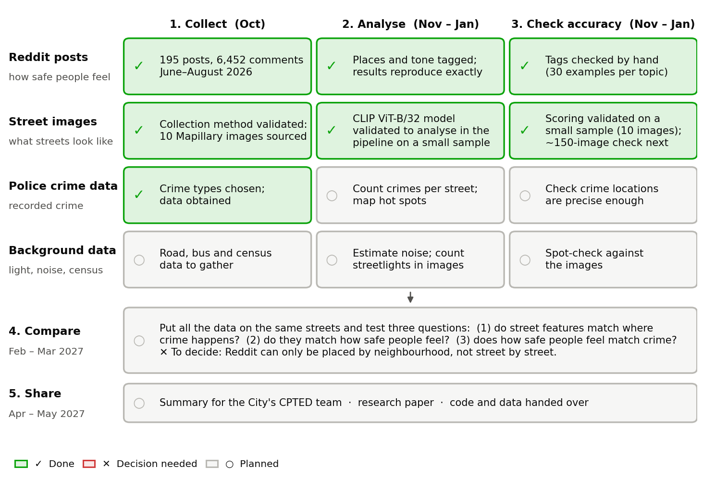

# CPTED Computer Vision and Correlational Sentiment analysis of Public Safety - A Study on Crime Patterns - Saskatoon

USask AIRI 2026 project on CPTED, crime and perceived safety in Saskatoon.
Co-leads Dr. Varuni Jayasooriya (SENS) and Dr. Timothy Kang (Sociology); collaborators Dr. Khan Wahid (ECE) and
Elisabeth Miller (City of Saskatoon, Neighbourhood Safety and CPTED); RA Ryan Ocampo.

The study follows the **revised work plan** (`Plan/workplan_revised_2026-10.pdf`): a cross-sectional, correlational
study on open secondary data for **1 June – 31 August 2026**. CPTED features measured from street-level imagery (X) are
correlated with recorded crime (Y1, Saskatoon Police Service) and with perceived safety on Reddit (Y2), on street
segments in Downtown/CBD.

## Start here

| You want | Open |
|---|---|
| The latest update for supervisors | `Deliverables/2026-10_october_update/` |
| How the whole study fits together, and how to run it | `Docs/workflow.md` |
| What has been checked, and how | `Docs/verification/october_2026_checks.md` |
| Open decisions and known problems | `Docs/decisions_and_issues.md` |
| Any other documentation | `Docs/README.md` |

## Status (17 October 2026)

| October task (work plan p. 5) | Status |
|---|---|
| Finalize crime categories | **Done**: 5 included, assault conditional, 4 excluded; SPS June–August 2026 extract added and cleaned: 9,650 records, 2,982 in the study categories (`Docs/crime_data.md`) |
| Extend Reddit to June–August 2026 | **Done, verified**: 195 posts, 6,452 comments; every table reproduces byte-for-byte; 30 checks pass |
| Generate sample points | **In progress**: 423 points on 218 street segments generated and checked; being refined (about two more weeks), not yet reported |
| Collect street-level images | **Done: method validated**: 10 Mapillary images sourced and read by CLIP ViT-B/32 in the pipeline; no June–August 2026 imagery exists yet (newest 2020/2023), so the full set is sourced next |



## Folder map

```
Plan/            governing documents: revised work plan, grant application
Docs/            detailed documentation, verification checks, figures, history
Data/
  reddit_2026-06-01_2026-08-31/   CURRENT  study-period Reddit: raw, cleaned, tables, audits, charts
  reddit_2025-06-11_2026-06-11/   earlier  12-month collection behind the July/August reports (corrected)
  sps_crime_2026-06-01_2026-08-31/ CURRENT  SPS recorded crime (Y1): raw extract, cleaned rows, category counts
  cv_pilot_2026-10/               CURRENT  CBD sample points, imagery coverage audit, 10-image pilot
  boundaries/                              CBD polygon (interim, from OSM) and map context
Scripts/
  reddit_collection/   Reddit collector (reddit_scraper.py)
  reddit_analysis/     cleaning, tagging, analysis and self-checks (run_all.sh <dataset>)
  crime_data/          cleans the SPS extract into study categories (clean_sps_crime.py)
  cv_pilot/            sample points, Mapillary imagery, CLIP scoring, Reddit link (pilot.py)
  verification/        independent checks of every October claim
  reporting/           figures, report numbers, the October .docx builder
  make_handoff.sh      builds a shareable zip without credentials or private text
Deliverables/    dated copies of what was sent (2026-07, 2026-08, 2026-10); not edited afterwards
Reference/       literature (incl. computer-vision papers), literature review draft, presentations, maps
Archive/         superseded CV prototype and the surveys dropped in the revised plan
```

## Running

All commands from the repository root. Environment: `python3 -m venv .venv && .venv/bin/pip install -r requirements.txt`
(Python 3.14). Credentials go in a git-ignored `.env` at the root: `PRAW_CLIENT_ID`, `PRAW_CLIENT_SECRET`,
`PRAW_USER_AGENT`, `URBANSENTINEL_HASH_SALT`, `MAPILLARY_TOKEN`. The full list of commands is in `Docs/workflow.md`;
the most used:

```bash
bash Scripts/reddit_analysis/run_all.sh reddit_2026-06-01_2026-08-31            # Reddit analysis (scratch)
.venv/bin/python Scripts/crime_data/clean_sps_crime.py                            # clean the SPS crime extract
.venv/bin/python Scripts/cv_pilot/pilot.py coverage --out Data/cv_pilot_2026-10/cbd
.venv/bin/python Scripts/verification/verify_october_2026.py                      # re-check October claims
.venv/bin/python Scripts/reporting/make_figures.py                                # rebuild figures
```

## Ground rules

- Raw data in `Data/*/01_raw_collection/` is never edited; everything else is regenerated by code.
- Numbers in deliverables come from scripts (`Scripts/reporting/report_numbers.py`), not by hand.
- Reddit text is not quoted outside the team; images credit Mapillary (CC BY-SA 4.0); maps credit OpenStreetMap.
  See `Docs/data_ethics.md`.
